# 영역마다 세 자료의 불확실도 지도 — 최종 보고

- 작업: PHD-MAIN-UNCERT-v1 · 발주문 v2(2026-10-23, `본실험_불확실도지도_발주문_v2.md`) · 학습 없음 · GPU 없음 · 브랜치 `exp/main-experiment`
- 쓴 때: 2026-10-23 10:48:43 KST · 설정 잠금 sha256 4044e9b8…(01:41), 자리 둘째 잠금(01:54) · 고리 크기 지역마다 고른 크기: B0 1 m, B173 주변 1.5 m, R1 1.5 m
- 중간 보고: `중간보고_v1.md`(고리 1.5 m, 커밋 62429912) · 숫자표: `불확실도지도_숫자표_v1*.md`
- scientific_verdict: null

## 1. 물음과 답

| 물음 | 답 | 볼 값 |
|---|---|---|
| 1. MVS 불확실도가 실제 오차를 따라가는가 (판 가) | 그렇다 · 확인 | LoD2 패치 ρ 0.76, 커지지 않는 구간 0, 항공 LiDAR 패치 ρ 0.77, 커지지 않는 구간 0 |
| 2. 항공 LiDAR 불확실도가 실제 오차를 따라가는가 | 그렇다 · 가능·근거 불완전 | 항공 LiDAR 패치 ρ 0.55, 커지지 않는 구간 3 |
| 3. MVS 불확실도가 영상이 틀린 패치를 잡는가 (판 가) | 그렇다 · 확인 | LoD2 AUC 0.77, 항공 LiDAR AUC 0.77 |
| 4. 바뀐 곳에서 MVS 불확실도가 다듬기만큼 작은가 | 섞임 | 보정 칸 u_M 중앙값 ÷ 다듬기(큰 쪽): B0 · LoD2 2.00배, B0 · 항공 LiDAR 4.88배, B173 주변 · LoD2 2.28배, B173 주변 · 항공 LiDAR 3.12배, R1 · LoD2 2.13배, R1 · 항공 LiDAR 5.16배 |
| 5. LoD2 20 cm가 자료와 맞는가 | 아니다 · 확인 | 지붕면 p_G 크기의 68 % 값(보정 · 4τ 넘음 뺌): B0 9.7 cm, B173 주변 26.1 cm, R1 62.9 cm |
| 6. 놓친 곳은 얼마나 넓은가 | 값으로 답함 | LoD2 패치 MVS 판 가 9.1 %(1183 m²); 항공 LiDAR 패치 MVS 판 가 4.5 %(245 m²); 항공 LiDAR 패치 항공 LiDAR 25.1 %(1333 m²). 판 가의 놓친 넓이가 큰 칸: 참값 없음 654 m², 한계 233 m², 다듬기 145 m² |
| 7. 가장자리에서 불확실도가 실제 오차보다 얼마나 커지는가 | 값으로 답함 | MVS 판 가(LoD2 패치) 0~0.5 m에서 u 10.3·e 11.8 cm, 2 m 넘음에서 u 4.0·e 6.8 cm; MVS 판 가(항공 LiDAR 패치) 0~0.5 m에서 u 9.2·e 12.4 cm, 2 m 넘음에서 u 3.4·e 5.5 cm; 항공 LiDAR(항공 LiDAR 패치) 0~0.5 m에서 u 4.5·e 5.9 cm, 2 m 넘음에서 u 1.3·e 3.6 cm |
| 8. 무게 평균이 두 자료 각각보다 나은 칸과 못한 칸은 어디인가 | 값으로 답함 | 둘 다보다 나음: LoD2 보존 · 거름, LoD2 상속 · 결측, 항공 LiDAR 다듬기, 항공 LiDAR 한계, 항공 LiDAR 상속 · 결측. 나은 쪽보다 못함: LoD2 다듬기, LoD2 보정 · 1~4τ, LoD2 보정 · 4τ 넘음, LoD2 보존 · 문턱 안, LoD2 한계, LoD2 이중 오류, LoD2 결측 · 사전 정보 틀림, LoD2 참값 없음, 항공 LiDAR 보정 · 1~4τ, 항공 LiDAR 보정 · 4τ 넘음, 항공 LiDAR 보존 · 거름, 항공 LiDAR 보존 · 문턱 안, 항공 LiDAR 이중 오류, 항공 LiDAR 참값 없음 (세 지역 합, 칸마다 자리의 오차 중앙값, 판 가, 30패치 넘는 칸) |
| 9. 지금 식과 68.3 % 값 가운데 어느 쪽이 실제 오차를 더 잘 따라가는가 | 68.3 % 값 · 가능·근거 불완전 | LoD2 패치: ρ(u/q) e 0.76/0.73, 실제 68.3 % 0.76/0.75, 틀린 점 비율 0.73/0.75, 틀린 점으로 정한 AUC 0.95/0.96; 항공 LiDAR 패치: ρ(u/q) e 0.77/0.72, 실제 68.3 % 0.76/0.74, 틀린 점 비율 0.68/0.70, 틀린 점으로 정한 AUC 0.97/0.98 |

- 등급은 발주 10절의 기준을 그대로 썼다. 물음 1~3, 9는 세 지역을 합한 패치 묶음(LoD2 패치, 항공 LiDAR 패치)마다 판정하고 둘을 합쳤다. 물음 1·2의 '가능·근거 불완전'은 발주 글대로 '순위 상관 0.3 이상이거나 커지지 않는 구간이 하나'다. 물음 4는 경우마다 보정 두 칸 가운데 큰 쪽의 비율로 판정했다.
- 물음 9의 규칙: 패치 묶음마다 세 실제 오차 가운데 둘 이상에서 순위 상관이 0.05 넘게 높고 틀린 점으로 정한 곡선 아래 넓이(두 자리)도 높으면 그 쪽 '확인', 한 조건만 맞고 다른 쪽은 아무것도 이기지 않으면 '가능·근거 불완전', 그 밖은 '비슷함'.

## 2. 일 1의 확인과 맞춰 보기, 고른 고리 크기

**찾은 것.** 자세한 표는 [tables/u1_found.md](tables/u1_found.md), [tables/u1_checks.md](tables/u1_checks.md).

| 물음 | 적은 것 |
|---|---|
| MVS 깊이 지도 | `S0/fork_inputs/s61/<지역>/maps/mvs`(→ `S0/s61/export/<지역>/LoD2/mvs`, COLMAP 기하 단계 깊이, NaN = 없음), 관측 신뢰도 마스크 `maps/conf`(0/1; 깊이가 있는 화소와 같음). 학습 영상 B0 243장, B173 주변 203장, R1 333장. 깊이 = 광축 방향 깊이(아래 확인). 마스크 전 깊이(판 나): B173 주변 `S0/s61/export_maskoff/B173nb_b10/LoD2`, B0·R1 `S2/s61/export_maskoff/<지역>/LoD2`(광도 단계 깊이) |
| 카메라 | `S0/fork_inputs/s61/<지역>/scene_LoD2/sparse/0`(images.bin, cameras.bin) + `jbgs_calibration.json` K(cx, cy는 0.5 뺀 값), 937장 COLMAP 모델 좌표(EPSG:25832 − world shift, 축척 1). 두 축 평가 mvs_surface.cameras 그대로. 사전 정보 렌더 깊이와 같은 카메라: 렌더 깊이를 같은 식으로 풀면 LoD2 면에서 0.03 mm 안 |
| 원래 항공 LiDAR 점 | P0 `raw/als/{690_5335,690_5336,691_5335,691_5336}.laz`, 분류 2(지면)·6(건물), 실험 지역 + 3 m 안 9.1만~11.5만 점. 좌표 = 사전 정보 면과 같은 다리(+45.7 m)와 정합 이동. 원래 점의 자리 p_A는 사전 정보 면에서 중앙값 0.0 cm(TIN이 그 점을 지남) |
| LoD2 | P0 `raw/lod2/690_5336.gml`(CityGML 1.0), 면 = `DR/s02_box/<지역>/lod2_surfaces.json`의 ext와 패치 surf_ext. 지붕 형태 `bldg:roofType` 있음(B0 1000·3100·3200, B173 주변 1000·3100·9999, R1 1000·3900) |
| 패치 | 영역 파일에 법선이 없어 `defs_s1.patch_geometry`의 법선(접선 외적, 위가 바깥; LoD2 벽은 면 법선)을 씀. LoD2 벽 법선은 바닥 윤곽으로 점검해 B173 주변 면 132(13패치)만 뒤집음 |
| 칸 | 두 축 평가의 잠근 칸 규칙을 다시 셈. 여섯 경우 모두 두 축 평가가 저장한 칸과 패치마다 같음 |
| 참값 | `S1/defs/<지역>/gt_classes.npz` xyz_gt_points(B0는 주 참값 xyz_gt_primary 더함)에서 뺀 칸(나무, 일시 물체) 제외, 지역마다 650만~980만 점 |

**맞춰 보기.**

| 경우 | 면 | 다듬기 패치 | p_M 중앙값 (cm) | p_M NMAD (cm) | τ ÷ 2.5 | NMAD와 τ ÷ 2.5 |
|---|---:|---:|---:|---:|---:|---:|
| B0 · LoD2 | 지붕꼴 | 21,207 | 7.1 | 2.9 | 7.9 | 안 |
| B0 · LoD2 | 벽꼴 | 30,059 | -20.3 | 7.6 | 21.9 | 안 |
| B0 · 항공 LiDAR | 지붕꼴 | 21,751 | 1.0 | 1.9 | 5.1 | 안 |
| B0 · 항공 LiDAR | 벽꼴 | 66 | 3.3 | 6.6 | 5.1 | 넘음 |
| B173 주변 · LoD2 | 지붕꼴 | 11,928 | -1.9 | 4.8 | 7.0 | 안 |
| B173 주변 · LoD2 | 벽꼴 | 17,440 | -2.0 | 3.8 | 9.1 | 안 |
| B173 주변 · 항공 LiDAR | 지붕꼴 | 10,043 | 8.1 | 2.7 | 5.9 | 안 |
| B173 주변 · 항공 LiDAR | 벽꼴 | 71 | 36.1 | 76.0 | 5.9 | 두 배 넘음 |
| R1 · LoD2 | 지붕꼴 | 16,420 | 10.6 | 27.1 | 27.3 | 안 |
| R1 · LoD2 | 벽꼴 | 2,752 | -3.6 | 3.3 | 29.0 | 안 |
| R1 · 항공 LiDAR | 지붕꼴 | 16,953 | 1.7 | 3.0 | 4.1 | 안 |
| R1 · 항공 LiDAR | 벽꼴 | 720 | 2.9 | 2.1 | 4.1 | 안 |

- 2.8 멈춤 점검: 항공 LiDAR 경우 다듬기 패치(무작위 3,000개)에서 p_M 중앙값은 B0 1.1, B173 주변 8.1, R1 1.7 cm(기준 10 cm 안). 영상 하나의 점으로 구한 값은 영상 사이에서 18.1, 18.7, 76.5 cm 벌어져 멈춤 조건이 걸렸다. 깊이 뜻(광축 깊이)과 좌표를 확인했고(렌더 깊이 0.03 mm 안, 광선 거리로 읽으면 15~40 cm), 같은 패치의 짝지은 차의 크기는 중앙값 1.3~2.0 cm, 벗어난 영상(B0 4, B173 주변 6, R1 25장)은 R1에서 지붕을 멀리서(113~207 m) 스치듯 본 비스듬한 영상이다. 여쭈었고 사용자 결정(10월 23일 09:31) '그대로 진행'.

**고른 고리 크기 (1.7).** 띠 패치(평가 범위 밖) 가운데 참값 평면이 있는 패치: B0 39,362, B173 주변 65,423, R1 48,316. 모든 지역이 1,000개 이상이라 지역마다 자기 띠로 골랐다.

| 지역 | 띠 | R (m) | MVS 패치 | ρ_MVS | 항공 LiDAR 패치 | ρ_항공 LiDAR | 잣대 |  |
|---|---:|---:|---:|---:|---:|---:|---:|---:|
| B0 | B0 | 1 | 37,756 | 0.82 | 9,485 | 0.40 | 0.61 | 고름 |
| B0 | B0 | 1.5 | 37,758 | 0.81 | 9,775 | 0.36 | 0.59 |  |
| B0 | B0 | 3 | 37,759 | 0.75 | 9,782 | 0.24 | 0.49 |  |
| B173 주변 | B173 주변 | 1 | 63,674 | 0.60 | 17,143 | 0.40 | 0.50 |  |
| B173 주변 | B173 주변 | 1.5 | 63,677 | 0.59 | 19,214 | 0.40 | 0.49 | 고름 |
| B173 주변 | B173 주변 | 3 | 63,680 | 0.55 | 19,294 | 0.32 | 0.44 |  |
| R1 | R1 | 1 | 47,009 | 0.70 | 12,074 | 0.02 | 0.36 |  |
| R1 | R1 | 1.5 | 47,009 | 0.65 | 12,687 | 0.05 | 0.35 | 고름 |
| R1 | R1 | 3 | 47,026 | 0.38 | 12,810 | 0.31 | 0.35 |  |

- 평가 범위의 표와 그림은 지역마다 고른 크기: B0 1 m, B173 주변 1.5 m, R1 1.5 m로 냈다. 다른 크기의 표는 `tables/R1.0`, `tables/R1.5`, `tables/R3.0`에 있다.

## 3. 일 2~5의 표와 그림

### 3.1 일 2: 값이 있는 비율과 불확실도의 분포

표 1 (평가 범위, 모든 면; 지붕꼴·벽꼴과 칸마다는 [표 폴더](tables/R_chosen_per_site/t1_value_share.md))

| 경우 | 자료 | 패치 | 값 있음 | 면 없음 | 점 부족 | 한쪽 고리* | 지지 약함(다시 맞춘 평면)* | 솎음* |
|---|---:|---:|---:|---:|---:|---:|---:|---:|
| B0 · LoD2 | MVS 판 가 | 82,117 | 93.7 % | 5.7 % | 0.6 % | 0.3 % | 0.0 % | 36.0 % |
| B0 · LoD2 | MVS 판 나 | 82,117 | 95.2 % | 4.1 % | 0.7 % | 0.0 % | 0.0 % | 38.6 % |
| B0 · 항공 LiDAR | MVS 판 가 | 23,280 | 99.6 % | 0.1 % | 0.0 % | 0.0 % | 0.0 % | 60.7 % |
| B0 · 항공 LiDAR | MVS 판 나 | 23,280 | 99.5 % | 0.2 % | 0.0 % | 0.0 % | 0.0 % | 69.8 % |
| B0 · 항공 LiDAR | 항공 LiDAR | 23,280 | 98.5 % | 0.0 % | 1.3 % | 0.0 % | 0.0 % | 해당 없음 |
| B173 주변 · LoD2 | MVS 판 가 | 141,534 | 66.4 % | 31.5 % | 2.1 % | 2.5 % | 0.0 % | 31.1 % |
| B173 주변 · LoD2 | MVS 판 나 | 141,534 | 73.1 % | 18.5 % | 8.4 % | 0.6 % | 0.0 % | 29.3 % |
| B173 주변 · 항공 LiDAR | MVS 판 가 | 34,273 | 98.8 % | 1.1 % | 0.0 % | 0.1 % | 0.0 % | 71.8 % |
| B173 주변 · 항공 LiDAR | MVS 판 나 | 34,273 | 97.2 % | 2.6 % | 0.1 % | 0.0 % | 0.0 % | 72.3 % |
| B173 주변 · 항공 LiDAR | 항공 LiDAR | 34,273 | 97.7 % | 0.1 % | 1.9 % | 0.2 % | 0.0 % | 해당 없음 |
| R1 · LoD2 | MVS 판 가 | 79,054 | 82.2 % | 16.2 % | 1.5 % | 1.0 % | 0.0 % | 43.8 % |
| R1 · LoD2 | MVS 판 나 | 79,054 | 81.0 % | 17.1 % | 1.9 % | 0.1 % | 0.0 % | 46.6 % |
| R1 · 항공 LiDAR | MVS 판 가 | 24,189 | 97.1 % | 2.2 % | 0.1 % | 0.0 % | 0.0 % | 81.7 % |
| R1 · 항공 LiDAR | MVS 판 나 | 24,189 | 92.6 % | 6.8 % | 0.0 % | 0.0 % | 0.0 % | 87.5 % |
| R1 · 항공 LiDAR | 항공 LiDAR | 24,189 | 97.4 % | 0.4 % | 1.7 % | 0.1 % | 0.0 % | 해당 없음 |

- \* 값이 있는 패치 가운데. 발주 글 그대로의 '지지 약함'(고른 평면의 잔차가 2.5 s₀ 안인 고리 점이 절반 미만)은 만들어지는 꼴상 늘 0이다. 후보 없음(45° 안 평면이 없음)은 표 폴더에 있다.

표 2 (cm; 칸마다와 판 나는 표 폴더)

| 경우 | 자료 | 면 | 패치 | 안쪽 원 점 | u 중앙값 | 25 % | 75 % | 90 % | 어긋남 중앙값 | 흩어짐 중앙값 |
|---|---:|---:|---:|---:|---:|---:|---:|---:|---:|---:|
| B0 · LoD2 | MVS 판 가 | 전체 | 76,978 | 106,995,016 | 4.6 | 2.2 | 10.5 | 17.8 | 1.2 | 4.1 |
| B0 · LoD2 | MVS 판 가 | 지붕꼴 | 27,280 | 48,177,564 | 2.4 | 1.3 | 4.3 | 8.1 | 0.5 | 2.3 |
| B0 · LoD2 | MVS 판 가 | 벽꼴 | 49,698 | 58,817,460 | 7.2 | 3.2 | 13.4 | 20.4 | 2.2 | 6.1 |
| B0 · 항공 LiDAR | MVS 판 가 | 전체 | 23,193 | 40,941,784 | 2.2 | 1.3 | 3.9 | 6.9 | 0.4 | 2.1 |
| B0 · 항공 LiDAR | MVS 판 가 | 지붕꼴 | 23,024 | 40,635,944 | 2.2 | 1.3 | 3.8 | 6.7 | 0.4 | 2.1 |
| B0 · 항공 LiDAR | MVS 판 가 | 벽꼴 | 169 | 305,839 | 9.3 | 6.8 | 13.6 | 20.3 | 3.5 | 8.2 |
| B0 · 항공 LiDAR | 항공 LiDAR | 전체 | 22,941 | 302,077 | 1.1 | 0.9 | 1.4 | 2.6 | 0.4 | 1.0 |
| B0 · 항공 LiDAR | 항공 LiDAR | 지붕꼴 | 22,795 | 300,084 | 1.1 | 0.8 | 1.4 | 2.5 | 0.4 | 1.0 |
| B0 · 항공 LiDAR | 항공 LiDAR | 벽꼴 | 146 | 1,993 | 5.2 | 2.2 | 8.8 | 16.6 | 1.6 | 4.1 |
| B173 주변 · LoD2 | MVS 판 가 | 전체 | 93,971 | 76,321,968 | 5.4 | 3.3 | 11.9 | 24.7 | 2.0 | 4.5 |
| B173 주변 · LoD2 | MVS 판 가 | 지붕꼴 | 41,917 | 58,592,404 | 5.1 | 3.3 | 10.7 | 21.5 | 1.8 | 4.4 |
| B173 주변 · LoD2 | MVS 판 가 | 벽꼴 | 52,054 | 17,729,560 | 5.6 | 3.3 | 13.1 | 27.1 | 2.1 | 4.7 |
| B173 주변 · 항공 LiDAR | MVS 판 가 | 전체 | 33,847 | 49,078,248 | 4.5 | 3.1 | 8.4 | 19.3 | 1.6 | 3.9 |
| B173 주변 · 항공 LiDAR | MVS 판 가 | 지붕꼴 | 33,406 | 48,575,552 | 4.5 | 3.1 | 8.3 | 18.9 | 1.6 | 3.9 |
| B173 주변 · 항공 LiDAR | MVS 판 가 | 벽꼴 | 441 | 502,699 | 10.8 | 5.8 | 23.2 | 44.4 | 3.3 | 8.5 |
| B173 주변 · 항공 LiDAR | 항공 LiDAR | 전체 | 33,490 | 396,224 | 2.9 | 1.6 | 5.1 | 8.1 | 1.8 | 1.7 |
| B173 주변 · 항공 LiDAR | 항공 LiDAR | 지붕꼴 | 33,034 | 390,973 | 2.9 | 1.6 | 5.0 | 8.0 | 1.8 | 1.7 |
| B173 주변 · 항공 LiDAR | 항공 LiDAR | 벽꼴 | 456 | 5,251 | 8.7 | 3.8 | 21.1 | 34.7 | 3.7 | 6.5 |
| R1 · LoD2 | MVS 판 가 | 전체 | 65,013 | 64,004,488 | 7.8 | 4.0 | 19.2 | 34.4 | 2.1 | 6.7 |
| R1 · LoD2 | MVS 판 가 | 지붕꼴 | 27,808 | 41,816,036 | 5.4 | 3.1 | 10.4 | 22.3 | 1.5 | 4.8 |
| R1 · LoD2 | MVS 판 가 | 벽꼴 | 37,205 | 22,188,456 | 11.5 | 5.5 | 24.8 | 44.7 | 3.4 | 9.0 |
| R1 · 항공 LiDAR | MVS 판 가 | 전체 | 23,482 | 35,530,488 | 4.6 | 2.8 | 7.8 | 16.5 | 1.3 | 4.1 |
| R1 · 항공 LiDAR | MVS 판 가 | 지붕꼴 | 22,232 | 34,098,816 | 4.6 | 2.8 | 7.6 | 16.4 | 1.3 | 4.1 |
| R1 · 항공 LiDAR | MVS 판 가 | 벽꼴 | 1,250 | 1,431,673 | 5.6 | 3.1 | 10.2 | 18.1 | 2.3 | 4.8 |
| R1 · 항공 LiDAR | 항공 LiDAR | 전체 | 23,563 | 317,310 | 1.2 | 0.9 | 1.9 | 4.9 | 0.4 | 1.1 |
| R1 · 항공 LiDAR | 항공 LiDAR | 지붕꼴 | 22,334 | 303,145 | 1.2 | 0.9 | 1.7 | 4.2 | 0.4 | 1.1 |
| R1 · 항공 LiDAR | 항공 LiDAR | 벽꼴 | 1,229 | 14,165 | 3.3 | 1.9 | 7.4 | 13.0 | 1.8 | 2.4 |

### 3.2 일 3: 지도

**그림 A — B0.** 지역 전체(평가 범위): (가) u 중앙값 4.6 cm, 값 있음 93.7 %, 50 cm 넘음 0.5 %; (나) u 중앙값 1.1 cm, 값 있음 98.5 %, 50 cm 넘음 0.0 %; (다) u 중앙값 20.0 cm, 값 있음 100.0 %, 50 cm 넘음 0.0 %

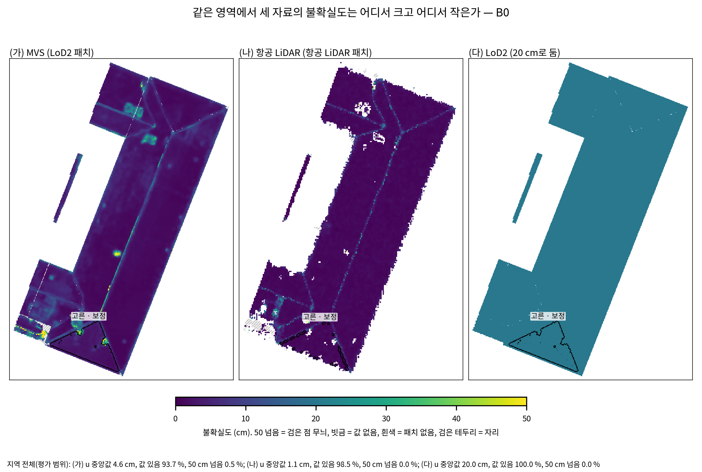

- 캡션 재료: (가) MVS 판 가 u를 LoD2 패치에, (나) 원래 항공 LiDAR 점의 u를 항공 LiDAR 패치에, (다) LoD2 20 cm를 LoD2 패치에. 평가 범위를 위에서 본 정사영(북쪽 위, 0.1 m 화소, 높은 패치가 위). 색 0~50 cm(viridis), 50 cm 넘음 = 50 cm 색 위 점 무늬, 빗금 = 값 없음, 흰색 = 그 묶음의 패치 없음. 검은 테두리 = 5.2의 자리

**그림 A — B173 주변.** 지역 전체(평가 범위): (가) u 중앙값 5.4 cm, 값 있음 66.4 %, 50 cm 넘음 2.4 %; (나) u 중앙값 2.9 cm, 값 있음 97.7 %, 50 cm 넘음 0.2 %; (다) u 중앙값 20.0 cm, 값 있음 100.0 %, 50 cm 넘음 0.0 %

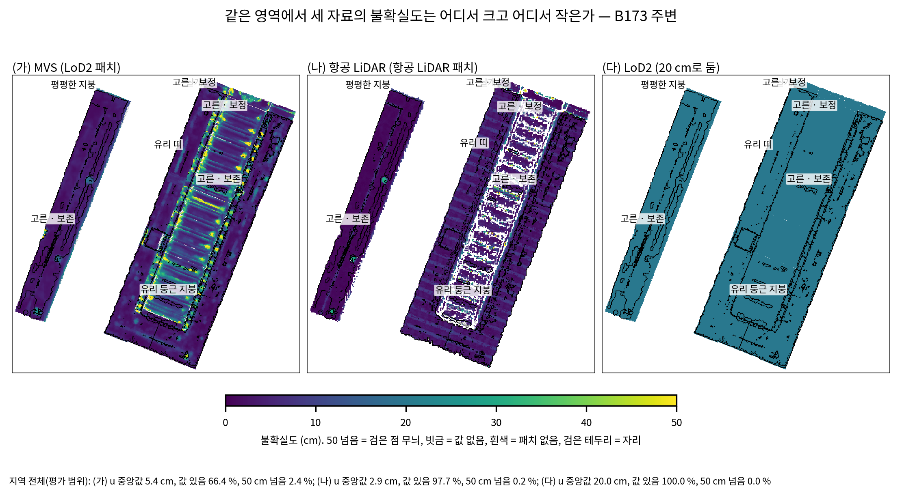

- 캡션 재료: (가) MVS 판 가 u를 LoD2 패치에, (나) 원래 항공 LiDAR 점의 u를 항공 LiDAR 패치에, (다) LoD2 20 cm를 LoD2 패치에. 평가 범위를 위에서 본 정사영(북쪽 위, 0.1 m 화소, 높은 패치가 위). 색 0~50 cm(viridis), 50 cm 넘음 = 50 cm 색 위 점 무늬, 빗금 = 값 없음, 흰색 = 그 묶음의 패치 없음. 검은 테두리 = 5.2의 자리

**그림 A — R1.** 지역 전체(평가 범위): (가) u 중앙값 7.8 cm, 값 있음 82.2 %, 50 cm 넘음 4.9 %; (나) u 중앙값 1.2 cm, 값 있음 97.4 %, 50 cm 넘음 0.9 %; (다) u 중앙값 20.0 cm, 값 있음 100.0 %, 50 cm 넘음 0.0 %

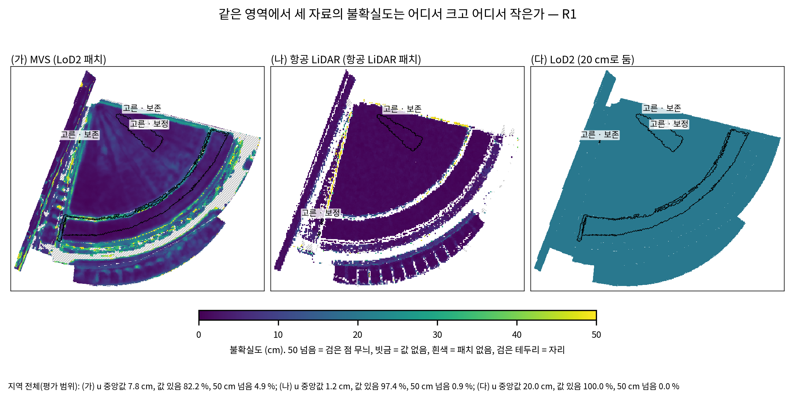

- 캡션 재료: (가) MVS 판 가 u를 LoD2 패치에, (나) 원래 항공 LiDAR 점의 u를 항공 LiDAR 패치에, (다) LoD2 20 cm를 LoD2 패치에. 평가 범위를 위에서 본 정사영(북쪽 위, 0.1 m 화소, 높은 패치가 위). 색 0~50 cm(viridis), 50 cm 넘음 = 50 cm 색 위 점 무늬, 빗금 = 값 없음, 흰색 = 그 묶음의 패치 없음. 검은 테두리 = 5.2의 자리

**그림 A-비스듬 — B0, 방위 225°.** 지역 전체(평가 범위): (가) u 중앙값 4.6 cm, 값 있음 93.7 %, 50 cm 넘음 0.5 %; (나) u 중앙값 1.1 cm, 값 있음 98.5 %, 50 cm 넘음 0.0 %; (다) u 중앙값 20.0 cm, 값 있음 100.0 %, 50 cm 넘음 0.0 %

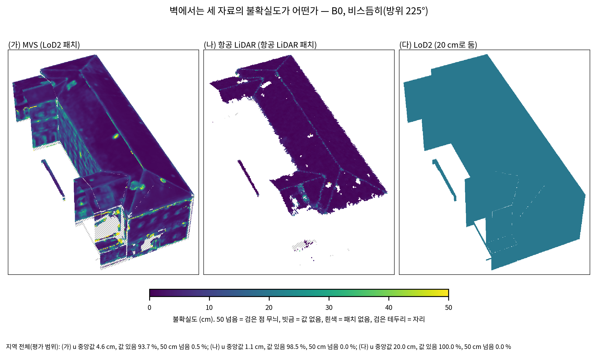

- 캡션 재료: 그림 A와 같은 칸을 연직에서 45°, 방위 225°에서 본 원근(두 축 평가 9.1과 같은 시점 규칙), 패치마다 5 × 5 점, 가까운 점이 보임. 색은 그림 A와 같음

**그림 A-비스듬 — B0, 방위 45°.** 지역 전체(평가 범위): (가) u 중앙값 4.6 cm, 값 있음 93.7 %, 50 cm 넘음 0.5 %; (나) u 중앙값 1.1 cm, 값 있음 98.5 %, 50 cm 넘음 0.0 %; (다) u 중앙값 20.0 cm, 값 있음 100.0 %, 50 cm 넘음 0.0 %

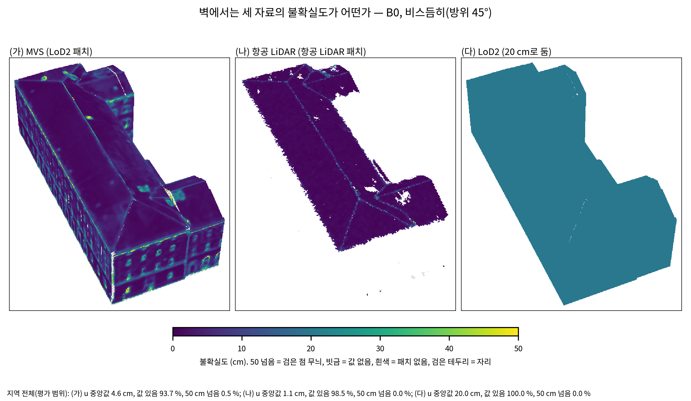

- 캡션 재료: 그림 A와 같은 칸을 연직에서 45°, 방위 45°에서 본 원근(두 축 평가 9.1과 같은 시점 규칙), 패치마다 5 × 5 점, 가까운 점이 보임. 색은 그림 A와 같음

**그림 A-비스듬 — B173 주변, 방위 225°.** 지역 전체(평가 범위): (가) u 중앙값 5.4 cm, 값 있음 66.4 %, 50 cm 넘음 2.4 %; (나) u 중앙값 2.9 cm, 값 있음 97.7 %, 50 cm 넘음 0.2 %; (다) u 중앙값 20.0 cm, 값 있음 100.0 %, 50 cm 넘음 0.0 %

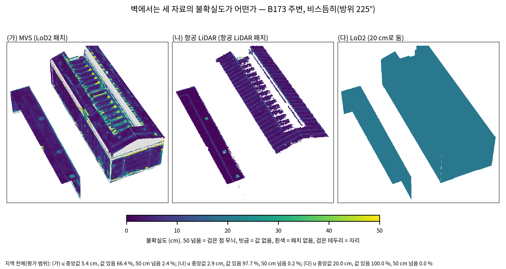

- 캡션 재료: 그림 A와 같은 칸을 연직에서 45°, 방위 225°에서 본 원근(두 축 평가 9.1과 같은 시점 규칙), 패치마다 5 × 5 점, 가까운 점이 보임. 색은 그림 A와 같음

**그림 A-비스듬 — B173 주변, 방위 45°.** 지역 전체(평가 범위): (가) u 중앙값 5.4 cm, 값 있음 66.4 %, 50 cm 넘음 2.4 %; (나) u 중앙값 2.9 cm, 값 있음 97.7 %, 50 cm 넘음 0.2 %; (다) u 중앙값 20.0 cm, 값 있음 100.0 %, 50 cm 넘음 0.0 %

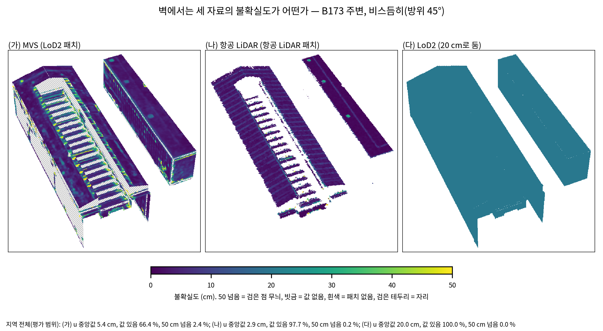

- 캡션 재료: 그림 A와 같은 칸을 연직에서 45°, 방위 45°에서 본 원근(두 축 평가 9.1과 같은 시점 규칙), 패치마다 5 × 5 점, 가까운 점이 보임. 색은 그림 A와 같음

**그림 A-비스듬 — R1, 방위 225°.** 지역 전체(평가 범위): (가) u 중앙값 7.8 cm, 값 있음 82.2 %, 50 cm 넘음 4.9 %; (나) u 중앙값 1.2 cm, 값 있음 97.4 %, 50 cm 넘음 0.9 %; (다) u 중앙값 20.0 cm, 값 있음 100.0 %, 50 cm 넘음 0.0 %

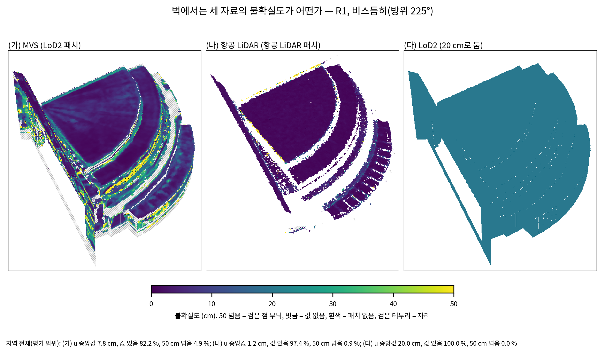

- 캡션 재료: 그림 A와 같은 칸을 연직에서 45°, 방위 225°에서 본 원근(두 축 평가 9.1과 같은 시점 규칙), 패치마다 5 × 5 점, 가까운 점이 보임. 색은 그림 A와 같음

**그림 A-비스듬 — R1, 방위 45°.** 지역 전체(평가 범위): (가) u 중앙값 7.8 cm, 값 있음 82.2 %, 50 cm 넘음 4.9 %; (나) u 중앙값 1.2 cm, 값 있음 97.4 %, 50 cm 넘음 0.9 %; (다) u 중앙값 20.0 cm, 값 있음 100.0 %, 50 cm 넘음 0.0 %

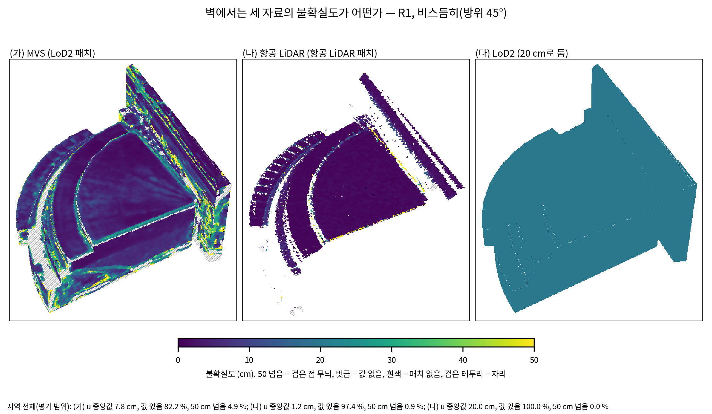

- 캡션 재료: 그림 A와 같은 칸을 연직에서 45°, 방위 45°에서 본 원근(두 축 평가 9.1과 같은 시점 규칙), 패치마다 5 × 5 점, 가까운 점이 보임. 색은 그림 A와 같음

**그림 B — B0.** 지역 전체(평가 범위): (가) 무게 비율 중앙값 0.23, MVS가 이끄는 넓이 17.9 %, 둘 다 값 없음 0.3 %; (나) 무게 비율 중앙값 0.94, MVS가 이끄는 넓이 86.7 %, 둘 다 값 없음 0.0 %

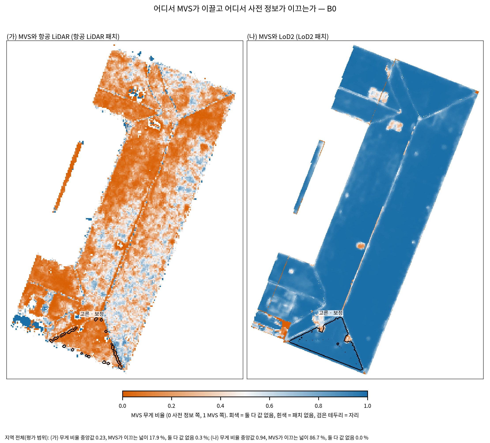

- 캡션 재료: MVS 무게 비율 w_M = u_사전² ÷ (u_M² + u_사전²) (판 가). 주황 0 = 사전 정보가 이끎, 흰색에 가까움 0.5, 파랑 1 = MVS가 이끎, 회색 = 둘 다 값 없음. 한 자료만 값이 있으면 그 끝 색. (가) MVS와 항공 LiDAR(항공 LiDAR 패치), (나) MVS와 LoD2(LoD2 패치)

**그림 B — B173 주변.** 지역 전체(평가 범위): (가) 무게 비율 중앙값 0.22, MVS가 이끄는 넓이 27.9 %, 둘 다 값 없음 0.4 %; (나) 무게 비율 중앙값 0.73, MVS가 이끄는 넓이 57.2 %, 둘 다 값 없음 0.0 %

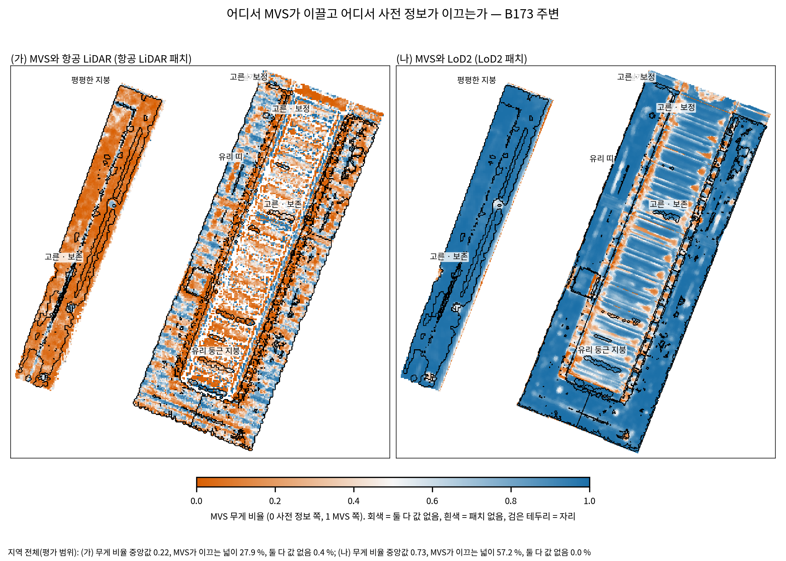

- 캡션 재료: MVS 무게 비율 w_M = u_사전² ÷ (u_M² + u_사전²) (판 가). 주황 0 = 사전 정보가 이끎, 흰색에 가까움 0.5, 파랑 1 = MVS가 이끎, 회색 = 둘 다 값 없음. 한 자료만 값이 있으면 그 끝 색. (가) MVS와 항공 LiDAR(항공 LiDAR 패치), (나) MVS와 LoD2(LoD2 패치)

**그림 B — R1.** 지역 전체(평가 범위): (가) 무게 비율 중앙값 0.08, MVS가 이끄는 넓이 10.0 %, 둘 다 값 없음 1.1 %; (나) 무게 비율 중앙값 0.76, MVS가 이끄는 넓이 62.7 %, 둘 다 값 없음 0.0 %

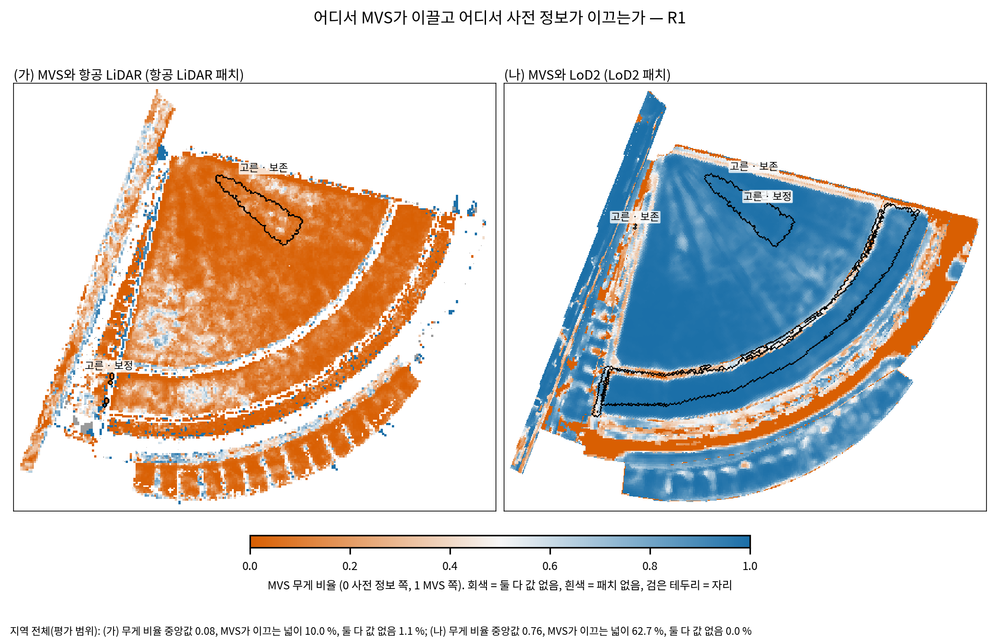

- 캡션 재료: MVS 무게 비율 w_M = u_사전² ÷ (u_M² + u_사전²) (판 가). 주황 0 = 사전 정보가 이끎, 흰색에 가까움 0.5, 파랑 1 = MVS가 이끎, 회색 = 둘 다 값 없음. 한 자료만 값이 있으면 그 끝 색. (가) MVS와 항공 LiDAR(항공 LiDAR 패치), (나) MVS와 LoD2(LoD2 패치)

**그림 C — B0.** 지역 전체(평가 범위): (가) 중앙값 1.2 cm, 값 있음 93.7 %, 50 cm 넘음 0.2 %; (나) 중앙값 4.1 cm, 값 있음 93.7 %, 50 cm 넘음 0.1 %

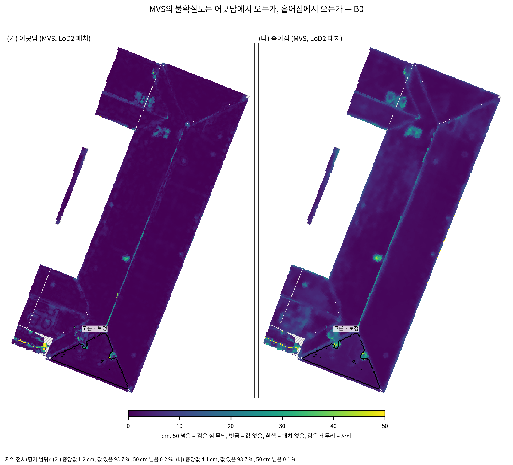

- 캡션 재료: (가) 어긋남, (나) 흩어짐. MVS 판 가, LoD2 패치. 색은 그림 A와 같음

**그림 C — B173 주변.** 지역 전체(평가 범위): (가) 중앙값 2.0 cm, 값 있음 66.4 %, 50 cm 넘음 1.8 %; (나) 중앙값 4.5 cm, 값 있음 66.4 %, 50 cm 넘음 0.1 %

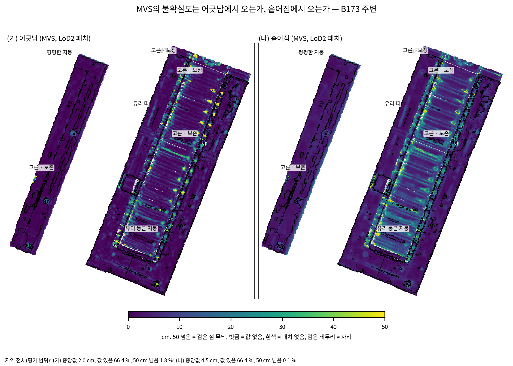

- 캡션 재료: (가) 어긋남, (나) 흩어짐. MVS 판 가, LoD2 패치. 색은 그림 A와 같음

**그림 C — R1.** 지역 전체(평가 범위): (가) 중앙값 2.1 cm, 값 있음 82.2 %, 50 cm 넘음 3.8 %; (나) 중앙값 6.7 cm, 값 있음 82.2 %, 50 cm 넘음 0.5 %

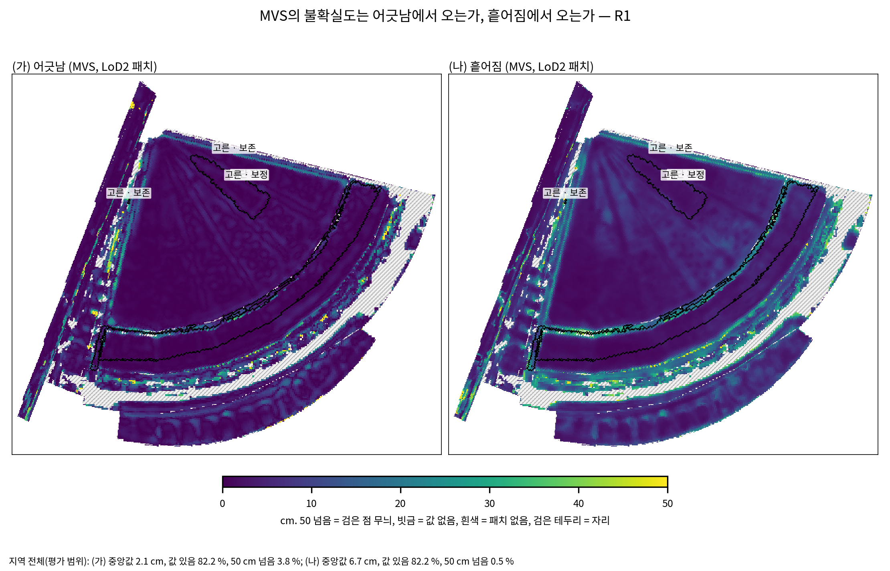

- 캡션 재료: (가) 어긋남, (나) 흩어짐. MVS 판 가, LoD2 패치. 색은 그림 A와 같음

**그림 D — B0, MVS(LoD2 패치).** 지역 전체(평가 범위): (가) u 중앙값 4.6 cm, 값 있음 93.7 %, 50 cm 넘음 0.5 %; (나) u 중앙값 5.1 cm, 값 있음 93.8 %, 50 cm 넘음 1.3 %; (다) u 중앙값 6.1 cm, 값 있음 93.8 %, 50 cm 넘음 4.9 %

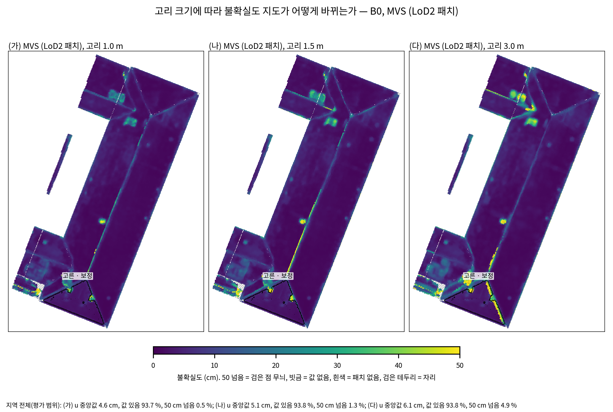

- 캡션 재료: (가) 고리 1.0 m, (나) 1.5 m, (다) 3.0 m. 색은 그림 A와 같음

**그림 D — B0, 항공 LiDAR(항공 LiDAR 패치).** 지역 전체(평가 범위): (가) u 중앙값 1.1 cm, 값 있음 98.5 %, 50 cm 넘음 0.0 %; (나) u 중앙값 1.1 cm, 값 있음 99.3 %, 50 cm 넘음 0.1 %; (다) u 중앙값 1.3 cm, 값 있음 99.3 %, 50 cm 넘음 0.2 %

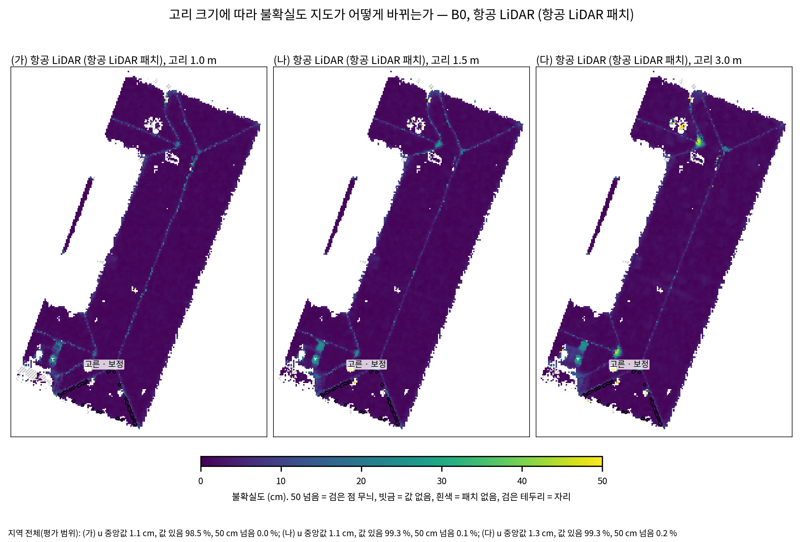

- 캡션 재료: (가) 고리 1.0 m, (나) 1.5 m, (다) 3.0 m. 색은 그림 A와 같음

**그림 D — B173 주변, MVS(LoD2 패치).** 지역 전체(평가 범위): (가) u 중앙값 4.8 cm, 값 있음 66.2 %, 50 cm 넘음 1.1 %; (나) u 중앙값 5.4 cm, 값 있음 66.4 %, 50 cm 넘음 2.4 %; (다) u 중앙값 6.5 cm, 값 있음 66.4 %, 50 cm 넘음 4.5 %

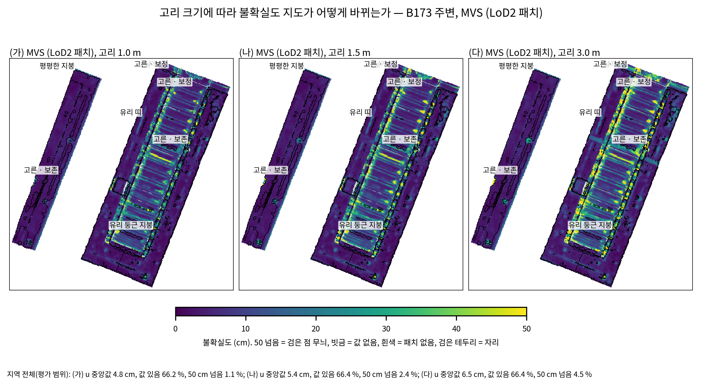

- 캡션 재료: (가) 고리 1.0 m, (나) 1.5 m, (다) 3.0 m. 색은 그림 A와 같음

**그림 D — B173 주변, 항공 LiDAR(항공 LiDAR 패치).** 지역 전체(평가 범위): (가) u 중앙값 1.9 cm, 값 있음 90.5 %, 50 cm 넘음 0.1 %; (나) u 중앙값 2.9 cm, 값 있음 97.7 %, 50 cm 넘음 0.2 %; (다) u 중앙값 3.8 cm, 값 있음 97.9 %, 50 cm 넘음 2.5 %

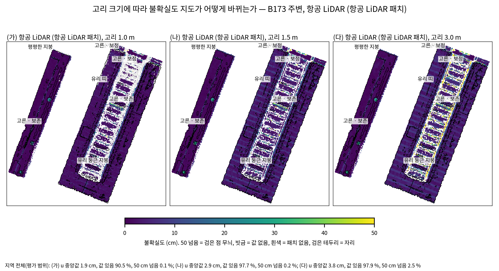

- 캡션 재료: (가) 고리 1.0 m, (나) 1.5 m, (다) 3.0 m. 색은 그림 A와 같음

**그림 D — R1, MVS(LoD2 패치).** 지역 전체(평가 범위): (가) u 중앙값 7.0 cm, 값 있음 82.1 %, 50 cm 넘음 3.0 %; (나) u 중앙값 7.8 cm, 값 있음 82.2 %, 50 cm 넘음 4.9 %; (다) u 중앙값 9.0 cm, 값 있음 82.3 %, 50 cm 넘음 9.9 %

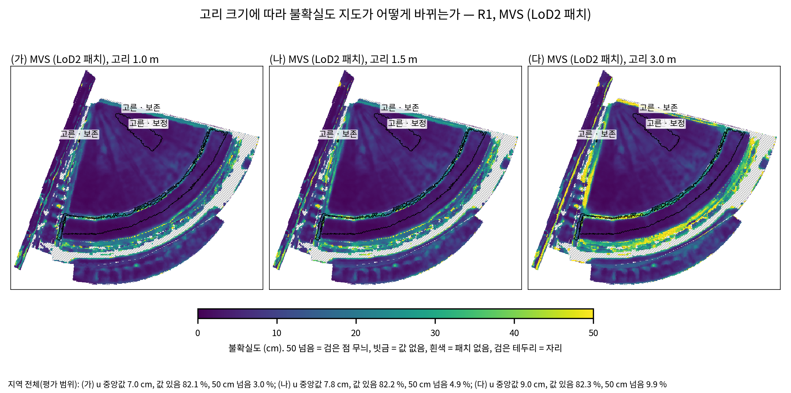

- 캡션 재료: (가) 고리 1.0 m, (나) 1.5 m, (다) 3.0 m. 색은 그림 A와 같음

**그림 D — R1, 항공 LiDAR(항공 LiDAR 패치).** 지역 전체(평가 범위): (가) u 중앙값 1.2 cm, 값 있음 94.2 %, 50 cm 넘음 0.6 %; (나) u 중앙값 1.2 cm, 값 있음 97.4 %, 50 cm 넘음 0.9 %; (다) u 중앙값 1.4 cm, 값 있음 97.8 %, 50 cm 넘음 1.1 %

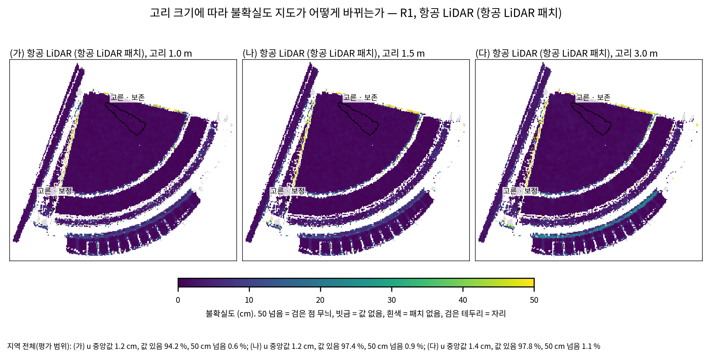

- 캡션 재료: (가) 고리 1.0 m, (나) 1.5 m, (다) 3.0 m. 색은 그림 A와 같음

**그림 E — 유리 띠.** 자리(181패치, 14.5 m², 참값 여러 층 20.4 %) 중앙값: u_M 23.9 cm, u_사전 5.3 cm, e_M 33.7 cm, e_사전 3.7 cm, MVS 무게 비율 0.10, p_M -6.7 cm, p_G 4.3 cm, p_W -0.0 cm; 판 나: u_M 36.4 cm, e_M 50.3 cm, p_M -11.0 cm

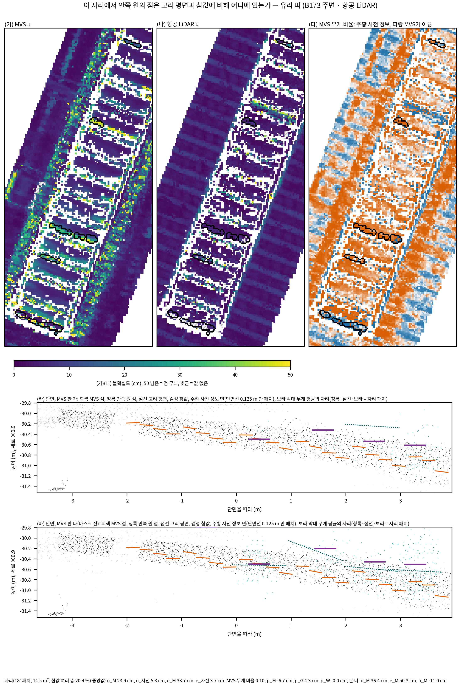

- 캡션 재료: 위 = 자리와 둘레 2 m를 키운 지도((가) MVS u, (나) 사전 정보 u, (다) MVS 무게 비율; 검은 테두리 = 자리). 아래 = 자리의 가장 큰 덩어리(0.36 m로 이음)를 그 긴 축(수평 주성분)으로 자른 단면, 띠 폭 0.5 m, 덩어리 끝에서 2 m까지. 회색 = 띠 안 MVS 점(1 m마다 400점까지), 검정 = 참값 점, 주황 = 단면선 0.125 m 안 사전 정보 패치, 청록 = 단면선 위 패치(1 m마다 하나)의 안쪽 원 점, 점선 = 그 패치의 고리 평면, 보라 막대 = 무게 평균의 자리. 세로 늘림 배율은 축 이름에; (마) = 판 나(마스크 전)

**그림 E — 유리 둥근 지붕.** 자리(66패치, 4.5 m², 참값 여러 층 0.0 %) 중앙값: u_M 5.1 cm, u_사전 3.2 cm, e_M 17.7 cm, e_사전 2.5 cm, MVS 무게 비율 0.22, p_M -14.7 cm, p_G 2.0 cm, p_W -3.2 cm; 판 나: u_M 8.2 cm, e_M 18.3 cm, p_M -14.3 cm

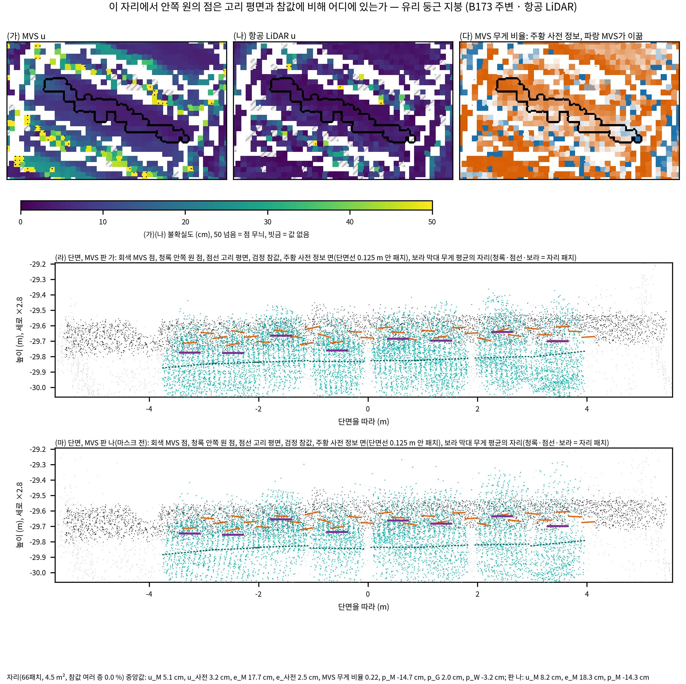

- 캡션 재료: 위 = 자리와 둘레 2 m를 키운 지도((가) MVS u, (나) 사전 정보 u, (다) MVS 무게 비율; 검은 테두리 = 자리). 아래 = 자리의 가장 큰 덩어리(0.36 m로 이음)를 그 긴 축(수평 주성분)으로 자른 단면, 띠 폭 0.5 m, 덩어리 끝에서 2 m까지. 회색 = 띠 안 MVS 점(1 m마다 400점까지), 검정 = 참값 점, 주황 = 단면선 0.125 m 안 사전 정보 패치, 청록 = 단면선 위 패치(1 m마다 하나)의 안쪽 원 점, 점선 = 그 패치의 고리 평면, 보라 막대 = 무게 평균의 자리. 세로 늘림 배율은 축 이름에; (마) = 판 나(마스크 전)

**그림 E — 평평한 지붕.** 자리(5696패치, 357.6 m², 참값 여러 층 0.0 %) 중앙값: u_M 3.2 cm, u_사전 1.0 cm, e_M 8.3 cm, e_사전 1.6 cm, MVS 무게 비율 0.10, p_M 8.7 cm, p_G 1.2 cm, p_W 0.8 cm

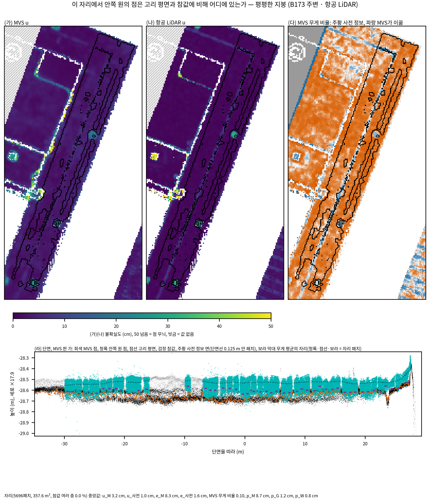

- 캡션 재료: 위 = 자리와 둘레 2 m를 키운 지도((가) MVS u, (나) 사전 정보 u, (다) MVS 무게 비율; 검은 테두리 = 자리). 아래 = 자리의 가장 큰 덩어리(0.36 m로 이음)를 그 긴 축(수평 주성분)으로 자른 단면, 띠 폭 0.5 m, 덩어리 끝에서 2 m까지. 회색 = 띠 안 MVS 점(1 m마다 400점까지), 검정 = 참값 점, 주황 = 단면선 0.125 m 안 사전 정보 패치, 청록 = 단면선 위 패치(1 m마다 하나)의 안쪽 원 점, 점선 = 그 패치의 고리 평면, 보라 막대 = 무게 평균의 자리. 세로 늘림 배율은 축 이름에

**그림 E — B173 날개.** 자리(14515패치, 964.3 m², 참값 여러 층 7.3 %) 중앙값: u_M 4.5 cm, u_사전 3.3 cm, e_M 7.0 cm, e_사전 455.4 cm, MVS 무게 비율 0.34, p_M -478.9 cm, p_G -480.8 cm, p_W -158.9 cm

- 캡션 재료: 위 = 자리와 둘레 2 m를 키운 지도((가) MVS u, (나) 사전 정보 u, (다) MVS 무게 비율; 검은 테두리 = 자리). 아래 = 자리의 가장 큰 덩어리(0.36 m로 이음)를 그 긴 축(수평 주성분)으로 자른 단면, 띠 폭 0.5 m, 덩어리 끝에서 2 m까지. 회색 = 띠 안 MVS 점(1 m마다 400점까지), 검정 = 참값 점, 주황 = 단면선 0.125 m 안 사전 정보 패치, 청록 = 단면선 위 패치(1 m마다 하나)의 안쪽 원 점, 점선 = 그 패치의 고리 평면, 보라 막대 = 무게 평균의 자리. 세로 늘림 배율은 축 이름에

**그림 E — R1 계단 지붕.** 자리(2621패치, 163.8 m², 참값 여러 층 2.7 %) 중앙값: u_M 3.4 cm, u_사전 20.0 cm, e_M 4.5 cm, e_사전 100.9 cm, MVS 무게 비율 0.97, p_M 98.4 cm, p_G 100.9 cm, p_W 91.2 cm

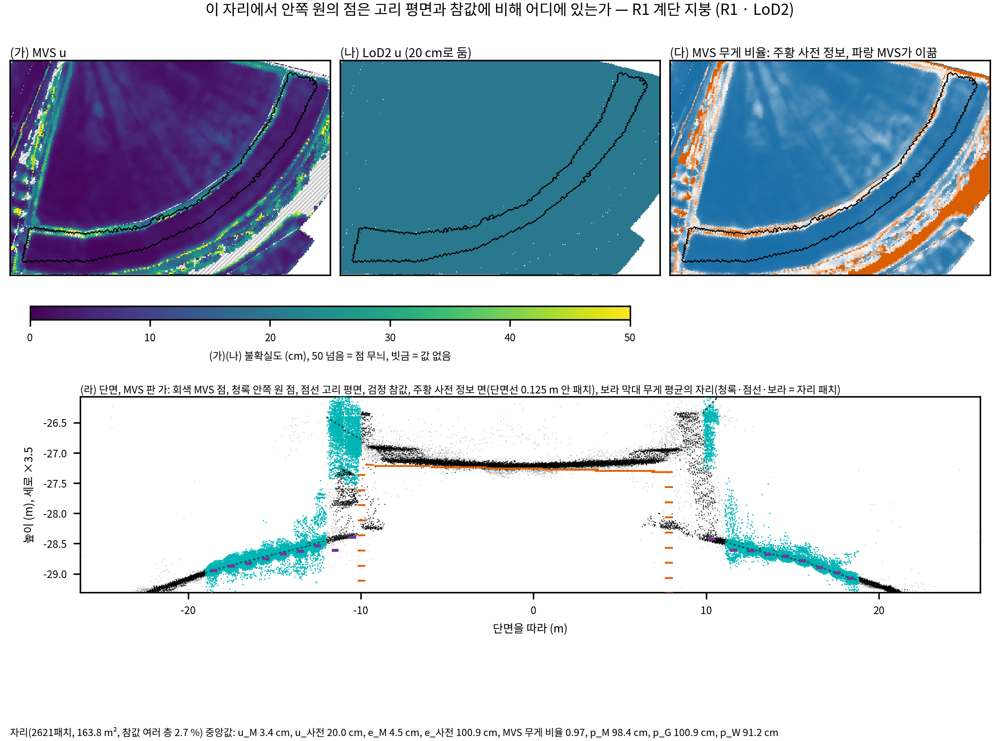

- 캡션 재료: 위 = 자리와 둘레 2 m를 키운 지도((가) MVS u, (나) 사전 정보 u, (다) MVS 무게 비율; 검은 테두리 = 자리). 아래 = 자리의 가장 큰 덩어리(0.36 m로 이음)를 그 긴 축(수평 주성분)으로 자른 단면, 띠 폭 0.5 m, 덩어리 끝에서 2 m까지. 회색 = 띠 안 MVS 점(1 m마다 400점까지), 검정 = 참값 점, 주황 = 단면선 0.125 m 안 사전 정보 패치, 청록 = 단면선 위 패치(1 m마다 하나)의 안쪽 원 점, 점선 = 그 패치의 고리 평면, 보라 막대 = 무게 평균의 자리. 세로 늘림 배율은 축 이름에

**그림 E — B0 LoD2 보정 합.** 자리(1418패치, 88.6 m², 참값 여러 층 0.0 %) 중앙값: u_M 2.8 cm, u_사전 20.0 cm, e_M 3.0 cm, e_사전 83.7 cm, MVS 무게 비율 0.98, p_M -82.3 cm, p_G -83.7 cm, p_W -80.8 cm

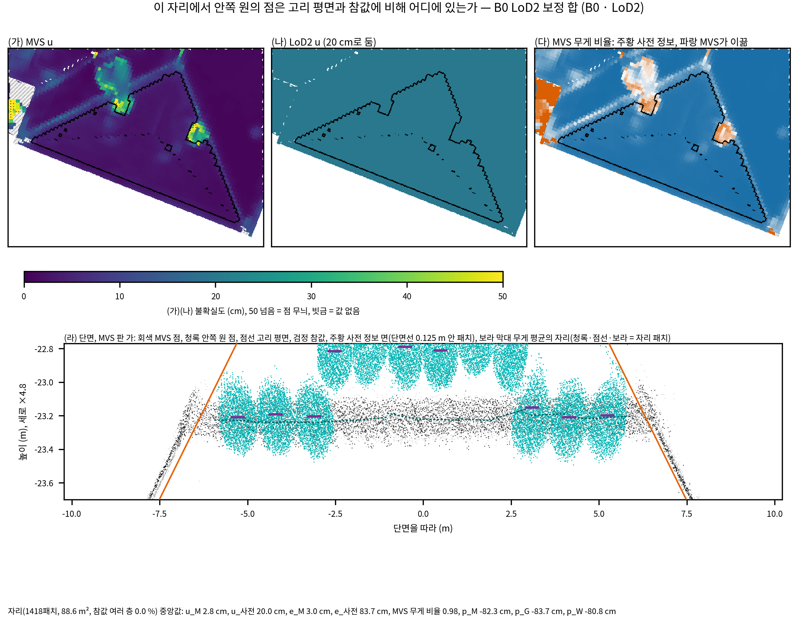

- 캡션 재료: 위 = 자리와 둘레 2 m를 키운 지도((가) MVS u, (나) 사전 정보 u, (다) MVS 무게 비율; 검은 테두리 = 자리). 아래 = 자리의 가장 큰 덩어리(0.36 m로 이음)를 그 긴 축(수평 주성분)으로 자른 단면, 띠 폭 0.5 m, 덩어리 끝에서 2 m까지. 회색 = 띠 안 MVS 점(1 m마다 400점까지), 검정 = 참값 점, 주황 = 단면선 0.125 m 안 사전 정보 패치, 청록 = 단면선 위 패치(1 m마다 하나)의 안쪽 원 점, 점선 = 그 패치의 고리 평면, 보라 막대 = 무게 평균의 자리. 세로 늘림 배율은 축 이름에

**그림 E — B0 LoD2 보존 합.** 자리(117패치, 7.3 m², 참값 여러 층 0.0 %) 중앙값: u_M 4.6 cm, u_사전 20.0 cm, e_M 6.4 cm, e_사전 22.6 cm, MVS 무게 비율 0.94, p_M -25.0 cm, p_G -22.6 cm, p_W -23.3 cm

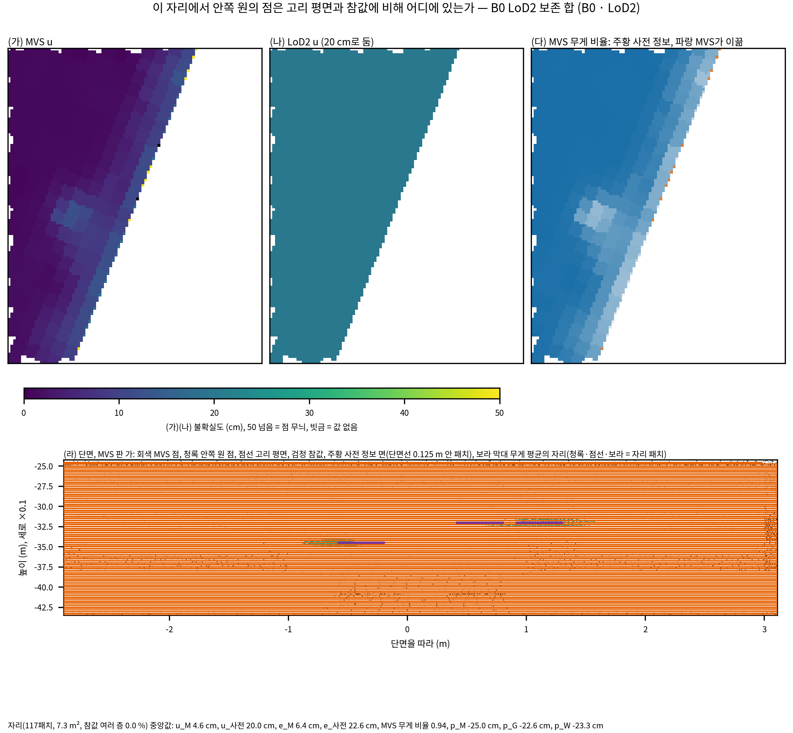

- 캡션 재료: 위 = 자리와 둘레 2 m를 키운 지도((가) MVS u, (나) 사전 정보 u, (다) MVS 무게 비율; 검은 테두리 = 자리). 아래 = 자리의 가장 큰 덩어리(0.36 m로 이음)를 그 긴 축(수평 주성분)으로 자른 단면, 띠 폭 0.5 m, 덩어리 끝에서 2 m까지. 회색 = 띠 안 MVS 점(1 m마다 400점까지), 검정 = 참값 점, 주황 = 단면선 0.125 m 안 사전 정보 패치, 청록 = 단면선 위 패치(1 m마다 하나)의 안쪽 원 점, 점선 = 그 패치의 고리 평면, 보라 막대 = 무게 평균의 자리. 세로 늘림 배율은 축 이름에

**그림 E — B173 주변 항공 LiDAR 보정 합.** 자리(13084패치, 869.0 m², 참값 여러 층 0.0 %) 중앙값: u_M 4.2 cm, u_사전 3.3 cm, e_M 6.6 cm, e_사전 450.5 cm, MVS 무게 비율 0.38, p_M -473.2 cm, p_G -475.5 cm, p_W -178.0 cm

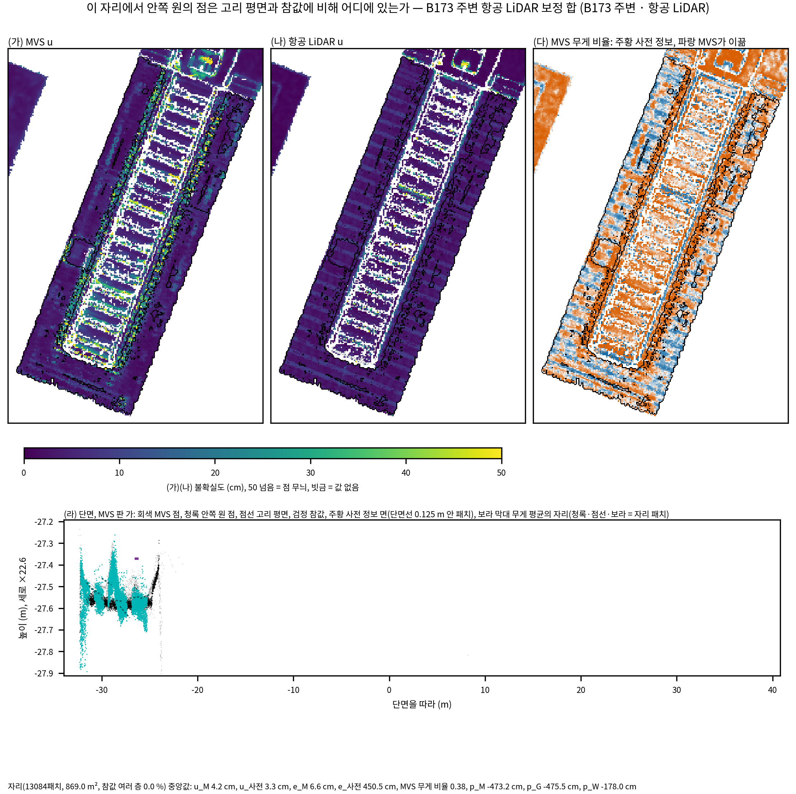

- 캡션 재료: 위 = 자리와 둘레 2 m를 키운 지도((가) MVS u, (나) 사전 정보 u, (다) MVS 무게 비율; 검은 테두리 = 자리). 아래 = 자리의 가장 큰 덩어리(0.36 m로 이음)를 그 긴 축(수평 주성분)으로 자른 단면, 띠 폭 0.5 m, 덩어리 끝에서 2 m까지. 회색 = 띠 안 MVS 점(1 m마다 400점까지), 검정 = 참값 점, 주황 = 단면선 0.125 m 안 사전 정보 패치, 청록 = 단면선 위 패치(1 m마다 하나)의 안쪽 원 점, 점선 = 그 패치의 고리 평면, 보라 막대 = 무게 평균의 자리. 세로 늘림 배율은 축 이름에

**그림 E — B173 주변 항공 LiDAR 보존 합.** 자리(82패치, 5.3 m², 참값 여러 층 0.0 %) 중앙값: u_M 4.2 cm, u_사전 7.4 cm, e_M 14.9 cm, e_사전 3.2 cm, MVS 무게 비율 0.76, p_M 16.7 cm, p_G 3.0 cm, p_W 12.6 cm

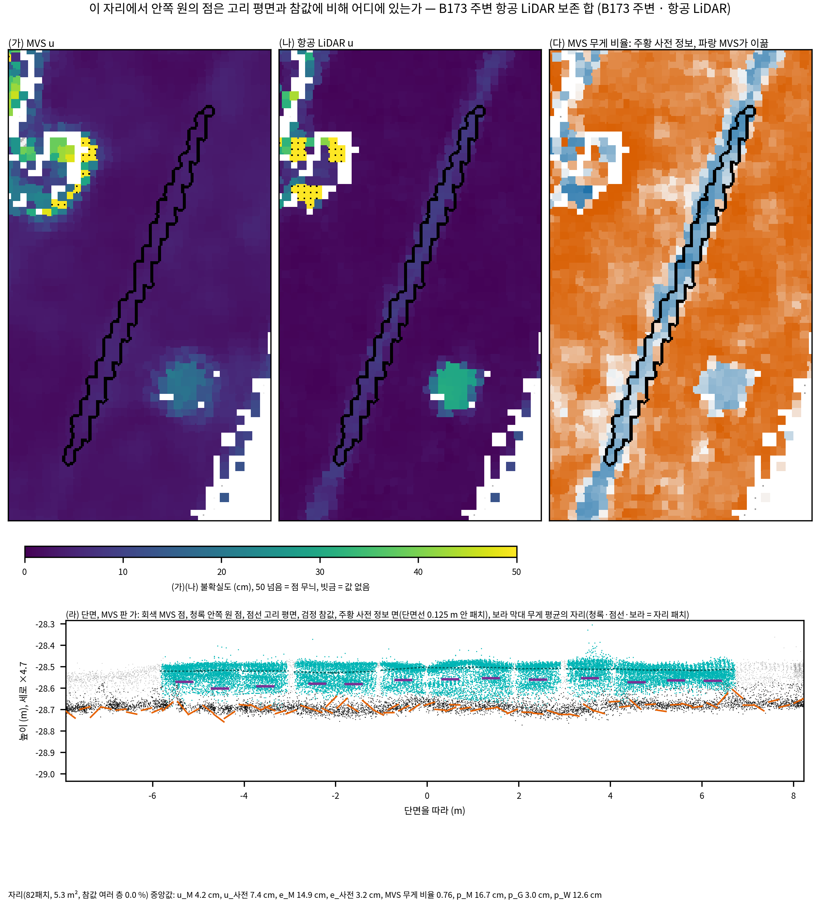

- 캡션 재료: 위 = 자리와 둘레 2 m를 키운 지도((가) MVS u, (나) 사전 정보 u, (다) MVS 무게 비율; 검은 테두리 = 자리). 아래 = 자리의 가장 큰 덩어리(0.36 m로 이음)를 그 긴 축(수평 주성분)으로 자른 단면, 띠 폭 0.5 m, 덩어리 끝에서 2 m까지. 회색 = 띠 안 MVS 점(1 m마다 400점까지), 검정 = 참값 점, 주황 = 단면선 0.125 m 안 사전 정보 패치, 청록 = 단면선 위 패치(1 m마다 하나)의 안쪽 원 점, 점선 = 그 패치의 고리 평면, 보라 막대 = 무게 평균의 자리. 세로 늘림 배율은 축 이름에

**그림 E — B173 주변 LoD2 보정 합.** 자리(7640패치, 477.5 m², 참값 여러 층 0.0 %) 중앙값: u_M 4.3 cm, u_사전 20.0 cm, e_M 7.2 cm, e_사전 469.3 cm, MVS 무게 비율 0.96, p_M -466.9 cm, p_G -469.3 cm, p_W -427.6 cm

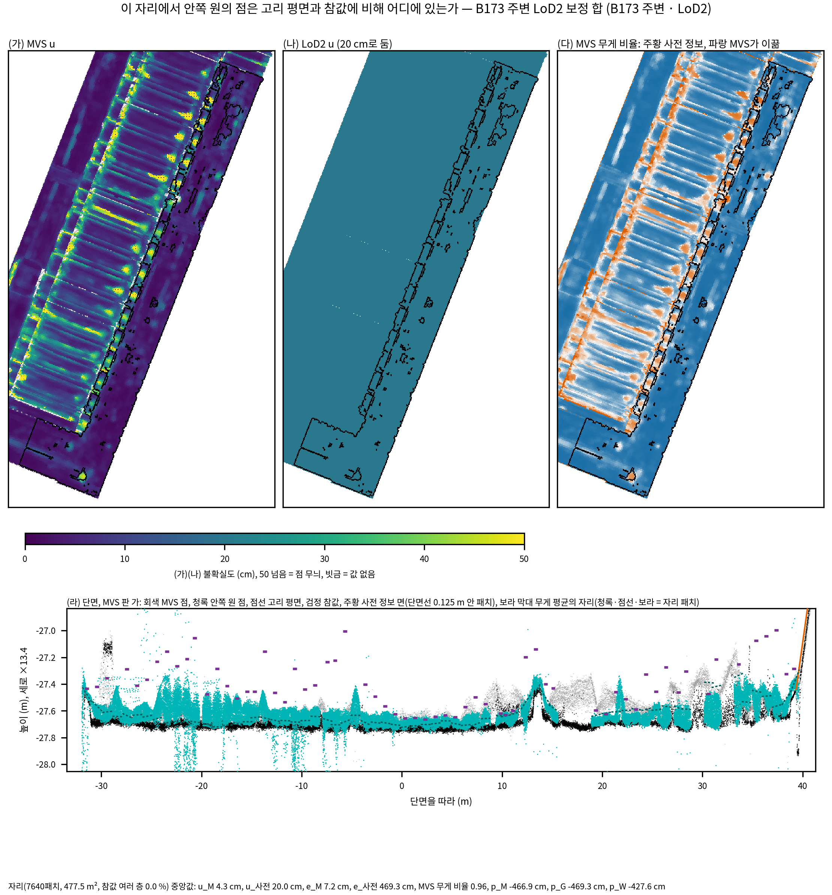

- 캡션 재료: 위 = 자리와 둘레 2 m를 키운 지도((가) MVS u, (나) 사전 정보 u, (다) MVS 무게 비율; 검은 테두리 = 자리). 아래 = 자리의 가장 큰 덩어리(0.36 m로 이음)를 그 긴 축(수평 주성분)으로 자른 단면, 띠 폭 0.5 m, 덩어리 끝에서 2 m까지. 회색 = 띠 안 MVS 점(1 m마다 400점까지), 검정 = 참값 점, 주황 = 단면선 0.125 m 안 사전 정보 패치, 청록 = 단면선 위 패치(1 m마다 하나)의 안쪽 원 점, 점선 = 그 패치의 고리 평면, 보라 막대 = 무게 평균의 자리. 세로 늘림 배율은 축 이름에

**그림 E — B173 주변 LoD2 보존 합.** 자리(48패치, 3.0 m², 참값 여러 층 0.0 %) 중앙값: u_M 6.2 cm, u_사전 20.0 cm, e_M 17.5 cm, e_사전 12.2 cm, MVS 무게 비율 0.91, p_M -4.7 cm, p_G 12.2 cm, p_W -4.2 cm

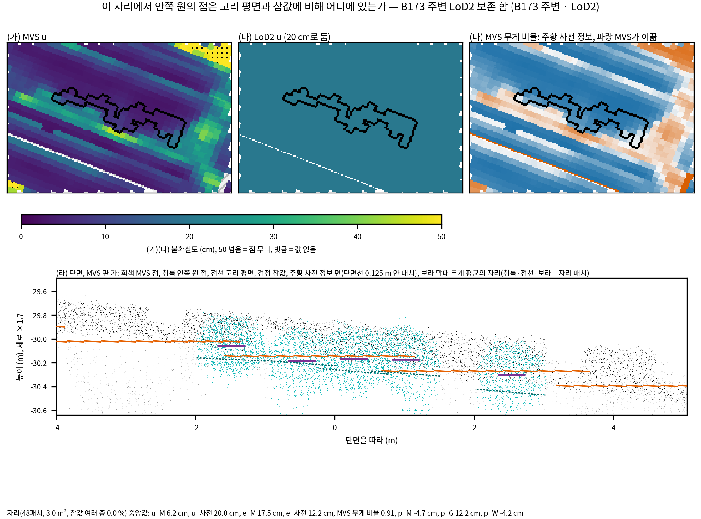

- 캡션 재료: 위 = 자리와 둘레 2 m를 키운 지도((가) MVS u, (나) 사전 정보 u, (다) MVS 무게 비율; 검은 테두리 = 자리). 아래 = 자리의 가장 큰 덩어리(0.36 m로 이음)를 그 긴 축(수평 주성분)으로 자른 단면, 띠 폭 0.5 m, 덩어리 끝에서 2 m까지. 회색 = 띠 안 MVS 점(1 m마다 400점까지), 검정 = 참값 점, 주황 = 단면선 0.125 m 안 사전 정보 패치, 청록 = 단면선 위 패치(1 m마다 하나)의 안쪽 원 점, 점선 = 그 패치의 고리 평면, 보라 막대 = 무게 평균의 자리. 세로 늘림 배율은 축 이름에

**그림 E — R1 항공 LiDAR 보존 합.** 자리(516패치, 32.5 m², 참값 여러 층 0.0 %) 중앙값: u_M 3.0 cm, u_사전 1.0 cm, e_M 12.8 cm, e_사전 5.7 cm, MVS 무게 비율 0.10, p_M -6.2 cm, p_G 5.7 cm, p_W -0.6 cm

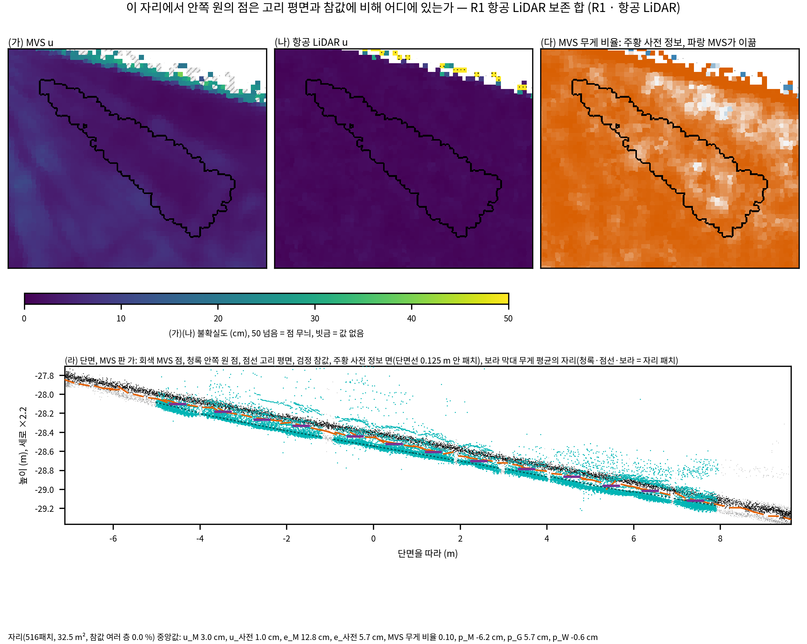

- 캡션 재료: 위 = 자리와 둘레 2 m를 키운 지도((가) MVS u, (나) 사전 정보 u, (다) MVS 무게 비율; 검은 테두리 = 자리). 아래 = 자리의 가장 큰 덩어리(0.36 m로 이음)를 그 긴 축(수평 주성분)으로 자른 단면, 띠 폭 0.5 m, 덩어리 끝에서 2 m까지. 회색 = 띠 안 MVS 점(1 m마다 400점까지), 검정 = 참값 점, 주황 = 단면선 0.125 m 안 사전 정보 패치, 청록 = 단면선 위 패치(1 m마다 하나)의 안쪽 원 점, 점선 = 그 패치의 고리 평면, 보라 막대 = 무게 평균의 자리. 세로 늘림 배율은 축 이름에

**그림 E — R1 LoD2 보정 합.** 자리(2751패치, 171.9 m², 참값 여러 층 0.0 %) 중앙값: u_M 3.5 cm, u_사전 20.0 cm, e_M 4.7 cm, e_사전 101.8 cm, MVS 무게 비율 0.97, p_M 99.2 cm, p_G 101.8 cm, p_W 92.2 cm

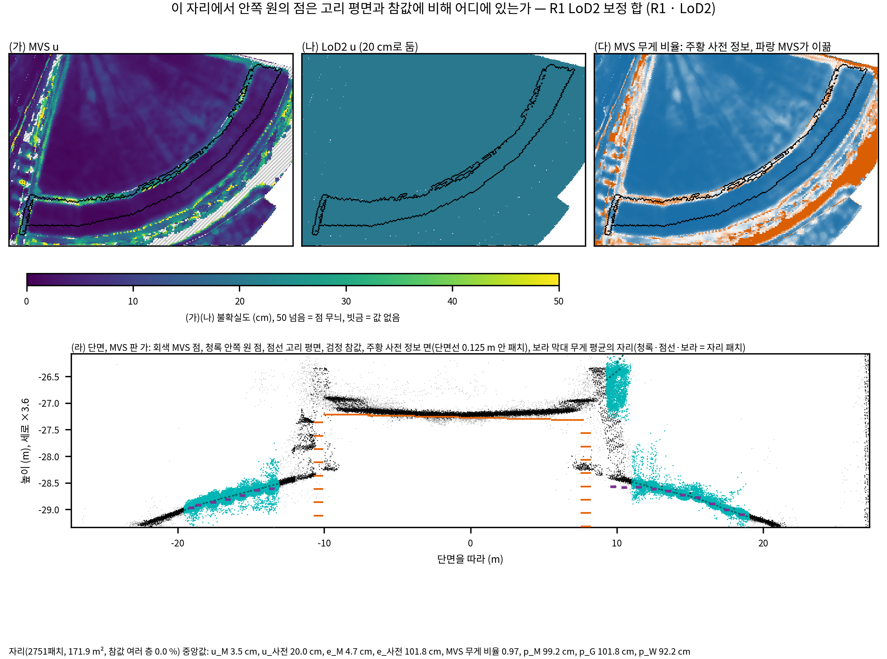

- 캡션 재료: 위 = 자리와 둘레 2 m를 키운 지도((가) MVS u, (나) 사전 정보 u, (다) MVS 무게 비율; 검은 테두리 = 자리). 아래 = 자리의 가장 큰 덩어리(0.36 m로 이음)를 그 긴 축(수평 주성분)으로 자른 단면, 띠 폭 0.5 m, 덩어리 끝에서 2 m까지. 회색 = 띠 안 MVS 점(1 m마다 400점까지), 검정 = 참값 점, 주황 = 단면선 0.125 m 안 사전 정보 패치, 청록 = 단면선 위 패치(1 m마다 하나)의 안쪽 원 점, 점선 = 그 패치의 고리 평면, 보라 막대 = 무게 평균의 자리. 세로 늘림 배율은 축 이름에

**그림 E — R1 LoD2 보존 합.** 자리(62패치, 3.9 m², 참값 여러 층 0.0 %) 중앙값: u_M 17.6 cm, u_사전 20.0 cm, e_M 181.0 cm, e_사전 57.0 cm, MVS 무게 비율 0.49, p_M 125.4 cm, p_G -57.0 cm, p_W 38.7 cm

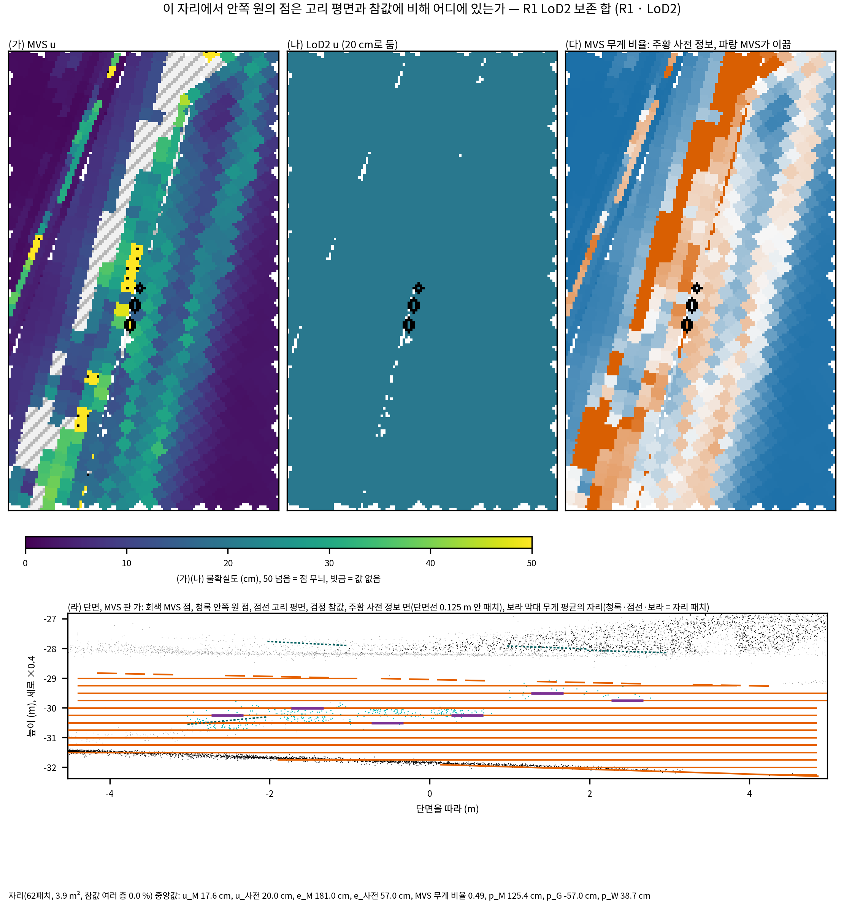

- 캡션 재료: 위 = 자리와 둘레 2 m를 키운 지도((가) MVS u, (나) 사전 정보 u, (다) MVS 무게 비율; 검은 테두리 = 자리). 아래 = 자리의 가장 큰 덩어리(0.36 m로 이음)를 그 긴 축(수평 주성분)으로 자른 단면, 띠 폭 0.5 m, 덩어리 끝에서 2 m까지. 회색 = 띠 안 MVS 점(1 m마다 400점까지), 검정 = 참값 점, 주황 = 단면선 0.125 m 안 사전 정보 패치, 청록 = 단면선 위 패치(1 m마다 하나)의 안쪽 원 점, 점선 = 그 패치의 고리 평면, 보라 막대 = 무게 평균의 자리. 세로 늘림 배율은 축 이름에

### 3.3 일 4: 참값으로 점검

**6.1 불확실도가 실제 오차를 따라가는가.**

| 패치 묶음(세 지역 합) | 자료 | u 구간 (cm) | 패치 | 넓이 m² | e 중앙값 | 25 % | 75 % | 90 % |
|---|---:|---:|---:|---:|---:|---:|---:|---:|
| LoD2 패치 | MVS 판 가 | 0~2 | 25,384 | 1586.5 | 3.2 | 2.2 | 4.1 | 6.0 |
| LoD2 패치 | MVS 판 가 | 2~5 | 74,169 | 4635.6 | 5.1 | 3.5 | 7.9 | 11.4 |
| LoD2 패치 | MVS 판 가 | 5~10 | 47,199 | 2949.9 | 8.9 | 6.6 | 12.5 | 19.7 |
| LoD2 패치 | MVS 판 가 | 10~20 | 34,364 | 2147.8 | 15.3 | 10.9 | 23.2 | 48.9 |
| LoD2 패치 | MVS 판 가 | 20~40 | 20,315 | 1269.7 | 26.8 | 16.6 | 44.3 | 158.8 |
| LoD2 패치 | MVS 판 가 | 40 넘음 | 6,392 | 399.5 | 44.6 | 19.0 | 74.7 | 172.0 |
| 항공 LiDAR 패치 | MVS 판 가 | 0~2 | 15,726 | 1057.4 | 3.1 | 2.1 | 3.8 | 4.6 |
| 항공 LiDAR 패치 | MVS 판 가 | 2~5 | 35,209 | 2339.7 | 5.1 | 3.5 | 8.0 | 10.3 |
| 항공 LiDAR 패치 | MVS 판 가 | 5~10 | 17,126 | 1155.4 | 8.9 | 6.6 | 12.0 | 15.8 |
| 항공 LiDAR 패치 | MVS 판 가 | 10~20 | 6,858 | 472.1 | 16.3 | 11.6 | 24.0 | 56.4 |
| 항공 LiDAR 패치 | MVS 판 가 | 20~40 | 4,072 | 276.3 | 35.6 | 22.3 | 71.8 | 290.7 |
| 항공 LiDAR 패치 | MVS 판 가 | 40 넘음 | 1,194 | 81.8 | 64.2 | 42.2 | 110.3 | 279.8 |
| 항공 LiDAR 패치 | 항공 LiDAR | 0~2 | 48,261 | 3180.1 | 2.7 | 1.4 | 4.5 | 5.6 |
| 항공 LiDAR 패치 | 항공 LiDAR | 2~5 | 19,480 | 1327.6 | 361.7 | 3.6 | 479.5 | 642.1 |
| 항공 LiDAR 패치 | 항공 LiDAR | 5~10 | 8,941 | 617.3 | 360.7 | 5.4 | 494.3 | 662.6 |
| 항공 LiDAR 패치 | 항공 LiDAR | 10~20 | 1,846 | 136.6 | 9.3 | 4.9 | 517.6 | 561.8 |
| 항공 LiDAR 패치 | 항공 LiDAR | 20~40 | 696 | 51.9 | 15.6 | 4.0 | 227.1 | 553.3 |
| 항공 LiDAR 패치 | 항공 LiDAR | 40 넘음 | 325 | 22.9 | 6.3 | 4.7 | 14.5 | 40.1 |

| 단위 | 자료 | 패치 | ρ(u,e) | 지붕꼴 | 벽꼴 | ρ(어긋남, 치우침 크기) | ρ(흩어짐, 퍼짐) | e ÷ u | u–e | u–실제 68.3 % | u–틀린 점 | q–e | q–실제 68.3 % | q–틀린 점 |
|---|---:|---:|---:|---:|---:|---:|---:|---:|---:|---:|---:|---:|---:|---:|
| B0 · LoD2 | MVS 판 가 | 72,728 | 0.81 | 0.70 | 0.73 | 0.33 | 0.91 | 1.26 | 0.81 | 0.81 | 0.73 | 0.80 | 0.81 | 0.74 |
| B173 주변 · LoD2 | MVS 판 가 | 78,537 | 0.64 | 0.74 | 0.55 | 0.24 | 0.83 | 1.60 | 0.64 | 0.64 | 0.72 | 0.62 | 0.64 | 0.73 |
| R1 · LoD2 | MVS 판 가 | 56,558 | 0.80 | 0.81 | 0.74 | 0.42 | 0.91 | 1.22 | 0.80 | 0.79 | 0.73 | 0.77 | 0.80 | 0.76 |
| 세 지역 합 · LoD2 | MVS 판 가 | 207,823 | 0.76 | 0.80 | 0.70 | 0.34 | 0.88 | 1.35 | 0.76 | 0.76 | 0.73 | 0.73 | 0.75 | 0.75 |
| B0 · 항공 LiDAR | MVS 판 가 | 23,178 | 0.66 | 0.65 | 0.63 | 0.07 | 0.98 | 1.31 | 0.66 | 0.66 | 0.50 | 0.63 | 0.68 | 0.51 |
| B0 · 항공 LiDAR | 항공 LiDAR | 22,924 | 0.38 | 0.37 | 0.42 | 0.08 | 0.78 | 1.44 | 0.38 | 0.36 | 0.33 | 0.36 | 0.36 | 0.35 |
| B173 주변 · 항공 LiDAR | MVS 판 가 | 33,651 | 0.70 | 0.70 | 0.38 | 0.26 | 0.94 | 1.74 | 0.70 | 0.70 | 0.76 | 0.67 | 0.70 | 0.79 |
| B173 주변 · 항공 LiDAR | 항공 LiDAR | 33,212 | 0.47 | 0.47 | 0.72 | 0.37 | 0.40 | 59.17 | 0.47 | 0.46 | 0.45 | 0.46 | 0.46 | 0.44 |
| R1 · 항공 LiDAR | MVS 판 가 | 23,356 | 0.77 | 0.77 | 0.88 | 0.28 | 0.97 | 1.40 | 0.77 | 0.76 | 0.59 | 0.72 | 0.76 | 0.65 |
| R1 · 항공 LiDAR | 항공 LiDAR | 23,413 | 0.25 | 0.28 | 0.65 | -0.04 | 0.84 | 3.83 | 0.25 | 0.32 | 0.36 | 0.24 | 0.32 | 0.38 |
| 세 지역 합 · 항공 LiDAR | MVS 판 가 | 80,185 | 0.77 | 0.77 | 0.80 | 0.34 | 0.96 | 1.50 | 0.77 | 0.76 | 0.68 | 0.72 | 0.74 | 0.70 |
| 세 지역 합 · 항공 LiDAR | 항공 LiDAR | 79,549 | 0.55 | 0.56 | 0.65 | 0.38 | 0.70 | 2.88 | 0.55 | 0.56 | 0.61 | 0.56 | 0.57 | 0.61 |

- 흩어짐과 퍼짐은 같은 안쪽 원 점의 NMAD이고 기준 평면(고리 평면, 참값 평면)만 다르다. 반쯤 틀린 패치와 판 나, q 구간 표는 [표 폴더](tables/R_chosen_per_site/t61_u_vs_error.md).

**그림 F-가.** 세 지역 합, 평가 범위, 값과 참값 평면이 있는 패치. 상자 = 25~75 %, 가로선 = 중앙값, 수염 = 10~90 %, 옅은 회색 띠 = e가 그 u 구간 안(e = u; 40~ 구간은 100 cm까지만 칠함). 구간 30패치 미만은 그리지 않음. 항공 LiDAR 값은 항공 LiDAR 패치에서만 구함.

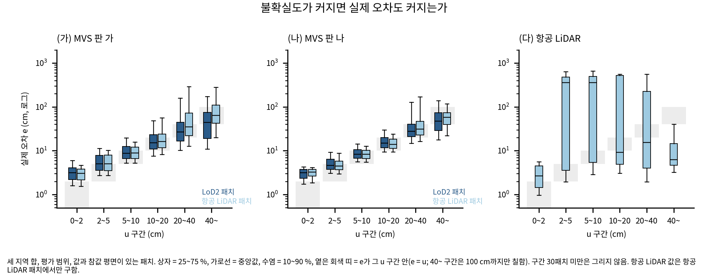

- 캡션 재료: 가로 = u 구간, 세로 = 실제 오차 e(로그). 상자 25~75 %, 가로선 중앙값, 수염 10~90 %. 옅은 회색 띠 = e가 그 u 구간 안. 짙은 파랑 = LoD2 패치, 옅은 파랑 = 항공 LiDAR 패치. 세 지역 합

**그림 F-바 — B0.** 지역 전체(평가 범위, LoD2 패치, MVS 판 가): 반쯤 틀린 패치(틀린 점 30~50 %) 5,877개; (가) 지금 식 u 중앙값 15.9 cm; (나) 68.3 % 값 q 중앙값 18.2 cm. 회색 = 그 밖의 값 있는 패치, 황갈 = 참값 평면 없음

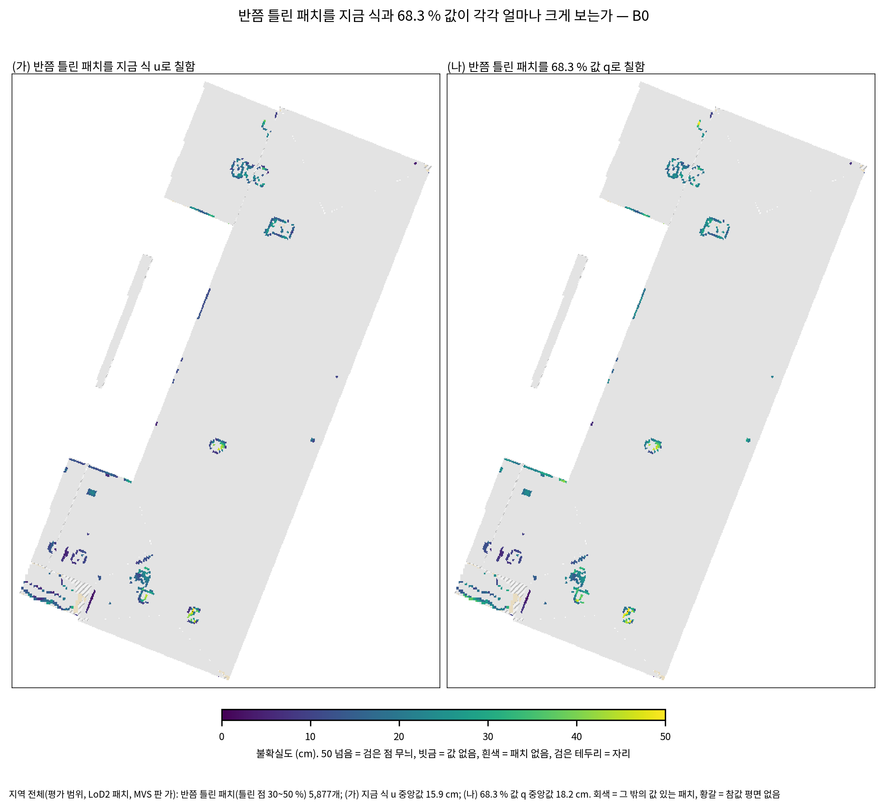

- 캡션 재료: 반쯤 틀린 패치(틀린 점 30~50 %)만 (가) u, (나) q로 칠함(색은 그림 A와 같음), 회색 = 그 밖의 값 있는 패치, 황갈 = 참값 평면 없음. LoD2 패치, MVS 판 가

**그림 F-바 — B173 주변.** 지역 전체(평가 범위, LoD2 패치, MVS 판 가): 반쯤 틀린 패치(틀린 점 30~50 %) 8,144개; (가) 지금 식 u 중앙값 13.9 cm; (나) 68.3 % 값 q 중앙값 17.8 cm. 회색 = 그 밖의 값 있는 패치, 황갈 = 참값 평면 없음

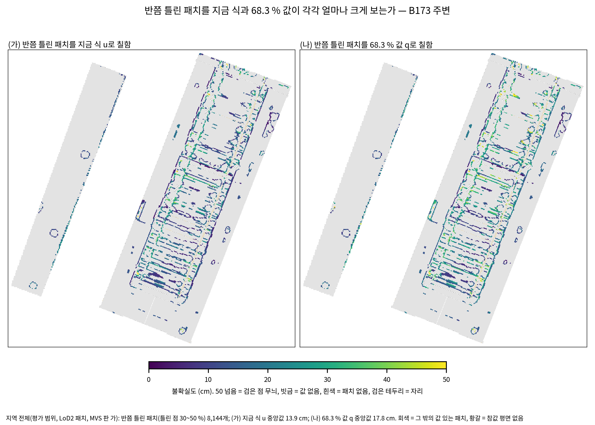

- 캡션 재료: 반쯤 틀린 패치(틀린 점 30~50 %)만 (가) u, (나) q로 칠함(색은 그림 A와 같음), 회색 = 그 밖의 값 있는 패치, 황갈 = 참값 평면 없음. LoD2 패치, MVS 판 가

**그림 F-바 — R1.** 지역 전체(평가 범위, LoD2 패치, MVS 판 가): 반쯤 틀린 패치(틀린 점 30~50 %) 6,781개; (가) 지금 식 u 중앙값 19.6 cm; (나) 68.3 % 값 q 중앙값 23.8 cm. 회색 = 그 밖의 값 있는 패치, 황갈 = 참값 평면 없음

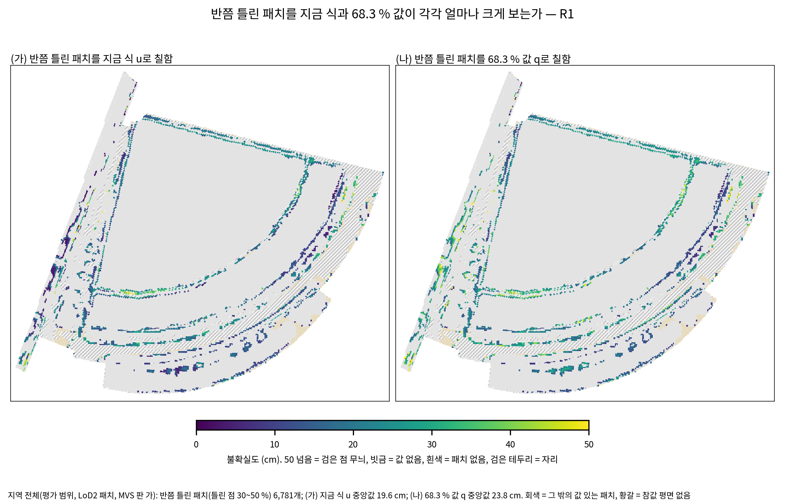

- 캡션 재료: 반쯤 틀린 패치(틀린 점 30~50 %)만 (가) u, (나) q로 칠함(색은 그림 A와 같음), 회색 = 그 밖의 값 있는 패치, 황갈 = 참값 평면 없음. LoD2 패치, MVS 판 가

**6.2 영상이 틀린 패치를 잡는가.**

| 단위 | 자료 | 양성 | 양성 패치 | 음성 패치 | AUC u | 어긋남 | 흩어짐 | q | 양성 절반 문턱의 잘못 잡음(u) |
|---|---:|---:|---:|---:|---:|---:|---:|---:|---:|
| 세 지역 합 · LoD2 | MVS 판 가 | 양성 전체 | 21,154 | 136,290 | 0.77 | 0.68 | 0.77 | 0.77 | 16.3 % |
| 세 지역 합 · LoD2 | MVS 판 가 | 보존 · 문턱 안만 | 560 | 136,290 | 0.81 | 0.74 | 0.81 | 0.80 | 16.2 % |
| 세 지역 합 · LoD2 | MVS 판 가 | 한계만 | 10,479 | 136,290 | 0.79 | 0.68 | 0.79 | 0.78 | 16.1 % |
| 세 지역 합 · LoD2 | MVS 판 나 | 양성 전체 | 21,012 | 134,770 | 0.77 | 0.68 | 0.78 | 0.78 | 14.9 % |
| 세 지역 합 · LoD2 | MVS 판 나 | 보존 · 문턱 안만 | 524 | 134,770 | 0.83 | 0.73 | 0.84 | 0.83 | 14.8 % |
| 세 지역 합 · LoD2 | MVS 판 나 | 한계만 | 9,770 | 134,770 | 0.78 | 0.67 | 0.79 | 0.78 | 15.4 % |
| 세 지역 합 · 항공 LiDAR | MVS 판 가 | 양성 전체 | 10,805 | 64,809 | 0.77 | 0.73 | 0.76 | 0.76 | 13.3 % |
| 세 지역 합 · 항공 LiDAR | MVS 판 가 | 보존 · 문턱 안만 | 3,672 | 64,809 | 0.71 | 0.68 | 0.71 | 0.70 | 22.2 % |
| 세 지역 합 · 항공 LiDAR | MVS 판 가 | 한계만 | 3,426 | 64,809 | 0.86 | 0.78 | 0.86 | 0.87 | 4.4 % |
| 세 지역 합 · 항공 LiDAR | MVS 판 나 | 양성 전체 | 10,060 | 64,336 | 0.78 | 0.72 | 0.78 | 0.79 | 12.0 % |
| 세 지역 합 · 항공 LiDAR | MVS 판 나 | 보존 · 문턱 안만 | 3,638 | 64,336 | 0.76 | 0.66 | 0.77 | 0.76 | 17.3 % |
| 세 지역 합 · 항공 LiDAR | MVS 판 나 | 한계만 | 2,743 | 64,336 | 0.85 | 0.76 | 0.85 | 0.86 | 4.5 % |

틀린 점의 비율로 정한 판(30 % 넘음 양성, 10 % 미만 음성):

| 단위 | 자료 | 양성 | 음성 | AUC u | 어긋남 | 흩어짐 | q |
|---|---:|---:|---:|---:|---:|---:|---:|
| 세 지역 합 · LoD2 | MVS 판 가 | 26,370 | 103,821 | 0.95 | 0.86 | 0.95 | 0.96 |
| 세 지역 합 · LoD2 | MVS 판 나 | 35,217 | 80,850 | 0.97 | 0.85 | 0.97 | 0.98 |
| 세 지역 합 · 항공 LiDAR | MVS 판 가 | 8,024 | 57,860 | 0.97 | 0.89 | 0.97 | 0.98 |
| 세 지역 합 · 항공 LiDAR | MVS 판 나 | 9,427 | 48,052 | 0.97 | 0.87 | 0.96 | 0.99 |

- 경우마다 값은 [표 폴더](tables/R_chosen_per_site/t62_roc.md).

**그림 F-나.** MVS 판 가, 세 지역 합, 평가 범위, 참값 평면이 있는 패치((가) 양성 21,154, 음성 136,290; (나) 양성 10,805, 음성 64,809). 양성 = 보존 · 문턱 안, 한계, 이중 오류; 음성 = 다듬기, 보정 두 칸. 오른쪽 아래 숫자 = 곡선 아래 넓이(u = 지금 식, q = 68.3 % 값). u, 흩어짐, q 곡선은 거의 겹친다.

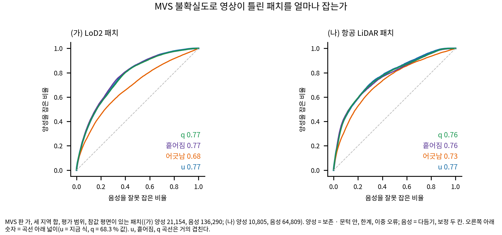

- 캡션 재료: ROC 곡선, MVS 판 가, 세 지역 합. 선 넷 = u, 어긋남, 흩어짐, q; 오른쪽 아래 숫자 = 곡선 아래 넓이. 양성 = 보존 · 문턱 안, 한계, 이중 오류; 음성 = 다듬기, 보정 두 칸

**6.3 바뀐 곳에서 MVS는 어떤가.**

| 경우 | 칸 | u 있는 패치 | u_M 중앙값 | 75 % | 90 % | MVS 무게 비율 0.5 넘는 넓이 |
|---|---:|---:|---:|---:|---:|---:|
| B0 · LoD2 | 보정 · 1~4τ | 5,139 | 6.4 | 14.1 | 21.6 | 87.4 % |
| B0 · LoD2 | 보정 · 4τ 넘음 | 1,134 | 3.2 | 5.4 | 12.8 | 91.2 % |
| B0 · LoD2 | 다듬기 | 51,266 | 3.2 | 7.6 | 14.3 | 94.3 % |
| B0 · 항공 LiDAR | 보정 · 1~4τ | 33 | 8.9 | 13.0 | 15.9 | 33.6 % |
| B0 · 항공 LiDAR | 보정 · 4τ 넘음 | 33 | 10.0 | 17.1 | 22.1 | 52.4 % |
| B0 · 항공 LiDAR | 다듬기 | 21,817 | 2.1 | 3.6 | 6.0 | 16.8 % |
| B173 주변 · LoD2 | 보정 · 1~4τ | 4,786 | 8.9 | 17.7 | 28.5 | 73.0 % |
| B173 주변 · LoD2 | 보정 · 4τ 넘음 | 16,345 | 4.3 | 7.9 | 17.8 | 90.7 % |
| B173 주변 · LoD2 | 다듬기 | 29,368 | 3.9 | 6.6 | 13.6 | 86.8 % |
| B173 주변 · LoD2 | B173 날개 자리 | 16,214 | 4.3 | 7.8 | 17.6 | 91.0 % |
| B173 주변 · 항공 LiDAR | 보정 · 1~4τ | 95 | 11.1 | 15.2 | 21.5 | 54.0 % |
| B173 주변 · 항공 LiDAR | 보정 · 4τ 넘음 | 15,000 | 4.6 | 8.7 | 19.6 | 36.7 % |
| B173 주변 · 항공 LiDAR | 다듬기 | 10,114 | 3.5 | 4.6 | 6.6 | 10.1 % |
| B173 주변 · 항공 LiDAR | B173 날개 자리 | 14,380 | 4.5 | 8.5 | 18.8 | 36.1 % |
| R1 · LoD2 | 보정 · 1~4τ | 6,119 | 6.2 | 12.3 | 22.6 | 82.2 % |
| R1 · LoD2 | 보정 · 4τ 넘음 | 3,483 | 9.0 | 22.5 | 33.9 | 58.9 % |
| R1 · LoD2 | 다듬기 | 19,172 | 4.2 | 6.7 | 11.4 | 93.7 % |
| R1 · 항공 LiDAR | 보정 · 1~4τ | 62 | 8.4 | 13.5 | 22.4 | 57.2 % |
| R1 · 항공 LiDAR | 보정 · 4τ 넘음 | 64 | 20.5 | 33.0 | 47.6 | 21.6 % |
| R1 · 항공 LiDAR | 다듬기 | 17,673 | 4.0 | 5.9 | 8.4 | 7.9 % |

**6.4 LoD2 20 cm는 자료와 맞는가.**

| 지역 | 줄 | 기준 | 패치 | 중앙값 | NMAD | 차 크기 68 % | 95 % | 20 cm 안 | 30 cm 안 | τ ÷ 2.5 |
|---|---:|---:|---:|---:|---:|---:|---:|---:|---:|---:|
| B0 | 지붕면 | MVS(u_M ≤ 5 cm) | 21,846 | 7.0 | 3.1 | 8.9 | 60.5 | 86.9 % | 89.8 % | 7.9 |
| B0 | 지붕면 | MVS(u_M ≤ 10 cm) | 25,334 | 7.0 | 3.5 | 9.1 | 60.0 | 85.9 % | 89.5 % | 7.9 |
| B0 | 지붕면 | 참값(모두) | 27,274 | 7.8 | 3.8 | 10.1 | 65.2 | 85.9 % | 89.5 % | 7.9 |
| B0 | 지붕면 | 참값(보정 · 4τ 넘음 뺌) | 26,137 | 7.9 | 3.6 | 9.7 | 36.5 | 89.2 % | 93.0 % | 7.9 |
| B0 | 벽면 | MVS(u_M ≤ 5 cm) | 18,829 | -20.2 | 5.5 | 23.2 | 39.1 | 47.6 % | 93.4 % | 21.9 |
| B0 | 벽면 | MVS(u_M ≤ 10 cm) | 31,332 | -20.5 | 7.0 | 24.4 | 53.3 | 44.4 % | 86.0 % | 21.9 |
| B0 | 벽면 | 참값(모두) | 46,901 | -20.0 | 7.7 | 24.3 | 63.8 | 45.0 % | 78.4 % | 21.9 |
| B0 | 벽면 | 참값(보정 · 4τ 넘음 뺌) | 46,901 | -20.0 | 7.7 | 24.3 | 63.8 | 45.0 % | 78.4 % | 21.9 |
| B0 | 지붕 형태 1000 평지붕 | MVS(u_M ≤ 5 cm) | 135 | 1.8 | 1.9 | 2.9 | 93.7 | 91.1 % | 91.1 % | 7.9 |
| B0 | 지붕 형태 1000 평지붕 | MVS(u_M ≤ 10 cm) | 211 | 1.0 | 4.8 | 5.6 | 94.4 | 80.6 % | 82.5 % | 7.9 |
| B0 | 지붕 형태 1000 평지붕 | 참값(모두) | 410 | -1.2 | 1.0 | 1.9 | 91.9 | 79.5 % | 79.5 % | 7.9 |
| B0 | 지붕 형태 1000 평지붕 | 참값(보정 · 4τ 넘음 뺌) | 284 | -1.4 | 0.7 | 2.0 | 91.5 | 81.7 % | 81.7 % | 7.9 |
| B0 | 지붕 형태 3100 박공지붕 | MVS(u_M ≤ 5 cm) | 21,271 | 7.1 | 3.0 | 8.9 | 62.1 | 86.6 % | 89.6 % | 7.9 |
| B0 | 지붕 형태 3100 박공지붕 | MVS(u_M ≤ 10 cm) | 24,443 | 7.2 | 3.4 | 9.2 | 60.7 | 85.6 % | 89.3 % | 7.9 |
| B0 | 지붕 형태 3100 박공지붕 | 참값(모두) | 26,081 | 8.0 | 3.6 | 10.2 | 64.2 | 85.6 % | 89.3 % | 7.9 |
| B0 | 지붕 형태 3100 박공지붕 | 참값(보정 · 4τ 넘음 뺌) | 25,071 | 8.0 | 3.4 | 9.8 | 36.3 | 89.0 % | 92.9 % | 7.9 |
| B0 | 지붕 형태 3200 모임지붕 | MVS(u_M ≤ 5 cm) | 440 | -1.8 | 8.4 | 8.0 | 11.0 | 99.1 % | 99.1 % | 7.9 |
| B0 | 지붕 형태 3200 모임지붕 | MVS(u_M ≤ 10 cm) | 680 | -0.2 | 5.6 | 7.1 | 11.4 | 98.7 % | 98.7 % | 7.9 |
| B0 | 지붕 형태 3200 모임지붕 | 참값(모두) | 783 | 0.0 | 5.6 | 5.0 | 12.6 | 98.7 % | 98.7 % | 7.9 |
| B0 | 지붕 형태 3200 모임지붕 | 참값(보정 · 4τ 넘음 뺌) | 782 | 0.0 | 5.6 | 5.0 | 12.6 | 98.8 % | 98.8 % | 7.9 |
| B173 주변 | 지붕면 | MVS(u_M ≤ 5 cm) | 20,483 | -13.9 | 482.2 | 424.7 | 637.8 | 44.1 % | 44.4 % | 7.0 |
| B173 주변 | 지붕면 | MVS(u_M ≤ 10 cm) | 30,714 | -10.0 | 299.7 | 410.2 | 677.7 | 43.1 % | 43.6 % | 7.0 |
| B173 주변 | 지붕면 | 참값(모두) | 41,859 | -12.1 | 292.0 | 414.5 | 766.7 | 35.0 % | 43.9 % | 7.0 |
| B173 주변 | 지붕면 | 참값(보정 · 4τ 넘음 뺌) | 25,424 | -3.2 | 21.9 | 26.1 | 454.3 | 57.7 % | 72.2 % | 7.0 |
| B173 주변 | 벽면 | MVS(u_M ≤ 5 cm) | 23,336 | -1.0 | 3.6 | 3.9 | 48.4 | 91.8 % | 94.3 % | 9.1 |
| B173 주변 | 벽면 | MVS(u_M ≤ 10 cm) | 35,529 | -1.0 | 4.2 | 5.0 | 203.4 | 88.1 % | 90.4 % | 9.1 |
| B173 주변 | 벽면 | 참값(모두) | 41,970 | 0.6 | 5.2 | 15.9 | 245.8 | 69.8 % | 77.3 % | 9.1 |
| B173 주변 | 벽면 | 참값(보정 · 4τ 넘음 뺌) | 41,970 | 0.6 | 5.2 | 15.9 | 245.8 | 69.8 % | 77.3 % | 9.1 |
| B173 주변 | 지붕 형태 1000 평지붕 | MVS(u_M ≤ 5 cm) | 405 | -10.5 | 3.5 | 12.9 | 142.6 | 85.7 % | 85.7 % | 7.0 |
| B173 주변 | 지붕 형태 1000 평지붕 | MVS(u_M ≤ 10 cm) | 671 | -10.0 | 4.0 | 12.5 | 142.8 | 86.7 % | 86.7 % | 7.0 |
| B173 주변 | 지붕 형태 1000 평지붕 | 참값(모두) | 1,081 | -9.5 | 3.3 | 12.4 | 202.7 | 78.5 % | 79.2 % | 7.0 |
| B173 주변 | 지붕 형태 1000 평지붕 | 참값(보정 · 4τ 넘음 뺌) | 1,019 | -9.5 | 3.1 | 11.7 | 165.5 | 83.3 % | 84.0 % | 7.0 |
| B173 주변 | 지붕 형태 3100 박공지붕 | MVS(u_M ≤ 5 cm) | 12,743 | -429.8 | 100.2 | 472.1 | 699.0 | 10.5 % | 11.0 % | 7.0 |
| B173 주변 | 지붕 형태 3100 박공지붕 | MVS(u_M ≤ 10 cm) | 21,507 | -394.8 | 166.2 | 461.9 | 734.6 | 19.1 % | 19.8 % | 7.0 |
| B173 주변 | 지붕 형태 3100 박공지붕 | 참값(모두) | 31,482 | -380.2 | 535.3 | 462.1 | 786.3 | 14.8 % | 26.2 % | 7.0 |
| B173 주변 | 지붕 형태 3100 박공지붕 | 참값(보정 · 4τ 넘음 뺌) | 15,115 | 21.7 | 35.4 | 184.1 | 764.3 | 30.7 % | 54.4 % | 7.0 |
| B173 주변 | 지붕 형태 9999 그 밖 | MVS(u_M ≤ 5 cm) | 7,335 | -2.6 | 3.2 | 4.1 | 7.3 | 100.0 % | 100.0 % | 7.0 |
| B173 주변 | 지붕 형태 9999 그 밖 | MVS(u_M ≤ 10 cm) | 8,536 | -2.4 | 3.7 | 4.6 | 8.0 | 100.0 % | 100.0 % | 7.0 |
| B173 주변 | 지붕 형태 9999 그 밖 | 참값(모두) | 9,296 | -9.4 | 3.7 | 11.1 | 17.3 | 98.7 % | 99.9 % | 7.0 |
| B173 주변 | 지붕 형태 9999 그 밖 | 참값(보정 · 4τ 넘음 뺌) | 9,290 | -9.4 | 3.7 | 11.1 | 17.2 | 98.7 % | 99.9 % | 7.0 |
| R1 | 지붕면 | MVS(u_M ≤ 5 cm) | 12,926 | 18.7 | 36.7 | 55.8 | 146.3 | 40.0 % | 49.3 % | 27.3 |
| R1 | 지붕면 | MVS(u_M ≤ 10 cm) | 20,549 | 16.9 | 39.7 | 56.3 | 267.3 | 41.0 % | 51.1 % | 27.3 |
| R1 | 지붕면 | 참값(모두) | 28,690 | 22.2 | 41.7 | 85.1 | 471.6 | 36.3 % | 44.8 % | 27.3 |
| R1 | 지붕면 | 참값(보정 · 4τ 넘음 뺌) | 25,770 | 21.0 | 36.0 | 62.9 | 279.4 | 40.0 % | 49.4 % | 27.3 |
| R1 | 벽면 | MVS(u_M ≤ 5 cm) | 8,297 | -5.4 | 122.3 | 165.6 | 254.5 | 37.7 % | 38.0 % | 29.0 |
| R1 | 벽면 | MVS(u_M ≤ 10 cm) | 17,046 | -1.5 | 100.5 | 155.0 | 259.0 | 40.0 % | 41.2 % | 29.0 |
| R1 | 벽면 | 참값(모두) | 31,991 | 7.5 | 165.1 | 183.6 | 278.6 | 33.5 % | 35.5 % | 29.0 |
| R1 | 벽면 | 참값(보정 · 4τ 넘음 뺌) | 31,097 | 8.4 | 145.8 | 181.2 | 279.2 | 34.5 % | 36.5 % | 29.0 |
| R1 | 지붕 형태 1000 평지붕 | MVS(u_M ≤ 5 cm) | 11,646 | 24.1 | 37.0 | 44.2 | 109.1 | 44.3 % | 54.7 % | 27.3 |
| R1 | 지붕 형태 1000 평지붕 | MVS(u_M ≤ 10 cm) | 19,082 | 21.0 | 39.8 | 45.9 | 137.4 | 44.2 % | 55.1 % | 27.3 |
| R1 | 지붕 형태 1000 평지붕 | 참값(모두) | 27,032 | 26.2 | 41.6 | 70.6 | 497.5 | 38.6 % | 47.5 % | 27.3 |
| R1 | 지붕 형태 1000 평지붕 | 참값(보정 · 4τ 넘음 뺌) | 25,085 | 22.3 | 36.0 | 58.4 | 279.9 | 41.1 % | 50.7 % | 27.3 |
| R1 | 지붕 형태 3900 둥근지붕 | MVS(u_M ≤ 5 cm) | 1,280 | -141.8 | 20.6 | 150.0 | 274.0 | 0.0 % | 0.0 % | 27.3 |
| R1 | 지붕 형태 3900 둥근지붕 | MVS(u_M ≤ 10 cm) | 1,467 | -142.7 | 22.3 | 151.9 | 273.7 | 0.0 % | 0.0 % | 27.3 |
| R1 | 지붕 형태 3900 둥근지붕 | 참값(모두) | 1,658 | -146.6 | 16.2 | 151.0 | 277.1 | 0.0 % | 0.0 % | 27.3 |
| R1 | 지붕 형태 3900 둥근지붕 | 참값(보정 · 4τ 넘음 뺌) | 685 | -130.9 | 8.8 | 136.6 | 150.6 | 0.0 % | 0.0 % | 27.3 |

**그림 F-다.** 평가 범위의 LoD2 지붕꼴 패치. 파랑 = 믿을 만한 MVS의 |p_M|(실선 u_M ≤ 5 cm, 점선 ≤ 10 cm), 검정 = 참값의 |p_G|(보정 · 4τ 넘음 = LoD2가 참값에서 4τ 넘게 벗어난 칸을 뺌). 점선 = 20, 30 cm. 곡선이 1에 닿지 않는 만큼은 100 cm 넘는 패치.

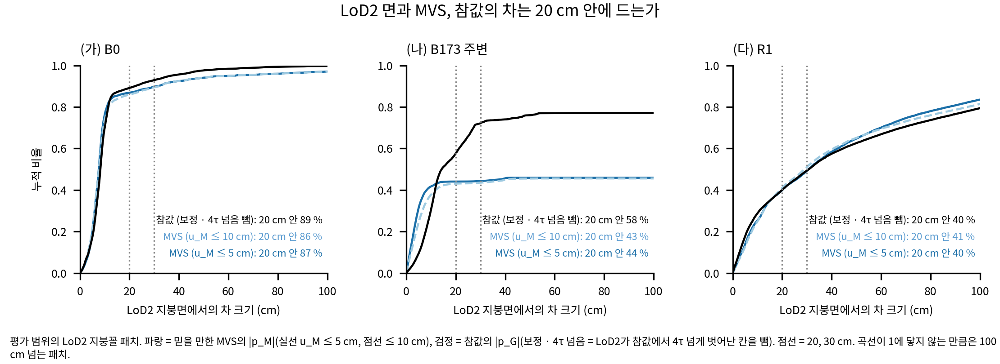

- 캡션 재료: LoD2 지붕꼴 패치(평가 범위). 파랑 = 믿을 만한 MVS(u_M 5 cm 이하 실선, 10 cm 이하 점선)의 p_M 크기 누적 분포, 검정 = 참값 p_G 크기(보정 · 4τ 넘음 뺌). 점선 = 20, 30 cm

**6.5 놓친 곳과 가장자리.**

| 경우 | 자료 | 값·참값 있는 패치 | 놓친 패치 | 놓친 넓이 m² | 패치 비율 | 넓이 비율 |
|---|---:|---:|---:|---:|---:|---:|
| B0 · LoD2 | MVS 판 가 | 72,728 | 3,593 | 224.6 | 4.9 % | 4.9 % |
| B0 · 항공 LiDAR | MVS 판 가 | 23,178 | 123 | 8.7 | 0.5 % | 0.5 % |
| B0 · 항공 LiDAR | 항공 LiDAR | 22,924 | 54 | 3.8 | 0.2 % | 0.2 % |
| B173 주변 · LoD2 | MVS 판 가 | 78,537 | 7,555 | 472.2 | 9.6 % | 9.6 % |
| B173 주변 · 항공 LiDAR | MVS 판 가 | 33,651 | 1,799 | 123.8 | 5.3 % | 5.5 % |
| B173 주변 · 항공 LiDAR | 항공 LiDAR | 33,212 | 19,438 | 1296.0 | 58.5 % | 58.7 % |
| R1 · LoD2 | MVS 판 가 | 56,558 | 7,780 | 486.2 | 13.8 % | 13.8 % |
| R1 · 항공 LiDAR | MVS 판 가 | 23,356 | 1,713 | 112.3 | 7.3 % | 7.2 % |
| R1 · 항공 LiDAR | 항공 LiDAR | 23,413 | 504 | 33.5 | 2.2 % | 2.1 % |

| 경우 | 자료 | 표시 | 다른 면까지 (m) | 패치 | u 중앙값 | e 중앙값 |
|---|---:|---:|---:|---:|---:|---:|
| B0 · LoD2 | MVS 판 가 | 모든 값 | 0~0.5 | 6,892 | 8.7 | 8.6 |
| B0 · LoD2 | MVS 판 가 | 모든 값 | 0.5~1.0 | 7,120 | 4.9 | 5.5 |
| B0 · LoD2 | MVS 판 가 | 모든 값 | 1.0~2.0 | 12,461 | 3.4 | 4.7 |
| B0 · LoD2 | MVS 판 가 | 모든 값 | 2.0 넘음 | 46,255 | 3.9 | 5.7 |
| B0 · 항공 LiDAR | MVS 판 가 | 모든 값 | 0~0.5 | 152 | 4.5 | 5.6 |
| B0 · 항공 LiDAR | MVS 판 가 | 모든 값 | 0.5~1.0 | 873 | 3.9 | 4.9 |
| B0 · 항공 LiDAR | MVS 판 가 | 모든 값 | 1.0~2.0 | 3,161 | 3.0 | 3.6 |
| B0 · 항공 LiDAR | MVS 판 가 | 모든 값 | 2.0 넘음 | 18,992 | 2.0 | 3.5 |
| B0 · 항공 LiDAR | 항공 LiDAR | 모든 값 | 0~0.5 | 138 | 3.0 | 3.8 |
| B0 · 항공 LiDAR | 항공 LiDAR | 모든 값 | 0.5~1.0 | 809 | 1.9 | 2.9 |
| B0 · 항공 LiDAR | 항공 LiDAR | 모든 값 | 1.0~2.0 | 3,033 | 1.2 | 2.0 |
| B0 · 항공 LiDAR | 항공 LiDAR | 모든 값 | 2.0 넘음 | 18,944 | 1.1 | 1.8 |
| B173 주변 · LoD2 | MVS 판 가 | 모든 값 | 0~0.5 | 10,092 | 9.2 | 12.8 |
| B173 주변 · LoD2 | MVS 판 가 | 모든 값 | 0.5~1.0 | 10,745 | 9.4 | 11.7 |
| B173 주변 · LoD2 | MVS 판 가 | 모든 값 | 1.0~2.0 | 15,483 | 6.7 | 11.9 |
| B173 주변 · LoD2 | MVS 판 가 | 모든 값 | 2.0 넘음 | 42,217 | 3.8 | 7.4 |
| B173 주변 · 항공 LiDAR | MVS 판 가 | 모든 값 | 0~0.5 | 416 | 10.4 | 13.7 |
| B173 주변 · 항공 LiDAR | MVS 판 가 | 모든 값 | 0.5~1.0 | 1,452 | 8.8 | 12.9 |
| B173 주변 · 항공 LiDAR | MVS 판 가 | 모든 값 | 1.0~2.0 | 8,567 | 6.5 | 13.1 |
| B173 주변 · 항공 LiDAR | MVS 판 가 | 모든 값 | 2.0 넘음 | 23,216 | 3.9 | 7.9 |
| B173 주변 · 항공 LiDAR | 항공 LiDAR | 모든 값 | 0~0.5 | 402 | 5.6 | 23.7 |
| B173 주변 · 항공 LiDAR | 항공 LiDAR | 모든 값 | 0.5~1.0 | 1,375 | 4.3 | 22.5 |
| B173 주변 · 항공 LiDAR | 항공 LiDAR | 모든 값 | 1.0~2.0 | 8,203 | 3.5 | 23.8 |
| B173 주변 · 항공 LiDAR | 항공 LiDAR | 모든 값 | 2.0 넘음 | 23,232 | 2.6 | 375.3 |
| R1 · LoD2 | MVS 판 가 | 모든 값 | 0~0.5 | 11,156 | 13.6 | 15.5 |
| R1 · LoD2 | MVS 판 가 | 모든 값 | 0.5~1.0 | 11,042 | 11.2 | 14.8 |
| R1 · LoD2 | MVS 판 가 | 모든 값 | 1.0~2.0 | 11,628 | 7.3 | 8.3 |
| R1 · LoD2 | MVS 판 가 | 모든 값 | 2.0 넘음 | 22,732 | 5.2 | 7.0 |
| R1 · 항공 LiDAR | MVS 판 가 | 모든 값 | 0~0.5 | 425 | 10.9 | 13.1 |
| R1 · 항공 LiDAR | MVS 판 가 | 모든 값 | 0.5~1.0 | 1,867 | 8.1 | 8.6 |
| R1 · 항공 LiDAR | MVS 판 가 | 모든 값 | 1.0~2.0 | 6,811 | 4.6 | 5.4 |
| R1 · 항공 LiDAR | MVS 판 가 | 모든 값 | 2.0 넘음 | 14,253 | 4.2 | 6.8 |
| R1 · 항공 LiDAR | 항공 LiDAR | 모든 값 | 0~0.5 | 436 | 4.9 | 5.3 |
| R1 · 항공 LiDAR | 항공 LiDAR | 모든 값 | 0.5~1.0 | 1,947 | 1.9 | 4.4 |
| R1 · 항공 LiDAR | 항공 LiDAR | 모든 값 | 1.0~2.0 | 6,804 | 1.3 | 4.3 |
| R1 · 항공 LiDAR | 항공 LiDAR | 모든 값 | 2.0 넘음 | 14,226 | 1.1 | 4.9 |

- 칸마다 놓친 패치, 한쪽 고리·지지 약함 표시 패치의 가장자리 값은 [표 폴더](tables/R_chosen_per_site/t65_missed_edge.md).

**그림 F-라 — B0.** 지역 전체(평가 범위): (가) 놓친 패치 3,593 / 72,728 (4.9 %); (나) 놓친 패치 123 / 23,178 (0.5 %); (다) 놓친 패치 54 / 22,924 (0.2 %). 빨강 = 놓친 패치(실제 오차 e > 20 cm 그리고 e > 2u), 회색 = 그 밖의 값 있는 패치, 빗금 = 값 없음, 황갈 = 참값 평면 없음

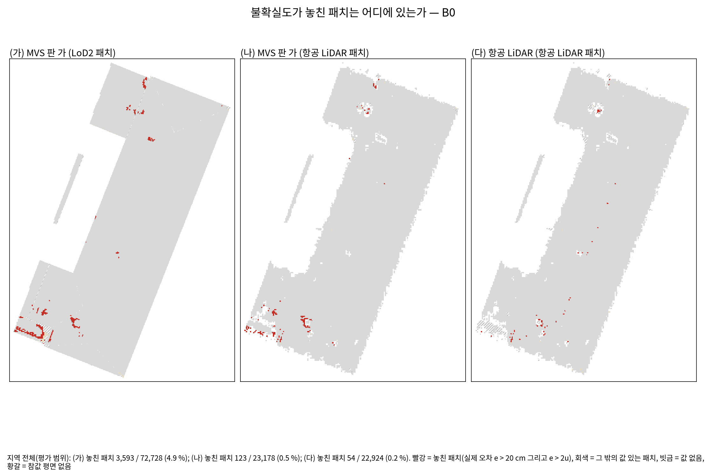

- 캡션 재료: 빨강 = 놓친 패치(e > 20 cm 그리고 e > 2u), 회색 = 그 밖의 값·참값 있는 패치, 빗금 = 값 없음, 황갈 = 참값 평면 없음. (가) MVS 판 가(LoD2 패치), (나) MVS 판 가(항공 LiDAR 패치), (다) 항공 LiDAR

**그림 F-라 — B173 주변.** 지역 전체(평가 범위): (가) 놓친 패치 7,555 / 78,537 (9.6 %); (나) 놓친 패치 1,799 / 33,651 (5.3 %); (다) 놓친 패치 19,438 / 33,212 (58.5 %). 빨강 = 놓친 패치(실제 오차 e > 20 cm 그리고 e > 2u), 회색 = 그 밖의 값 있는 패치, 빗금 = 값 없음, 황갈 = 참값 평면 없음

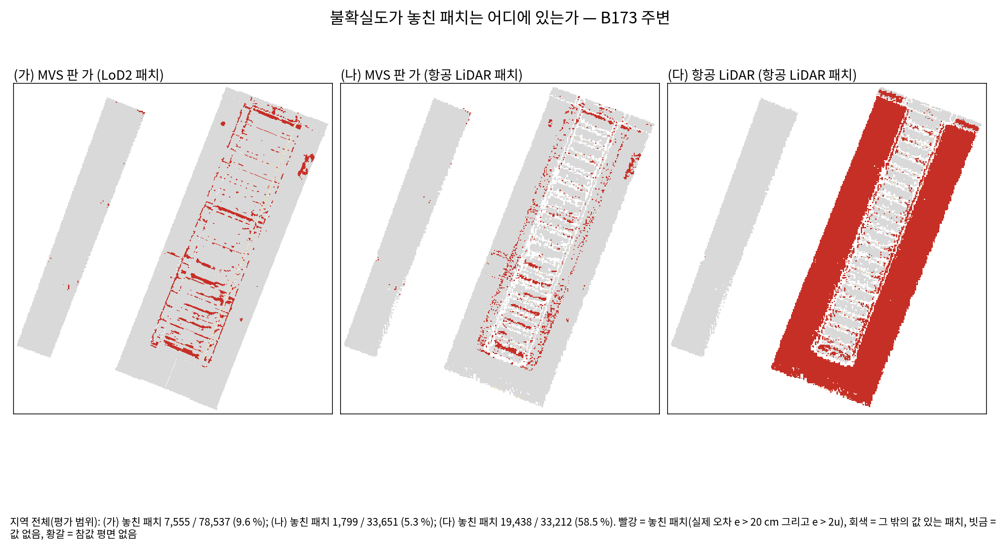

- 캡션 재료: 빨강 = 놓친 패치(e > 20 cm 그리고 e > 2u), 회색 = 그 밖의 값·참값 있는 패치, 빗금 = 값 없음, 황갈 = 참값 평면 없음. (가) MVS 판 가(LoD2 패치), (나) MVS 판 가(항공 LiDAR 패치), (다) 항공 LiDAR

**그림 F-라 — R1.** 지역 전체(평가 범위): (가) 놓친 패치 7,780 / 56,558 (13.8 %); (나) 놓친 패치 1,713 / 23,356 (7.3 %); (다) 놓친 패치 504 / 23,413 (2.2 %). 빨강 = 놓친 패치(실제 오차 e > 20 cm 그리고 e > 2u), 회색 = 그 밖의 값 있는 패치, 빗금 = 값 없음, 황갈 = 참값 평면 없음

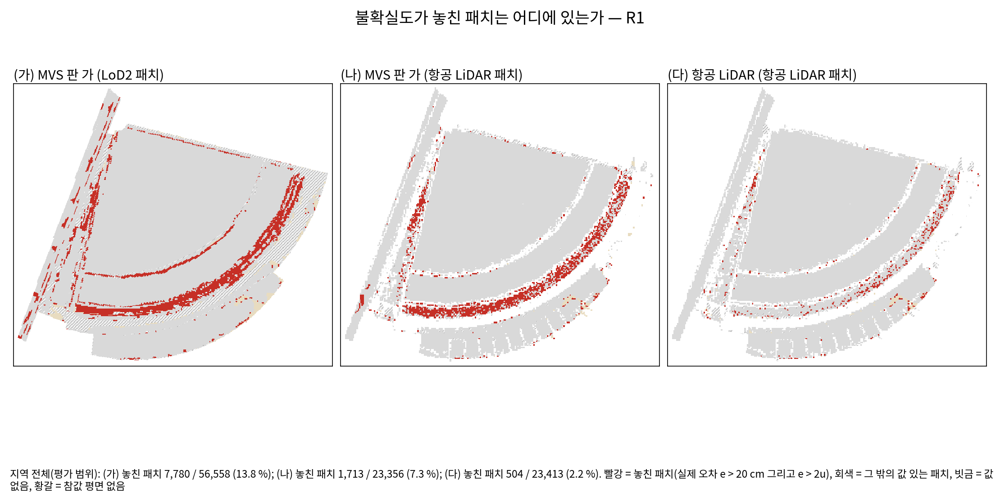

- 캡션 재료: 빨강 = 놓친 패치(e > 20 cm 그리고 e > 2u), 회색 = 그 밖의 값·참값 있는 패치, 빗금 = 값 없음, 황갈 = 참값 평면 없음. (가) MVS 판 가(LoD2 패치), (나) MVS 판 가(항공 LiDAR 패치), (다) 항공 LiDAR

**그림 F-마.** 세 지역 합, 평가 범위, 값과 참값 평면이 있는 패치. 가로 = 면 번호가 다른 가장 가까운 패치까지 거리. 파랑 = u의 중앙값, 검정 = 실제 오차 e의 중앙값. 세 칸의 세로축 같음.

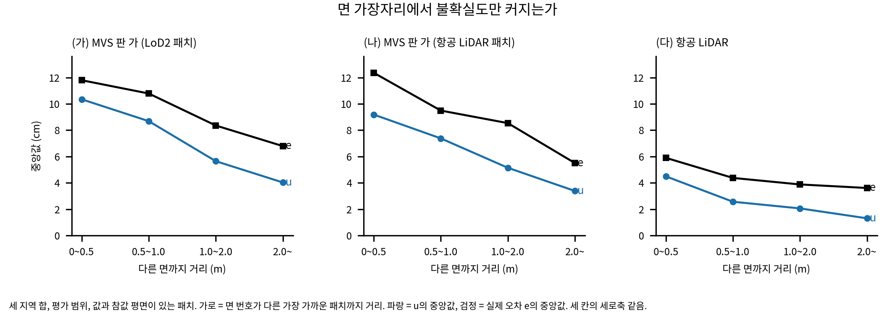

- 캡션 재료: 가로 = 다른 면 번호의 패치까지 거리 구간, 세로 = 중앙값(cm). 파랑 u, 검정 e. 세 지역 합

### 3.4 일 5: 누가 이끄는가, 무게 평균 미리 보기

**7.1 누가 이끄는가 (넓이 비율, 판 가; 모든 칸은 표 폴더).**

| 경우 | 칸 | 패치 | 무게 비율 중앙값 | MVS가 이끎 | 사전 정보만 | MVS만 | 둘 다 없음 |
|---|---:|---:|---:|---:|---:|---:|---:|
| B0 · LoD2 | 전체 | 82,117 | 0.94 | 86.7 % | 6.3 % | 0.0 % | 0.0 % |
| B0 · LoD2 | 다듬기 | 52,107 | 0.97 | 94.3 % | 1.6 % | 0.0 % | 0.0 % |
| B0 · LoD2 | 보정 · 1~4τ | 5,153 | 0.91 | 87.4 % | 0.3 % | 0.0 % | 0.0 % |
| B0 · LoD2 | 보정 · 4τ 넘음 | 1,187 | 0.97 | 91.2 % | 4.5 % | 0.0 % | 0.0 % |
| B0 · LoD2 | 보존 · 거름 | 992 | 0.94 | 83.7 % | 12.1 % | 0.0 % | 0.0 % |
| B0 · LoD2 | 보존 · 문턱 안 | 87 | 0.45 | 40.2 % | 34.5 % | 0.0 % | 0.0 % |
| B0 · LoD2 | 한계 | 3,368 | 0.86 | 80.6 % | 10.2 % | 0.0 % | 0.0 % |
| B0 · LoD2 | 상속 · 결측 | 1,069 | 0.96 | 94.6 % | 1.5 % | 0.0 % | 0.0 % |
| B0 · 항공 LiDAR | 전체 | 23,280 | 0.23 | 17.8 % | 0.1 % | 1.2 % | 0.2 % |
| B0 · 항공 LiDAR | 다듬기 | 21,847 | 0.23 | 16.8 % | 0.1 % | 0.4 % | 0.0 % |
| B0 · 항공 LiDAR | 보정 · 1~4τ | 37 | 0.16 | 29.0 % | 0.0 % | 0.0 % | 13.8 % |
| B0 · 항공 LiDAR | 보정 · 4τ 넘음 | 33 | 1.00 | 52.4 % | 0.0 % | 52.4 % | 0.0 % |
| B0 · 항공 LiDAR | 보존 · 거름 | 8 | 표본 부족 | 표본 부족 | 표본 부족 | 표본 부족 | 표본 부족 |
| B0 · 항공 LiDAR | 보존 · 문턱 안 | 276 | 0.11 | 22.1 % | 0.0 % | 3.1 % | 0.0 % |
| B0 · 항공 LiDAR | 한계 | 600 | 0.35 | 33.5 % | 0.0 % | 7.5 % | 1.2 % |
| B0 · 항공 LiDAR | 상속 · 결측 | 23 | 표본 부족 | 표본 부족 | 표본 부족 | 표본 부족 | 표본 부족 |
| B173 주변 · LoD2 | 전체 | 141,534 | 0.73 | 57.2 % | 33.6 % | 0.0 % | 0.0 % |
| B173 주변 · LoD2 | 다듬기 | 31,980 | 0.96 | 86.8 % | 8.2 % | 0.0 % | 0.0 % |
| B173 주변 · LoD2 | 보정 · 1~4τ | 5,208 | 0.80 | 73.0 % | 8.1 % | 0.0 % | 0.0 % |
| B173 주변 · LoD2 | 보정 · 4τ 넘음 | 16,481 | 0.95 | 90.7 % | 0.8 % | 0.0 % | 0.0 % |
| B173 주변 · LoD2 | 보존 · 거름 | 259 | 0.92 | 81.5 % | 10.8 % | 0.0 % | 0.0 % |
| B173 주변 · LoD2 | 보존 · 문턱 안 | 472 | 0.73 | 72.9 % | 13.8 % | 0.0 % | 0.0 % |
| B173 주변 · LoD2 | 한계 | 2,221 | 0.63 | 61.9 % | 11.3 % | 0.0 % | 0.0 % |
| B173 주변 · LoD2 | 상속 · 결측 | 1,049 | 0.97 | 92.8 % | 4.1 % | 0.0 % | 0.0 % |
| B173 주변 · LoD2 | 상속 · 비가시 | 4 | 표본 부족 | 표본 부족 | 표본 부족 | 표본 부족 | 표본 부족 |
| B173 주변 · 항공 LiDAR | 전체 | 34,273 | 0.22 | 27.8 % | 1.0 % | 2.1 % | 0.3 % |
| B173 주변 · 항공 LiDAR | 다듬기 | 10,142 | 0.11 | 10.1 % | 0.2 % | 0.6 % | 0.1 % |
| B173 주변 · 항공 LiDAR | 보정 · 1~4τ | 108 | 0.59 | 53.0 % | 12.9 % | 5.4 % | 1.9 % |
| B173 주변 · 항공 LiDAR | 보정 · 4τ 넘음 | 15,167 | 0.35 | 36.7 % | 1.0 % | 0.2 % | 0.1 % |
| B173 주변 · 항공 LiDAR | 보존 · 거름 | 16 | 표본 부족 | 표본 부족 | 표본 부족 | 표본 부족 | 표본 부족 |
| B173 주변 · 항공 LiDAR | 보존 · 문턱 안 | 1,419 | 0.30 | 28.5 % | 0.9 % | 4.4 % | 0.1 % |
| B173 주변 · 항공 LiDAR | 한계 | 696 | 0.14 | 29.4 % | 2.4 % | 14.0 % | 1.6 % |
| B173 주변 · 항공 LiDAR | 상속 · 결측 | 1 | 표본 부족 | 표본 부족 | 표본 부족 | 표본 부족 | 표본 부족 |
| B173 주변 · 항공 LiDAR | 상속 · 비가시 | 1 | 표본 부족 | 표본 부족 | 표본 부족 | 표본 부족 | 표본 부족 |
| R1 · LoD2 | 전체 | 79,054 | 0.76 | 62.7 % | 17.8 % | 0.0 % | 0.0 % |
| R1 · LoD2 | 다듬기 | 19,401 | 0.96 | 93.7 % | 1.2 % | 0.0 % | 0.0 % |
| R1 · LoD2 | 보정 · 1~4τ | 6,432 | 0.90 | 82.2 % | 4.9 % | 0.0 % | 0.0 % |
| R1 · LoD2 | 보정 · 4τ 넘음 | 4,141 | 0.66 | 58.9 % | 15.9 % | 0.0 % | 0.0 % |
| R1 · LoD2 | 보존 · 거름 | 74 | 0.44 | 40.5 % | 4.1 % | 0.0 % | 0.0 % |
| R1 · LoD2 | 보존 · 문턱 안 | 128 | 0.46 | 48.4 % | 19.5 % | 0.0 % | 0.0 % |
| R1 · LoD2 | 한계 | 6,320 | 0.55 | 55.0 % | 11.7 % | 0.0 % | 0.0 % |
| R1 · LoD2 | 상속 · 결측 | 130 | 0.24 | 23.8 % | 13.1 % | 0.0 % | 0.0 % |
| R1 · LoD2 | 상속 · 비가시 | 1 | 표본 부족 | 표본 부족 | 표본 부족 | 표본 부족 | 표본 부족 |
| R1 · 항공 LiDAR | 전체 | 24,189 | 0.08 | 9.9 % | 1.9 % | 1.6 % | 0.9 % |
| R1 · 항공 LiDAR | 다듬기 | 17,747 | 0.09 | 7.9 % | 0.3 % | 0.2 % | 0.1 % |
| R1 · 항공 LiDAR | 보정 · 1~4τ | 80 | 0.58 | 51.5 % | 9.2 % | 1.4 % | 9.9 % |
| R1 · 항공 LiDAR | 보정 · 4τ 넘음 | 90 | 0.03 | 19.7 % | 21.5 % | 9.8 % | 8.7 % |
| R1 · 항공 LiDAR | 보존 · 거름 | 120 | 0.07 | 5.9 % | 2.1 % | 0.7 % | 0.0 % |
| R1 · 항공 LiDAR | 보존 · 문턱 안 | 2,074 | 0.07 | 9.9 % | 2.9 % | 0.3 % | 0.4 % |
| R1 · 항공 LiDAR | 한계 | 2,390 | 0.02 | 11.2 % | 6.4 % | 4.1 % | 1.3 % |
| R1 · 항공 LiDAR | 상속 · 결측 | 23 | 표본 부족 | 표본 부족 | 표본 부족 | 표본 부족 | 표본 부족 |
| R1 · 항공 LiDAR | 상속 · 비가시 | 1 | 표본 부족 | 표본 부족 | 표본 부족 | 표본 부족 | 표본 부족 |

**7.2 무게 평균 미리 보기 — 학습 없음, 미리 보기 (자리의 오차 cm, 판 가).**

| 경우 | 칸 | 패치 | MVS만 | 20 cm 안 | 사전 정보만 | 20 cm 안 | 무게 평균 | 20 cm 안 | z 중앙값 | z > 2.5 |
|---|---:|---:|---:|---:|---:|---:|---:|---:|---:|---:|
| B0 · LoD2 | 전체 | 74,175 | 3.3 | 93.5 % | 17.3 | 60.0 % | 3.4 | 90.0 % | 0.83 | 5.9 % |
| B0 · LoD2 | 다듬기 | 51,609 | 3.0 | 97.4 % | 13.3 | 70.6 % | 2.9 | 96.6 % | 0.65 | 1.5 % |
| B0 · LoD2 | 보정 · 1~4τ | 5,140 | 4.0 | 89.2 % | 48.8 | 3.9 % | 6.0 | 70.5 % | 1.89 | 27.7 % |
| B0 · LoD2 | 보정 · 4τ 넘음 | 1,137 | 1.8 | 94.7 % | 120.4 | 8.9 % | 3.5 | 85.5 % | 5.92 | 92.1 % |
| B0 · LoD2 | 보존 · 거름 | 990 | 4.4 | 91.5 % | 22.5 | 13.7 % | 3.9 | 87.2 % | 1.24 | 4.0 % |
| B0 · LoD2 | 보존 · 문턱 안 | 56 | 13.0 | 66.1 % | 11.7 | 78.6 % | 12.6 | 67.9 % | 0.47 | 25.0 % |
| B0 · LoD2 | 한계 | 3,316 | 5.3 | 84.7 % | 10.5 | 85.0 % | 6.2 | 87.1 % | 0.36 | 6.1 % |
| B0 · LoD2 | 상속 · 결측 | 1,067 | 3.3 | 97.1 % | 22.0 | 19.2 % | 2.9 | 97.2 % | 1.17 | 0.4 % |
| B0 · 항공 LiDAR | 전체 | 23,191 | 2.2 | 99.3 % | 1.5 | 99.4 % | 1.4 | 99.4 % | 0.52 | 1.5 % |
| B0 · 항공 LiDAR | 다듬기 | 21,812 | 2.1 | 99.9 % | 1.4 | 99.9 % | 1.3 | 99.9 % | 0.51 | 1.1 % |
| B0 · 항공 LiDAR | 보정 · 1~4τ | 35 | 3.3 | 93.9 % | 5.7 | 94.3 % | 3.2 | 93.9 % | 0.69 | 6.1 % |
| B0 · 항공 LiDAR | 보정 · 4τ 넘음 | 33 | 5.4 | 81.8 % | 5.0 | 63.6 % | 13.2 | 54.5 % | 표본 부족 | 표본 부족 |
| B0 · 항공 LiDAR | 보존 · 거름 | 8 | 표본 부족 | 표본 부족 | 표본 부족 | 표본 부족 | 표본 부족 | 표본 부족 | 표본 부족 | 표본 부족 |
| B0 · 항공 LiDAR | 보존 · 문턱 안 | 276 | 8.0 | 94.2 % | 2.6 | 95.7 % | 2.4 | 96.0 % | 0.89 | 9.0 % |
| B0 · 항공 LiDAR | 한계 | 584 | 3.5 | 92.0 % | 2.7 | 98.1 % | 2.9 | 97.1 % | 0.53 | 2.8 % |
| B0 · 항공 LiDAR | 상속 · 결측 | 23 | 표본 부족 | 표본 부족 | 표본 부족 | 표본 부족 | 표본 부족 | 표본 부족 | 표본 부족 | 표본 부족 |
| B173 주변 · LoD2 | 전체 | 83,829 | 6.4 | 86.4 % | 16.1 | 52.4 % | 9.5 | 68.1 % | 0.39 | 32.3 % |
| B173 주변 · LoD2 | 다듬기 | 30,082 | 5.8 | 97.0 % | 3.9 | 93.6 % | 5.7 | 93.3 % | 0.16 | 4.1 % |
| B173 주변 · LoD2 | 보정 · 1~4τ | 4,845 | 10.3 | 91.5 % | 25.0 | 28.0 % | 13.7 | 76.7 % | 0.70 | 10.6 % |
| B173 주변 · LoD2 | 보정 · 4τ 넘음 | 16,435 | 5.3 | 90.1 % | 472.5 | 0.1 % | 23.8 | 44.0 % | 22.26 | 99.8 % |
| B173 주변 · LoD2 | 보존 · 거름 | 238 | 2.6 | 98.3 % | 2.8 | 79.8 % | 3.0 | 92.9 % | 0.15 | 13.5 % |
| B173 주변 · LoD2 | 보존 · 문턱 안 | 411 | 14.4 | 85.7 % | 11.1 | 75.2 % | 14.8 | 80.5 % | 0.40 | 21.0 % |
| B173 주변 · LoD2 | 한계 | 2,099 | 9.9 | 73.8 % | 28.3 | 48.6 % | 17.0 | 59.0 % | 3.98 | 50.4 % |
| B173 주변 · LoD2 | 상속 · 결측 | 1,012 | 3.2 | 99.6 % | 2.2 | 97.5 % | 3.1 | 99.0 % | 0.12 | 0.6 % |
| B173 주변 · 항공 LiDAR | 전체 | 33,866 | 7.4 | 87.3 % | 377.8 | 41.5 % | 82.9 | 42.8 % | 28.68 | 70.5 % |
| B173 주변 · 항공 LiDAR | 다듬기 | 10,126 | 7.5 | 99.7 % | 1.2 | 99.2 % | 1.0 | 99.3 % | 2.14 | 36.1 % |
| B173 주변 · 항공 LiDAR | 보정 · 1~4τ | 73 | 9.7 | 81.4 % | 49.9 | 9.6 % | 17.1 | 56.2 % | 2.10 | 43.8 % |
| B173 주변 · 항공 LiDAR | 보정 · 4τ 넘음 | 15,072 | 5.5 | 88.3 % | 484.6 | 0.0 % | 299.9 | 1.3 % | 68.37 | 100.0 % |
| B173 주변 · 항공 LiDAR | 보존 · 거름 | 16 | 표본 부족 | 표본 부족 | 표본 부족 | 표본 부족 | 표본 부족 | 표본 부족 | 표본 부족 | 표본 부족 |
| B173 주변 · 항공 LiDAR | 보존 · 문턱 안 | 1,405 | 13.9 | 88.6 % | 1.8 | 94.2 % | 5.1 | 94.9 % | 1.83 | 17.1 % |
| B173 주변 · 항공 LiDAR | 한계 | 676 | 32.2 | 31.7 % | 3.7 | 72.8 % | 6.2 | 68.5 % | 1.80 | 33.6 % |
| B173 주변 · 항공 LiDAR | 상속 · 결측 | 1 | 표본 부족 | 표본 부족 | 표본 부족 | 표본 부족 | 표본 부족 | 표본 부족 | 표본 부족 | 표본 부족 |
| R1 · LoD2 | 전체 | 60,681 | 5.6 | 78.3 % | 58.0 | 34.8 % | 9.5 | 60.7 % | 2.61 | 51.0 % |
| R1 · LoD2 | 다듬기 | 19,179 | 3.9 | 96.4 % | 12.8 | 59.1 % | 4.2 | 96.2 % | 0.66 | 9.2 % |
| R1 · LoD2 | 보정 · 1~4τ | 6,141 | 3.5 | 86.4 % | 108.0 | 0.3 % | 8.6 | 66.8 % | 4.80 | 95.4 % |
| R1 · LoD2 | 보정 · 4τ 넘음 | 3,814 | 6.6 | 74.6 % | 275.1 | 2.8 % | 91.4 | 29.9 % | 11.89 | 98.1 % |
| R1 · LoD2 | 보존 · 거름 | 74 | 76.3 | 19.7 % | 7.2 | 83.8 % | 22.0 | 47.3 % | 2.51 | 50.7 % |
| R1 · LoD2 | 보존 · 문턱 안 | 118 | 75.4 | 24.2 % | 58.5 | 10.2 % | 67.1 | 5.9 % | 3.16 | 56.6 % |
| R1 · LoD2 | 한계 | 5,965 | 12.5 | 57.4 % | 7.1 | 61.5 % | 37.6 | 46.0 % | 2.33 | 49.0 % |
| R1 · LoD2 | 상속 · 결측 | 130 | 19.1 | 52.2 % | 7.2 | 90.8 % | 7.2 | 76.9 % | 0.68 | 23.0 % |
| R1 · 항공 LiDAR | 전체 | 23,804 | 4.0 | 91.2 % | 4.6 | 95.7 % | 4.3 | 95.4 % | 0.71 | 9.8 % |
| R1 · 항공 LiDAR | 다듬기 | 17,708 | 3.3 | 99.6 % | 4.4 | 99.7 % | 4.1 | 99.8 % | 0.58 | 1.0 % |
| R1 · 항공 LiDAR | 보정 · 1~4τ | 70 | 6.0 | 88.7 % | 12.2 | 77.1 % | 4.7 | 89.4 % | 1.12 | 18.0 % |
| R1 · 항공 LiDAR | 보정 · 4τ 넘음 | 79 | 115.8 | 32.8 % | 11.0 | 60.8 % | 12.5 | 54.5 % | 6.84 | 76.4 % |
| R1 · 항공 LiDAR | 보존 · 거름 | 120 | 7.4 | 64.1 % | 3.4 | 93.3 % | 3.0 | 85.8 % | 1.60 | 40.5 % |
| R1 · 항공 LiDAR | 보존 · 문턱 안 | 2,052 | 10.9 | 96.1 % | 5.5 | 99.0 % | 5.9 | 98.7 % | 1.32 | 11.5 % |
| R1 · 항공 LiDAR | 한계 | 2,339 | 30.5 | 40.9 % | 5.4 | 81.0 % | 5.0 | 76.3 % | 6.67 | 59.7 % |
| R1 · 항공 LiDAR | 상속 · 결측 | 23 | 표본 부족 | 표본 부족 | 표본 부족 | 표본 부족 | 표본 부족 | 표본 부족 | 표본 부족 | 표본 부족 |

- 정성은 그림 E 단면의 보라 막대(무게 평균의 자리)로 보인다.

## 4. 자리마다의 값

| 자리 | 사전 정보 | 패치 | 넓이 m² | u_M | u_사전 | e_M | e_사전 | 무게 비율 | p_M | p_G | p_W | 참값 여러 층 | 판 나 u_M | 판 나 e_M |
|---|---:|---:|---:|---:|---:|---:|---:|---:|---:|---:|---:|---:|---:|---:|
| B173 날개 | LoD2 | 16,336 | 1021.0 | 4.3 | 20.0 | 6.7 | 473.3 | 0.96 | -470.7 | -473.3 | -422.4 | 6.5 % |  |  |
| B173 날개 | 항공 LiDAR | 14,515 | 964.3 | 4.5 | 3.3 | 7.0 | 455.4 | 0.34 | -478.9 | -480.8 | -158.9 | 7.3 % |  |  |
| B0 LoD2 보정 합 | LoD2 | 1,418 | 88.6 | 2.8 | 20.0 | 3.0 | 83.7 | 0.98 | -82.3 | -83.7 | -80.8 | 0.0 % |  |  |
| B0 LoD2 보정 합 | 항공 LiDAR | 53 | 3.6 | 4.3 | 1.3 | 4.0 | 1.7 | 0.09 | 1.6 | 0.3 | 0.1 | 3.8 % |  |  |
| B0 LoD2 보존 합 | LoD2 | 117 | 7.3 | 4.6 | 20.0 | 6.4 | 22.6 | 0.94 | -25.0 | -22.6 | -23.3 | 0.0 % |  |  |
| B0 LoD2 보존 합 | 항공 LiDAR | 0 | 0.0 | 표본 부족 | 표본 부족 | 표본 부족 | 표본 부족 | 표본 부족 | 표본 부족 | 표본 부족 | 표본 부족 | 표본 부족 |  |  |
| B173 주변 항공 LiDAR 보정 합 | LoD2 | 15,665 | 979.1 | 4.3 | 20.0 | 6.7 | 475.7 | 0.96 | -472.6 | -475.7 | -425.6 | 5.8 % |  |  |
| B173 주변 항공 LiDAR 보정 합 | 항공 LiDAR | 13,084 | 869.0 | 4.2 | 3.3 | 6.6 | 450.5 | 0.38 | -473.2 | -475.5 | -178.0 | 0.0 % |  |  |
| B173 주변 항공 LiDAR 보존 합 | LoD2 | 80 | 5.0 | 4.1 | 20.0 | 14.4 | 18.6 | 0.96 | -4.0 | -18.6 | -3.8 | 0.0 % |  |  |
| B173 주변 항공 LiDAR 보존 합 | 항공 LiDAR | 82 | 5.3 | 4.2 | 7.4 | 14.9 | 3.2 | 0.76 | 16.7 | 3.0 | 12.6 | 0.0 % |  |  |
| B173 주변 LoD2 보정 합 | LoD2 | 7,640 | 477.5 | 4.3 | 20.0 | 7.2 | 469.3 | 0.96 | -466.9 | -469.3 | -427.6 | 0.0 % |  |  |
| B173 주변 LoD2 보정 합 | 항공 LiDAR | 7,459 | 495.6 | 4.8 | 3.2 | 7.8 | 455.5 | 0.31 | -478.4 | -480.8 | -149.4 | 6.6 % |  |  |
| B173 주변 LoD2 보존 합 | LoD2 | 48 | 3.0 | 6.2 | 20.0 | 17.5 | 12.2 | 0.91 | -4.7 | 12.2 | -4.2 | 0.0 % |  |  |
| B173 주변 LoD2 보존 합 | 항공 LiDAR | 52 | 3.9 | 5.0 | 4.2 | 17.3 | 1.9 | 0.37 | -16.2 | 0.9 | -6.0 | 1.9 % |  |  |
| R1 항공 LiDAR 보존 합 | LoD2 | 583 | 36.4 | 3.0 | 20.0 | 12.6 | 3.0 | 0.98 | -10.0 | 2.2 | -9.8 | 0.0 % |  |  |
| R1 항공 LiDAR 보존 합 | 항공 LiDAR | 516 | 32.5 | 3.0 | 1.0 | 12.8 | 5.7 | 0.10 | -6.2 | 5.7 | -0.6 | 0.0 % |  |  |
| R1 LoD2 보정 합 | LoD2 | 2,751 | 171.9 | 3.5 | 20.0 | 4.7 | 101.8 | 0.97 | 99.2 | 101.8 | 92.2 | 0.0 % |  |  |
| R1 LoD2 보정 합 | 항공 LiDAR | 6 | 0.4 | 표본 부족 | 표본 부족 | 표본 부족 | 표본 부족 | 표본 부족 | 표본 부족 | 표본 부족 | 표본 부족 | 표본 부족 |  |  |
| R1 LoD2 보존 합 | LoD2 | 62 | 3.9 | 17.6 | 20.0 | 181.0 | 57.0 | 0.49 | 125.4 | -57.0 | 38.7 | 0.0 % |  |  |
| R1 LoD2 보존 합 | 항공 LiDAR | 0 | 0.0 | 표본 부족 | 표본 부족 | 표본 부족 | 표본 부족 | 표본 부족 | 표본 부족 | 표본 부족 | 표본 부족 | 표본 부족 |  |  |
| 평평한 지붕 | LoD2 | 6,200 | 387.5 | 3.2 | 20.0 | 8.4 | 10.0 | 0.97 | -2.6 | -10.0 | -2.5 | 0.0 % |  |  |
| 평평한 지붕 | 항공 LiDAR | 5,696 | 357.6 | 3.2 | 1.0 | 8.3 | 1.6 | 0.10 | 8.7 | 1.2 | 0.8 | 0.0 % |  |  |
| 유리 둥근 지붕 | LoD2 | 80 | 5.0 | 4.7 | 20.0 | 16.6 | 16.3 | 0.95 | 0.2 | 16.3 | 0.2 | 61.3 % | 7.1 | 17.2 |
| 유리 둥근 지붕 | 항공 LiDAR | 66 | 4.5 | 5.1 | 3.2 | 17.7 | 2.5 | 0.22 | -14.7 | 2.0 | -3.2 | 0.0 % | 8.2 | 18.3 |
| 유리 띠 | LoD2 | 161 | 10.1 | 4.1 | 20.0 | 6.3 | 334.8 | 0.96 | 334.8 | 334.8 | 326.6 | 75.8 % | 5.1 | 7.4 |
| 유리 띠 | 항공 LiDAR | 181 | 14.5 | 23.9 | 5.3 | 33.7 | 3.7 | 0.10 | -6.7 | 4.3 | -0.0 | 20.4 % | 36.4 | 50.3 |
| R1 계단 지붕 | LoD2 | 2,621 | 163.8 | 3.4 | 20.0 | 4.5 | 100.9 | 0.97 | 98.4 | 100.9 | 91.2 | 2.7 % |  |  |
| R1 계단 지붕 | 항공 LiDAR | 0 | 0.0 | 표본 부족 | 표본 부족 | 표본 부족 | 표본 부족 | 표본 부족 | 표본 부족 | 표본 부족 | 표본 부족 | 표본 부족 |  |  |

맞춰 볼 값:

| 자리 | 값 | 이 셈 대 기록 (cm) | 비고 |
|---|---:|---:|---:|
| 평평한 지붕 | MVS − 참값 | 7.6 대 기록 7.6 | 기록의 셈은 참값 점마다, 여기는 패치 중앙값 |
| 평평한 지붕 | 사전 정보 − 참값 | -1.2 대 기록 -1.4 |  |
| 평평한 지붕 | 항공 LiDAR 평면 맞춤 흔들림 | u_A 중앙값 1.0 대 기록 2.86 | 정의가 다름(기록 = 고친 판 시험 일 1의 평면 맞춤 흔들림) |
| 유리 둥근 지붕 | MVS − 참값 | -16.7 대 기록 -17.8 | 기록의 셈은 참값 점마다, 여기는 패치 중앙값 |
| 유리 둥근 지붕 | 사전 정보 − 참값 | -2.0 대 기록 -2.4 | 기록 '참값에서 사전 정보'를 사전 정보 − 참값으로 읽음 |
| 유리 띠 | MVS − 참값 중앙값 | -20.5 대 기록 -41.7 ! 어긋남 | 기록 = 참값 점마다의 MVS 깊이 − 참값(실제 사진 그림 1), 여기 = 패치마다 p_M − p_G의 중앙값 |
| 유리 띠 | MVS − 참값 NMAD | 35.5 대 기록 54.8 | 같은 차이 |
| 유리 띠 | 마스크 통과 | 판 가 점 ÷ 판 나 점 96.9 % 대 기록 90.1 % | 정의가 다름: 기록 = 화소의 마스크 통과율, 여기 = 자리 패치 안쪽 원 점(솎기 전) 수의 비율(판 가 점이 판 나 점의 부분 집합인지는 보지 않음) |

R1 고르게 낮은 평지붕: 확인 불가(앞 작업에 R1 상자의 그런 자리가 없음).

- 자리 패치 수가 0인 줄(R1 계단 지붕의 항공 LiDAR 쪽 등)은 다른 사전 정보의 패치가 0.25 m 안에 없는 경우다.

## 5. 바꾼 것, 확인 불가, 결과를 본 뒤 더한 것

- **2.8 멈춤 → 사용자 결정 '그대로 진행'.** 영상 사이 벌어짐(18~77 cm)으로 멈춤 조건이 걸렸고 확인 뒤 여쭈었다(2절). 답을 기다리는 동안 1.5 m 셈을 미리 돌렸고(01:54~02:32), 답에 따라 그대로 썼다.
- **'지지 약함'.** 발주 글 그대로(고른 평면의 잔차)는 만들어지는 꼴상 늘 0이라, 다시 맞춘 최소 제곱 평면의 잔차로 센 비율을 옆 열과 6.5에 함께 냈다(셈 전 잠근 설정에 적음).
- **정의 세부(셈 전 잠금).** 층은 양 끝 포함, '여러 층' = 20 % 넘는 층이 끊겨 두 묶음 이상, 사분면 = n에 수직인 두 축의 부호, 점 부족 = 솎기 전 수, MVS 영상 수 = 솎기 전 안쪽 원 점. q = numpy quantile 선형 보간.
- **셈의 세부(결과 같음).** 최소 중앙 제곱의 가장 작은 중앙값 찾기를 가지치기로 빠르게 함(모의 300벌에서 원래 셈과 같음). MVS 솎기는 열쇠 차례 저장으로 정확히 같은 2,000·8,000점. 고리 점은 열쇠 앞부분(4^-k)에서 찾되 8,000점이 안 되면 더 촘촘한 부분으로.
- **그리는 법만 바꿈.** 그림 E 단면은 자리의 가장 큰 덩어리의 긴 축으로 자름(유리 띠는 떨어진 채광창 여러 개). 확대 지도는 0.05 m 화소에 패치마다 9 × 9 점. 단면의 사전 정보 선은 단면선 0.125 m 안 패치만.
- **확인 불가.** R1 고르게 낮은 평지붕: 앞 작업에 R1 상자의 그런 자리가 없다(기록된 20~30 cm 평지붕은 탐색 지역 R4·R3E, 빈칸 채우기 준비 보고는 R1 상자에 없다고 적음). 유리 띠의 '마스크 통과 90.1 %'는 화소 단위 값이라 이 셈(패치)과 정의가 다르다. 참고로 자리 패치 안쪽 원 점 수의 비율(판 가 ÷ 판 나)을 4절에 적었다.
- **자리.** R1 계단 지붕은 0.25 m 안 항공 LiDAR 패치가 없다. 지역마다 고른 자리는 B0 항공 LiDAR(보정 합, 보존 합), R1 항공 LiDAR(보정 합)에서 2.5 m² 넘는 한 층 덩어리가 없어 '없음'.
- **처음 보는 사람 점검(8.7).** 제목을 자른 그림 13장(그림 꼴마다 하나)을 하위 에이전트 한 번에 보였다. 13장 모두에서 짐작한 물음이 설정의 제목과 같거나 가까웠다(PH/main_uncert_v1/PHD-MAIN-UNCERT-v1/work/blind/answers_round1.md). 지적에 따라 그리는 법만 고쳤다: 색 막대 이름에 빗금·흰색·검은 테두리의 뜻, 비스듬한 그림은 패치마다 9 × 9 점, 자리 이름 표지를 칸 안으로, 그림 E 단면의 세로 범위를 그 자리 구간의 참값·자리 사전 정보·안쪽 원 점으로, 그림 E (다)의 설명을 칸 제목으로, F-가의 마지막 띠는 100 cm까지, F-나 칸 제목을 줄이고 수는 아래 줄로, F-다·F-라·F-마 아래 줄에 기준과 뜻, F-마 세 칸의 세로축을 같게. F-바의 두 칸이 비슷해 보인다는 지적은 발주의 꼴(칸 둘, 같은 색 범위) 그대로 두었다. 2회차 점검은 아래 줄.
- **점검 2회차.** 6장 모두 물음을 맞게 짐작했다(E 유리 둥근 지붕: u가 실제 오차를 덜 잡고 무게 평균이 참값 가까이; E 평평한 지붕: 두 u가 작고 사전 정보가 이끎; A-비스듬 R1: 항공 LiDAR가 가장 작고 벽은 거의 비며 MVS는 벽과 모서리에서 큼; F-나: u는 0.77로 흩어짐·q와 같고 어긋남보다 나음; B: 항공 LiDAR와는 사전 정보 쪽, LoD2와는 MVS 쪽; F-마: 경계 가까이에서 u와 e가 함께 커짐). 남은 지적(그리는 법은 더 바꾸지 않음, 한 눈에 볼 것을 가리지 않음): 그림 E마다 세로 배율이 다름(평평한 지붕 ×17.9, 유리 ×2.8), 약자(u_M, p_G, 판 나)와 칸 이름은 그림 밖 캡션에서 설명, F-나 세 곡선 겹침, 자리 이름 표지 겹침.
- **결과를 본 뒤 더함.** 없음(표와 그림의 꼴은 모두 설정과 발주에서 정함). 그림 배치(여백, 색 막대 자리)만 첫 그림을 보고 고쳤다.

## 6. 걸린 시간과 자원

| 단계 | 초(성공한 실행의 합) |
|---|---:|
| MVS 점 만들기(여섯 판) | 326 |
| 항공 LiDAR·참값 점 | 36 |
| 패치 표 | 32 |
| 참값 평면(여섯 묶음) | 83 |
| 2.8 점검과 진단 | 87 |
| 자리 풀기 | 3 |
| 고리 1.5 m 셈(15단계) | 2307 |
| 고리 1.0·3.0 m 셈(15단계, 두 크기 함께) | 4489 |
| 값 모으기 | 90 |
| 표 | 70 |
| 그림(다시 그린 것 포함) | 650 |

지역마다(셈 단계의 트리 만들기와 패치 셈, 세 고리 크기와 참값 평면의 합):

| 지역 | 초 | MVS 판 가 점 | MVS 판 나 점 | 항공 LiDAR 점 | 참값 점 |
|---|---:|---:|---:|---:|---:|
| B0 | 2,467 | 23,393,919 | 26,438,128 | 90,938 | 9,661,639 |
| B173 주변 | 2,599 | 18,985,897 | 21,781,936 | 114,972 | 9,786,075 |
| R1 | 1,991 | 21,658,682 | 26,629,217 | 94,905 | 6,533,709 |

- 셈은 CPU 48개(nice 19), 메모리 40 GB 상한의 컨테이너(jointbuildgs:dev, MVS 점은 jointbuildgs:geogs-conf-guided-v1). GPU와 학습 없음. 점 파일 약 3.5 GB(지역마다 MVS 1,900만~2,700만 점 두 판, 참값 650만~980만 점), 패치마다 값 약 0.46 GB.
- 사용자 답을 기다린 시간(01:5x~09:31)은 위 합에 들지 않는다.

## 7. 검토 기록에 붙일 요약

- 세 자료의 불확실도를 같은 꼴(고리 평면에서 안쪽 원 점까지 거리의 어긋남·흩어짐)로 구했다. 고리 크기는 띠 패치로 골랐다(지역마다 고른 크기: B0 1 m, B173 주변 1.5 m, R1 1.5 m).
- 물음 1(MVS 불확실도가 실제 오차를 따라감): 그렇다 · 확인. 물음 2(항공 LiDAR): 그렇다 · 가능·근거 불완전. 물음 3(영상이 틀린 패치를 잡음): 그렇다 · 확인.
- 물음 4(바뀐 곳의 MVS u가 다듬기만큼 작음): 섞임. 물음 5(LoD2 20 cm): 아니다 · 확인.
- 물음 9(지금 식과 68.3 % 값): 68.3 % 값 · 가능·근거 불완전.
- 놓친 패치(e > 20 cm, e > 2u)와 가장자리, 무게 평균 미리 보기는 6.5, 7.2의 값으로 답했다.
- 2.8 멈춤 조건(영상 사이 벌어짐)이 걸려 확인 뒤 여쭈었고, 사용자 결정으로 그대로 진행했다.
- 학습·GPU 없음. 설정은 첫 셈 전에 잠갔고, 자리는 불확실도 셈 전에 둘째 잠금.
