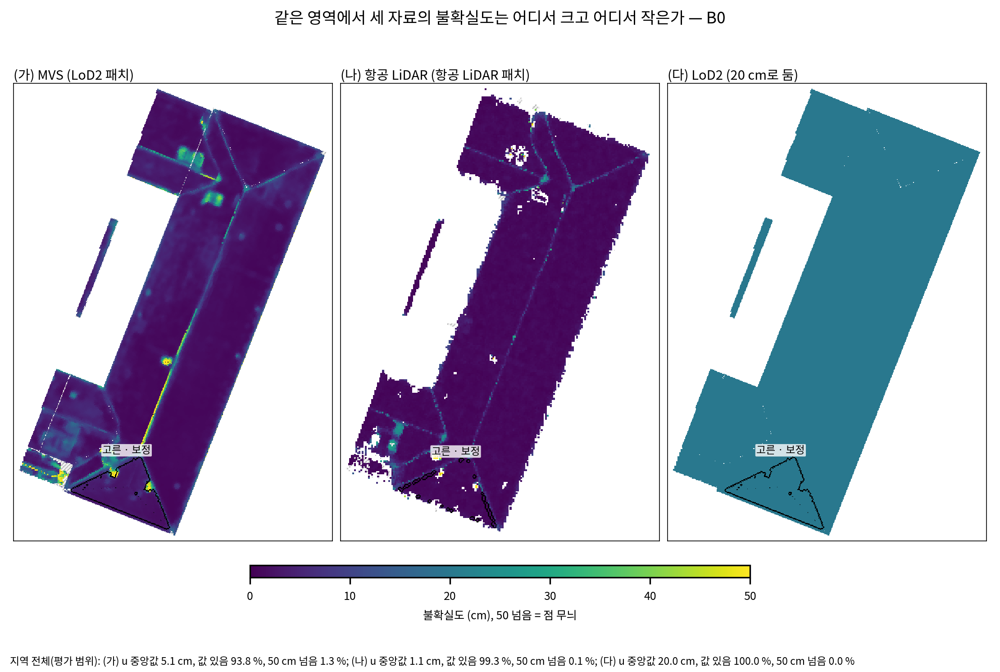
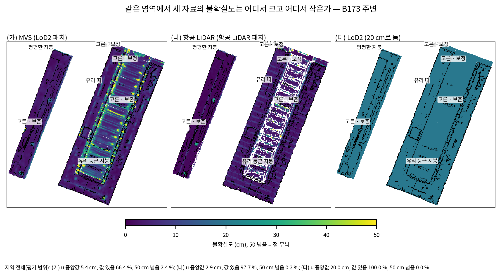
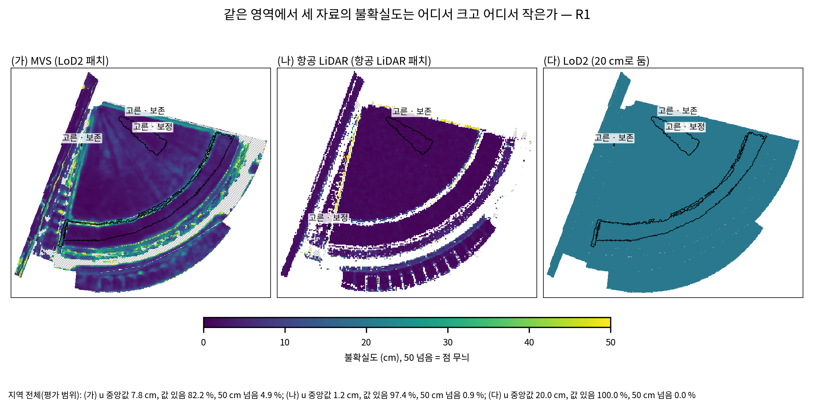
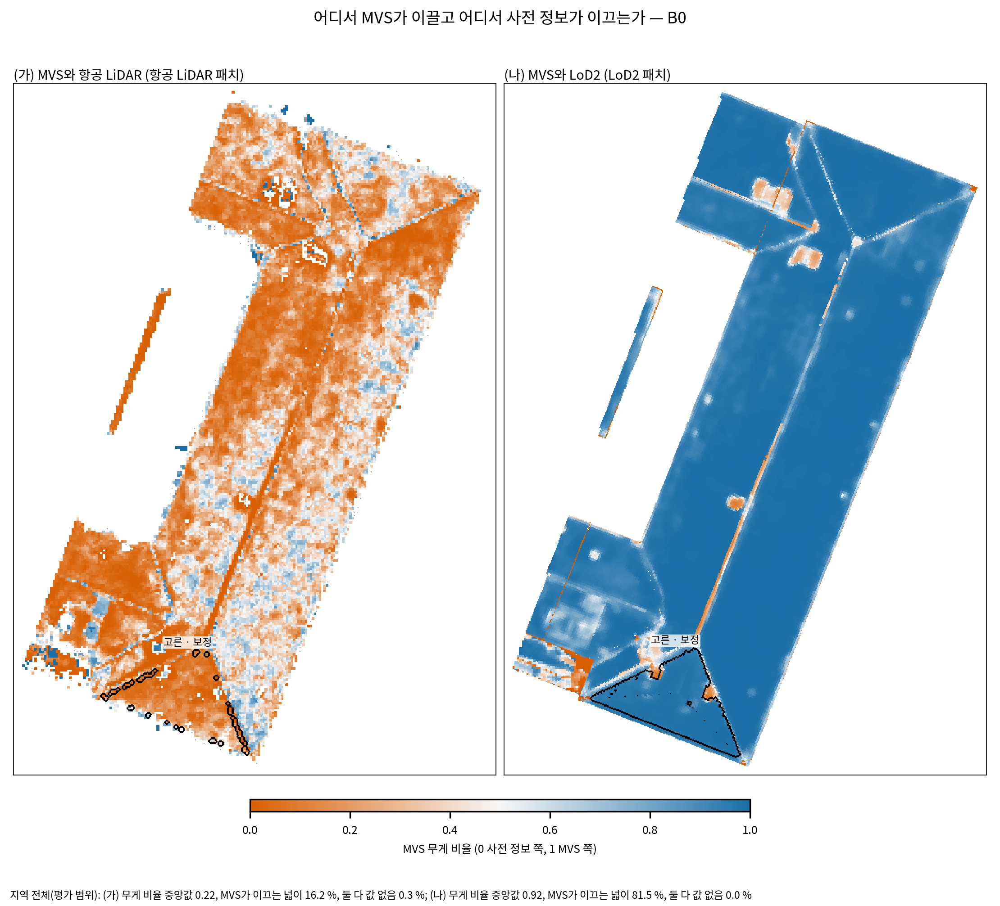
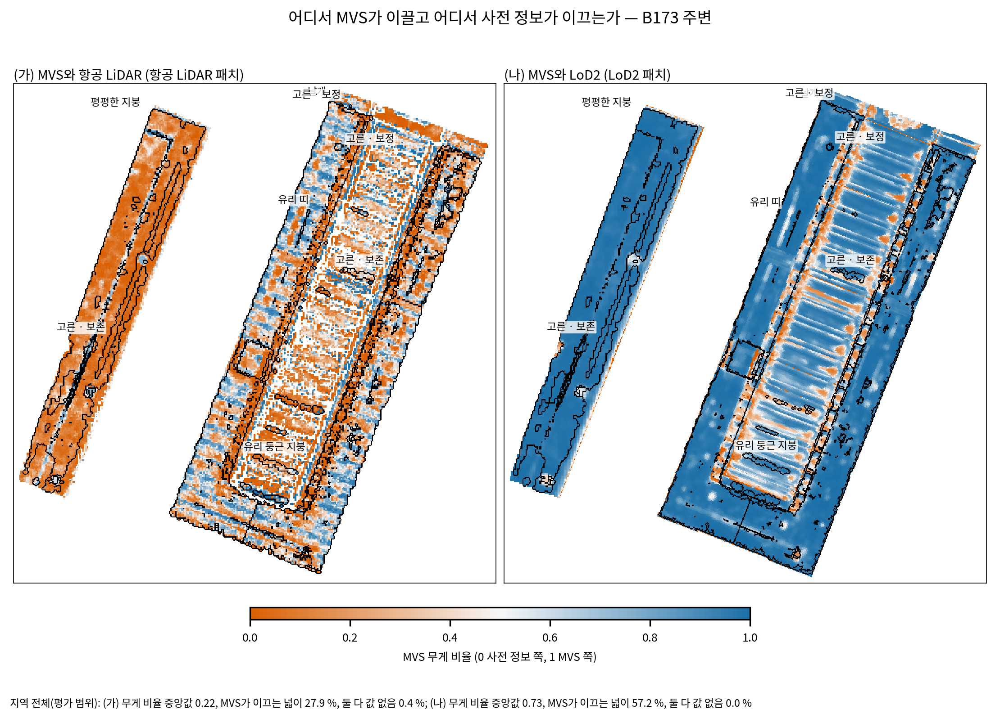
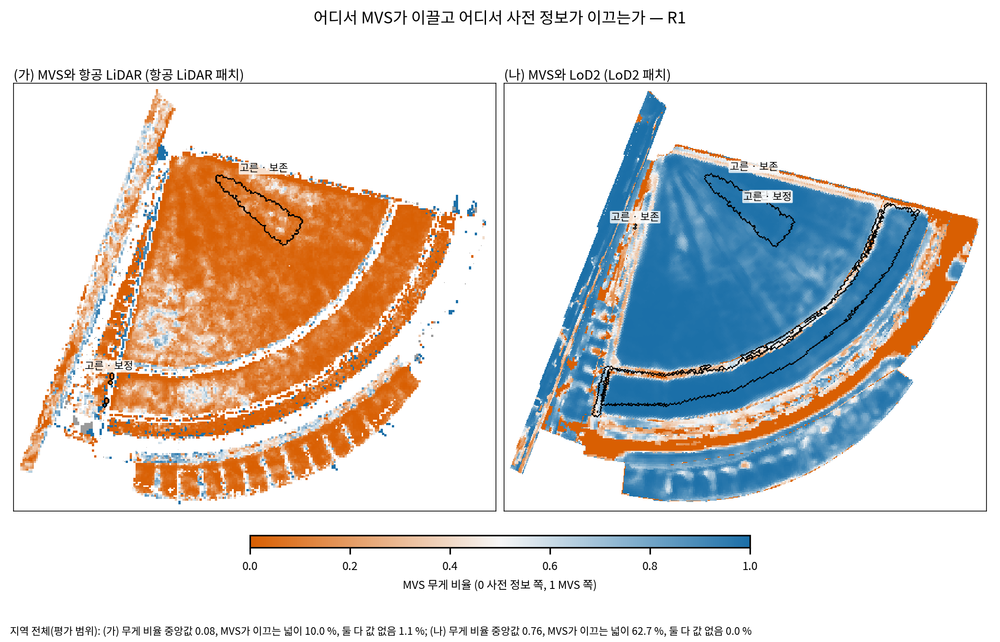
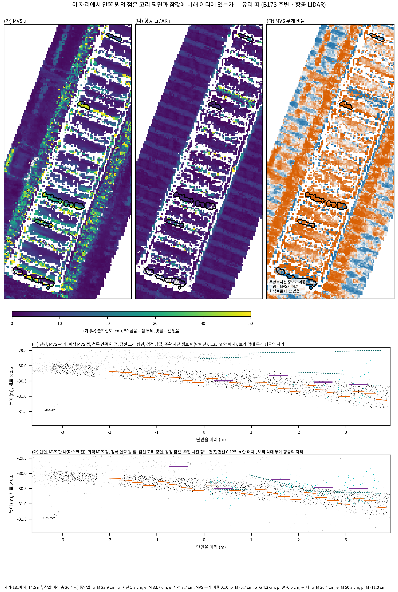
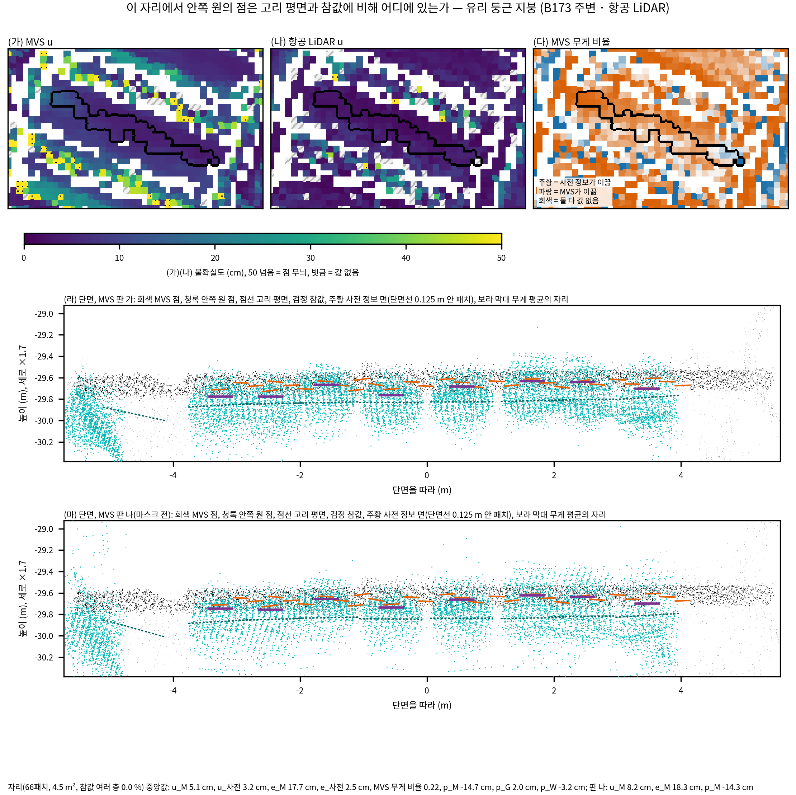

# 불확실도 지도 — 중간 보고 (고리 1.5 m)

- 작업: PHD-MAIN-UNCERT-v1 · 발주문 v2(2026-10-23) · 학습 없음 · GPU 없음 · 브랜치 `exp/main-experiment`
- 쓴 때: 2026-10-23 09:46:50 KST · 설정 잠금 `configs/phd/main_uncert_v1/uncert_v1.lock.json`(sha256 4044e9b8…, 01:41), 자리 둘째 잠금 `places_v1.lock.json`(01:54)
- scientific_verdict: null

## 1. 물음과 답 (고리 1.5 m, 세 지역 합)

| 물음 | 답 | 볼 값 |
|---|---:|---:|
| 1. MVS 불확실도가 실제 오차를 따라가는가 (판 가) | 그렇다 · 확인 | LoD2 패치 ρ 0.75, 커지지 않는 구간 0, 항공 LiDAR 패치 ρ 0.76, 커지지 않는 구간 0 |
| 2. 항공 LiDAR 불확실도가 실제 오차를 따라가는가 | 그렇다 · 가능·근거 불완전 | 항공 LiDAR 패치 ρ 0.55, 커지지 않는 구간 3 |
| 3. MVS 불확실도가 영상이 틀린 패치를 잡는가 (판 가) | 그렇다 · 확인 | LoD2 AUC 0.76(양성 21,166, 음성 136,290), 항공 LiDAR AUC 0.77(양성 10,805, 음성 64,809) |
| 6. 놓친 곳은 얼마나 넓은가 | 값으로 답함 | LoD2 패치의 MVS 판 가 8.6 %(17,842패치, 1115 m²); LoD2 패치의 MVS 판 나 6.6 %(13,451패치, 841 m²); 항공 LiDAR 패치의 MVS 판 가 4.5 %(3,617패치, 243 m²); 항공 LiDAR 패치의 MVS 판 나 2.4 %(1,892패치, 129 m²); 항공 LiDAR 패치의 항공 LiDAR 25.1 %(19,999패치, 1334 m²) |

- 등급은 발주 10절의 기준을 두 패치 묶음(세 지역 합)에 그대로 적용했다. 경우마다의 값은 아래 표와 `tables/R1.5/`에 있다.
- 물음 1과 2의 ρ는 u와 e의 스피어만 순위 상관, '커지지 않는 구간'은 패치 100개 이상인 u 구간에서 e 중앙값이 앞 구간보다 커지지 않은 횟수다.

## 2. 어디까지 왔나

- 끝: 일 1(자료 준비, 맞춰 보기, 설정과 자리 잠금), 일 2의 고리 1.5 m(세 지역, 패치 묶음 둘, MVS 판 가·판 나, 항공 LiDAR, 참값 평면), 이 보고의 표와 그림.
- 도는 중: 고리 1.0 m와 3.0 m(한 번에 두 크기, 09:32 시작). 1.5 m 한 바퀴가 38분이었으므로 끝은 10시 40분 무렵으로 본다.
- 다음: 고리 크기 고르기(1.7, 띠 패치), 고른 크기로 일 3~5의 표와 그림 모두, 최종 보고서. 최종 보고는 13시 무렵으로 본다.

## 3. 일 1 요약

- MVS 점: 학습 영상(B0 243장 등) 깊이 지도의 화소마다 한 점, 합치지 않음. 판 가 = 관측 신뢰도 마스크를 통과한 깊이(마스크 = 깊이가 있는 화소와 같음), 판 나 = 마스크 전 광도 단계 깊이. 깊이는 광축 방향 깊이이고, 사전 정보 렌더 깊이를 같은 식으로 풀면 LoD2 면에서 0.03 mm 안에 놓였다(광선 거리로 읽으면 15~40 cm 벗어남).
- 원래 항공 LiDAR 점: P0의 LAZ 타일 넷, 분류 2와 6, 정합 이동은 영역 파일과 같다. 원래 점의 자리 p_A는 사전 정보 면에서 중앙값 0.0 cm, NMAD 0.1 cm 안이다(TIN이 그 점을 지남).
- 칸: 여섯 경우 모두 두 축 평가가 저장한 칸과 패치마다 같다. τ는 표 A와 같다. LoD2 벽 법선은 B173 주변 면 132(13패치)만 안쪽을 가리켜 뒤집었다.
- 2.8 멈춤: 항공 LiDAR 경우 다듬기 패치의 p_M 중앙값은 B0 1.1, B173 주변 8.1, R1 1.7 cm로 기준 안이었다. 영상 하나의 점으로 구한 값은 영상 사이에서 18.1, 18.7, 76.5 cm 벌어져 멈춤 조건이 걸렸다. 같은 패치에서 짝지은 차의 크기는 중앙값 1.7, 2.0, 1.3 cm이고, 벗어난 영상(B0 4장, B173 주변 6장, R1 25장)은 R1에서 지붕을 멀리서 스치듯 본 비스듬한 영상이다. 확인 내용을 적어 여쭈었고, 사용자 결정(10월 23일 09:31)으로 '그대로 진행'했다.
- 표: [tables/u1_found.md](tables/u1_found.md), [tables/u1_checks.md](tables/u1_checks.md).

## 4. 표 1. 값이 있는 비율 (평가 범위, 모든 면)

| 경우 | 자료 | 패치 | 값 있음 | 면 없음 | 점 부족 | 한쪽 고리* | 지지 약함(다시 맞춘 평면)* |
|---|---:|---:|---:|---:|---:|---:|---:|
| B0 · LoD2 | MVS 판 가 | 82,117 | 93.8 % | 5.7 % | 0.5 % | 0.2 % | 0.0 % |
| B0 · LoD2 | MVS 판 나 | 82,117 | 95.4 % | 4.1 % | 0.6 % | 0.0 % | 0.0 % |
| B0 · 항공 LiDAR | MVS 판 가 | 23,280 | 99.6 % | 0.1 % | 0.0 % | 0.0 % | 0.0 % |
| B0 · 항공 LiDAR | MVS 판 나 | 23,280 | 99.5 % | 0.2 % | 0.0 % | 0.0 % | 0.0 % |
| B0 · 항공 LiDAR | 항공 LiDAR | 23,280 | 99.3 % | 0.0 % | 0.4 % | 0.0 % | 0.0 % |
| B173 주변 · LoD2 | MVS 판 가 | 141,534 | 66.4 % | 31.5 % | 2.1 % | 2.5 % | 0.0 % |
| B173 주변 · LoD2 | MVS 판 나 | 141,534 | 73.1 % | 18.5 % | 8.4 % | 0.6 % | 0.0 % |
| B173 주변 · 항공 LiDAR | MVS 판 가 | 34,273 | 98.8 % | 1.1 % | 0.0 % | 0.1 % | 0.0 % |
| B173 주변 · 항공 LiDAR | MVS 판 나 | 34,273 | 97.2 % | 2.6 % | 0.1 % | 0.0 % | 0.0 % |
| B173 주변 · 항공 LiDAR | 항공 LiDAR | 34,273 | 97.7 % | 0.1 % | 1.9 % | 0.2 % | 0.0 % |
| R1 · LoD2 | MVS 판 가 | 79,054 | 82.2 % | 16.2 % | 1.5 % | 1.0 % | 0.0 % |
| R1 · LoD2 | MVS 판 나 | 79,054 | 81.0 % | 17.1 % | 1.9 % | 0.1 % | 0.0 % |
| R1 · 항공 LiDAR | MVS 판 가 | 24,189 | 97.1 % | 2.2 % | 0.1 % | 0.0 % | 0.0 % |
| R1 · 항공 LiDAR | MVS 판 나 | 24,189 | 92.6 % | 6.8 % | 0.0 % | 0.0 % | 0.0 % |
| R1 · 항공 LiDAR | 항공 LiDAR | 24,189 | 97.4 % | 0.4 % | 1.7 % | 0.1 % | 0.0 % |

- \* 값이 있는 패치 가운데. 발주 글 그대로의 '지지 약함'(고른 평면의 잔차)은 만들어지는 꼴상 늘 0이라 다시 맞춘 평면의 잔차로 센 비율을 함께 적었다. 지붕꼴·벽꼴과 칸마다는 [tables/R1.5/t1_value_share.md](tables/R1.5/t1_value_share.md).

## 5. 6.1 불확실도 구간별 실제 오차 (세 지역 합, cm)

| 패치 묶음 | 자료 | u 구간 | 패치 | 넓이 m² | e 중앙값 | e 25 % | e 75 % | e 90 % |
|---|---:|---:|---:|---:|---:|---:|---:|---:|
| LoD2 패치 | MVS 판 가 | 0~2 | 23,364 | 1460.2 | 3.2 | 2.2 | 4.0 | 5.9 |
| LoD2 패치 | MVS 판 가 | 2~5 | 73,822 | 4613.9 | 5.0 | 3.5 | 7.7 | 11.1 |
| LoD2 패치 | MVS 판 가 | 5~10 | 45,730 | 2858.1 | 8.7 | 6.5 | 12.2 | 19.0 |
| LoD2 패치 | MVS 판 가 | 10~20 | 34,411 | 2150.7 | 14.9 | 10.6 | 22.3 | 47.9 |
| LoD2 패치 | MVS 판 가 | 20~40 | 22,943 | 1433.9 | 25.3 | 15.2 | 41.0 | 142.1 |
| LoD2 패치 | MVS 판 가 | 40 넘음 | 7,570 | 473.1 | 37.2 | 16.1 | 69.0 | 152.4 |
| 항공 LiDAR 패치 | MVS 판 가 | 0~2 | 15,078 | 1013.2 | 3.1 | 2.2 | 3.8 | 4.7 |
| 항공 LiDAR 패치 | MVS 판 가 | 2~5 | 35,399 | 2352.7 | 5.0 | 3.5 | 8.0 | 10.3 |
| 항공 LiDAR 패치 | MVS 판 가 | 5~10 | 17,237 | 1162.5 | 8.9 | 6.5 | 11.9 | 15.7 |
| 항공 LiDAR 패치 | MVS 판 가 | 10~20 | 7,012 | 482.8 | 16.0 | 11.4 | 23.8 | 52.7 |
| 항공 LiDAR 패치 | MVS 판 가 | 20~40 | 4,198 | 285.0 | 34.6 | 21.3 | 67.6 | 288.4 |
| 항공 LiDAR 패치 | MVS 판 가 | 40 넘음 | 1,261 | 86.4 | 62.9 | 38.3 | 104.7 | 276.7 |
| 항공 LiDAR 패치 | 항공 LiDAR | 0~2 | 48,276 | 3180.8 | 2.7 | 1.4 | 4.5 | 5.6 |
| 항공 LiDAR 패치 | 항공 LiDAR | 2~5 | 19,533 | 1330.8 | 361.0 | 3.6 | 479.2 | 641.6 |
| 항공 LiDAR 패치 | 항공 LiDAR | 5~10 | 9,027 | 623.7 | 359.2 | 5.3 | 491.9 | 661.1 |
| 항공 LiDAR 패치 | 항공 LiDAR | 10~20 | 1,791 | 132.9 | 10.0 | 5.1 | 522.7 | 562.0 |
| 항공 LiDAR 패치 | 항공 LiDAR | 20~40 | 753 | 56.0 | 13.3 | 4.0 | 182.2 | 552.4 |
| 항공 LiDAR 패치 | 항공 LiDAR | 40 넘음 | 337 | 23.8 | 6.3 | 4.7 | 15.1 | 39.9 |
| LoD2 패치 | MVS 판 나 | 0~2 | 8,378 | 523.6 | 3.2 | 2.4 | 3.7 | 4.2 |
| LoD2 패치 | MVS 판 나 | 2~5 | 50,120 | 3132.5 | 4.6 | 3.7 | 6.3 | 9.1 |
| LoD2 패치 | MVS 판 나 | 5~10 | 61,684 | 3855.2 | 8.3 | 6.6 | 10.4 | 13.9 |
| LoD2 패치 | MVS 판 나 | 10~20 | 41,370 | 2585.6 | 14.8 | 11.5 | 19.4 | 28.8 |
| LoD2 패치 | MVS 판 나 | 20~40 | 33,988 | 2124.2 | 27.0 | 19.8 | 38.5 | 111.7 |
| LoD2 패치 | MVS 판 나 | 40 넘음 | 7,879 | 492.4 | 44.2 | 24.4 | 68.6 | 126.2 |
| 항공 LiDAR 패치 | MVS 판 나 | 0~2 | 5,974 | 406.6 | 3.3 | 2.7 | 3.8 | 4.1 |
| 항공 LiDAR 패치 | MVS 판 나 | 2~5 | 24,792 | 1661.4 | 4.5 | 3.7 | 5.8 | 8.8 |
| 항공 LiDAR 패치 | MVS 판 나 | 5~10 | 30,277 | 2001.1 | 8.3 | 6.5 | 10.1 | 12.6 |
| 항공 LiDAR 패치 | MVS 판 나 | 10~20 | 10,349 | 713.7 | 13.9 | 11.2 | 18.1 | 23.9 |
| 항공 LiDAR 패치 | MVS 판 나 | 20~40 | 5,698 | 389.6 | 31.0 | 22.1 | 46.3 | 162.9 |
| 항공 LiDAR 패치 | MVS 판 나 | 40 넘음 | 1,474 | 102.7 | 58.2 | 39.4 | 74.1 | 114.9 |

순위 상관(경우마다):

| 단위 | 자료 | 패치 | ρ(u, e) 전체 | 지붕꼴 | 벽꼴 | ρ(어긋남, 치우침 크기) | ρ(흩어짐, 퍼짐) | e ÷ u 중앙값 |
|---|---:|---:|---:|---:|---:|---:|---:|---:|
| B0 · LoD2 | MVS 판 가 | 72,745 | 0.81 | 0.69 | 0.73 | 0.34 | 0.91 | 1.15 |
| B0 · LoD2 | MVS 판 나 | 72,903 | 0.88 | 0.86 | 0.80 | 0.34 | 0.93 | 1.07 |
| B173 주변 · LoD2 | MVS 판 가 | 78,537 | 0.64 | 0.74 | 0.55 | 0.24 | 0.83 | 1.60 |
| B173 주변 · LoD2 | MVS 판 나 | 77,080 | 0.77 | 0.83 | 0.70 | 0.23 | 0.89 | 1.27 |
| R1 · LoD2 | MVS 판 가 | 56,558 | 0.80 | 0.81 | 0.74 | 0.42 | 0.91 | 1.22 |
| R1 · LoD2 | MVS 판 나 | 53,436 | 0.88 | 0.89 | 0.82 | 0.41 | 0.94 | 1.09 |
| 세 지역 합 · LoD2 | MVS 판 가 | 207,840 | 0.75 | 0.79 | 0.69 | 0.33 | 0.88 | 1.30 |
| 세 지역 합 · LoD2 | MVS 판 나 | 203,419 | 0.84 | 0.88 | 0.79 | 0.32 | 0.92 | 1.13 |
| B0 · 항공 LiDAR | MVS 판 가 | 23,178 | 0.64 | 0.64 | 0.57 | 0.06 | 0.96 | 1.24 |
| B0 · 항공 LiDAR | MVS 판 나 | 23,163 | 0.84 | 0.84 | 0.66 | 0.07 | 0.98 | 1.10 |
| B0 · 항공 LiDAR | 항공 LiDAR | 23,092 | 0.36 | 0.36 | 0.39 | 0.08 | 0.78 | 1.40 |
| B173 주변 · 항공 LiDAR | MVS 판 가 | 33,651 | 0.70 | 0.70 | 0.38 | 0.26 | 0.94 | 1.74 |
| B173 주변 · 항공 LiDAR | MVS 판 나 | 33,126 | 0.77 | 0.77 | 0.66 | 0.24 | 0.96 | 1.36 |
| B173 주변 · 항공 LiDAR | 항공 LiDAR | 33,212 | 0.47 | 0.47 | 0.72 | 0.37 | 0.40 | 59.17 |
| R1 · 항공 LiDAR | MVS 판 가 | 23,356 | 0.77 | 0.77 | 0.88 | 0.28 | 0.97 | 1.40 |
| R1 · 항공 LiDAR | MVS 판 나 | 22,275 | 0.87 | 0.87 | 0.93 | 0.17 | 0.98 | 1.13 |
| R1 · 항공 LiDAR | 항공 LiDAR | 23,413 | 0.25 | 0.28 | 0.65 | -0.04 | 0.84 | 3.83 |
| 세 지역 합 · 항공 LiDAR | MVS 판 가 | 80,185 | 0.76 | 0.76 | 0.80 | 0.31 | 0.96 | 1.47 |
| 세 지역 합 · 항공 LiDAR | MVS 판 나 | 78,564 | 0.86 | 0.85 | 0.88 | 0.26 | 0.97 | 1.19 |
| 세 지역 합 · 항공 LiDAR | 항공 LiDAR | 79,717 | 0.55 | 0.55 | 0.65 | 0.36 | 0.70 | 2.84 |

- 흩어짐과 퍼짐은 같은 안쪽 원 점의 NMAD이고 기준 평면(고리 평면, 참값 평면)만 다르다. 전체 표는 [tables/R1.5/t61_u_vs_error.md](tables/R1.5/t61_u_vs_error.md).

## 6. 6.2 영상이 틀린 패치를 잡는가 (곡선 아래 넓이)

| 단위 | 자료 | 양성 | 양성 패치 | 음성 패치 | AUC u | AUC 어긋남 | AUC 흩어짐 | AUC q | 양성 절반 문턱의 잘못 잡음 |
|---|---:|---:|---:|---:|---:|---:|---:|---:|---:|
| B0 · LoD2 | MVS 판 가 | 양성 전체 | 3,757 | 57,495 | 0.72 | 0.64 | 0.73 | 0.71 | 26.3 % |
| B0 · LoD2 | MVS 판 나 | 양성 전체 | 4,872 | 57,413 | 0.74 | 0.64 | 0.76 | 0.74 | 24.6 % |
| B173 주변 · LoD2 | MVS 판 가 | 양성 전체 | 8,779 | 50,225 | 0.77 | 0.69 | 0.77 | 0.77 | 15.4 % |
| B173 주변 · LoD2 | MVS 판 나 | 양성 전체 | 8,619 | 49,624 | 0.78 | 0.71 | 0.78 | 0.78 | 14.2 % |
| R1 · LoD2 | MVS 판 가 | 양성 전체 | 8,630 | 28,570 | 0.76 | 0.66 | 0.76 | 0.75 | 14.3 % |
| R1 · LoD2 | MVS 판 나 | 양성 전체 | 7,533 | 27,733 | 0.74 | 0.65 | 0.74 | 0.74 | 13.1 % |
| 세 지역 합 · LoD2 | MVS 판 가 | 양성 전체 | 21,166 | 136,290 | 0.76 | 0.66 | 0.77 | 0.76 | 17.8 % |
| 세 지역 합 · LoD2 | MVS 판 나 | 양성 전체 | 21,024 | 134,770 | 0.76 | 0.67 | 0.77 | 0.77 | 16.5 % |
| B0 · 항공 LiDAR | MVS 판 가 | 양성 전체 | 1,012 | 21,876 | 0.83 | 0.74 | 0.83 | 0.81 | 11.0 % |
| B0 · 항공 LiDAR | MVS 판 나 | 양성 전체 | 1,013 | 21,876 | 0.83 | 0.75 | 0.83 | 0.81 | 10.4 % |
| B173 주변 · 항공 LiDAR | MVS 판 가 | 양성 전체 | 5,331 | 25,136 | 0.69 | 0.64 | 0.69 | 0.70 | 23.0 % |
| B173 주변 · 항공 LiDAR | MVS 판 나 | 양성 전체 | 5,266 | 24,734 | 0.72 | 0.67 | 0.71 | 0.74 | 17.1 % |
| R1 · 항공 LiDAR | MVS 판 가 | 양성 전체 | 4,462 | 17,797 | 0.77 | 0.74 | 0.77 | 0.78 | 5.1 % |
| R1 · 항공 LiDAR | MVS 판 나 | 양성 전체 | 3,781 | 17,726 | 0.77 | 0.70 | 0.77 | 0.78 | 9.1 % |
| 세 지역 합 · 항공 LiDAR | MVS 판 가 | 양성 전체 | 10,805 | 64,809 | 0.77 | 0.72 | 0.76 | 0.76 | 13.6 % |
| 세 지역 합 · 항공 LiDAR | MVS 판 나 | 양성 전체 | 10,060 | 64,336 | 0.78 | 0.71 | 0.78 | 0.79 | 12.2 % |

- 양성 = 보존 · 문턱 안, 한계, 이중 오류(판 나는 보존 · 거름도), 음성 = 다듬기, 보정 두 칸. 보존 · 문턱 안만, 한계만, 틀린 점의 비율로 정한 판은 [tables/R1.5/t62_roc.md](tables/R1.5/t62_roc.md).

## 7. 6.5 놓친 패치 (e > 20 cm 그리고 e > 2u)

| 경우 | 자료 | 값·참값 있는 패치 | 놓친 패치 | 놓친 넓이 m² | 패치 비율 | 넓이 비율 |
|---|---:|---:|---:|---:|---:|---:|
| B0 · LoD2 | MVS 판 가 | 72,745 | 2,507 | 156.7 | 3.4 % | 3.4 % |
| B0 · LoD2 | MVS 판 나 | 72,903 | 2,002 | 125.1 | 2.7 % | 2.7 % |
| B0 · 항공 LiDAR | MVS 판 가 | 23,178 | 105 | 7.4 | 0.5 % | 0.5 % |
| B0 · 항공 LiDAR | MVS 판 나 | 23,163 | 72 | 5.2 | 0.3 % | 0.3 % |
| B0 · 항공 LiDAR | 항공 LiDAR | 23,092 | 57 | 4.0 | 0.2 % | 0.3 % |
| B173 주변 · LoD2 | MVS 판 가 | 78,537 | 7,555 | 472.2 | 9.6 % | 9.6 % |
| B173 주변 · LoD2 | MVS 판 나 | 77,080 | 6,014 | 375.9 | 7.8 % | 7.8 % |
| B173 주변 · 항공 LiDAR | MVS 판 가 | 33,651 | 1,799 | 123.8 | 5.3 % | 5.5 % |
| B173 주변 · 항공 LiDAR | MVS 판 나 | 33,126 | 1,105 | 77.0 | 3.3 % | 3.5 % |
| B173 주변 · 항공 LiDAR | 항공 LiDAR | 33,212 | 19,438 | 1296.0 | 58.5 % | 58.7 % |
| R1 · LoD2 | MVS 판 가 | 56,558 | 7,780 | 486.2 | 13.8 % | 13.8 % |
| R1 · LoD2 | MVS 판 나 | 53,436 | 5,435 | 339.7 | 10.2 % | 10.2 % |
| R1 · 항공 LiDAR | MVS 판 가 | 23,356 | 1,713 | 112.3 | 7.3 % | 7.2 % |
| R1 · 항공 LiDAR | MVS 판 나 | 22,275 | 715 | 47.0 | 3.2 % | 3.2 % |
| R1 · 항공 LiDAR | 항공 LiDAR | 23,413 | 504 | 33.5 | 2.2 % | 2.1 % |

- 칸마다와 가장자리 구간은 [tables/R1.5/t65_missed_edge.md](tables/R1.5/t65_missed_edge.md).

## 8. 그림

**그림 A — B0.** 지역 전체(평가 범위): (가) u 중앙값 5.1 cm, 값 있음 93.8 %, 50 cm 넘음 1.3 %; (나) u 중앙값 1.1 cm, 값 있음 99.3 %, 50 cm 넘음 0.1 %; (다) u 중앙값 20.0 cm, 값 있음 100.0 %, 50 cm 넘음 0.0 %

- 캡션 재료: 평가 범위를 위에서 본 정사영(북쪽 위, 0.1 m 화소, 높은 패치가 위). (가) MVS 판 가의 u를 LoD2 패치에, (나) 원래 항공 LiDAR 점의 u를 항공 LiDAR 패치에, (다) LoD2 20 cm를 LoD2 패치에 칠함. 색 0~50 cm, 50 cm 넘음 = 점 무늬, 빗금 = 값 없음, 흰색 = 그 묶음의 패치 없음. 검은 테두리 = 5.2의 자리.

**그림 A — B173 주변.** 지역 전체(평가 범위): (가) u 중앙값 5.4 cm, 값 있음 66.4 %, 50 cm 넘음 2.4 %; (나) u 중앙값 2.9 cm, 값 있음 97.7 %, 50 cm 넘음 0.2 %; (다) u 중앙값 20.0 cm, 값 있음 100.0 %, 50 cm 넘음 0.0 %

- 캡션 재료: 평가 범위를 위에서 본 정사영(북쪽 위, 0.1 m 화소, 높은 패치가 위). (가) MVS 판 가의 u를 LoD2 패치에, (나) 원래 항공 LiDAR 점의 u를 항공 LiDAR 패치에, (다) LoD2 20 cm를 LoD2 패치에 칠함. 색 0~50 cm, 50 cm 넘음 = 점 무늬, 빗금 = 값 없음, 흰색 = 그 묶음의 패치 없음. 검은 테두리 = 5.2의 자리.

**그림 A — R1.** 지역 전체(평가 범위): (가) u 중앙값 7.8 cm, 값 있음 82.2 %, 50 cm 넘음 4.9 %; (나) u 중앙값 1.2 cm, 값 있음 97.4 %, 50 cm 넘음 0.9 %; (다) u 중앙값 20.0 cm, 값 있음 100.0 %, 50 cm 넘음 0.0 %

- 캡션 재료: 평가 범위를 위에서 본 정사영(북쪽 위, 0.1 m 화소, 높은 패치가 위). (가) MVS 판 가의 u를 LoD2 패치에, (나) 원래 항공 LiDAR 점의 u를 항공 LiDAR 패치에, (다) LoD2 20 cm를 LoD2 패치에 칠함. 색 0~50 cm, 50 cm 넘음 = 점 무늬, 빗금 = 값 없음, 흰색 = 그 묶음의 패치 없음. 검은 테두리 = 5.2의 자리.

**그림 B — B0.** 지역 전체(평가 범위): (가) 무게 비율 중앙값 0.22, MVS가 이끄는 넓이 16.2 %, 둘 다 값 없음 0.3 %; (나) 무게 비율 중앙값 0.92, MVS가 이끄는 넓이 81.5 %, 둘 다 값 없음 0.0 %

**그림 B — B173 주변.** 지역 전체(평가 범위): (가) 무게 비율 중앙값 0.22, MVS가 이끄는 넓이 27.9 %, 둘 다 값 없음 0.4 %; (나) 무게 비율 중앙값 0.73, MVS가 이끄는 넓이 57.2 %, 둘 다 값 없음 0.0 %

**그림 B — R1.** 지역 전체(평가 범위): (가) 무게 비율 중앙값 0.08, MVS가 이끄는 넓이 10.0 %, 둘 다 값 없음 1.1 %; (나) 무게 비율 중앙값 0.76, MVS가 이끄는 넓이 62.7 %, 둘 다 값 없음 0.0 %

- 캡션 재료: MVS 무게 비율 w_M = u_사전² ÷ (u_M² + u_사전²). 주황 = 사전 정보가 이끎(0), 흰색에 가까움 = 0.5, 파랑 = MVS가 이끎(1), 회색 = 둘 다 값 없음. (가) MVS 판 가와 항공 LiDAR(항공 LiDAR 패치), (나) MVS 판 가와 LoD2(LoD2 패치).

**그림 E — 유리 띠.** 자리(181패치, 14.5 m², 참값 여러 층 20.4 %) 중앙값: u_M 23.9 cm, u_사전 5.3 cm, e_M 33.7 cm, e_사전 3.7 cm, MVS 무게 비율 0.10, p_M -6.7 cm, p_G 4.3 cm, p_W -0.0 cm; 판 나: u_M 36.4 cm, e_M 50.3 cm, p_M -11.0 cm

**그림 E — 유리 둥근 지붕.** 자리(66패치, 4.5 m², 참값 여러 층 0.0 %) 중앙값: u_M 5.1 cm, u_사전 3.2 cm, e_M 17.7 cm, e_사전 2.5 cm, MVS 무게 비율 0.22, p_M -14.7 cm, p_G 2.0 cm, p_W -3.2 cm; 판 나: u_M 8.2 cm, e_M 18.3 cm, p_M -14.3 cm

- 캡션 재료: 위 = 자리와 둘레 2 m를 키운 지도(검은 테두리 = 자리). 아래 = 자리의 가장 큰 덩어리를 그 긴 축으로 자른 단면, 띠 폭 0.5 m, 덩어리 끝에서 2 m까지. 회색 MVS 점, 검정 참값 점, 주황 사전 정보 면, 청록 = 단면선 위 패치(1 m마다 하나)의 안쪽 원 점, 점선 = 그 패치의 고리 평면, 보라 막대 = 무게 평균의 자리. (마) = 판 나.

## 9. 바꾼 것과 확인 불가 (지금까지)

- 2.8 멈춤 → 확인 → 사용자 결정 '그대로 진행'(3절).
- '지지 약함'은 정의대로 늘 0이라 다시 맞춘 평면의 같은 비율을 옆 열에 둠(설정 defs.weak_support_rule, 셈 전 잠금에 적음).
- 그림 E의 단면: 유리 띠는 떨어진 채광창 여러 개라, 자리 전체의 긴 축 대신 가장 큰 덩어리(0.36 m로 이음)의 긴 축으로 잘랐다. 그리는 법만 바꿈(그림 json에 적음).
- R1 고르게 낮은 평지붕: 확인 불가. 앞 작업에 R1 상자의 그런 자리가 없다(기록된 20~30 cm 평지붕은 탐색 지역 R4·R3E).
- R1 계단 지붕은 항공 LiDAR 패치가 0.25 m 안에 하나도 없다(LoD2 쪽 값만). 지역마다 고른 자리는 B0 항공 LiDAR의 보정 합·보존 합, R1 항공 LiDAR의 보정 합에서 2.5 m² 넘는 한 층 덩어리가 없어 '없음'.

## 10. 걸린 시간

| 단계 | 초 |
|---|---:|
| MVS 점 만들기(여섯 판) | 326 |
| 항공 LiDAR·참값 점 | 36 |
| 패치 표 | 32 |
| 참값 평면(여섯 묶음) | 83 |
| 고리 1.5 m 셈(15단계) | 2307 |

- CPU 48개(nice 19), 메모리 40 GB 상한. GPU와 학습 없음.
