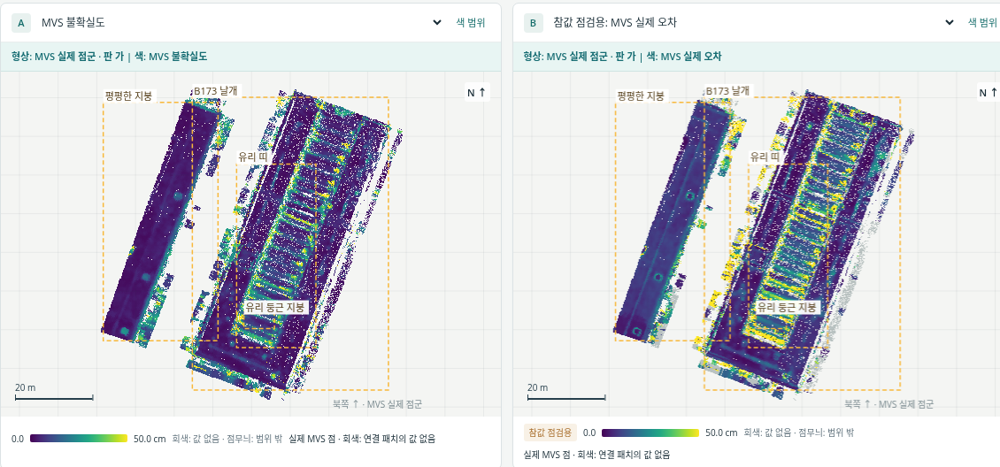
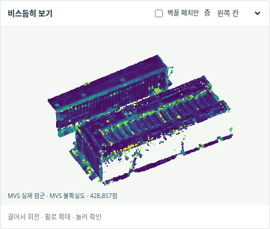
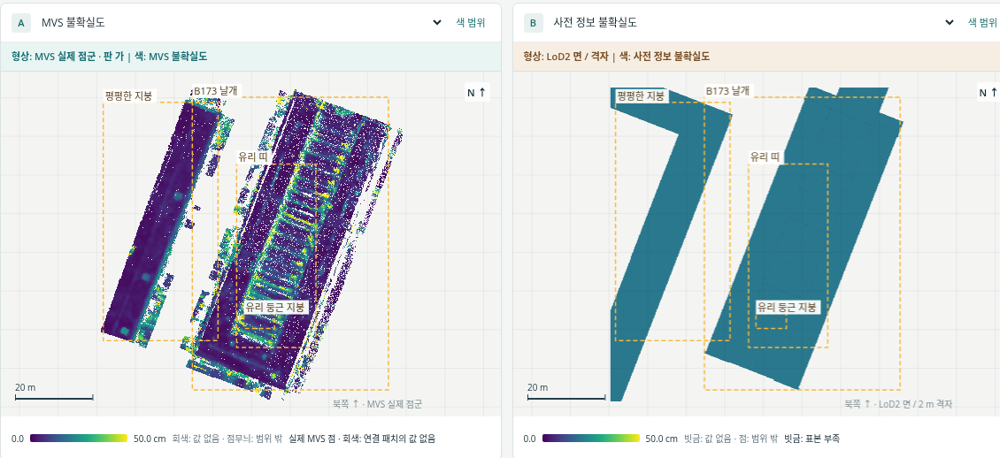
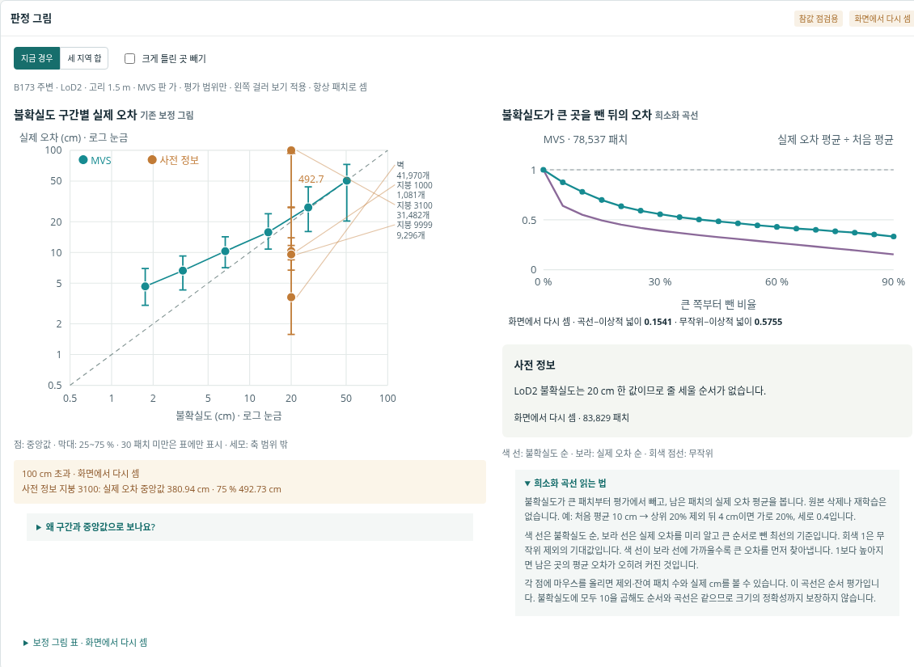

# MVS 실제 점군 표시 v1.2

사용자가 요청한 MVS 실제 점군 위의 불확실도·참값 오차 표시를 추가했다. MVS 수치가 LoD2 면의 정밀도로 보이던 혼동을 줄이기 위해 지도마다 **형상**과 **색으로 나타내는 값**을 명시한다. 과학적 판정은 수행하지 않는다.

- MVS 불확실도·어긋남·흩어짐·실제 오차·놓친 패치 등 MVS 층은 실제 MVS XYZ에 원래 패치 값을 연결해 색칠한다. 고리 크기와 MVS 판 가/나 선택을 따른다.
- MVS 점군의 2차원 지도와 3차원 회전 보기에서 점을 누르면 연결 패치의 원래 수치와 단면 표본을 확인한다.
- 사전 정보 층은 기존 사전 면/패치에 표시한다. 항공 LiDAR 패치를 LoD2 면에 집계한 보기는 그렇게 명시한다.
- 기존 화면은 ‘표시 형상 → 공통 사전 면 / 패치’로 볼 수 있다. 형상 전환은 차트의 표본·통계를 바꾸지 않는다.
- 기본 주소: http://192.168.10.203:8912/ (연구실 네트워크/VPN).

## 값과 형상의 관계

점 좌표는 `PHD-MAIN-UNCERT-v1/points/<site>/mvs_<a|b>_xyz.npy`의 원래 float32 XYZ 바이트다. 각 원본은 기존 계산에서 고정한 무작위 키 순으로 정렬되어 있으므로, 표시에는 앞 1,200,000점을 사용한다. 원본 점과 기존 수치 파일을 바꾸지 않는다. 표본 수는 지도 표시 전용이며 차트는 기존 유효 패치를 모두 사용한다.

패치의 저장된 MVS 면 위치 `c + o*n`에 가까운 16개 후보 가운데, 원래 정의인 옆 거리 0.5 m 이내·MVS 면의 법선 방향 ±1 m를 충족하는 가장 가까운 패치를 연결한다. 거리가 같으면 패치 번호가 작은 것을 고른다. 연결되지 않은 점에는 값을 칠하지 않는다. 이 후보 탐색은 화면용이며 모든 점에 연결을 보장하지 않는다. 표시 표본·연결 범위 밖의 점이 없다고 해서 원본 MVS가 없다는 뜻은 아니다.

참값으로 점의 위치나 연결을 선택하지 않는다. 색은 연결된 **패치 통계**이며 개별 점의 새 오차 측정이 아니다. 패치 구역 자체의 사전 정보 유래는 유지한다. LoD2 패치 묶음과 ALS 패치 묶음은 원래 별도 측정이므로 같은 MVS 점의 색도 선택한 묶음에 따라 다를 수 있다.

CRS 계보는 EPSG:25832이며 표시 좌표는 기존 COLMAP 지역 좌표와 world shift 정의를 그대로 따른다. 학습·GPU·방법 변경은 없다.

## 구간과 희소화 곡선의 설명

‘6.1’은 기존 발주문 `본실험_불확실도지도_발주문_v2.md`의 절 번호다. 0~2·2~5·5~10·10~20·20~40·40 cm 이상이라는 고정 구간이 지정되어 있지만, 각 경계를 정한 별도 통계적 도출이나 외부 표준 근거는 문서에 없다. 20 cm는 다른 평가의 문턱에도 쓰이지만 이것이 나머지 경계를 도출하지는 않는다. 이번 수정에서 경계·중앙값·표본 최소 개수는 바꾸지 않았다. 실제 구현의 마지막 구간은 40 cm를 포함하므로 기존 ‘40 초과’ 표기를 ‘40 이상’으로 바로잡았다.

희소화 곡선은 불확실도가 큰 패치를 평가에서 0·5·…·90% 제외하고 남은 실제 오차 평균을 처음 평균으로 나눈다. 처음 10 cm, 20% 제외 뒤 4 cm라면 (20%, 0.4)다. 원본 삭제나 재학습은 없다. 보라는 실제 오차가 큰 순으로 뺀 최선의 기준, 회색 1은 무작위 제외의 기대값이다. 곡선 사이의 넓이가 작을수록 실제 오차의 순서와 가깝다. 불확실도에 일정 양수를 곱해도 곡선이 같으므로 크기의 정확성을 판정하지 못한다. 각 점의 안내에 제외·잔여 패치 수와 실제 cm를 넣었다.

## 검증과 화면

- 모든 표시 XYZ의 원본 바이트 동일성, 모든 연결점의 안쪽 원·면 띠 조건을 확인했다. [자료·연결 기록](tables_v1_2/mvs_geometry.json)
- 여섯 경우의 구간별 패치 수·불확실도와 실제 오차 중앙값·25/75%를 동결 참조와 비교했다. MVS 판 전환, 실제 지도·3D 점 클릭, 필터, 기존 보기 전환, 좁은 화면을 Chromium에서 검사했다. [브라우저 기록](tables_v1_2/browser_preview.json)
- 원래 v1·v1.1 웹 ZIP과 전체 결과 ZIP을 보존한다. v1.2는 별도 웹 폴더·별도 다운로드 ZIP으로 제공한다.

scientific_verdict: null
