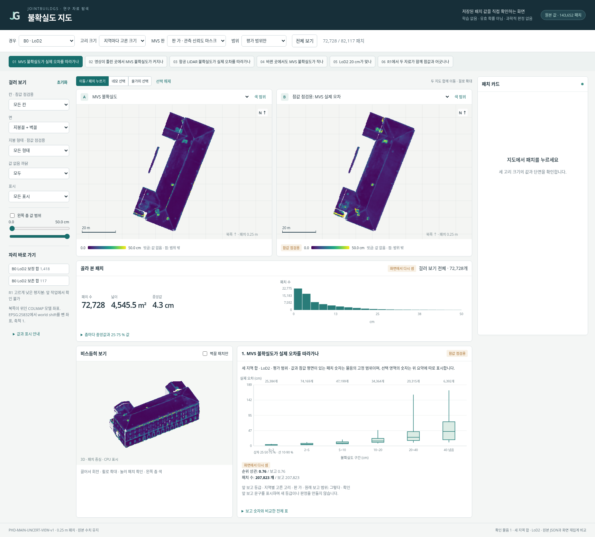
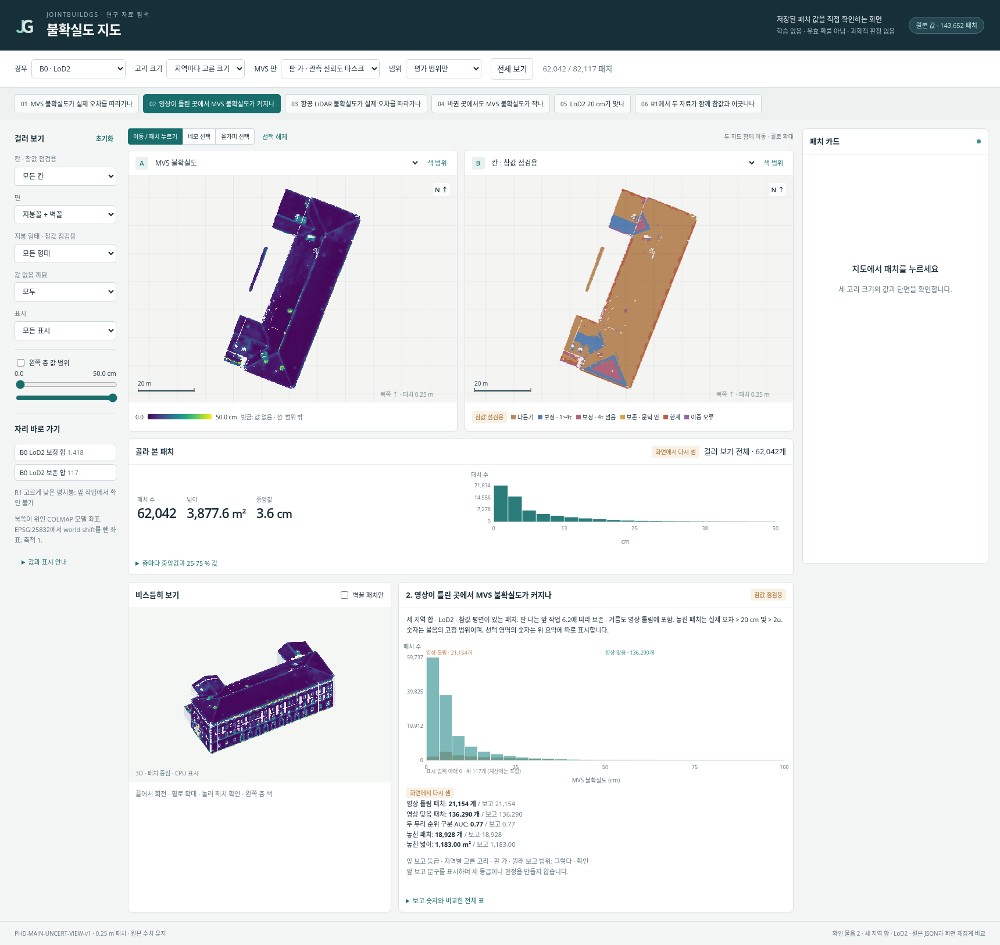
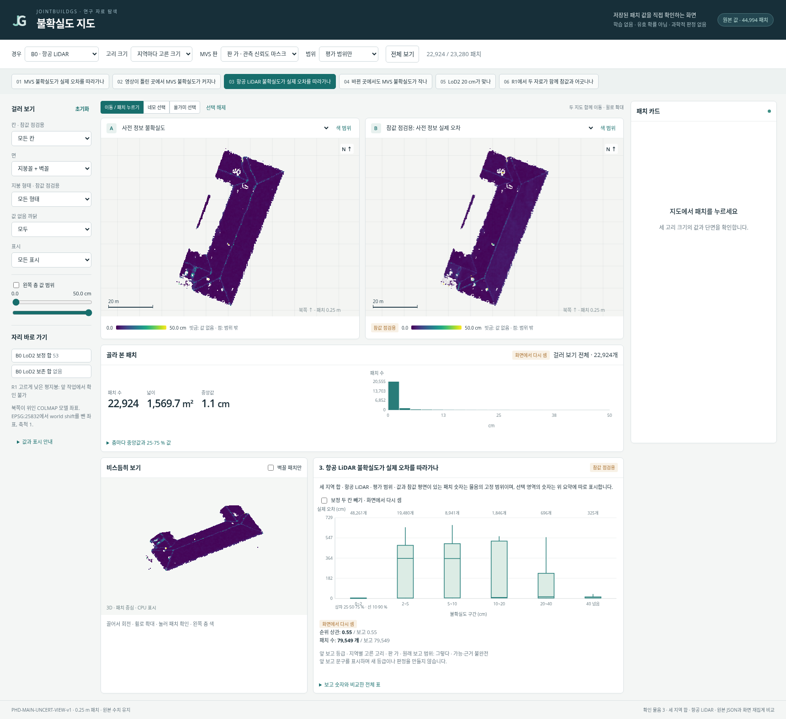
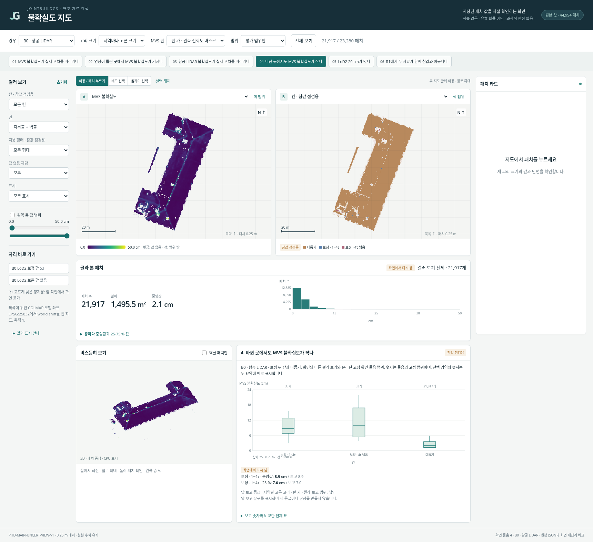
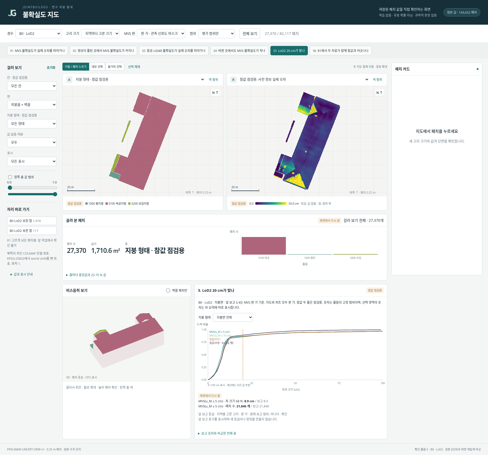
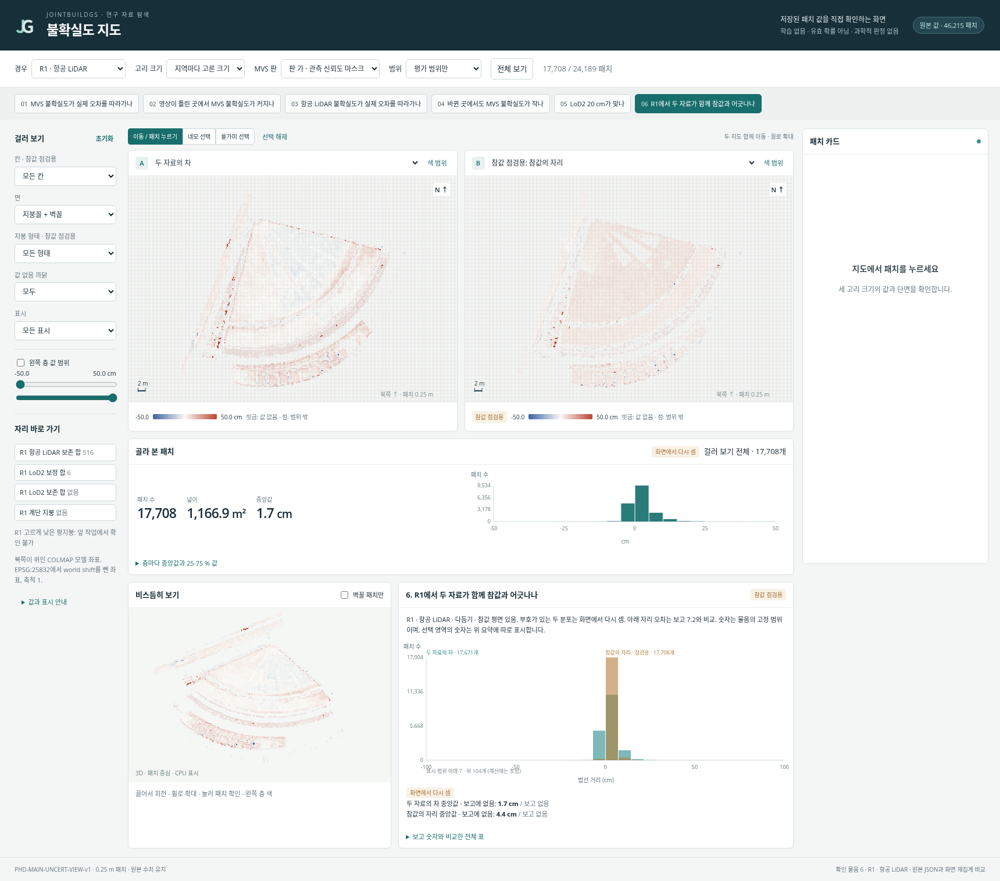
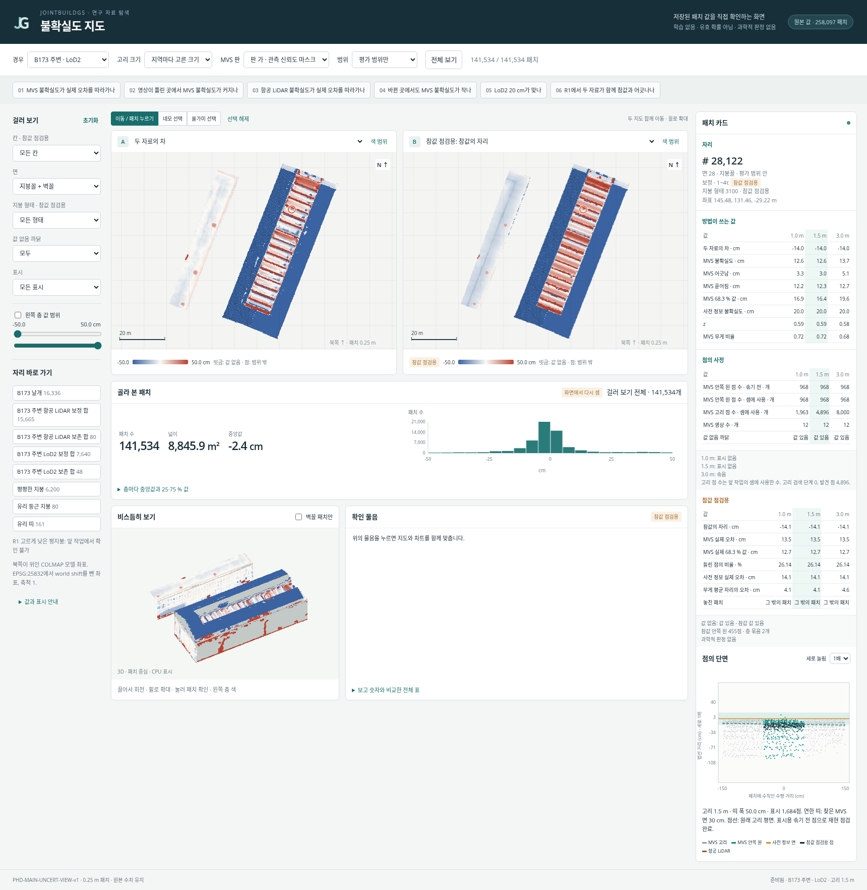
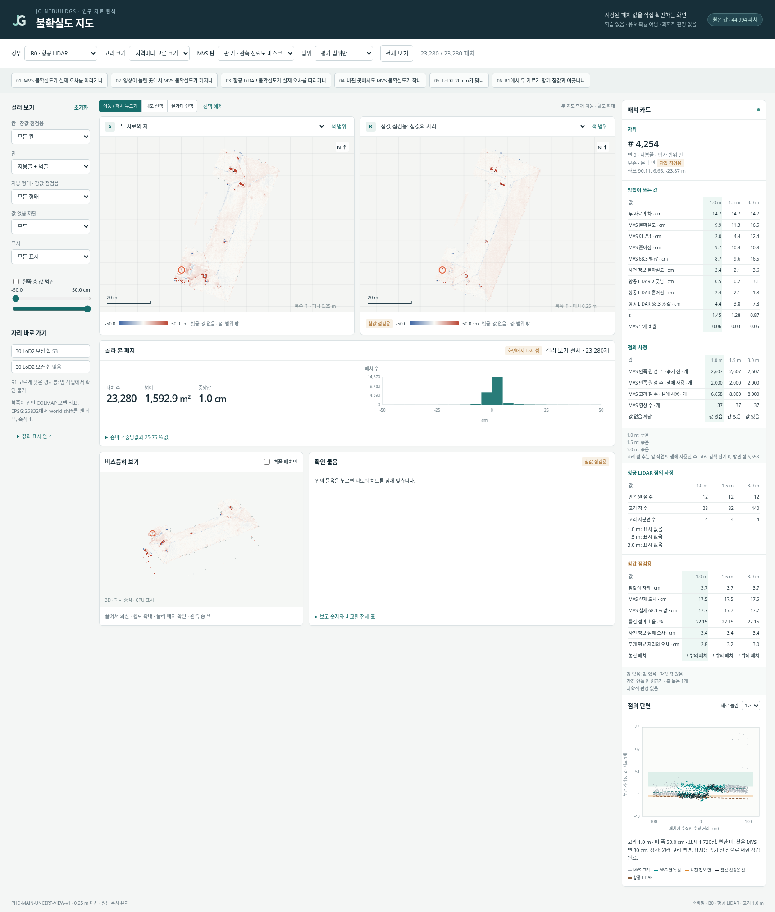
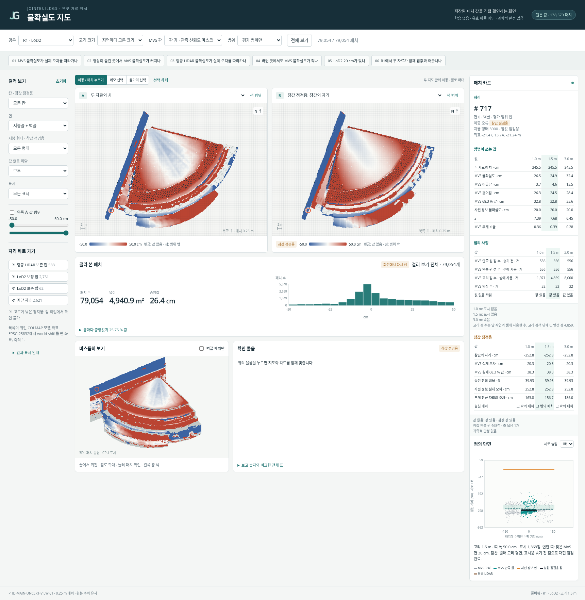

# 불확실도 보기 보고 v1

여섯 경우·세 고리 크기·MVS 두 판을 볼 수 있는 웹 화면과 오프라인 묶음을 만들었다.
여는 주소: **[불확실도 지도](http://192.168.10.203:8912/)** — 연구 서버에 연결되는 같은 네트워크 또는 VPN에서 접속한다. 파일 실행은 필요 없다.
단면 재현·숫자 맞춰 보기·Linux Chromium 화면 점검은 PASS. Windows Chrome·Edge는 확인 불가다. 연구실 네트워크·VPN 접속과 정밀도·표본을 유지한 300 MB 초과는 사용자 승인 완료다. `scientific_verdict: null`.

## 1. 자료와 키 이름

- 저장소: `/media/innopam/InnoPAM-8TB/hwiyoung/code/JointBuildGS-exp`
- 패치 값: `/media/innopam/InnoPAM-8TB/hwiyoung/code/JointBuildGS-artifacts/phase-payloads/phd/main_uncert_v1/PHD-MAIN-UNCERT-v1/patch_values/`
- MVS 판 가·나, 원래 항공 LiDAR, 참값 점: 같은 작업의 `points/<지역>/mvs_a_xyz.npy`, `mvs_b_xyz.npy`, `als_xyz.npy`, `gt_xyz.npy`. 영상 번호와 솎기 열쇠도 같은 폴더에서 읽었다.
- 영역: `phase-payloads/phd/main_stage1_v1/PHD-MAIN-STAGE1-v1/regions_v3/regions_ext_v3_<지역>_<사전 정보>.npz`.
- 앞 작업 스크립트와 표는 읽기 전용으로 연결했다. 전체 경로·크기·SHA-256과 원본 키 목록: [input_audit.json](tables/input_audit.json).
- 좌표는 EPSG:25832에서 `[690953, 5336071, 604]` m를 뺀 COLMAP 모델 좌표, 축척 1, 북쪽 위.

| 화면 값 | 원본 키 |
|---|---|
| 패치 중심·법선·면·영역 | `centre`, `normal`, `surf`, `in_eval`, `roof_like`, `area` |
| 칸·지붕 형태 (참값 점검용) | `cell`, `roof_type` |
| 두 자료의 차 | `mvs_a_p`, `mvs_b_p` |
| MVS 불확실도·어긋남·흩어짐·68.3 % | `mvs_{a,b}_{u,a,s,q}` |
| 사전 정보 불확실도·항공 LiDAR 성분 | `u_prior`, `als_{a,s,q}` |
| z·MVS 무게 비율 | `z_{a,b}`, `w_{a,b}` |
| 점의 사정 | `{mvs_a,mvs_b,als}_{status,n_col,n_inner_all,n_inner,n_ring,ring_found,ring_level,views,quadrants,thinned_inner,thinned_ring,support_lmeds,support_final}`. `als_views`는 값이 없는 원본 배열이며 항공 LiDAR 영상 수는 표시하지 않음 |
| 참값 점검용 | `gt_{p,status,o,n_inner,runs}`, `mvs_{a,b}_{e,qe,f}`, `als_e`, `eL`, `errW_{a,b}` |
| 놓친 패치 | 원본의 `e > .2` 및 `e > 2u`를 그대로 적용한 화면 표시. 새 불확실도나 확률이 아님 |

| 경우 | 평가 범위 | 띠 | 표 1 값 있음 일치 |
|---|---:|---:|---|
| B0 · LoD2 | 82,117 | 61,535 | 세 고리·자료 모두 일치 |
| B0 · 항공 LiDAR | 23,280 | 21,714 | 세 고리·자료 모두 일치 |
| B173 주변 · LoD2 | 141,534 | 116,563 | 세 고리·자료 모두 일치 |
| B173 주변 · 항공 LiDAR | 34,273 | 42,384 | 세 고리·자료 모두 일치 |
| R1 · LoD2 | 79,054 | 59,525 | 세 고리·자료 모두 일치 |
| R1 · 항공 LiDAR | 24,189 | 22,026 | 세 고리·자료 모두 일치 |

## 2. 재현과 맞춰 보기

입력 360개 파일 SHA-256 재확인: 변경 0개. 모든 웹 패킷의 모든 내보낸 배열을 복원해 원본과 비교했고 일치했다. 브라우저가 푼 Float32/Float64 배열 18개의 바이트 SHA-256도 원본과 일치했다.

| 점검 | 건수 | 결과 |
|---|---:|---|
| 단면 재현: 원래 `u2_run.one_patch`, `column`, `ring_points`, 씨앗·순서·솎기 동일 | 12,615 | 전부 0.1 cm 안 |
| 표 1·2·6.1·6.3·6.4 독립 재집계 | 1,828 | 전부 허용차 안 |
| 여섯 물음의 브라우저 재집계 | 보고 값이 있는 모든 비교 행 | 허용차 초과 0 |
| 파일 직접 열기 + 네트워크 차단 | 1 | PASS |
| Windows Chrome·Edge | 0 | 확인 불가: 해당 OS·브라우저 없음 |

재현 세부 표: [section_replay.json](tables/section_replay.json). 비교 양쪽 값·허용차: [table_recount.json](tables/table_recount.json). 브라우저 숫자: [browser_full.json](tables/browser_full.json). 바이트 확인: [integrity.json](tables/integrity.json).

## 3. 확인 물음 화면

### 1. MVS 불확실도가 실제 오차를 따라가나



세 지역 합 · LoD2 · 순위 상관: 보고 0.7583213036062874 / 화면에서 다시 셈 0.7583213036062874 .

### 2. 영상이 틀린 곳에서 MVS 불확실도가 커지나



세 지역 합 · LoD2 · 영상 틀림 패치: 보고 21154 / 화면에서 다시 셈 21154 개.

### 3. 항공 LiDAR 불확실도가 실제 오차를 따라가나



세 지역 합 · 항공 LiDAR · 순위 상관: 보고 0.5545825495399361 / 화면에서 다시 셈 0.5545825495399361 .

### 4. 바뀐 곳에서도 MVS 불확실도가 작나



B0 · 항공 LiDAR · 보정 · 1~4τ · 중앙값: 보고 8.923763781785965 / 화면에서 다시 셈 8.923763781785965 cm.

### 5. LoD2 20 cm가 맞나



B0 · LoD2 · MVS(u_M ≤ 5 cm) · 차 크기 68 %: 보고 8.896644860506058 / 화면에서 다시 셈 8.896644860506058 cm.

### 6. R1에서 두 자료가 함께 참값과 어긋나나



R1 · 항공 LiDAR · 두 자료의 차 중앙값 · 보고에 없음: 보고 None / 화면에서 다시 셈 1.7120961099863052 cm.

## 4. 패치 카드와 단면







## 5. 변경·확인 불가·추가 기록

- 웹주소 접속 요청에 따라 독립 정적 서버를 추가했다. 이 작업의 `web/`만 읽기 전용으로 제공하며 자동 재시작한다. 다른 서비스는 변경하지 않았다.
- 숫자는 무손실 저장한다. 부동소수점 원래 정밀도, 표본 패치 수, 잠근 표시 점 상한을 줄이지 않았다.
- 사용자 확정: 연구실 네트워크나 VPN에서 접속하며, 정밀도·표본을 유지한 300 MB 초과를 허용한다. 승인 대상은 현재 웹 392.43 MB / ZIP 293.07 MB 묶음이다. [승인 기록](tables/delivery_approval_20261023.json). 최초 설정·잠금·배포 당시 receipt·웹·ZIP 바이트는 보존했다.
- 자리 목록에 원래 대응 패치가 0개인 항목은 없음으로 표시하고 이동을 막는다. R1 고르게 낮은 평지붕은 앞 작업의 확인 불가 기록을 유지한다.
- 앞 보고 6.2의 판 나는 보존 · 거름도 영상 틀림에 포함한다. 화면에서 이를 명시하고 같은 정의로 비교한다. 6.4는 판 가를 사용한다.
- `cell`과 `roof_type`도 참값 유래이므로 참값 점검용으로 표시했다. 확인 물음의 보고 등급은 JSON에서 읽은 기존 문구이며 새 등급을 만들지 않았다.
- 화면 코드는 `scripts/phd/main_uncert_view_v1/`에만 추가했다. 제삼자 웹 라이브러리는 포함하지 않았다.
- 실패·수정 내역: [issues.md](issues.md). 설정 잠금 이후 표본·수치 정의·색 범위 변경 없음. 렌더러와 접힌 통계표 계산 시점만 성능을 위해 수정했다.

## 6. 크기·자원·시간

- 웹 폴더 392.43 MB, ZIP 293.07 MB (10진 MB).
- 페이로드: `/media/innopam/InnoPAM-8TB/hwiyoung/code/JointBuildGS-artifacts/phase-payloads/phd/main_uncert_view_v1/PHD-MAIN-UNCERT-VIEW-v1/`.
- 가장 큰 경우 258,097개 패치, 층 전환 260 ms. 최초 B0 자료 준비 2214 ms. CPU 4개를 제한한 Chromium 측정이며 다른 PC·네트워크의 속도를 보장하지 않는다.
- 전처리 Docker: CPU 최대 8개, 메모리 제한 32 GB. 브라우저 Docker: CPU 4개, 8 GB. 서버: CPU 2개, 512 MB. CUDA 장치 요청 없음. 학습 없음.
- 입력 감사 기록 이후 40.7분. 실제 최대 메모리는 별도로 수집하지 않아 확인 불가.
- 브라우저 버전: Chromium 152.0.7977.82 (Linux). 오프라인, 실제 휠·드래그·올가미·마우스 카드, 범위 필터, 보정 칸 제외, 판 나·고리 3 m 확인.

| 경우 자료 | 크기 MB | 단면 파일 MB |
|---|---:|---:|
| B0 · LoD2 | 50.67 | 23.35 |
| B0 · 항공 LiDAR | 19.59 | 20.47 |
| B173 주변 · LoD2 | 72.33 | 27.31 |
| B173 주변 · 항공 LiDAR | 32.87 | 28.03 |
| R1 · LoD2 | 50.15 | 20.00 |
| R1 · 항공 LiDAR | 22.30 | 21.67 |

## 7. 재실행

아래 스크립트는 Docker에서 실행한다. 잠금은 처음 한 번만 만들며 기존 잠금은 덮어쓰지 않는다. 원본 입력은 읽기 전용이다.

```bash
bash scripts/phd/main_uncert_view_v1/run_cpu.sh audit.py
bash scripts/phd/main_uncert_view_v1/run_cpu.sh lock_config.py  # 최초 한 번만
bash scripts/phd/main_uncert_view_v1/run_cpu.sh build_data.py
bash scripts/phd/main_uncert_view_v1/run_cpu.sh build_sections.py
bash scripts/phd/main_uncert_view_v1/run_cpu.sh validate_tables.py
bash scripts/phd/main_uncert_view_v1/run_cpu.sh finalize.py
bash scripts/phd/main_uncert_view_v1/serve.sh
```

브라우저 QA는 기존 `jointbuildgs:geogs-viewer-browser-v2` 이미지에서 `qa_browser.mjs full`, 추가 실제 조작은 `qa_interactions.mjs smoke`로 수행한다. 입력 `/src`, 웹 `/web`은 읽기 전용, 보고 `/docs`만 쓰기 가능으로 연결한다.
