# 불확실도 보기 보고 v1.1

보정 그림·희소화 곡선, LoD2 면 단위 보기, 지도 짝 세 가지와 부호 있는 색을 추가·수정했다.
여는 주소: [불확실도 지도 v1.1](http://192.168.10.203:8912/) — 연구실 네트워크·VPN에서 파일 실행 없이 접속한다.
판정 그림과 면 값은 화면에서 다시 셈이며 참값 관련 값은 참값 점검용이다. `scientific_verdict: null`.

## 1. 바꾼 것과 여는 법

- 위쪽의 보는 단위에서 패치·면을 바꾼다. 지도 짝 단추는 면과 0~50 cm를 선택하며 양쪽 색 범위를 함께 바꾼다.
- 판정 그림은 왼쪽 걸러 보기와 범위를 따르며 항상 패치로 센다. 세 지역 합은 B0 1 m, B173 주변·R1 1.5 m다.
- 크게 틀린 곳 빼기는 사전 정보의 보정 · 4τ 넘음만 제외한다. MVS·지도에는 적용하지 않는다. 보정 · 1~4τ는 남는다.
- 면 중앙값·25·75 % 값과 값 있음 비율은 면 카드에서 확인한다. 이 면의 패치 보기로 더 작은 곳을 확인한다.
- 부호 있는 두 층은 −50~+50 cm, 0은 흰색이다. 지붕 형태는 LoD2 속성으로 표시한다.

## 2. 판정 그림의 숫자

화면에서 다시 셈 · 참값 점검용. 아래는 평가 범위, 지역마다 고른 고리 크기, MVS 판 가, 걸러 보기 없음이다. 30개 미만 구간도 표에는 남겼다. 길이는 cm, 비율과 넓이는 단위 없음이다.

[보정 그림 전체 표](tables_v1_1/calibration.md) · [JSON](tables_v1_1/calibration.json) · [희소화 곡선 값](tables_v1_1/sparsification_values.md) · [두 넓이](tables_v1_1/sparsification.md) · [JSON](tables_v1_1/sparsification.json)

### B0 · LoD2 · 크게 틀린 곳 빼기 끔

| 자료 | 구간 / 면 | 패치 수 | u 중앙값 | e 중앙값 | e 25 % | e 75 % | e ÷ u 중앙값 |
|---|---|---|---|---|---|---|---|
| MVS | 0~2 | 16984 | 1.3552 | 2.9149 | 1.952 | 3.7327 | 2.0996 |
| MVS | 2~5 | 22967 | 3.0989 | 4.1287 | 3.1711 | 5.8238 | 1.281 |
| MVS | 5~10 | 14435 | 7.1149 | 8.6983 | 6.607 | 11.895 | 1.2004 |
| MVS | 10~20 | 13262 | 13.706 | 13.687 | 10.144 | 18.718 | 1.0194 |
| MVS | 20~40 | 4488 | 24.747 | 21.219 | 13.721 | 29.968 | 0.8711 |
| MVS | 40 초과 | 592 | 47.594 | 20.766 | 11.405 | 48.756 | 0.39757 |
| 사전 정보 | 벽 | 46901 | 20 | 20.836 | 16.211 | 26.373 | 1.0418 |
| 사전 정보 | 지붕 1000 | 410 | 20 | 1.556 | 1.0209 | 2.0347 | 0.077799 |
| 사전 정보 | 지붕 3100 | 26081 | 20 | 8.4488 | 6.3045 | 11.152 | 0.42244 |
| 사전 정보 | 지붕 3200 | 783 | 20 | 3.7844 | 1.7897 | 7.9348 | 0.18922 |

| 자료 | 곡선−이상적 넓이 | 무작위−이상적 넓이 |
|---|---|---|
| MVS | 0.12362 | 0.56163 |
| 사전 정보 | 없음 | 없음 |

LoD2는 20 cm 한 값이어서 희소화 곡선을 그리지 않는다.

### B0 · LoD2 · 크게 틀린 곳 빼기 켬

| 자료 | 구간 / 면 | 패치 수 | u 중앙값 | e 중앙값 | e 25 % | e 75 % | e ÷ u 중앙값 |
|---|---|---|---|---|---|---|---|
| MVS | 0~2 | 16984 | 1.3552 | 2.9149 | 1.952 | 3.7327 | 2.0996 |
| MVS | 2~5 | 22967 | 3.0989 | 4.1287 | 3.1711 | 5.8238 | 1.281 |
| MVS | 5~10 | 14435 | 7.1149 | 8.6983 | 6.607 | 11.895 | 1.2004 |
| MVS | 10~20 | 13262 | 13.706 | 13.687 | 10.144 | 18.718 | 1.0194 |
| MVS | 20~40 | 4488 | 24.747 | 21.219 | 13.721 | 29.968 | 0.8711 |
| MVS | 40 초과 | 592 | 47.594 | 20.766 | 11.405 | 48.756 | 0.39757 |
| 사전 정보 | 벽 | 46901 | 20 | 20.836 | 16.211 | 26.373 | 1.0418 |
| 사전 정보 | 지붕 1000 | 284 | 20 | 1.756 | 1.3296 | 2.0322 | 0.087798 |
| 사전 정보 | 지붕 3100 | 25071 | 20 | 8.3192 | 6.2118 | 10.737 | 0.41596 |
| 사전 정보 | 지붕 3200 | 782 | 20 | 3.7836 | 1.7804 | 7.9031 | 0.18918 |

| 자료 | 곡선−이상적 넓이 | 무작위−이상적 넓이 |
|---|---|---|
| MVS | 0.12362 | 0.56163 |
| 사전 정보 | 없음 | 없음 |

LoD2는 20 cm 한 값이어서 희소화 곡선을 그리지 않는다.

### B173 주변 · LoD2 · 크게 틀린 곳 빼기 끔

| 자료 | 구간 / 면 | 패치 수 | u 중앙값 | e 중앙값 | e 25 % | e 75 % | e ÷ u 중앙값 |
|---|---|---|---|---|---|---|---|
| MVS | 0~2 | 4770 | 1.7526 | 4.6531 | 3.0399 | 6.9537 | 2.7736 |
| MVS | 2~5 | 34553 | 3.2811 | 6.6347 | 4.3007 | 9.2314 | 2.0111 |
| MVS | 5~10 | 18136 | 6.6575 | 10.267 | 7.0965 | 14.226 | 1.4828 |
| MVS | 10~20 | 11648 | 13.636 | 15.75 | 10.777 | 23.913 | 1.1591 |
| MVS | 20~40 | 7174 | 26.581 | 27.575 | 16.01 | 43.943 | 1.0344 |
| MVS | 40 초과 | 2256 | 50.548 | 50.399 | 20.343 | 72.842 | 0.99686 |
| 사전 정보 | 벽 | 41970 | 20 | 3.6431 | 1.5751 | 27.834 | 0.18216 |
| 사전 정보 | 지붕 1000 | 1081 | 20 | 10.331 | 8.4637 | 13.911 | 0.51654 |
| 사전 정보 | 지붕 3100 | 31482 | 20 | 380.94 | 27.492 | 492.73 | 19.047 |
| 사전 정보 | 지붕 9999 | 9296 | 20 | 9.5508 | 6.7009 | 11.701 | 0.47754 |

| 자료 | 곡선−이상적 넓이 | 무작위−이상적 넓이 |
|---|---|---|
| MVS | 0.15405 | 0.57548 |
| 사전 정보 | 없음 | 없음 |

LoD2는 20 cm 한 값이어서 희소화 곡선을 그리지 않는다.

### B173 주변 · LoD2 · 크게 틀린 곳 빼기 켬

| 자료 | 구간 / 면 | 패치 수 | u 중앙값 | e 중앙값 | e 25 % | e 75 % | e ÷ u 중앙값 |
|---|---|---|---|---|---|---|---|
| MVS | 0~2 | 4770 | 1.7526 | 4.6531 | 3.0399 | 6.9537 | 2.7736 |
| MVS | 2~5 | 34553 | 3.2811 | 6.6347 | 4.3007 | 9.2314 | 2.0111 |
| MVS | 5~10 | 18136 | 6.6575 | 10.267 | 7.0965 | 14.226 | 1.4828 |
| MVS | 10~20 | 11648 | 13.636 | 15.75 | 10.777 | 23.913 | 1.1591 |
| MVS | 20~40 | 7174 | 26.581 | 27.575 | 16.01 | 43.943 | 1.0344 |
| MVS | 40 초과 | 2256 | 50.548 | 50.399 | 20.343 | 72.842 | 0.99686 |
| 사전 정보 | 벽 | 41970 | 20 | 3.6431 | 1.5751 | 27.834 | 0.18216 |
| 사전 정보 | 지붕 1000 | 1019 | 20 | 10.036 | 8.3602 | 12.79 | 0.50179 |
| 사전 정보 | 지붕 3100 | 15115 | 20 | 26.916 | 16.158 | 194.9 | 1.3458 |
| 사전 정보 | 지붕 9999 | 9290 | 20 | 9.5508 | 6.7009 | 11.681 | 0.47754 |

| 자료 | 곡선−이상적 넓이 | 무작위−이상적 넓이 |
|---|---|---|
| MVS | 0.15405 | 0.57548 |
| 사전 정보 | 없음 | 없음 |

LoD2는 20 cm 한 값이어서 희소화 곡선을 그리지 않는다.

### R1 · LoD2 · 크게 틀린 곳 빼기 끔

| 자료 | 구간 / 면 | 패치 수 | u 중앙값 | e 중앙값 | e 25 % | e 75 % | e ÷ u 중앙값 |
|---|---|---|---|---|---|---|---|
| MVS | 0~2 | 3630 | 1.6359 | 3.173 | 2.6903 | 3.8964 | 2.1392 |
| MVS | 2~5 | 16649 | 3.3071 | 4.4925 | 3.3178 | 6.3138 | 1.3181 |
| MVS | 5~10 | 14628 | 6.773 | 7.9703 | 6.405 | 10.414 | 1.1438 |
| MVS | 10~20 | 9454 | 14.182 | 18.016 | 12.566 | 37.307 | 1.2247 |
| MVS | 20~40 | 8653 | 26.577 | 30.085 | 19.345 | 69.353 | 1.0983 |
| MVS | 40 초과 | 3544 | 59.56 | 44.456 | 20.837 | 83.437 | 0.75777 |
| 사전 정보 | 벽 | 31991 | 20 | 108.96 | 7.0459 | 213.43 | 5.4479 |
| 사전 정보 | 지붕 1000 | 27032 | 20 | 32.869 | 8.4647 | 95.513 | 1.6434 |
| 사전 정보 | 지붕 3900 | 1658 | 20 | 146.56 | 135.84 | 267.49 | 7.3281 |

| 자료 | 곡선−이상적 넓이 | 무작위−이상적 넓이 |
|---|---|---|
| MVS | 0.20022 | 0.69538 |
| 사전 정보 | 없음 | 없음 |

LoD2는 20 cm 한 값이어서 희소화 곡선을 그리지 않는다.

### R1 · LoD2 · 크게 틀린 곳 빼기 켬

| 자료 | 구간 / 면 | 패치 수 | u 중앙값 | e 중앙값 | e 25 % | e 75 % | e ÷ u 중앙값 |
|---|---|---|---|---|---|---|---|
| MVS | 0~2 | 3630 | 1.6359 | 3.173 | 2.6903 | 3.8964 | 2.1392 |
| MVS | 2~5 | 16649 | 3.3071 | 4.4925 | 3.3178 | 6.3138 | 1.3181 |
| MVS | 5~10 | 14628 | 6.773 | 7.9703 | 6.405 | 10.414 | 1.1438 |
| MVS | 10~20 | 9454 | 14.182 | 18.016 | 12.566 | 37.307 | 1.2247 |
| MVS | 20~40 | 8653 | 26.577 | 30.085 | 19.345 | 69.353 | 1.0983 |
| MVS | 40 초과 | 3544 | 59.56 | 44.456 | 20.837 | 83.437 | 0.75777 |
| 사전 정보 | 벽 | 31097 | 20 | 94.117 | 6.8215 | 209.13 | 4.7058 |
| 사전 정보 | 지붕 1000 | 25085 | 20 | 29.172 | 7.6031 | 77.613 | 1.4586 |
| 사전 정보 | 지붕 3900 | 685 | 20 | 130.92 | 125.04 | 136.92 | 6.546 |

| 자료 | 곡선−이상적 넓이 | 무작위−이상적 넓이 |
|---|---|---|
| MVS | 0.20022 | 0.69538 |
| 사전 정보 | 없음 | 없음 |

LoD2는 20 cm 한 값이어서 희소화 곡선을 그리지 않는다.

### 세 지역 합 · LoD2 · 크게 틀린 곳 빼기 끔

| 자료 | 구간 / 면 | 패치 수 | u 중앙값 | e 중앙값 | e 25 % | e 75 % | e ÷ u 중앙값 |
|---|---|---|---|---|---|---|---|
| MVS | 0~2 | 25384 | 1.5124 | 3.164 | 2.1818 | 4.0642 | 2.2161 |
| MVS | 2~5 | 74169 | 3.2337 | 5.0942 | 3.5476 | 7.8683 | 1.537 |
| MVS | 5~10 | 47199 | 6.8297 | 8.866 | 6.6484 | 12.487 | 1.2464 |
| MVS | 10~20 | 34364 | 13.803 | 15.324 | 10.929 | 23.16 | 1.1033 |
| MVS | 20~40 | 20315 | 26.17 | 26.782 | 16.645 | 44.262 | 1.0211 |
| MVS | 40 초과 | 6392 | 53.836 | 44.581 | 19.004 | 74.733 | 0.82147 |
| 사전 정보 | B0 · 벽 | 46901 | 20 | 20.836 | 16.211 | 26.373 | 1.0418 |
| 사전 정보 | B0 · 지붕 | 27274 | 20 | 8.365 | 6.0842 | 11.098 | 0.41825 |
| 사전 정보 | B173 주변 · 벽 | 41970 | 20 | 3.6431 | 1.5751 | 27.834 | 0.18216 |
| 사전 정보 | B173 주변 · 지붕 | 41859 | 20 | 185.56 | 11.781 | 456.05 | 9.2778 |
| 사전 정보 | R1 · 벽 | 31991 | 20 | 108.96 | 7.0459 | 213.43 | 5.4479 |
| 사전 정보 | R1 · 지붕 | 28690 | 20 | 36.639 | 9.336 | 112.99 | 1.832 |

| 자료 | 곡선−이상적 넓이 | 무작위−이상적 넓이 |
|---|---|---|
| MVS | 0.1498 | 0.63879 |
| 사전 정보 | 없음 | 없음 |

LoD2는 20 cm 한 값이어서 희소화 곡선을 그리지 않는다.

### 세 지역 합 · LoD2 · 크게 틀린 곳 빼기 켬

| 자료 | 구간 / 면 | 패치 수 | u 중앙값 | e 중앙값 | e 25 % | e 75 % | e ÷ u 중앙값 |
|---|---|---|---|---|---|---|---|
| MVS | 0~2 | 25384 | 1.5124 | 3.164 | 2.1818 | 4.0642 | 2.2161 |
| MVS | 2~5 | 74169 | 3.2337 | 5.0942 | 3.5476 | 7.8683 | 1.537 |
| MVS | 5~10 | 47199 | 6.8297 | 8.866 | 6.6484 | 12.487 | 1.2464 |
| MVS | 10~20 | 34364 | 13.803 | 15.324 | 10.929 | 23.16 | 1.1033 |
| MVS | 20~40 | 20315 | 26.17 | 26.782 | 16.645 | 44.262 | 1.0211 |
| MVS | 40 초과 | 6392 | 53.836 | 44.581 | 19.004 | 74.733 | 0.82147 |
| 사전 정보 | B0 · 벽 | 46901 | 20 | 20.836 | 16.211 | 26.373 | 1.0418 |
| 사전 정보 | B0 · 지붕 | 26137 | 20 | 8.2408 | 6.0088 | 10.684 | 0.41204 |
| 사전 정보 | B173 주변 · 벽 | 41970 | 20 | 3.6431 | 1.5751 | 27.834 | 0.18216 |
| 사전 정보 | B173 주변 · 지붕 | 25424 | 20 | 14.268 | 8.8509 | 45.562 | 0.71341 |
| 사전 정보 | R1 · 벽 | 31097 | 20 | 94.117 | 6.8215 | 209.13 | 4.7058 |
| 사전 정보 | R1 · 지붕 | 25770 | 20 | 30.737 | 7.9737 | 84.275 | 1.5369 |

| 자료 | 곡선−이상적 넓이 | 무작위−이상적 넓이 |
|---|---|---|
| MVS | 0.1498 | 0.63879 |
| 사전 정보 | 없음 | 없음 |

LoD2는 20 cm 한 값이어서 희소화 곡선을 그리지 않는다.

### B0 · 항공 LiDAR · 크게 틀린 곳 빼기 끔

| 자료 | 구간 / 면 | 패치 수 | u 중앙값 | e 중앙값 | e 25 % | e 75 % | e ÷ u 중앙값 |
|---|---|---|---|---|---|---|---|
| MVS | 0~2 | 10773 | 1.255 | 2.9735 | 1.939 | 3.6761 | 2.2139 |
| MVS | 2~5 | 8542 | 3.0412 | 3.6571 | 2.9674 | 4.5082 | 1.1417 |
| MVS | 5~10 | 2636 | 6.527 | 6.8964 | 5.7667 | 8.6489 | 1.069 |
| MVS | 10~20 | 919 | 12.619 | 10.934 | 7.6323 | 14.959 | 0.90321 |
| MVS | 20~40 | 277 | 25.545 | 17.724 | 4.9557 | 28.986 | 0.67437 |
| MVS | 40 초과 | 31 | 45.306 | 71.036 | 20.223 | 94.492 | 1.5001 |
| 사전 정보 | 0~2 | 19833 | 1.0258 | 1.6632 | 1.1237 | 2.5979 | 1.5536 |
| 사전 정보 | 2~5 | 1996 | 2.8492 | 3.2132 | 2.3341 | 4.7098 | 1.1183 |
| 사전 정보 | 5~10 | 623 | 6.8679 | 5.0667 | 3.7236 | 7.1926 | 0.75192 |
| 사전 정보 | 10~20 | 356 | 13.057 | 4.6403 | 2.9801 | 7.1078 | 0.34452 |
| 사전 정보 | 20~40 | 109 | 24.261 | 3.3945 | 2.1239 | 6.2416 | 0.13635 |
| 사전 정보 | 40 초과 | 7 | 75.537 | 8.0794 | 3.6494 | 25.729 | 0.099509 |

| 자료 | 곡선−이상적 넓이 | 무작위−이상적 넓이 |
|---|---|---|
| MVS | 0.079508 | 0.42159 |
| 사전 정보 | 0.20276 | 0.40545 |

### B0 · 항공 LiDAR · 크게 틀린 곳 빼기 켬

| 자료 | 구간 / 면 | 패치 수 | u 중앙값 | e 중앙값 | e 25 % | e 75 % | e ÷ u 중앙값 |
|---|---|---|---|---|---|---|---|
| MVS | 0~2 | 10773 | 1.255 | 2.9735 | 1.939 | 3.6761 | 2.2139 |
| MVS | 2~5 | 8542 | 3.0412 | 3.6571 | 2.9674 | 4.5082 | 1.1417 |
| MVS | 5~10 | 2636 | 6.527 | 6.8964 | 5.7667 | 8.6489 | 1.069 |
| MVS | 10~20 | 919 | 12.619 | 10.934 | 7.6323 | 14.959 | 0.90321 |
| MVS | 20~40 | 277 | 25.545 | 17.724 | 4.9557 | 28.986 | 0.67437 |
| MVS | 40 초과 | 31 | 45.306 | 71.036 | 20.223 | 94.492 | 1.5001 |
| 사전 정보 | 0~2 | 19827 | 1.0259 | 1.6632 | 1.1237 | 2.5978 | 1.5535 |
| 사전 정보 | 2~5 | 1989 | 2.8505 | 3.2131 | 2.3346 | 4.693 | 1.1169 |
| 사전 정보 | 5~10 | 621 | 6.8679 | 5.0667 | 3.7213 | 7.1848 | 0.75192 |
| 사전 정보 | 10~20 | 356 | 13.057 | 4.6403 | 2.9801 | 7.1078 | 0.34452 |
| 사전 정보 | 20~40 | 109 | 24.261 | 3.3945 | 2.1239 | 6.2416 | 0.13635 |
| 사전 정보 | 40 초과 | 7 | 75.537 | 8.0794 | 3.6494 | 25.729 | 0.099509 |

| 자료 | 곡선−이상적 넓이 | 무작위−이상적 넓이 |
|---|---|---|
| MVS | 0.079508 | 0.42159 |
| 사전 정보 | 0.20477 | 0.39871 |

### B173 주변 · 항공 LiDAR · 크게 틀린 곳 빼기 끔

| 자료 | 구간 / 면 | 패치 수 | u 중앙값 | e 중앙값 | e 25 % | e 75 % | e ÷ u 중앙값 |
|---|---|---|---|---|---|---|---|
| MVS | 0~2 | 2102 | 1.7291 | 3.8472 | 2.2258 | 7.4874 | 2.297 |
| MVS | 2~5 | 16783 | 3.3723 | 7.3453 | 4.5087 | 9.2156 | 2.1188 |
| MVS | 5~10 | 7966 | 6.5861 | 10.929 | 7.7974 | 14.194 | 1.5887 |
| MVS | 10~20 | 3651 | 13.467 | 17.333 | 13.061 | 23.707 | 1.2795 |
| MVS | 20~40 | 2287 | 26.826 | 36.12 | 23.613 | 51.744 | 1.3017 |
| MVS | 40 초과 | 862 | 49.754 | 60.651 | 39.818 | 76.896 | 1.2185 |
| 사전 정보 | 0~2 | 10387 | 1.1266 | 1.7692 | 1.1945 | 2.672 | 1.7573 |
| 사전 정보 | 2~5 | 14364 | 3.0696 | 424.08 | 334.63 | 503.96 | 136.31 |
| 사전 정보 | 5~10 | 6883 | 7.0445 | 418.64 | 111.81 | 520.77 | 58.449 |
| 사전 정보 | 10~20 | 1006 | 13.078 | 430.6 | 8.1569 | 558.85 | 28.906 |
| 사전 정보 | 20~40 | 469 | 25.166 | 23.693 | 7.7488 | 543.88 | 0.93585 |
| 사전 정보 | 40 초과 | 103 | 50.499 | 16.895 | 7.1898 | 34.514 | 0.33452 |

| 자료 | 곡선−이상적 넓이 | 무작위−이상적 넓이 |
|---|---|---|
| MVS | 0.092895 | 0.55841 |
| 사전 정보 | 0.27202 | 0.58579 |

### B173 주변 · 항공 LiDAR · 크게 틀린 곳 빼기 켬

| 자료 | 구간 / 면 | 패치 수 | u 중앙값 | e 중앙값 | e 25 % | e 75 % | e ÷ u 중앙값 |
|---|---|---|---|---|---|---|---|
| MVS | 0~2 | 2102 | 1.7291 | 3.8472 | 2.2258 | 7.4874 | 2.297 |
| MVS | 2~5 | 16783 | 3.3723 | 7.3453 | 4.5087 | 9.2156 | 2.1188 |
| MVS | 5~10 | 7966 | 6.5861 | 10.929 | 7.7974 | 14.194 | 1.5887 |
| MVS | 10~20 | 3651 | 13.467 | 17.333 | 13.061 | 23.707 | 1.2795 |
| MVS | 20~40 | 2287 | 26.826 | 36.12 | 23.613 | 51.744 | 1.3017 |
| MVS | 40 초과 | 862 | 49.754 | 60.651 | 39.818 | 76.896 | 1.2185 |
| 사전 정보 | 0~2 | 8584 | 1.0336 | 1.5564 | 1.1144 | 2.0959 | 1.5002 |
| 사전 정보 | 2~5 | 5337 | 3.1752 | 3.2229 | 1.8536 | 449.51 | 1.0521 |
| 사전 정보 | 5~10 | 2975 | 6.8735 | 6.7425 | 2.7521 | 522.26 | 0.94791 |
| 사전 정보 | 10~20 | 762 | 13.137 | 19.345 | 6.3432 | 554.11 | 1.3453 |
| 사전 정보 | 20~40 | 415 | 26.03 | 20.45 | 5.4906 | 364.55 | 0.80265 |
| 사전 정보 | 40 초과 | 99 | 49.783 | 15.894 | 6.8804 | 32.301 | 0.32064 |

| 자료 | 곡선−이상적 넓이 | 무작위−이상적 넓이 |
|---|---|---|
| MVS | 0.092895 | 0.55841 |
| 사전 정보 | 0.26152 | 0.78423 |

### R1 · 항공 LiDAR · 크게 틀린 곳 빼기 끔

| 자료 | 구간 / 면 | 패치 수 | u 중앙값 | e 중앙값 | e 25 % | e 75 % | e ÷ u 중앙값 |
|---|---|---|---|---|---|---|---|
| MVS | 0~2 | 2851 | 1.5763 | 3.1909 | 2.7486 | 3.8654 | 2.2205 |
| MVS | 2~5 | 9884 | 3.337 | 4.8052 | 3.5491 | 6.7923 | 1.4253 |
| MVS | 5~10 | 6524 | 6.5776 | 8.1714 | 6.423 | 10.389 | 1.181 |
| MVS | 10~20 | 2288 | 13.396 | 17.178 | 11.635 | 34.188 | 1.2349 |
| MVS | 20~40 | 1508 | 25.39 | 40.175 | 23.414 | 276.43 | 1.525 |
| MVS | 40 초과 | 301 | 50.88 | 131.14 | 53.463 | 321.26 | 2.6046 |
| 사전 정보 | 0~2 | 18041 | 1.0652 | 4.6493 | 3.7394 | 5.3167 | 4.3012 |
| 사전 정보 | 2~5 | 3120 | 2.8656 | 4.7294 | 3.4958 | 6.203 | 1.5963 |
| 사전 정보 | 5~10 | 1435 | 6.7388 | 6.2777 | 4.8337 | 8.4799 | 0.94587 |
| 사전 정보 | 10~20 | 484 | 12.568 | 6.5329 | 4.7852 | 10.114 | 0.52646 |
| 사전 정보 | 20~40 | 118 | 26.661 | 7.5088 | 5.1206 | 19.805 | 0.32269 |
| 사전 정보 | 40 초과 | 215 | 75.256 | 5.4554 | 4.6417 | 7.1496 | 0.074997 |

| 자료 | 곡선−이상적 넓이 | 무작위−이상적 넓이 |
|---|---|---|
| MVS | 0.1059 | 0.70928 |
| 사전 정보 | 0.18067 | 0.54611 |

### R1 · 항공 LiDAR · 크게 틀린 곳 빼기 켬

| 자료 | 구간 / 면 | 패치 수 | u 중앙값 | e 중앙값 | e 25 % | e 75 % | e ÷ u 중앙값 |
|---|---|---|---|---|---|---|---|
| MVS | 0~2 | 2851 | 1.5763 | 3.1909 | 2.7486 | 3.8654 | 2.2205 |
| MVS | 2~5 | 9884 | 3.337 | 4.8052 | 3.5491 | 6.7923 | 1.4253 |
| MVS | 5~10 | 6524 | 6.5776 | 8.1714 | 6.423 | 10.389 | 1.181 |
| MVS | 10~20 | 2288 | 13.396 | 17.178 | 11.635 | 34.188 | 1.2349 |
| MVS | 20~40 | 1508 | 25.39 | 40.175 | 23.414 | 276.43 | 1.525 |
| MVS | 40 초과 | 301 | 50.88 | 131.14 | 53.463 | 321.26 | 2.6046 |
| 사전 정보 | 0~2 | 18030 | 1.0652 | 4.6494 | 3.7394 | 5.3162 | 4.3008 |
| 사전 정보 | 2~5 | 3101 | 2.8646 | 4.7197 | 3.4852 | 6.1785 | 1.5936 |
| 사전 정보 | 5~10 | 1411 | 6.7241 | 6.2259 | 4.8121 | 8.4162 | 0.94111 |
| 사전 정보 | 10~20 | 478 | 12.557 | 6.5196 | 4.7804 | 10.081 | 0.52491 |
| 사전 정보 | 20~40 | 115 | 26.313 | 7.4631 | 5.1631 | 19.71 | 0.31162 |
| 사전 정보 | 40 초과 | 210 | 75.315 | 5.4625 | 4.6674 | 7.1548 | 0.075474 |

| 자료 | 곡선−이상적 넓이 | 무작위−이상적 넓이 |
|---|---|---|
| MVS | 0.1059 | 0.70928 |
| 사전 정보 | 0.18004 | 0.54148 |

### 세 지역 합 · 항공 LiDAR · 크게 틀린 곳 빼기 끔

| 자료 | 구간 / 면 | 패치 수 | u 중앙값 | e 중앙값 | e 25 % | e 75 % | e ÷ u 중앙값 |
|---|---|---|---|---|---|---|---|
| MVS | 0~2 | 15726 | 1.4083 | 3.0856 | 2.1492 | 3.8033 | 2.2198 |
| MVS | 2~5 | 35209 | 3.2915 | 5.0691 | 3.5232 | 8.0132 | 1.51 |
| MVS | 5~10 | 17126 | 6.5725 | 8.9299 | 6.5733 | 12.013 | 1.2881 |
| MVS | 10~20 | 6858 | 13.284 | 16.322 | 11.637 | 24.032 | 1.216 |
| MVS | 20~40 | 4072 | 26.212 | 35.576 | 22.26 | 71.826 | 1.2973 |
| MVS | 40 초과 | 1194 | 49.904 | 64.171 | 42.226 | 110.31 | 1.2526 |
| 사전 정보 | 0~2 | 48261 | 1.0569 | 2.6935 | 1.4478 | 4.4923 | 2.5793 |
| 사전 정보 | 2~5 | 19480 | 3.019 | 361.67 | 3.594 | 479.53 | 102.55 |
| 사전 정보 | 5~10 | 8941 | 6.9913 | 360.71 | 5.3848 | 494.31 | 47.867 |
| 사전 정보 | 10~20 | 1846 | 12.919 | 9.2733 | 4.8836 | 517.63 | 0.73828 |
| 사전 정보 | 20~40 | 696 | 25.163 | 15.568 | 4.0378 | 227.13 | 0.60969 |
| 사전 정보 | 40 초과 | 325 | 73.377 | 6.2702 | 4.6859 | 14.483 | 0.08528 |

| 자료 | 곡선−이상적 넓이 | 무작위−이상적 넓이 |
|---|---|---|
| MVS | 0.081902 | 0.64273 |
| 사전 정보 | 0.16953 | 0.77201 |

### 세 지역 합 · 항공 LiDAR · 크게 틀린 곳 빼기 켬

| 자료 | 구간 / 면 | 패치 수 | u 중앙값 | e 중앙값 | e 25 % | e 75 % | e ÷ u 중앙값 |
|---|---|---|---|---|---|---|---|
| MVS | 0~2 | 15726 | 1.4083 | 3.0856 | 2.1492 | 3.8033 | 2.2198 |
| MVS | 2~5 | 35209 | 3.2915 | 5.0691 | 3.5232 | 8.0132 | 1.51 |
| MVS | 5~10 | 17126 | 6.5725 | 8.9299 | 6.5733 | 12.013 | 1.2881 |
| MVS | 10~20 | 6858 | 13.284 | 16.322 | 11.637 | 24.032 | 1.216 |
| MVS | 20~40 | 4072 | 26.212 | 35.576 | 22.26 | 71.826 | 1.2973 |
| MVS | 40 초과 | 1194 | 49.904 | 64.171 | 42.226 | 110.31 | 1.2526 |
| 사전 정보 | 0~2 | 46441 | 1.041 | 2.597 | 1.4124 | 4.2184 | 2.4721 |
| 사전 정보 | 2~5 | 10427 | 3.021 | 3.8879 | 2.2819 | 10.338 | 1.3026 |
| 사전 정보 | 5~10 | 5007 | 6.8266 | 6.0005 | 3.5719 | 287.71 | 0.89787 |
| 사전 정보 | 10~20 | 1596 | 12.929 | 7.4677 | 4.5247 | 21.073 | 0.60724 |
| 사전 정보 | 20~40 | 639 | 25.499 | 13.225 | 3.8388 | 37.208 | 0.47891 |
| 사전 정보 | 40 초과 | 316 | 73.507 | 6.2386 | 4.6939 | 14.008 | 0.085051 |

| 자료 | 곡선−이상적 넓이 | 무작위−이상적 넓이 |
|---|---|---|
| MVS | 0.081902 | 0.64273 |
| 사전 정보 | 0.15382 | 0.82531 |

## 3. 맞춰 보기 표

| 점검 | 수 | 허용 기준 | 차이 |
|---|---|---|---|
| 앞 보고 6.1 구간별 패치 수·25·50·75 % | 72 | 길이 0.1 cm, 패치 수 0개 | 0 |
| 무작위 면 중앙값 | 360 | 길이 0.1 cm | 0 |
| 브라우저 수치·조작 | 5789 | 수치 0.000001 또는 개수 일치 | 0 |

[앞 보고 / 다시 셈 전체 비교](tables_v1_1/report61_comparison.md) · [JSON](tables_v1_1/report61_comparison.json) · [60개 면의 독립 / 화면 중앙값 비교](tables_v1_1/face_comparison.md) · [브라우저 기록](tables_v1_1/browser_full.json)

추가 조작 점검 5개: 점 선택 후 패치 표시, 세 지역 합의 지역별 고리 적용, 다른 지역 선택 시 필터 유지, 비스듬히 보기의 면 클릭, 오프라인 묶음. [기록](tables_v1_1/browser_final.json).

## 4. 면 붙이기 결과

면 목록은 `PH/main_prep_discard_rule_v1/PHD-MAIN-PREP-DISCARD-RULE-v1/s02_box/<지역>/lod2_surfaces.json`, 같은 폴더의 `lod2_mesh.npz`에서 삼각형을 읽었다. 좌표는 EPSG:25832에서 원래 world shift를 뺀 COLMAP 모델 좌표다. 면 번호와 LoD2 영역 파일의 `surf_ext`를 맞췄다. 항공 LiDAR는 지붕의 XY 포함·가장 가까운 높이, 벽은 1 m 안의 가장 가까운 삼각형으로 붙였다. 나머지는 2 m 격자다.

| 경우 | 연결된 면 수 | 전체 패치 | 면 패치 % | 격자 패치 % | 평가 범위 면 / 격자 패치 | 평가 범위 면 수 | 표본 부족 MVS 짝 / 사전 정보 짝 |
|---|---|---|---|---|---|---|---|
| B0 · LoD2 | 100 | 143652 | 100 | 0 | 82117 / 0 | 43 | 18 / 14 |
| B0 · 항공 LiDAR | 46 | 44994 | 78.688 | 21.312 | 23133 / 147 | 28 | 13 / 13 |
| B173 주변 · LoD2 | 155 | 258097 | 100 | 0 | 141534 / 0 | 79 | 44 / 28 |
| B173 주변 · 항공 LiDAR | 93 | 76657 | 92.7 | 7.3001 | 34064 / 209 | 59 | 23 / 22 |
| R1 · LoD2 | 111 | 138579 | 100 | 0 | 79054 / 0 | 96 | 40 / 31 |
| R1 · 항공 LiDAR | 76 | 46215 | 81.694 | 18.306 | 23757 / 432 | 68 | 51 / 51 |

표본 부족은 현재 범위·필터를 통과한 면 패치 중 해당 층의 값이 10개 미만 또는 30 % 미만인 경우다. 두 지도는 각 층의 표본 부족을 따로 표시한다.

## 5. 지도 짝의 숫자 줄

화면에서 다시 셈. 두 층 모두 표본이 충분한 LoD2 면만 센다. 격자는 제외한다. 같은 값뿐인 층의 순위 상관은 없음이다.

| 경우 | 짝 | 면 수 | 순위 상관 | 오른쪽 ÷ 왼쪽 중앙값 |
|---|---|---|---|---|
| B0 · LoD2 | MVS 정밀도 | 25 | 0.96231 | 1.1967 |
| B0 · LoD2 | 사전 정보 정밀도 | 29 | 없음 | 0.76851 |
| B0 · LoD2 | 자료끼리 | 31 | 없음 | 3.1833 |
| B0 · 항공 LiDAR | MVS 정밀도 | 15 | 0.89643 | 1.1051 |
| B0 · 항공 LiDAR | 사전 정보 정밀도 | 15 | 0.65357 | 1.2367 |
| B0 · 항공 LiDAR | 자료끼리 | 15 | 0.58571 | 0.43826 |
| B173 주변 · LoD2 | MVS 정밀도 | 35 | 0.86331 | 1.4652 |
| B173 주변 · LoD2 | 사전 정보 정밀도 | 51 | 없음 | 1.3141 |
| B173 주변 · LoD2 | 자료끼리 | 44 | 없음 | 2.3775 |
| B173 주변 · 항공 LiDAR | MVS 정밀도 | 36 | 0.69781 | 1.8365 |
| B173 주변 · 항공 LiDAR | 사전 정보 정밀도 | 37 | 0.15908 | 0.74584 |
| B173 주변 · 항공 LiDAR | 자료끼리 | 38 | 0.39206 | 0.63125 |
| R1 · LoD2 | MVS 정밀도 | 56 | 0.72392 | 1.1993 |
| R1 · LoD2 | 사전 정보 정밀도 | 65 | 없음 | 5.044 |
| R1 · LoD2 | 자료끼리 | 89 | 없음 | 1.3443 |
| R1 · 항공 LiDAR | MVS 정밀도 | 17 | 0.94363 | 1.0761 |
| R1 · 항공 LiDAR | 사전 정보 정밀도 | 17 | 0.64706 | 1.3712 |
| R1 · 항공 LiDAR | 자료끼리 | 17 | 0.75 | 0.62573 |

## 6. 화면 사진

요청한 34장과 시작 화면·부호 색·좁은 화면 3장을 저장했다. 사진마다 촬영 상태와 숫자 한 줄을 적었다. 숫자는 화면에서 다시 셈이다.

### 00_initial

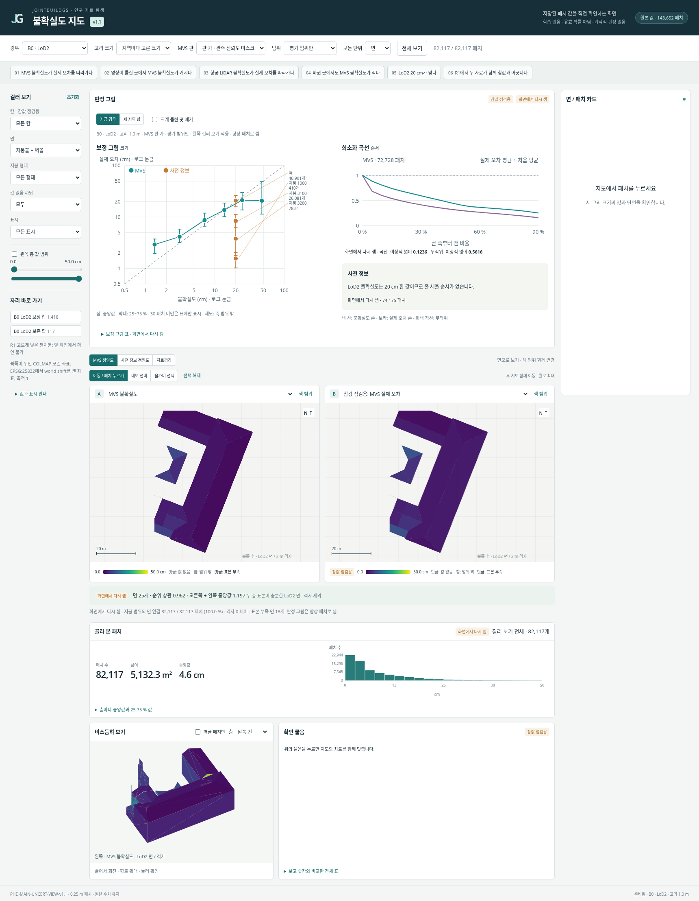

B0 · LoD2 · 고리 1 m · MVS 판 가 · 평가 범위 · 면 · 지금 경우 · 크게 틀린 곳 빼기 끔. 화면에서 다시 셈: 그림의 MVS 72728개 / 사전 정보 74175개; 지도 면 25개, 순위 상관 0.96231, 오른쪽 ÷ 왼쪽 1.1967.

### judge_B0_b10__LoD2

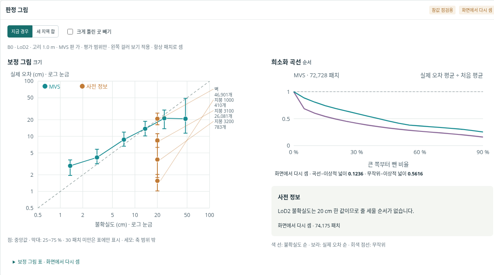

B0 · LoD2 · 고리 1 m · MVS 판 가 · 평가 범위 · 면 · 지금 경우 · 크게 틀린 곳 빼기 끔. 화면에서 다시 셈: 그림의 MVS 72728개 / 사전 정보 74175개; 지도 면 25개, 순위 상관 0.96231, 오른쪽 ÷ 왼쪽 1.1967.

### pair_mvs_B0_b10__LoD2

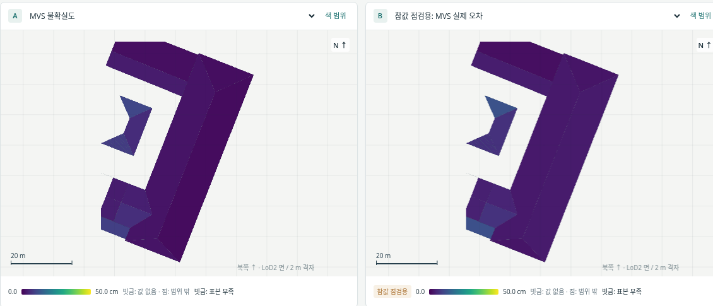

B0 · LoD2 · 고리 1 m · MVS 판 가 · 평가 범위 · 면 · 지금 경우 · 크게 틀린 곳 빼기 끔. 화면에서 다시 셈: 그림의 MVS 72728개 / 사전 정보 74175개; 지도 면 25개, 순위 상관 0.96231, 오른쪽 ÷ 왼쪽 1.1967.

### pair_prior_B0_b10__LoD2

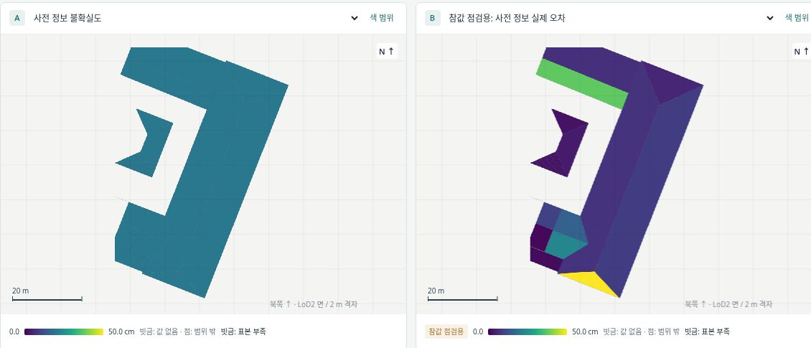

B0 · LoD2 · 고리 1 m · MVS 판 가 · 평가 범위 · 면 · 지금 경우 · 크게 틀린 곳 빼기 끔. 화면에서 다시 셈: 그림의 MVS 72728개 / 사전 정보 74175개; 지도 면 29개, 순위 상관 없음, 오른쪽 ÷ 왼쪽 0.76851.

### judge_B0_b10__ALS

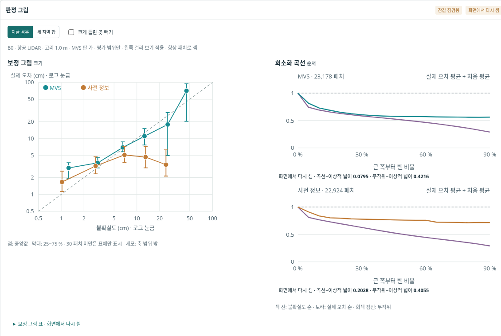

B0 · 항공 LiDAR · 고리 1 m · MVS 판 가 · 평가 범위 · 면 · 지금 경우 · 크게 틀린 곳 빼기 끔. 화면에서 다시 셈: 그림의 MVS 23178개 / 사전 정보 22924개; 지도 면 15개, 순위 상관 0.89643, 오른쪽 ÷ 왼쪽 1.1051.

### pair_mvs_B0_b10__ALS

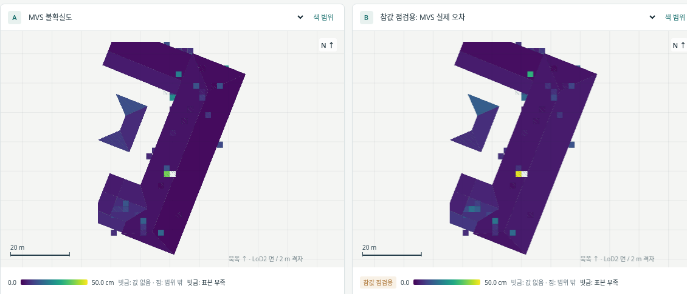

B0 · 항공 LiDAR · 고리 1 m · MVS 판 가 · 평가 범위 · 면 · 지금 경우 · 크게 틀린 곳 빼기 끔. 화면에서 다시 셈: 그림의 MVS 23178개 / 사전 정보 22924개; 지도 면 15개, 순위 상관 0.89643, 오른쪽 ÷ 왼쪽 1.1051.

### pair_prior_B0_b10__ALS

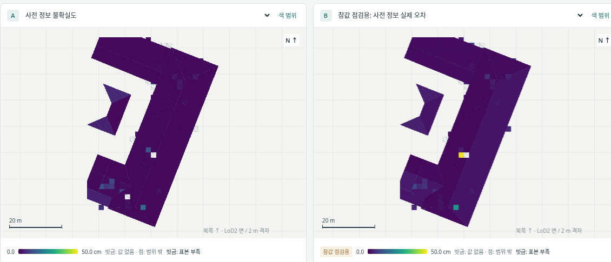

B0 · 항공 LiDAR · 고리 1 m · MVS 판 가 · 평가 범위 · 면 · 지금 경우 · 크게 틀린 곳 빼기 끔. 화면에서 다시 셈: 그림의 MVS 23178개 / 사전 정보 22924개; 지도 면 15개, 순위 상관 0.65357, 오른쪽 ÷ 왼쪽 1.2367.

### pair_sources_B0_b10__ALS

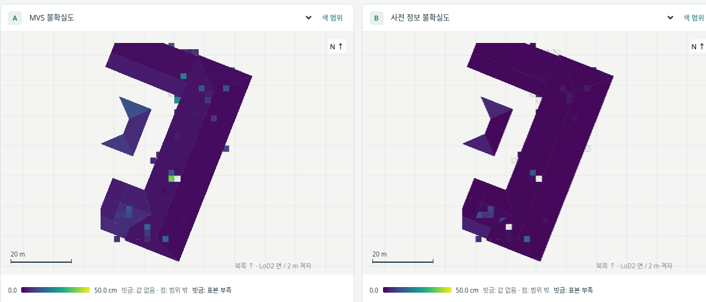

B0 · 항공 LiDAR · 고리 1 m · MVS 판 가 · 평가 범위 · 면 · 지금 경우 · 크게 틀린 곳 빼기 끔. 화면에서 다시 셈: 그림의 MVS 23178개 / 사전 정보 22924개; 지도 면 15개, 순위 상관 0.58571, 오른쪽 ÷ 왼쪽 0.43826.

### judge_B173nb_b10__LoD2

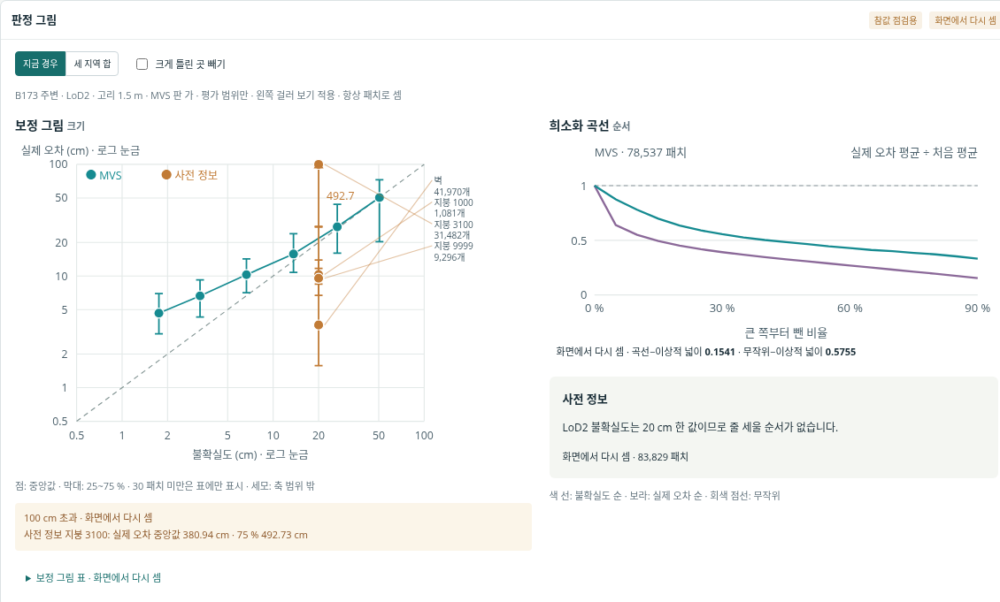

B173 주변 · LoD2 · 고리 1.5 m · MVS 판 가 · 평가 범위 · 면 · 지금 경우 · 크게 틀린 곳 빼기 끔. 화면에서 다시 셈: 그림의 MVS 78537개 / 사전 정보 83829개; 지도 면 35개, 순위 상관 0.86331, 오른쪽 ÷ 왼쪽 1.4652.

### pair_mvs_B173nb_b10__LoD2

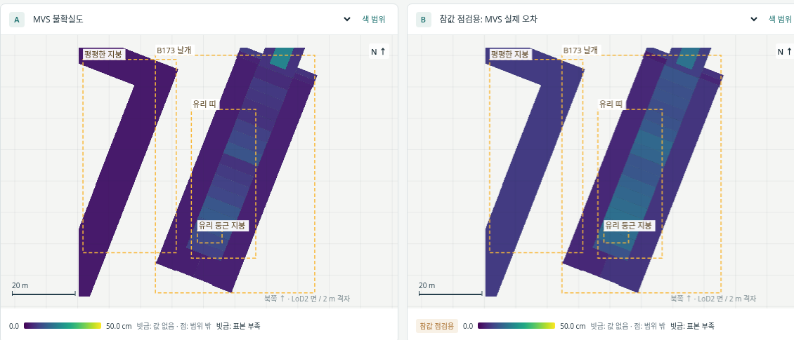

B173 주변 · LoD2 · 고리 1.5 m · MVS 판 가 · 평가 범위 · 면 · 지금 경우 · 크게 틀린 곳 빼기 끔. 화면에서 다시 셈: 그림의 MVS 78537개 / 사전 정보 83829개; 지도 면 35개, 순위 상관 0.86331, 오른쪽 ÷ 왼쪽 1.4652.

### pair_prior_B173nb_b10__LoD2

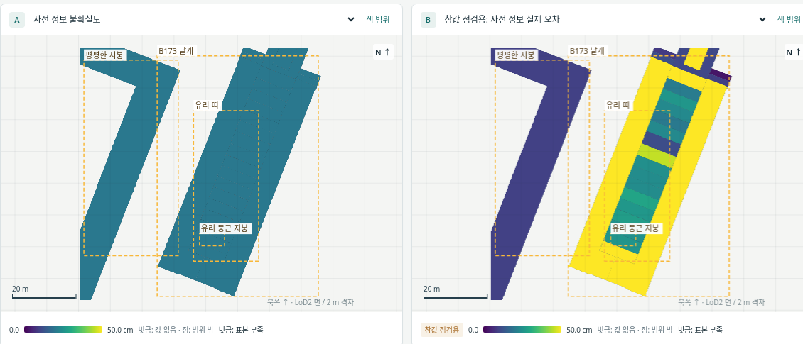

B173 주변 · LoD2 · 고리 1.5 m · MVS 판 가 · 평가 범위 · 면 · 지금 경우 · 크게 틀린 곳 빼기 끔. 화면에서 다시 셈: 그림의 MVS 78537개 / 사전 정보 83829개; 지도 면 51개, 순위 상관 없음, 오른쪽 ÷ 왼쪽 1.3141.

### judge_B173nb_b10__ALS

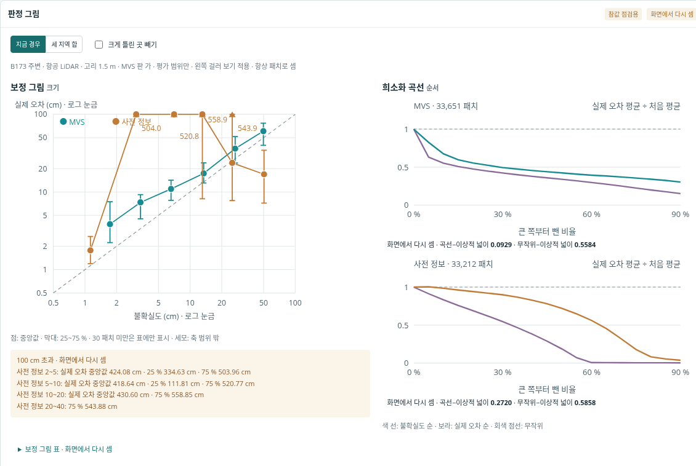

B173 주변 · 항공 LiDAR · 고리 1.5 m · MVS 판 가 · 평가 범위 · 면 · 지금 경우 · 크게 틀린 곳 빼기 끔. 화면에서 다시 셈: 그림의 MVS 33651개 / 사전 정보 33212개; 지도 면 36개, 순위 상관 0.69781, 오른쪽 ÷ 왼쪽 1.8365.

### pair_mvs_B173nb_b10__ALS

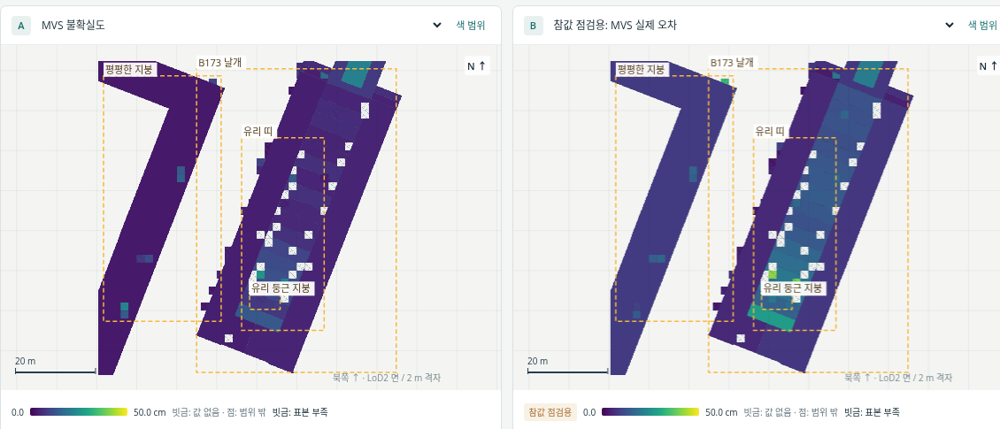

B173 주변 · 항공 LiDAR · 고리 1.5 m · MVS 판 가 · 평가 범위 · 면 · 지금 경우 · 크게 틀린 곳 빼기 끔. 화면에서 다시 셈: 그림의 MVS 33651개 / 사전 정보 33212개; 지도 면 36개, 순위 상관 0.69781, 오른쪽 ÷ 왼쪽 1.8365.

### pair_prior_B173nb_b10__ALS

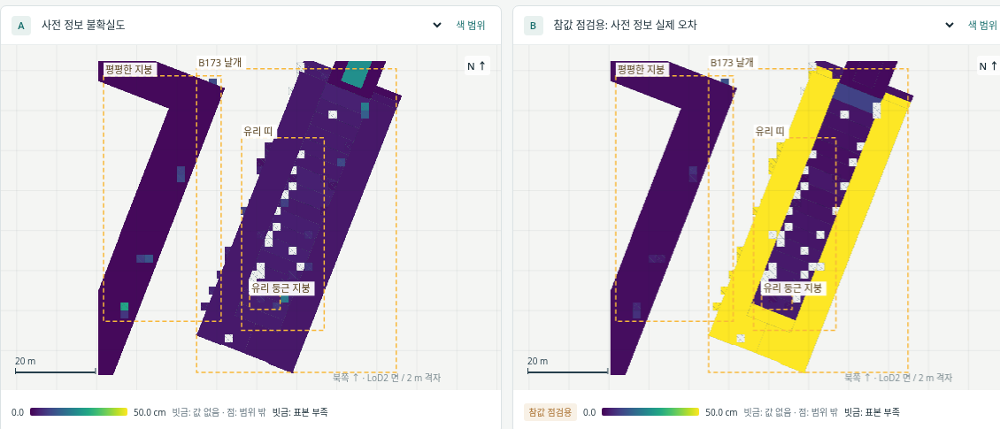

B173 주변 · 항공 LiDAR · 고리 1.5 m · MVS 판 가 · 평가 범위 · 면 · 지금 경우 · 크게 틀린 곳 빼기 끔. 화면에서 다시 셈: 그림의 MVS 33651개 / 사전 정보 33212개; 지도 면 37개, 순위 상관 0.15908, 오른쪽 ÷ 왼쪽 0.74584.

### pair_sources_B173nb_b10__ALS

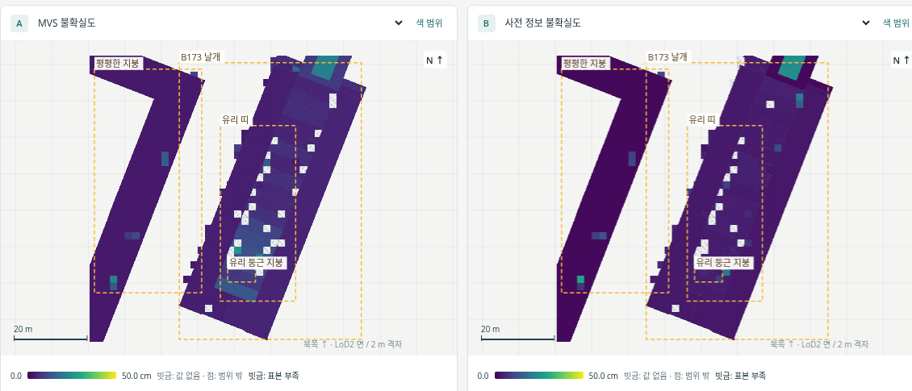

B173 주변 · 항공 LiDAR · 고리 1.5 m · MVS 판 가 · 평가 범위 · 면 · 지금 경우 · 크게 틀린 곳 빼기 끔. 화면에서 다시 셈: 그림의 MVS 33651개 / 사전 정보 33212개; 지도 면 38개, 순위 상관 0.39206, 오른쪽 ÷ 왼쪽 0.63125.

### judge_R1rep_b10__LoD2

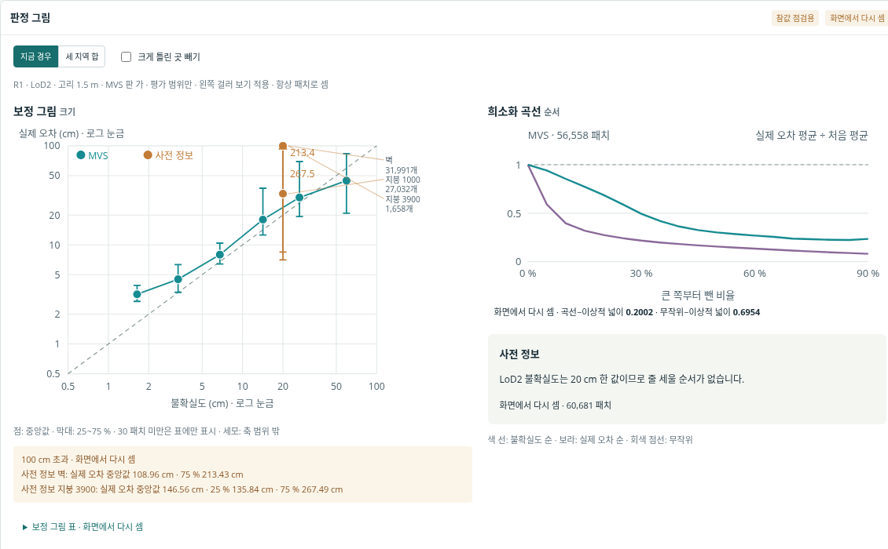

R1 · LoD2 · 고리 1.5 m · MVS 판 가 · 평가 범위 · 면 · 지금 경우 · 크게 틀린 곳 빼기 끔. 화면에서 다시 셈: 그림의 MVS 56558개 / 사전 정보 60681개; 지도 면 56개, 순위 상관 0.72392, 오른쪽 ÷ 왼쪽 1.1993.

### pair_mvs_R1rep_b10__LoD2

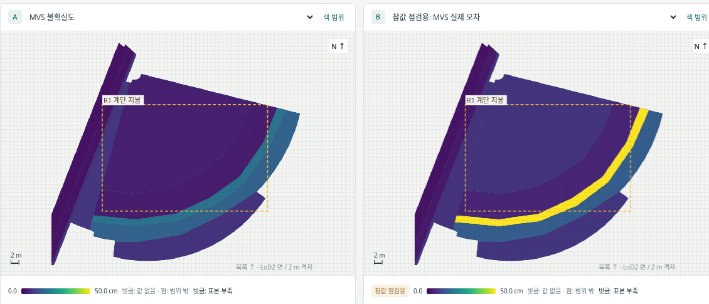

R1 · LoD2 · 고리 1.5 m · MVS 판 가 · 평가 범위 · 면 · 지금 경우 · 크게 틀린 곳 빼기 끔. 화면에서 다시 셈: 그림의 MVS 56558개 / 사전 정보 60681개; 지도 면 56개, 순위 상관 0.72392, 오른쪽 ÷ 왼쪽 1.1993.

### pair_prior_R1rep_b10__LoD2

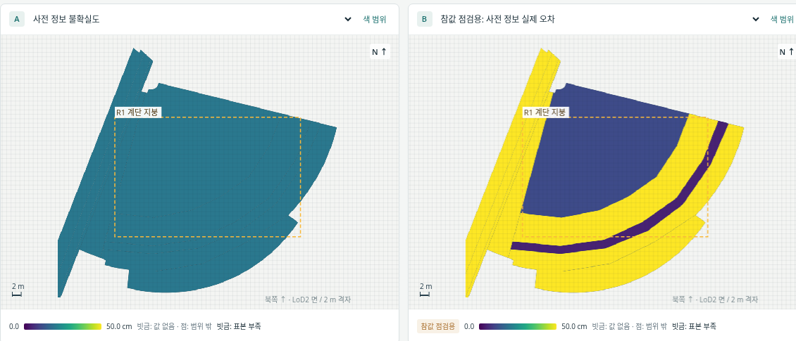

R1 · LoD2 · 고리 1.5 m · MVS 판 가 · 평가 범위 · 면 · 지금 경우 · 크게 틀린 곳 빼기 끔. 화면에서 다시 셈: 그림의 MVS 56558개 / 사전 정보 60681개; 지도 면 65개, 순위 상관 없음, 오른쪽 ÷ 왼쪽 5.044.

### judge_R1rep_b10__ALS

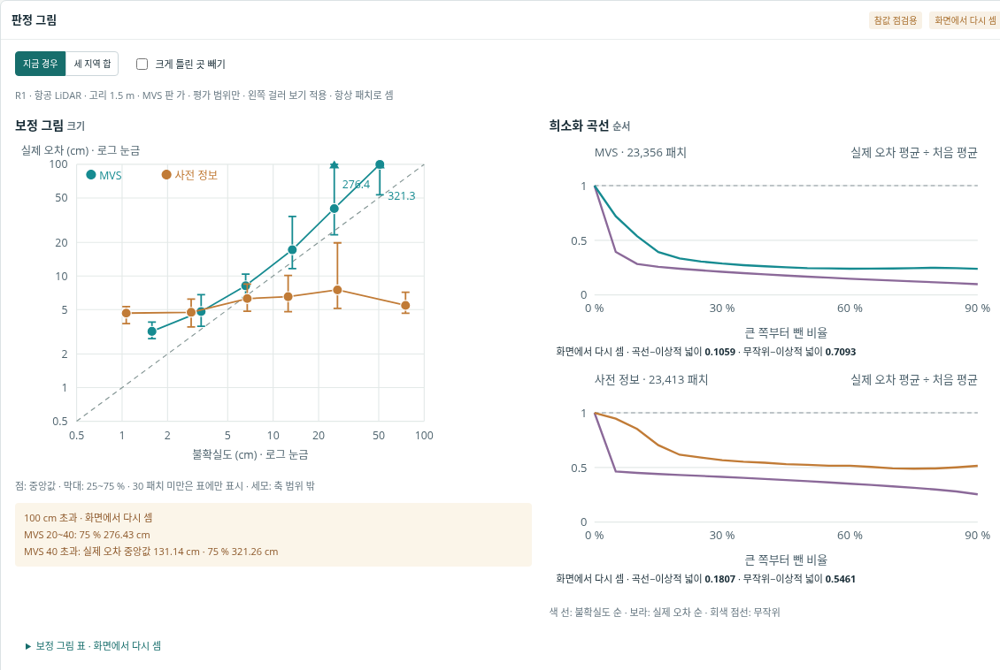

R1 · 항공 LiDAR · 고리 1.5 m · MVS 판 가 · 평가 범위 · 면 · 지금 경우 · 크게 틀린 곳 빼기 끔. 화면에서 다시 셈: 그림의 MVS 23356개 / 사전 정보 23413개; 지도 면 17개, 순위 상관 0.94363, 오른쪽 ÷ 왼쪽 1.0761.

### pair_mvs_R1rep_b10__ALS

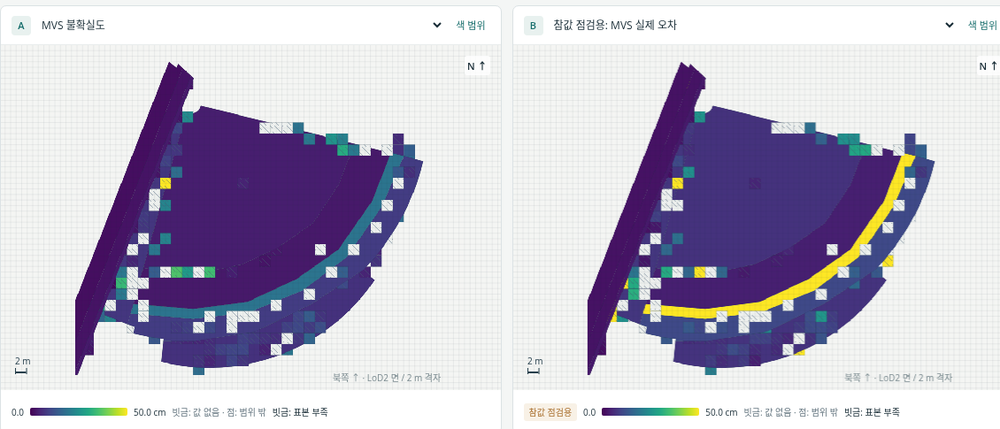

R1 · 항공 LiDAR · 고리 1.5 m · MVS 판 가 · 평가 범위 · 면 · 지금 경우 · 크게 틀린 곳 빼기 끔. 화면에서 다시 셈: 그림의 MVS 23356개 / 사전 정보 23413개; 지도 면 17개, 순위 상관 0.94363, 오른쪽 ÷ 왼쪽 1.0761.

### pair_prior_R1rep_b10__ALS

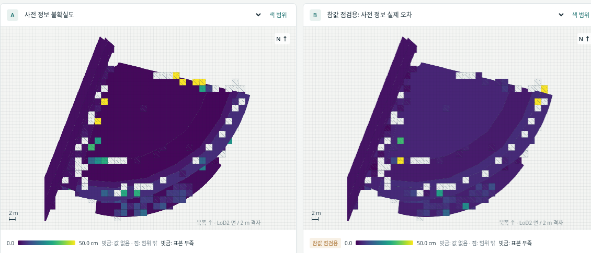

R1 · 항공 LiDAR · 고리 1.5 m · MVS 판 가 · 평가 범위 · 면 · 지금 경우 · 크게 틀린 곳 빼기 끔. 화면에서 다시 셈: 그림의 MVS 23356개 / 사전 정보 23413개; 지도 면 17개, 순위 상관 0.64706, 오른쪽 ÷ 왼쪽 1.3712.

### pair_sources_R1rep_b10__ALS

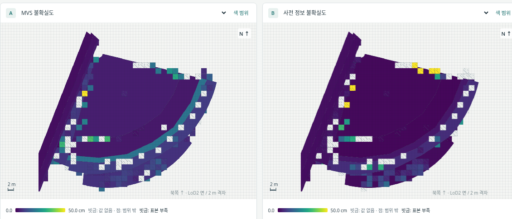

R1 · 항공 LiDAR · 고리 1.5 m · MVS 판 가 · 평가 범위 · 면 · 지금 경우 · 크게 틀린 곳 빼기 끔. 화면에서 다시 셈: 그림의 MVS 23356개 / 사전 정보 23413개; 지도 면 17개, 순위 상관 0.75, 오른쪽 ÷ 왼쪽 0.62573.

### pooled_LoD2_exclude_0

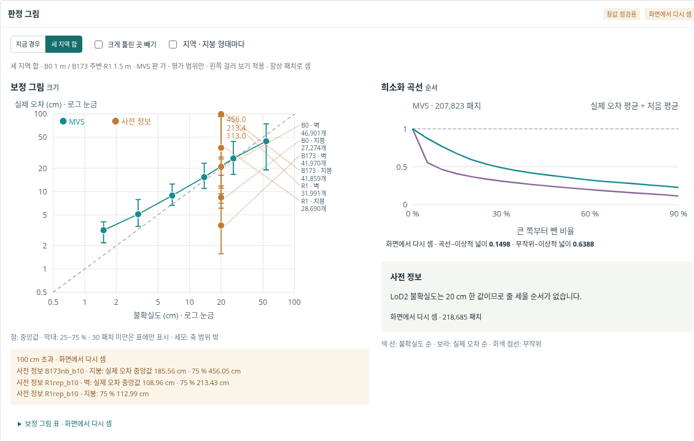

B0 · LoD2 · 고리 1 m · MVS 판 가 · 평가 범위 · 면 · 세 지역 합 · 크게 틀린 곳 빼기 끔. 화면에서 다시 셈: 그림의 MVS 207823개 / 사전 정보 218685개; 지도 면 31개, 순위 상관 없음, 오른쪽 ÷ 왼쪽 3.1833.

### pooled_LoD2_exclude_1

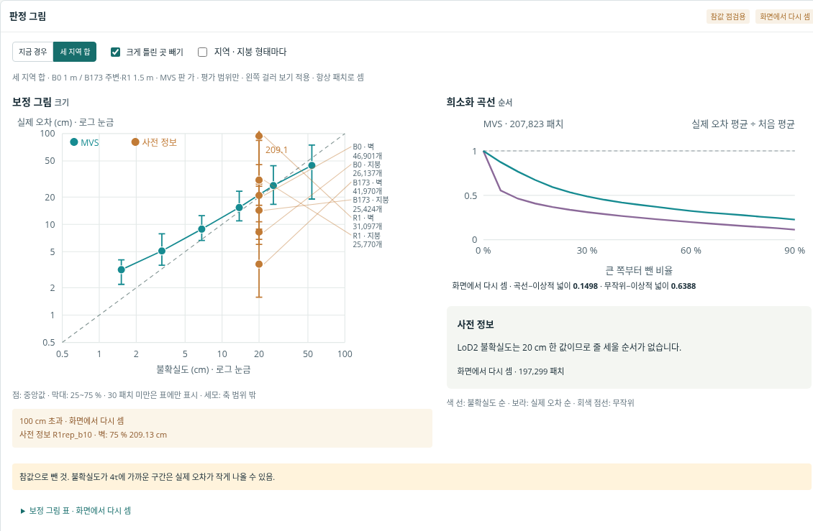

B0 · LoD2 · 고리 1 m · MVS 판 가 · 평가 범위 · 면 · 세 지역 합 · 크게 틀린 곳 빼기 켬. 화면에서 다시 셈: 그림의 MVS 207823개 / 사전 정보 197299개; 지도 면 31개, 순위 상관 없음, 오른쪽 ÷ 왼쪽 3.1833.

### pooled_ALS_exclude_0

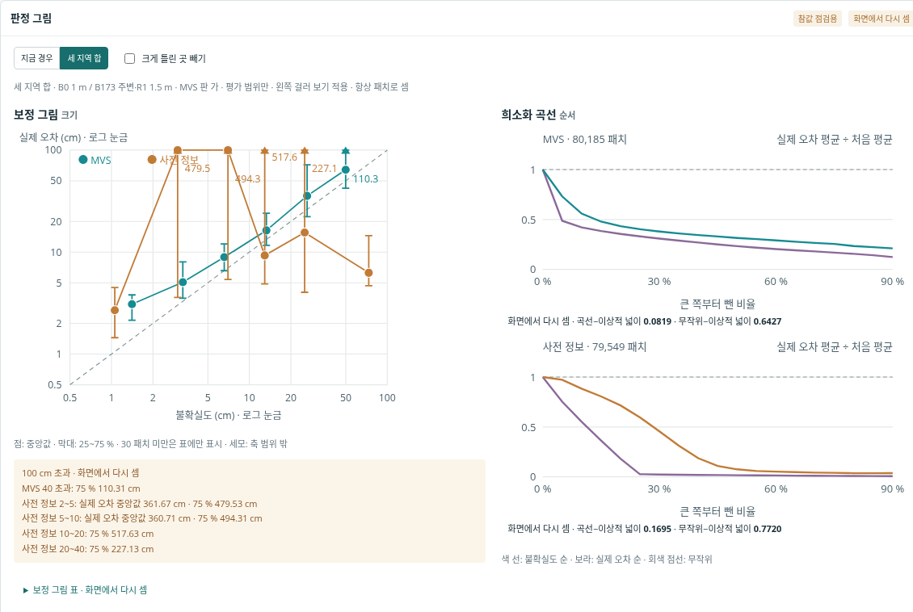

B0 · 항공 LiDAR · 고리 1 m · MVS 판 가 · 평가 범위 · 면 · 세 지역 합 · 크게 틀린 곳 빼기 끔. 화면에서 다시 셈: 그림의 MVS 80185개 / 사전 정보 79549개; 지도 면 15개, 순위 상관 0.58571, 오른쪽 ÷ 왼쪽 0.43826.

### pooled_ALS_exclude_1

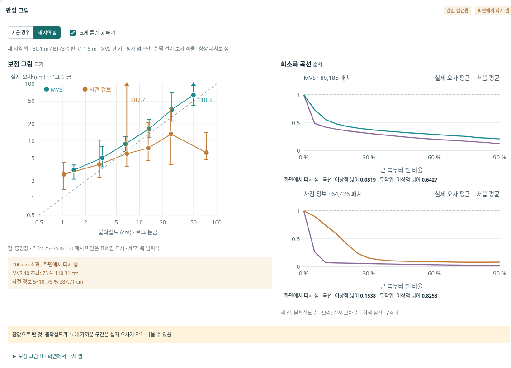

B0 · 항공 LiDAR · 고리 1 m · MVS 판 가 · 평가 범위 · 면 · 세 지역 합 · 크게 틀린 곳 빼기 켬. 화면에서 다시 셈: 그림의 MVS 80185개 / 사전 정보 64426개; 지도 면 15개, 순위 상관 0.58571, 오른쪽 ÷ 왼쪽 0.43826.

### place_glass_strip

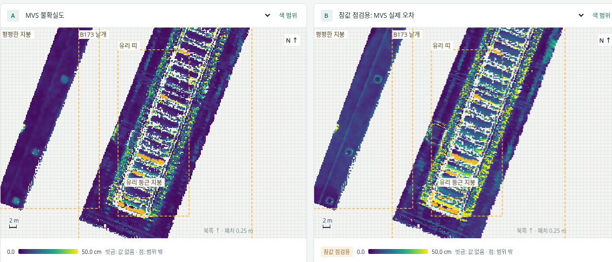

B173 주변 · 항공 LiDAR · 고리 1.5 m · MVS 판 가 · 평가 범위 · 패치 · 지금 경우 · 크게 틀린 곳 빼기 끔. 화면에서 다시 셈: 그림의 MVS 33651개 / 사전 정보 33212개; 지도 면 36개, 순위 상관 0.69781, 오른쪽 ÷ 왼쪽 1.8365.

### place_glass_dome

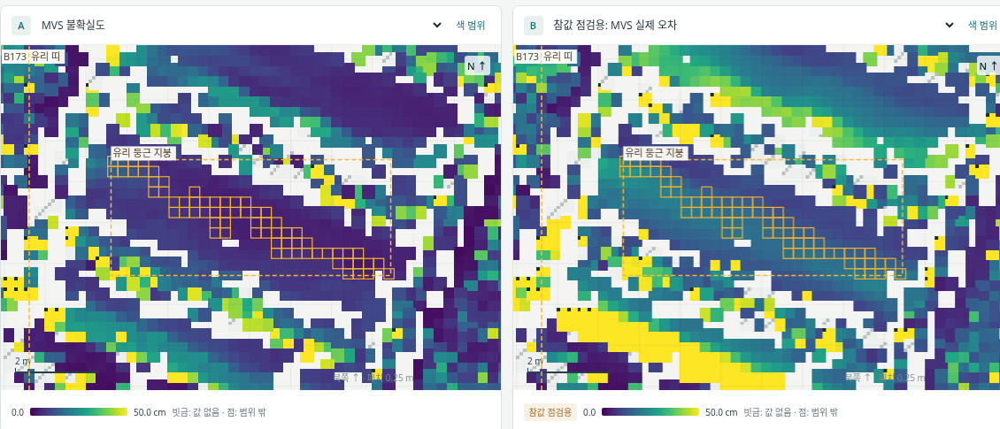

B173 주변 · 항공 LiDAR · 고리 1.5 m · MVS 판 가 · 평가 범위 · 패치 · 지금 경우 · 크게 틀린 곳 빼기 끔. 화면에서 다시 셈: 그림의 MVS 33651개 / 사전 정보 33212개; 지도 면 36개, 순위 상관 0.69781, 오른쪽 ÷ 왼쪽 1.8365.

### place_flat_roof

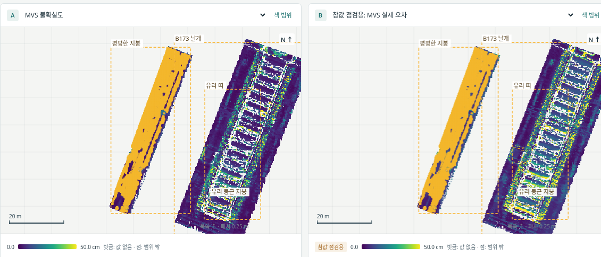

B173 주변 · 항공 LiDAR · 고리 1.5 m · MVS 판 가 · 평가 범위 · 패치 · 지금 경우 · 크게 틀린 곳 빼기 끔. 화면에서 다시 셈: 그림의 MVS 33651개 / 사전 정보 33212개; 지도 면 36개, 순위 상관 0.69781, 오른쪽 ÷ 왼쪽 1.8365.

### place_b173_wing

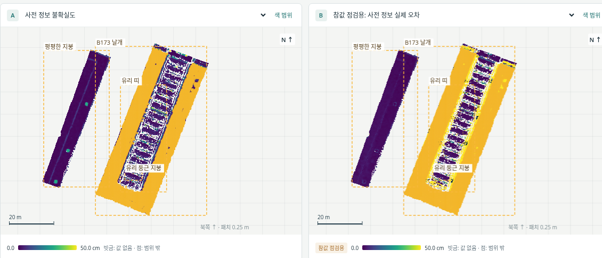

B173 주변 · 항공 LiDAR · 고리 1.5 m · MVS 판 가 · 평가 범위 · 패치 · 지금 경우 · 크게 틀린 곳 빼기 끔. 화면에서 다시 셈: 그림의 MVS 33651개 / 사전 정보 33212개; 지도 면 37개, 순위 상관 0.15908, 오른쪽 ÷ 왼쪽 0.74584.

### place_r1_step_roof

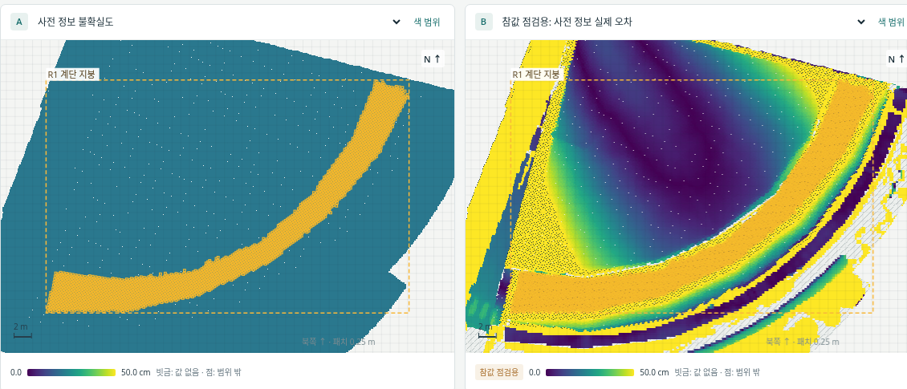

R1 · LoD2 · 고리 1.5 m · MVS 판 가 · 평가 범위 · 패치 · 지금 경우 · 크게 틀린 곳 빼기 끔. 화면에서 다시 셈: 그림의 MVS 56558개 / 사전 정보 60681개; 지도 면 65개, 순위 상관 없음, 오른쪽 ÷ 왼쪽 5.044.

### oblique_left

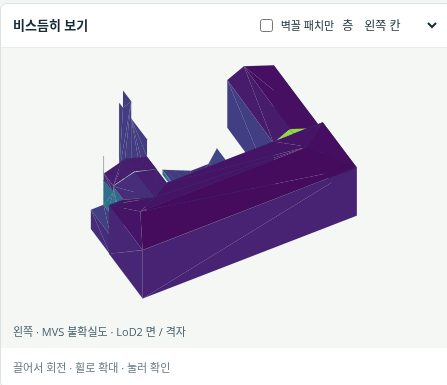

B0 · LoD2 · 고리 1 m · MVS 판 가 · 평가 범위 · 면 · 지금 경우 · 크게 틀린 곳 빼기 끔. 화면에서 다시 셈: 그림의 MVS 72728개 / 사전 정보 74175개; 지도 면 25개, 순위 상관 0.96231, 오른쪽 ÷ 왼쪽 1.1967.

### oblique_right

B0 · LoD2 · 고리 1 m · MVS 판 가 · 평가 범위 · 면 · 지금 경우 · 크게 틀린 곳 빼기 끔. 화면에서 다시 셈: 그림의 MVS 72728개 / 사전 정보 74175개; 지도 면 25개, 순위 상관 0.96231, 오른쪽 ÷ 왼쪽 1.1967.

### comparison_face

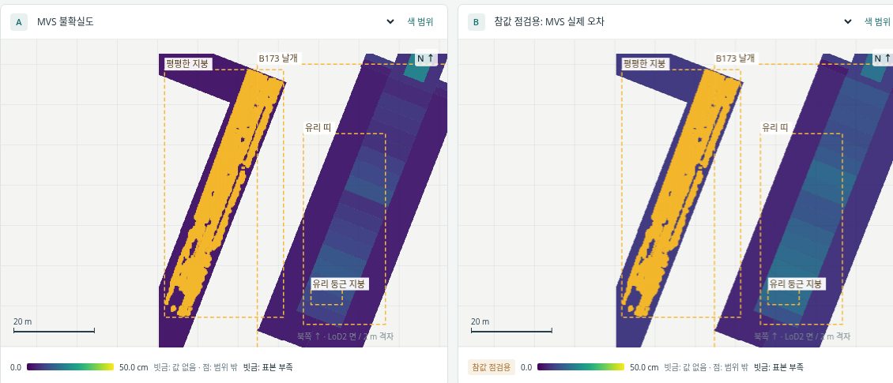

B173 주변 · LoD2 · 고리 1.5 m · MVS 판 가 · 평가 범위 · 면 · 지금 경우 · 크게 틀린 곳 빼기 끔. 화면에서 다시 셈: 그림의 MVS 78537개 / 사전 정보 83829개; 지도 면 35개, 순위 상관 0.86331, 오른쪽 ÷ 왼쪽 1.4652.

### comparison_patch

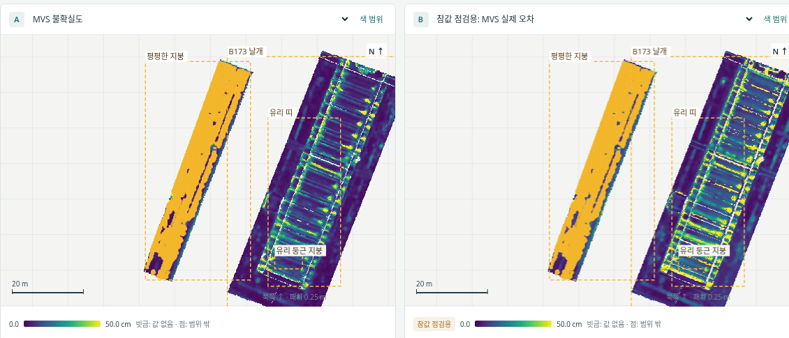

B173 주변 · LoD2 · 고리 1.5 m · MVS 판 가 · 평가 범위 · 패치 · 지금 경우 · 크게 틀린 곳 빼기 끔. 화면에서 다시 셈: 그림의 MVS 78537개 / 사전 정보 83829개; 지도 면 35개, 순위 상관 0.86331, 오른쪽 ÷ 왼쪽 1.4652.

### signed_colors

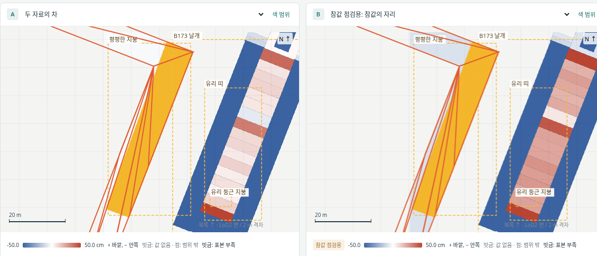

B173 주변 · LoD2 · 고리 1.5 m · MVS 판 가 · 평가 범위 · 면 · 지금 경우 · 크게 틀린 곳 빼기 켬. 화면에서 다시 셈: 그림의 MVS 78537개 / 사전 정보 67394개; 지도 면 37개, 순위 상관 0.90446, 오른쪽 ÷ 왼쪽 2.1612.

### narrow

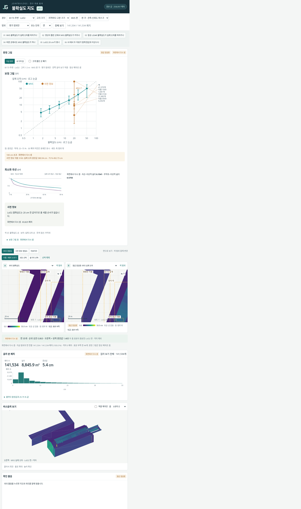

B173 주변 · LoD2 · 고리 1.5 m · MVS 판 가 · 평가 범위 · 면 · 지금 경우 · 크게 틀린 곳 빼기 끔. 화면에서 다시 셈: 그림의 MVS 78537개 / 사전 정보 83829개; 지도 면 35개, 순위 상관 0.86331, 오른쪽 ÷ 왼쪽 1.4652.

## 7. v1 맞춰 보기와 다시 셈 점검 표

v1 보고에는 전체 행의 맞춰 보기 표가 링크된 JSON 중심으로 남아 있어, 이번에 같은 기록을 Markdown 표로 함께 제공한다. 새 수치로 바꾸지 않았다.

- [v1 독립 다시 셈 전체 1828행](tables_v1_1/v1_recount.md) · [JSON](tables_v1_1/v1_recount.json). 당시 일치 1828행.
- [v1 여섯 확인 물음의 보고 / 화면 비교 58행](tables_v1_1/v1_browser_comparison.md) · [JSON](tables_v1_1/v1_browser_comparison.json).

## 8. 변경·확인 불가·시간

- 첫 빌드 전 잠금: 2026-10-23T20:59:04.155100+09:00. SHA-256 `beaead64ff5a5ffee1cfaee5fe7fa17efcfe074a47c136ee872dc622fc93533b`. 설정 변경 이력은 비어 있으며 최초 정의를 유지했다.
- 원본·v1 보존: 390개 입력의 SHA-256 일치. v1 웹과 ZIP은 그대로 남았다. [보존 점검](tables_v1_1/integrity.json).
- v1.1 웹 393.36 MB, ZIP 293.21 MB. 정밀도·표본 수를 줄이지 않았다.
- 학습 없음, GPU 없음. 계산은 Docker CPU의 NumPy·SciPy, 화면은 Chromium의 CPU 표시를 사용했다. 원래 불확실도 값·설정·방법 코드는 변경하지 않았다.
- 확인 불가: Windows Chrome·Edge 직접 실행. Linux Chromium에서 계산·지도 선택·면 카드·필터·색 범위 연결을 확인했다.
- 설정 잠금부터 보고 생성까지 25.4분. 브라우저 점검 2026-10-23T12:16:49.085Z ~ 2026-10-23T12:18:09.029Z.
- 표시 수정과 예외는 [점검 기록](issues_v1_1.md)에 적었다. 유효 확률과 과학적 판정은 추가하지 않았다.
