범위: 공통 XY 130,331.75 m², LoD2 154동, EPSG:25832. [이 발주에서 냄]
나눔: 정하는 곳 135동·바닥 54,785.31 m² / 확인용 19동·바닥 2,705.53 m². [이 발주에서 냄]
확인 불가: 정하는 곳 참값 면·평면 없는 패치 1,129,319개(두 사전 정보 합, 서로 다른 표면 표본), 대표 사진 6곳. 기존 값과의 차이는 4절에 보존.

# 본실험 넓히기 0단계 보고 v2

- PHD-MAIN-WIDEN0-v2 · scientific_verdict: null
- 새 측정은 [이 발주에서 냄]. 학습과 유효 확률 계산은 하지 않았다. 해석·원인 판정은 포함하지 않는다.
- 전체 점검 중 허용 경로 밖 빈 파일 생성 1건은 예외다. 내용과 복구를 7절에 적었다.

## 1. 범위와 건물 나눔

사진·연직 비행 드론 LiDAR·항공 LiDAR·LoD2가 모두 닿는 0.5 m XY 격자를 범위로 정했다. 사진 범위는 카메라 안에 ALS 지형이 투영되는지를 사용했다. 기존 MVS 점의 유무는 범위 조건이 아니다.
연직 LiDAR 원자료 177,981,904점, 관측 XY 넓이 130,917.25 m². 같은 원자료 바깥상자 안 사진 267,120.00 m², 항공 LiDAR 266,053.00 m². 공통 범위 중 기존 MVS 없는 곳 7,589.25 m². [이 발주에서 냄]
항공 LiDAR 측량일은 기존 GPS 시각 감사의 2022-02-27이다. 원본의 생성일과 측량일을 따로 적었다. 원자료 범위·점 수·해시는 `tables/원자료_머리글.json`, LoD2 원본 건물 수와 범위는 `tables/scope_split.json`에 있다.
평가 네 영역과 탐색 일곱 영역에 걸친 88동은 정하는 곳이다. 그 밖 66동을 건물 번호 순서로 놓고 씨앗 20261023으로 floor(30%)를 확인용으로 선택했다. 건물별 결과를 읽기 전에 나눴다. 계산은 100×100 m 구역 24개, 둘레 10 m 겹침이다. 원본 패치 중심이 속한 구역만 그 패치를 소유한다.
정합 후 모든 패치의 기둥·층·1.5 m 고리 범위가 입력 구역의 10 m 겹침 안에 들어오는지 확인했다. 구역 자르기 때문에 필요한 점이 빠지는지에 대한 검사이며, 원자료 자체의 결측을 없다는 뜻으로 바꾸지 않는다. `tables/구역_겹침_검사.json`에 통과 기록이 있다.

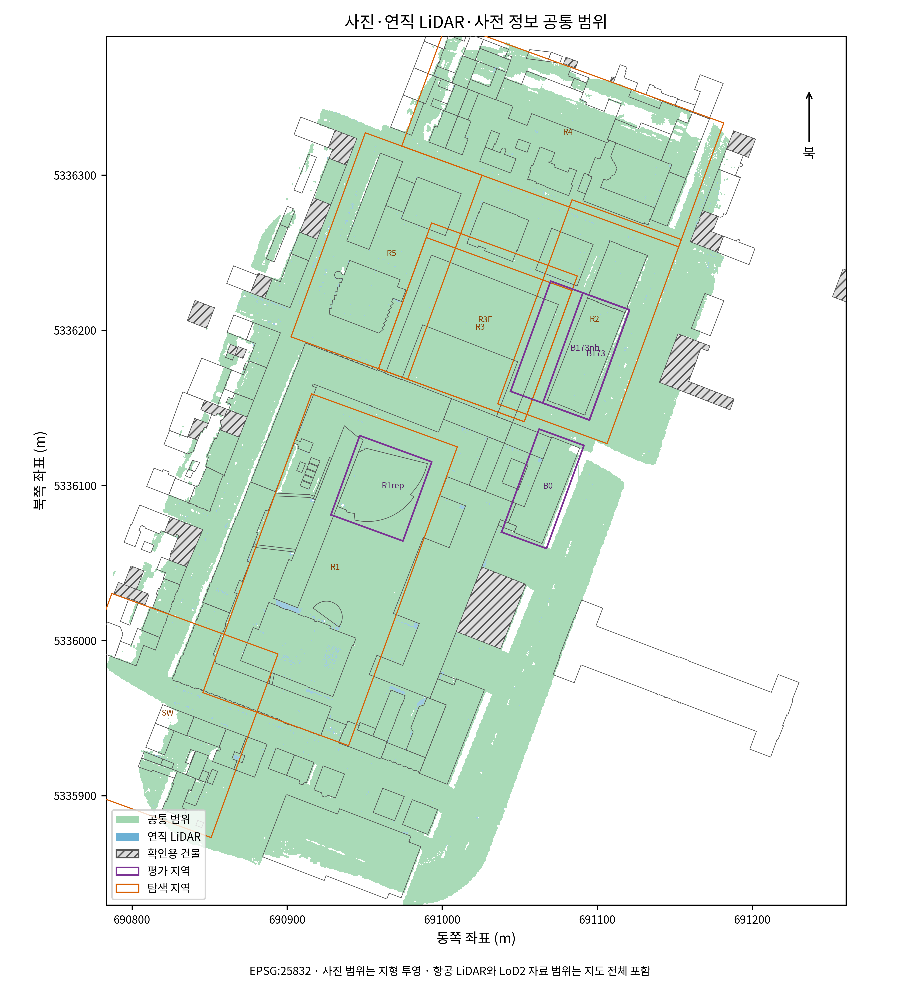

## 2. 단계 가: 입력과 사전 정보

전체 937장 중 학습 819장, 평가 118장이다. 이름 차례의 매 여덟 번째 영상을 평가로 두었다. MVS 입력 모델·관측 연결에는 학습 영상만 남겼다. 기존 전체 937장 MVS는 입력 현황과 기존 후보 선정 규칙에만 사용했다.

| 영상 나눔 | 비행 시간 구간 | 수 | 연직 | 비스듬함 | UTC 처음~끝 | 상대 고도 중앙값 m |
|---|---|---:|---:|---:|---|---:|
| train | nadir | 292 | 292 | 0 | 2024-12-17T07:42:55.308572 ~ 2024-12-17T08:12:59.686563 | 75.01 |
| train | manual | 521 | 42 | 479 | 2024-12-17T08:37:45.392928 ~ 2024-12-17T09:36:55.014586 | 39.38 |
| train | unknown | 6 | 6 | 0 | 2024-12-17T08:13:01.693020 ~ 2024-12-17T08:13:14.332377 | 75.01 |
| evaluation | nadir | 42 | 42 | 0 | 2024-12-17T07:42:53.333643 ~ 2024-12-17T08:12:49.676540 | 75.01 |
| evaluation | manual | 74 | 9 | 65 | 2024-12-17T08:39:19.524800 ~ 2024-12-17T09:36:40.971451 | 39.41 |
| evaluation | unknown | 2 | 1 | 1 | 2024-12-17T08:13:05.686018 ~ 2024-12-17T09:37:04.980974 | 61.41 |

촬영일은 2024-12-17이다. 비행 시간 구간은 앞 사진 보고의 분류이며, 구간 밖 시각은 unknown으로 남겼다. 상대 고도는 XMP 기록이다. 연직/비스듬함은 광축의 연직 각도 20°를 사용했다. 수동 비행 LiDAR는 사용하지 않았다.
`tables/입력_있음없음.json`에 기존 깊이·신뢰도 마스크·사전 정보 렌더·영역·패치 파일의 유무를 적었다. 전체 학습 목록의 깊이는 이 발주에서 만들었다. 방법의 판정·영역 코드는 만들지 않았다.
패치는 앞 작업의 0.25 m 면 생성 규칙을 사용했다. LoD2는 소속 면의 건물, 항공 LiDAR는 보기 화면 v1.1의 지붕·벽 면 붙이기 규칙으로 건물을 정했다. 붙지 않은 패치는 수·넓이만 별첨에 남겼다.
참값은 연직 원자료, 1단계의 높이 이동 −0.043807299569302446 m, 기존 제외 규칙과 불확실도 작업의 기둥·면·평면 정의를 사용했다. 지붕꼴·벽꼴의 점 밀도는 참값 안쪽 원의 점 수를 π×0.5² m²로 나눈 표면 지지 밀도다. 평면을 정할 수 있는 패치만의 통계이며 원자료 고유 점 전체의 밀도와 다르다.

| 사전 정보 | 참값 면 | 유효 패치 | 점 밀도 중앙값 / 25% / 75% (점/m²) |
|---|---|---:|---|
| LoD2 | 지붕꼴 | 879,751 | 920.55 / 494.02 / 1,457.86 |
| LoD2 | 벽꼴 | 1,014,819 | 138.78 / 59.84 / 294.12 |
| ALS | 지붕꼴 | 727,963 | 965.12 / 509.30 / 1,496.06 |
| ALS | 벽꼴 | 8,731 | 808.51 / 432.26 / 1,112.81 |

[이 발주에서 냄] `tables/참값_점밀도.json`의 표면 지지 밀도. 동일 원자료 점이 여러 패치에서 사용될 수 있다.

τ는 항공 LiDAR 0.1266 m, LoD2 지붕·벽 모두 0.20 m다. LoD2는 사용자의 이번 답변으로 정했다. 과거 τ와 결과는 바꾸지 않았다. 고리는 1.5 m 하나다.

| 사전 정보 | 사전 정보가 틀린 덩어리 1 m² 이상 | 1 m² 미만 수 | 1 m² 미만 넓이 m² |
|---|---:|---:|---:|
| LoD2 | 2,499 | 5,525 | 1,500.69 |
| ALS | 286 | 8,183 | 1,308.74 |

덩어리의 건물·지붕 형태·부호 있는 gt_p 사분위수·참값 밀도는 `사전정보_틀린자리_*.json`, 오차 크기·부호별 넓이는 `사전정보_크기부호_*.json`, 건물별 상위 30동은 `사전정보_건물상위30_*.json`이다. 건물 순위의 분모는 참값이 있는 표면 넓이이고 전체 표면을 분모로 한 비율도 보존했다.

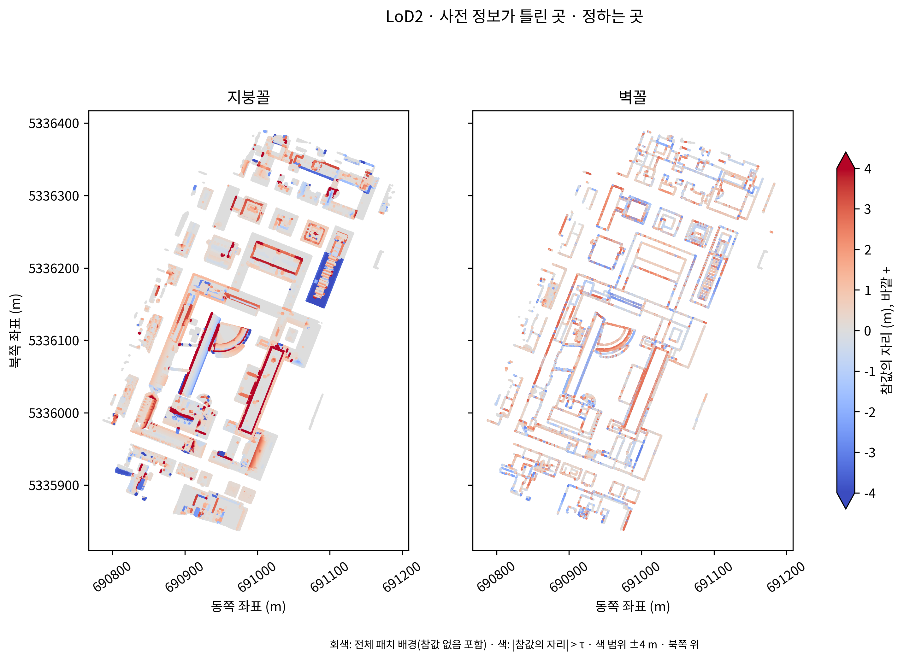

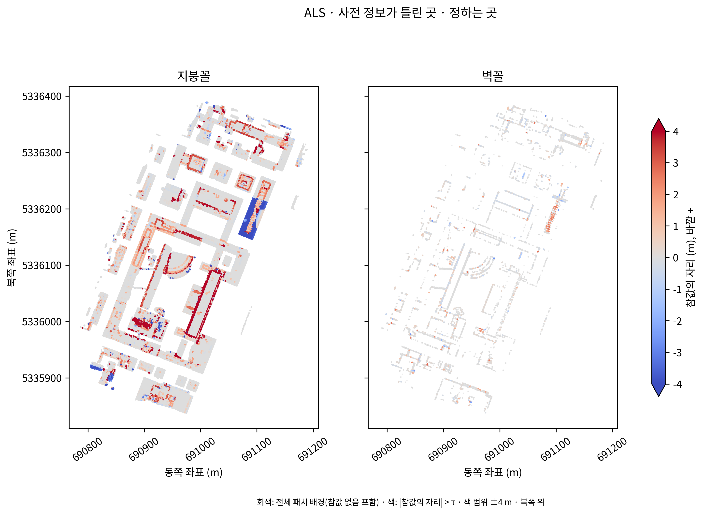

## 3. 단계 나: 맞는 쪽 칸과 시험 자리

COLMAP 기하 깊이 819장, GPU 실행 2.846시간. 기존 판 가의 1024 크기·3회 반복·기하 일관성·필터 설정이다. 학습은 실행하지 않았다. [이 발주에서 냄]
깊이 입력의 영상 이름·크기·SHA-256과 학습 영상 전용 검사는 `tables/새_MVS_깊이파일.json`에 있다.
MVS 맞음은 실제 오차 e≤τ, 사전 정보 맞음은 |gt_p|≤τ다. 두 자료의 차 자체를 MVS 실제 오차로 쓰지 않았다. 실제 오차가 있으면 고리 평면·불확실도 실패와 독립적으로 칸을 정한다. 차가 없으면 그 넓이를 분포 분모에서 제외하고 따로 적는다.
시험 자리 표의 항공 LiDAR 실제 오차는 원점군의 e이며, 칸 분류용 사전 정보 면의 |gt_p|와 별개다. LoD2 실제 오차 열은 |gt_p|다. 지붕 형태 속성이 없으면 빈 원값과 해당 패치 수·확인 불가 사유를 남기고 형태를 추정하지 않았다.
참값 없음에는 점이 없는 경우뿐 아니라 기존 정의의 면 없음·10점 미만·평면 실패도 포함한다. 사유별 수는 `tables/참값_유무사유.json`이다. 이 보완을 첫 패치 오차 계산 전에 설정에 남겼다.

| 사전 정보 | 칸 | 패치 수 | 넓이 m² | 비율 % |
|---|---|---:|---:|---:|
| LoD2 | 둘 다 맞음 | 969,851 | 60,615.69 | 32.2609 |
| LoD2 | 사전 정보만 틀림 | 447,384 | 27,961.44 | 14.8817 |
| LoD2 | 영상만 틀림 | 180,725 | 11,295.31 | 6.0116 |
| LoD2 | 둘 다 틀림 | 186,429 | 11,651.81 | 6.2013 |
| LoD2 | MVS 없음 · 사전 정보 맞음 | 38,655 | 2,415.94 | 1.2858 |
| LoD2 | MVS 없음 · 사전 정보 틀림 | 71,526 | 4,470.31 | 2.3792 |
| LoD2 | 참값 없음 | 1,111,720 | 69,481.44 | 36.9795 |
| ALS | 둘 다 맞음 | 582,450 | 38,750.71 | 76.8942 |
| ALS | 사전 정보만 틀림 | 24,213 | 1,668.38 | 3.3106 |
| ALS | 영상만 틀림 | 94,071 | 6,326.48 | 12.5538 |
| ALS | 둘 다 틀림 | 22,641 | 1,577.48 | 3.1302 |
| ALS | MVS 없음 · 사전 정보 맞음 | 10,076 | 674.72 | 1.3389 |
| ALS | MVS 없음 · 사전 정보 틀림 | 3,243 | 233.56 | 0.4635 |
| ALS | 참값 없음 | 17,599 | 1,163.51 | 2.3088 |

두 사전 정보 각각 일곱 칸의 합은 100%이고 패치 중복 배정은 없다. 두 사전 정보의 패치 모집단은 별개다.

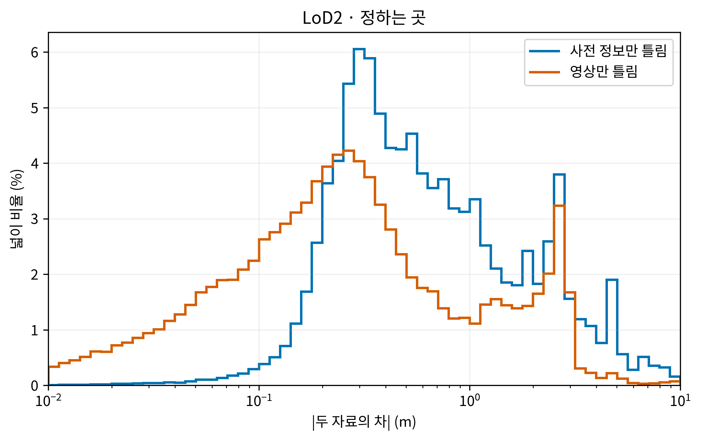

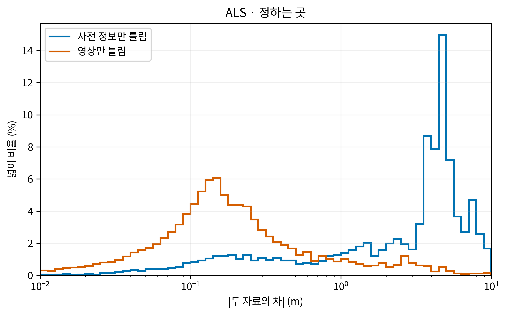

일곱 칸 각각의 분포도 같은 축·구간·분모 규칙으로 보존했다. 차가 있는 패치가 없으면 빈 분포임을 표시한다.

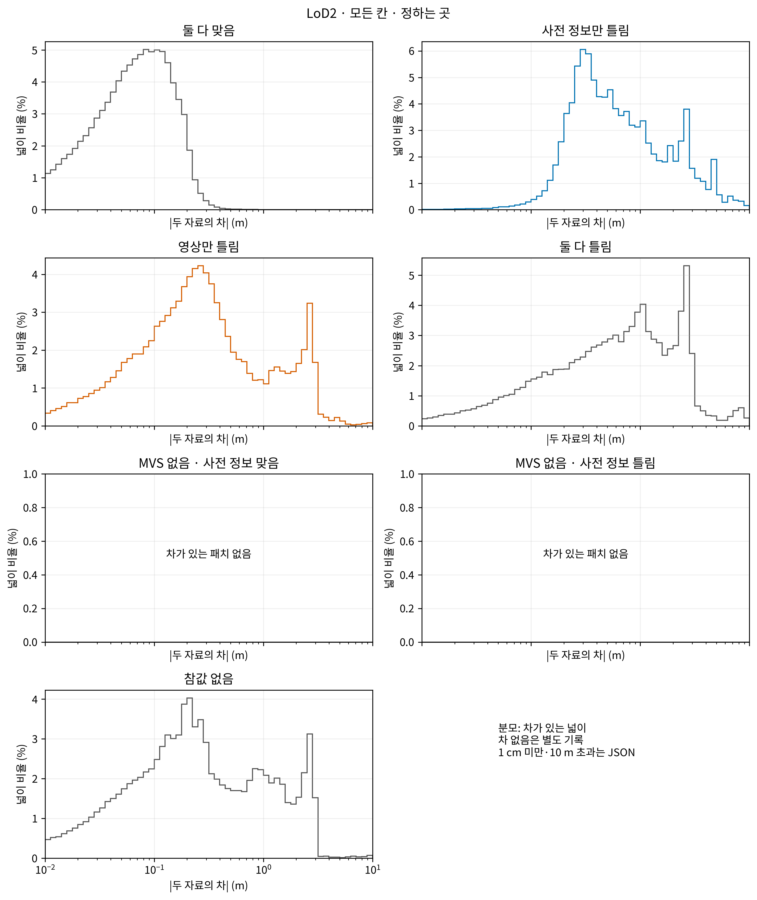

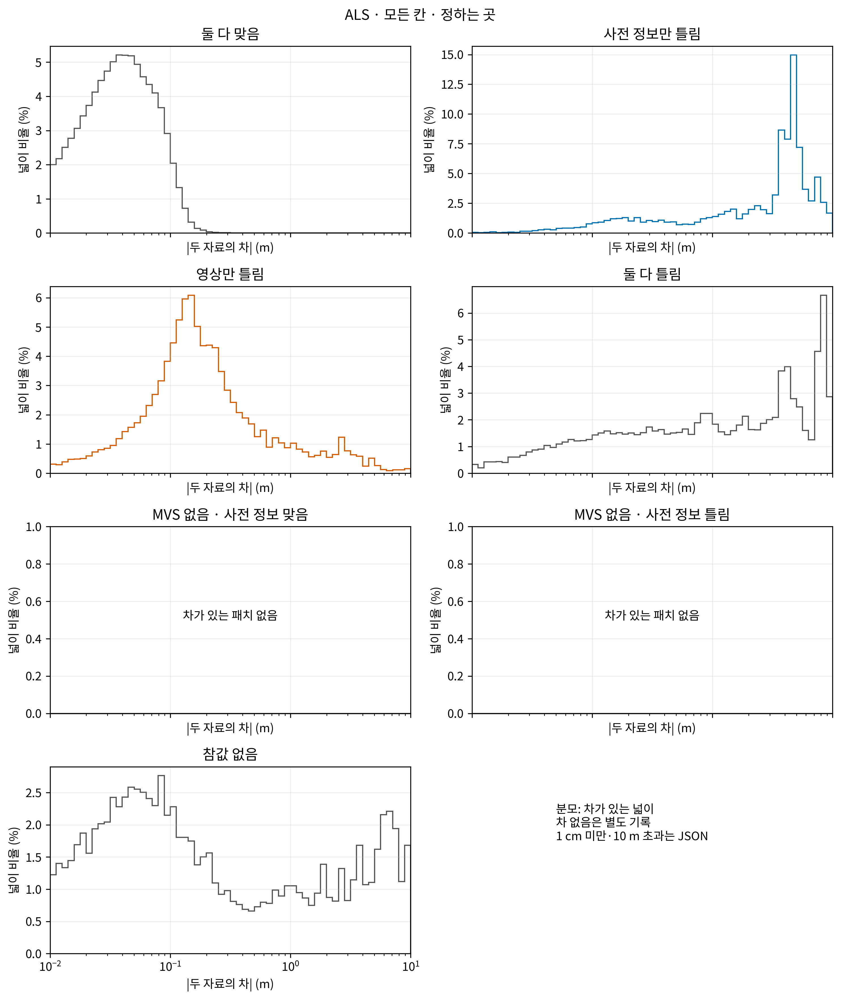

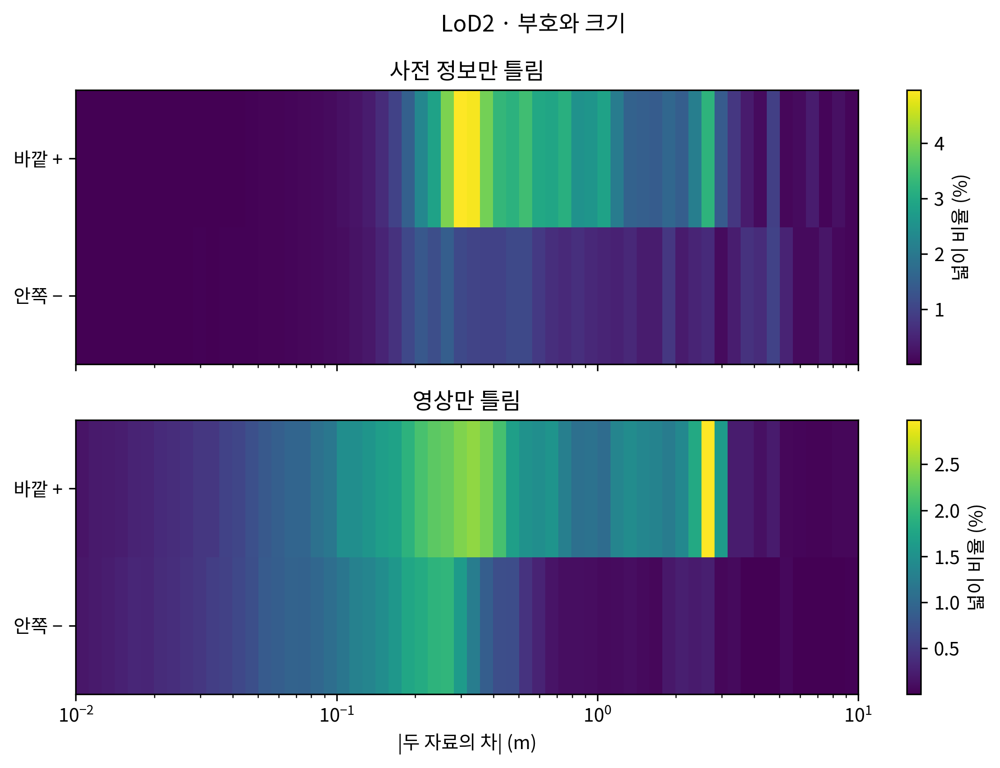

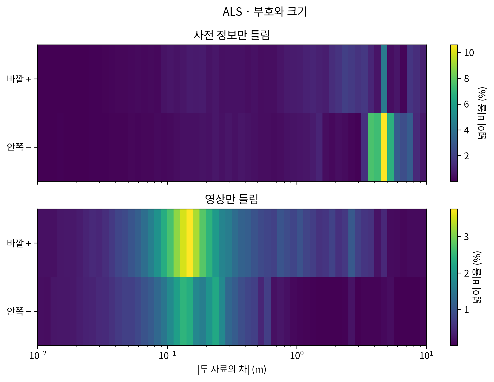

위 분포는 차가 있는 넓이를 분모로 한다. 1 cm 미만·10 m 초과·차 없음의 넓이는 그림별 JSON에 기록했다. 0.5·1·2 m 초과 비율과 바깥 + 비율은 `tables/차의크기_비율.csv`에 사전 정보·지붕꼴/벽꼴·전체/평가 세 영역별로 나란히 있다.

| 범위 | 사전 정보 | 칸 | 면 | 유효 패치 | >0.5 m % | >1 m % | >2 m % | 바깥 + % |
|---|---|---|---|---:|---:|---:|---:|---:|
| 전체 | LoD2 | 사전 정보만 틀림 | 지붕꼴 | 226,192 | 52.0876 | 33.1497 | 20.4309 | 75.6601 |
| 전체 | LoD2 | 사전 정보만 틀림 | 벽꼴 | 221,164 | 53.9688 | 28.7779 | 13.2500 | 72.2779 |
| 전체 | LoD2 | 영상만 틀림 | 지붕꼴 | 53,559 | 29.1977 | 16.2830 | 9.6529 | 66.6592 |
| 전체 | LoD2 | 영상만 틀림 | 벽꼴 | 127,019 | 26.7873 | 19.0735 | 9.8969 | 64.1502 |
| 평가 세 영역 합집합 | LoD2 | 사전 정보만 틀림 | 지붕꼴 | 39,292 | 74.2976 | 62.5929 | 46.8543 | 49.0685 |
| 평가 세 영역 합집합 | LoD2 | 사전 정보만 틀림 | 벽꼴 | 21,216 | 63.4238 | 50.1885 | 24.9953 | 46.4555 |
| 평가 세 영역 합집합 | LoD2 | 영상만 틀림 | 지붕꼴 | 3,490 | 48.5673 | 44.0688 | 34.4126 | 77.1347 |
| 평가 세 영역 합집합 | LoD2 | 영상만 틀림 | 벽꼴 | 8,434 | 32.9855 | 25.8359 | 11.6908 | 58.2997 |
| 전체 | ALS | 사전 정보만 틀림 | 지붕꼴 | 23,349 | 83.1959 | 77.8737 | 68.2716 | 39.2741 |
| 전체 | ALS | 사전 정보만 틀림 | 벽꼴 | 864 | 28.1513 | 17.5068 | 7.3798 | 48.7523 |
| 전체 | ALS | 영상만 틀림 | 지붕꼴 | 92,071 | 17.4016 | 10.6443 | 6.1031 | 61.9423 |
| 전체 | ALS | 영상만 틀림 | 벽꼴 | 1,953 | 12.2984 | 5.5997 | 2.0806 | 64.4972 |
| 평가 세 영역 합집합 | ALS | 사전 정보만 틀림 | 지붕꼴 | 13,721 | 92.2180 | 87.9608 | 80.4166 | 8.4777 |
| 평가 세 영역 합집합 | ALS | 사전 정보만 틀림 | 벽꼴 | 127 | 54.5088 | 47.7718 | 27.8079 | 67.3762 |
| 평가 세 영역 합집합 | ALS | 영상만 틀림 | 지붕꼴 | 7,587 | 23.0804 | 16.5671 | 12.9681 | 50.9966 |
| 평가 세 영역 합집합 | ALS | 영상만 틀림 | 벽꼴 | 159 | 19.1838 | 7.1239 | 2.5380 | 66.8299 |

[이 발주에서 냄] 분모는 해당 칸·면·범위에서 차가 있는 넓이. 각 평가 영역의 개별 값과 차 없음 넓이는 같은 CSV/JSON에 있다.

| 사전 정보 | 칸 | 전체 덩어리 수 | 1 m² 미만 | 1~2.5 / 2.5~10 / 10~100 / 100 m² 이상 |
|---|---|---:|---:|---|
| LoD2 | 둘 다 맞음 | 5,226 | 3,759 | 518 / 465 / 359 / 125 |
| LoD2 | 사전 정보만 틀림 | 10,530 | 8,558 | 954 / 706 / 263 / 49 |
| LoD2 | 영상만 틀림 | 14,711 | 12,673 | 1250 / 651 / 132 / 5 |
| LoD2 | 둘 다 틀림 | 15,627 | 13,238 | 1497 / 753 / 138 / 1 |
| LoD2 | MVS 없음 · 사전 정보 맞음 | 3,233 | 2,809 | 264 / 126 / 34 / 0 |
| LoD2 | MVS 없음 · 사전 정보 틀림 | 6,702 | 5,776 | 594 / 289 / 43 / 0 |
| LoD2 | 참값 없음 | 5,768 | 4,186 | 731 / 493 / 267 / 91 |
| ALS | 둘 다 맞음 | 4,159 | 3,600 | 205 / 158 / 123 / 73 |
| ALS | 사전 정보만 틀림 | 4,713 | 4,616 | 66 / 21 / 7 / 3 |
| ALS | 영상만 틀림 | 10,031 | 9,130 | 561 / 276 / 59 / 5 |
| ALS | 둘 다 틀림 | 6,445 | 6,289 | 104 / 38 / 14 / 0 |
| ALS | MVS 없음 · 사전 정보 맞음 | 2,504 | 2,443 | 36 / 16 / 9 / 0 |
| ALS | MVS 없음 · 사전 정보 틀림 | 1,745 | 1,735 | 7 / 2 / 1 / 0 |
| ALS | 참값 없음 | 3,866 | 3,754 | 61 / 34 / 16 / 1 |

연결 거리는 기본 0.36 m다. 같은 사전 정보·같은 칸 안에서 잇고, 건물·지붕/벽 경계는 연결을 끊지 않는다. 여러 건물에 걸치면 모든 건물 번호와 건물별 넓이를 남겼다. 간격에 따른 연결 거리 변경은 `시험자리_요약.json`에 있다. 이웃 칸은 1 m 안 다른 칸의 패치 수로 정했다.
`tables/시험자리_정하는곳.csv`와 JSON에는 1 m² 이상 덩어리의 차·실제 오차·불확실도·관측 수·지지 비율·이웃 칸을 기록했다. 각 사분위수에는 유효 표본 수도 있다.
차 ÷ 합친 불확실도는 부호를 유지한 값과 절댓값을 모두 기록했다. 합친 불확실도는 √(MVS 불확실도² + 사전 정보 불확실도²)이며 분모가 없거나 0이면 확인 불가다.
대표 사진은 두 사전 정보를 합해 칸마다 넓이가 큰 순서로 최대 20곳, 세 모음 전체에서 한 건물이 포함되는 덩어리는 최대 3곳을 골랐다. 칸 순서는 사전 정보만 틀림→영상만 틀림→둘 다 틀림이다. 사진 선정 전에 칸별로 초기화되던 건물 수를 전체 공통으로 수정했다. 연직 학습 영상 중 모든 표시 패치의 투영 좌표가 영상 안에 있고 투영 넓이가 가장 큰 영상을 원본 5280×3956 해상도로 잘랐다. 가려짐 검사는 포함하지 않는다. 표시는 0.25 m 사각형을 gt_p만큼 법선 방향으로 옮긴 테두리이며, 수치 넓이는 원본 패치 넓이를 유지한다. 원본 렌즈 왜곡을 반영했고 3 m 여백의 영상 경계 잘림은 사진 기록에 표시했다. 사진의 까닭은 분류하지 않았다.
원본 해상도 사진 54장의 크기와 원본 JPEG 화소를 검사했다. 노란 테두리를 제외한 모든 화소가 원본 잘라내기와 일치했다. `tables/사진_원본해상도_검사.json`에 기록했다. [이 발주에서 냄]

| 사진 칸 | 선정 | 원본 사진 있음 | 확인 불가 |
|---|---:|---:|---:|
| 사전 정보만 틀림 | 20 | 14 | 6 |
| 영상만 틀림 | 20 | 20 | 0 |
| 둘 다 틀림 | 20 | 20 | 0 |

사진 확인 불가는 모든 표시 패치를 영상 안에 담고 3 m 여백을 유한하게 투영할 수 있는 연직 학습 영상이 없는 경우다. 해당 덩어리를 다른 자리로 바꾸지 않았으며, 각 사유는 `tables/대표사진_기록.json`에 있다.

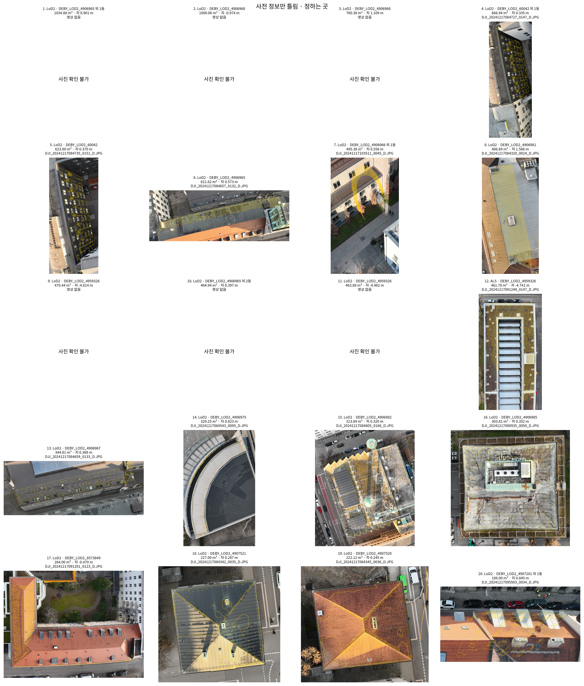

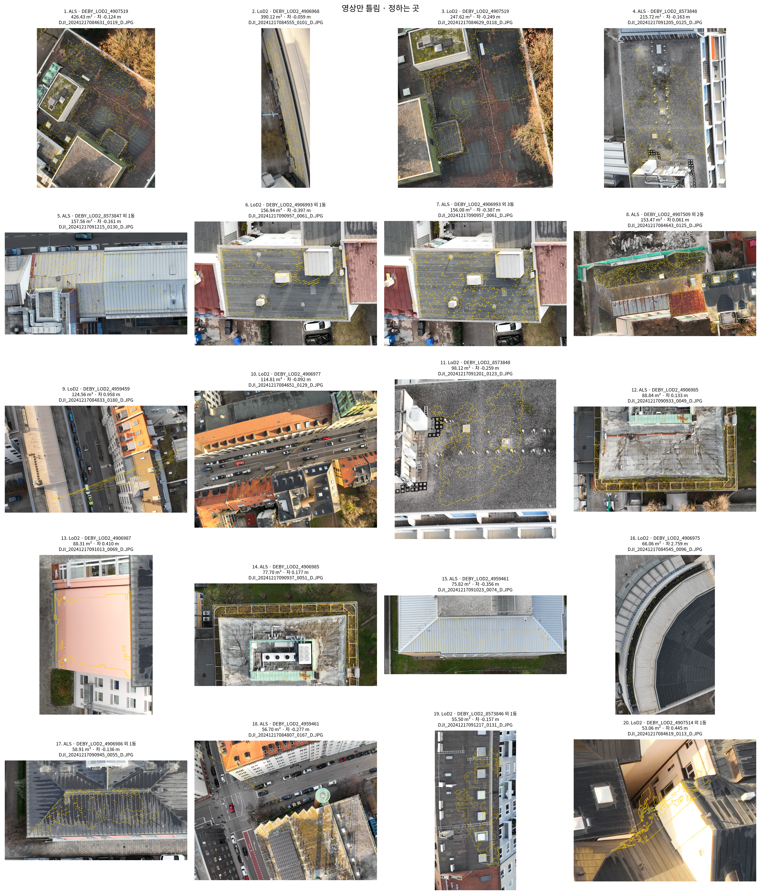

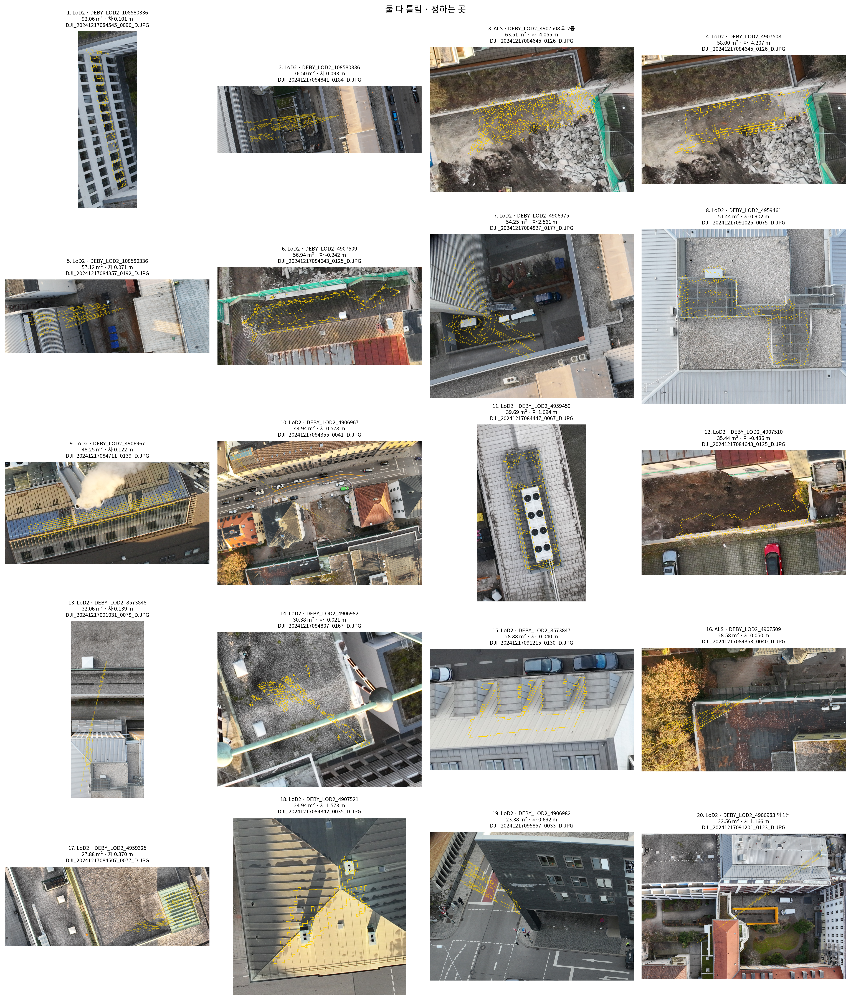

## 4. 앞 작업과 맞춰 보기

입력 표정은 평가 네 영역과 전체 모델이 일치했다. 기존 R1 항공 LiDAR 정합을 같은 입력으로 다시 계산한 이동 차이는 0 m였다. 기존 깊이 7장의 7,000점으로 정수 화소 역투영을 재현했으며 저장 좌표와 차이는 0 m였다. 새 구역의 MVS는 영상 묶음과 평가 나눔이 달라 기존 깊이와 동일한 입력 실행이 아니다.

| 영역 | 사전 정보 | 기존 평가 패치 | 같은 원본 중심·법선 | 대응 안 됨 | gt_p 쌍 수 | gt_p 새−기존 중앙값 m |
|---|---|---:|---:|---:|---:|---:|
| B0_b10 | LoD2 | 82,117 | 79,491 | 2,626 | 44,477 | 0.000001 |
| B173nb_b10 | LoD2 | 141,534 | 141,479 | 55 | 83,746 | 0.000001 |
| R1rep_b10 | LoD2 | 79,054 | 78,880 | 174 | 60,544 | 0.000000 |
| B0_b10 | ALS | 23,280 | 0 | 23,280 | 0 | 확인 불가 |
| B173nb_b10 | ALS | 34,273 | 0 | 34,273 | 0 | 확인 불가 |
| R1rep_b10 | ALS | 24,189 | 0 | 24,189 | 0 | 확인 불가 |

같은 원본 중심은 1e-5 m 안, 법선 내적은 1−1e-5 이상으로 제한했다. LoD2는 건물 번호도 일치해야 한다. 여러 기존 패치가 같은 새 패치에 대응하면 비교에서 제외하고 수를 남겼다. 기존 ALS 패치 표에는 붙인 건물 번호가 없어 좌표·법선의 단일 대응만 확인했다. 다른 패치를 같은 것으로 간주하지 않았다. 기존과 새 정합 이동, 구역 문맥, 난수 인덱스, 영상 목록 차이도 보존했다. B0 앞 참값에는 수동 비행이 포함될 수 있어 이번 연직 전용 참값과 동일하지 않다.
원본 패치 격자는 `맞춰보기_원본패치격자`, 참값 점 표본은 `맞춰보기_참값점`, 지역마다 3장 이하의 깊이 비교는 `맞춰보기_MVS깊이`, 불확실도·실제 오차를 포함한 기존/새 값은 `맞춰보기_패치와값`에 반올림 전 값으로 있다. 새 공통 XY 범위·건물 집합 밖의 패치는 새 값 비교 모집단에 포함되지 않는다.
원래 τ→고정 τ 교차표는 기존 값 전체와 새 값의 정확한 패치 대응 집합을 분리했다. 열두 칸→일곱 칸 교차표도 두 집합을 분리했다. 각각 `맞춰보기_tau_교차표.csv`, `맞춰보기_열두칸_교차표.csv`다. 앞 결과는 수정하지 않았다.

## 5. 확인용 봉인

| 사전 정보 | 건물 수 | 패치 수 | 표면 넓이 m² | 참값 있는 패치 비율 % |
|---|---:|---:|---:|---:|
| LoD2 | 19 | 173,119 | 10,819.87 | 51.3566 |
| ALS | 19 | 35,135 | 2,402.50 | 92.2527 |

건물 나눔의 확인용 총수는 19동이다. 표의 건물 수는 해당 사전 정보에 붙은 패치가 있는 건물 수다. 칸별 수·넓이·자리·사진은 공개하지 않았다. 값과 자리 목록은 외부 작업 폴더의 `holdout/`에만 있다. 두 전달 묶음에는 확인용 자료가 없다.

| 봉인 파일 | SHA-256 |
|---|---|
| holdout/LoD2_sealed.zip | `106e18461778e1374a3654262da8d8bb1b0db871b9b788035ff772af8e47fc96` |
| holdout/ALS_sealed.zip | `1e50ba9bda1054a4ef1faf13268fc6d43804c22cd48e97af9c0b0f799b3b3b7f` |

각 원본 파일의 SHA-256은 `tables/확인용_파일해시.json`에 있으며, 봉인 ZIP 안에도 파일별 해시 목록을 넣었다.

## 6. 계산 어림

MVS 사전 어림은 기존 4회 제출 924장·11,205초에서 영상당 12.126623377초를 적용했다. 819장 기준 한 GPU 2.758807시간, 두 GPU 이상적 분담 1.379403시간이다. 최초 출력 수 919장 분모의 2.773817시간도 보존했다. 실제 이번 MVS는 2.846시간이다.
`tables/앞학습_실행기록.json`에는 과거 실행 시도 모두, `tables/계산_어림.json`에는 성공한 실행의 학습 시간·GPU 최대 메모리·끝 가우시안 수·후처리 시간이 있다. 누락은 0으로 채우지 않았다.
넓이당 모델과 영상당 모델을 따로 사용했다. 전체 공통 넓이와 학습 영상 수, 100 m 구역 및 120 m 입력 구역으로 선형 환산했다. 구역별 반복 입력·초기화 비용이 있고, 가우시안 밀도와 가려짐이 같다는 보장이 없어 실제 전체 학습의 시간·메모리 검증값이 아니다. 새 유효 확률 방법은 아직 실행하지 않았으므로 해당 방법의 성능이나 자원 사용을 뜻하지 않는다.

## 7. 변경·확인 불가·시간

설정 SHA-256 `1597f0cf2f885277fadf7cf9581d0004b81240b89b43c323e58e67b26e17651f`. 건물 나눔 `c8b0faf28820d8fb0cc6eda1ba9ac08da52830f7a506c66eefa66ad83d66f7f8`, 영상 나눔 `b3d4e8a05345c386ee05f0a1bcdada8938521615c9cdb87efc68369369b64240`. 수정 전 설정과 시각은 설정 폴더에 보존했다.
- LoD2 τ 20 cm는 사용자 답변을 반영했다. 기존 τ·불확실도 정의·앞 작업 파일은 수정하지 않았다.
- 기존 패치 생성기가 작은 면에 넣는 중심점 추가 패치 중 법선이 없는 경우를 새 단위 법선 검사가 거부해 정합 단계가 중단됐다. 원본 추가 패치와 0 법선을 보존하도록 검사만 수정했고, 기존 계산의 면 없음 상태 재현을 확인한 뒤 재개했다. 정하는 곳의 수·넓이는 tables/사전정보_추가패치_법선.json에 있다. 사진에서 접선이 없는 추가 패치는 정의된 법선의 접평면에 0.25 m 표시용 사각형을 사용하며 측정값은 바꾸지 않았다.
- MVS 점의 유무로 정한 잠정 범위는 결과를 보기 전에 폐기하고 사진 투영 범위로 다시 잠갔다.
- 새 영역 정합에 학습 영상 전용 깊이가 필요해, 중간 보고의 사전 정보 오차·시험 자리 표는 PARTIAL로 먼저 남겼다. MVS 뒤 CPU로 완료하고 최초 기록을 보존한 보완 표·지도를 중간 보고 끝에 추가했다.
- 허용 경로 밖 루트에 편집 실수로 0바이트 interim.tmp가 잠시 생성됐다. 바로 제거했고 기존 파일은 바뀌지 않았다. 따라서 경로 준수 항목은 예외 1건이다.
- 파일 이름 확장자·PLY 자료형·저장 경로 형식·텍스트/이진 표정 허용 오차·실행기 종료 오류와 조치는 issues.md에 남겼다.
- 계산 중 CPU 여유를 확인하여 뒤쪽 12구역을 별도 컨테이너에서 함께 처리했다. 작업당 64개 작업자, 최대 두 컨테이너, 각각 32 GiB·nice 19다. 같은 작업의 중복 계산은 파일 잠금으로 막고 내보내기는 기존 실행기 하나가 맡았다. 설정·난수·수치 정의는 유지했다. 변경 시각과 앞 실행 방식은 configs의 execution_parallelism_20261024.json에 있다.
- 뒤쪽 12구역 완료 뒤 같은 두 번째 CPU 실행기가 앞쪽 미완료 작업 7개를 잠금 아래 요청했다. 이미 완료된 작업 53개는 건너뛰었다. 동시 컨테이너 수와 수치 정의는 유지했다. [이 발주에서 냄]
- GPU 대기 272초, MVS 실행 10246초. GPU 0의 데스크톱 서비스는 유지하고 GPU 1에서 MVS만 실행했다. CPU는 nice 19, 실행 컨테이너 전체 메모리 한도 32 GiB다.

최초 설정 저장부터 이 영수증까지 6.662시간이다. 준비·대기·계산·보고 생성 시간을 포함한다. 재개 후 구역 정합 경과 시간 0.100시간, 패치 계산·내보내기 경과 시간 2.467시간. 최초 정합 실패 시도는 종료 코드·로그를 보존했으나 단계 경과 시간을 저장하지 않아 정확한 소요 시간은 확인 불가다. [이 발주에서 냄]

| CPU 패치 계산 | 구역·사전 정보 작업 수 | 경과 시간 합계 h | 부모 프로세스 최대 RSS GiB |
|---|---:|---:|---:|
| als | 24 | 0.017 | 0.081 |
| mvs_a | 48 | 4.087 | 5.010 |
| gt | 48 | 0.385 | 1.348 |

시간은 구역별 작업 경과 시간의 합이다. RSS는 부모 프로세스만의 값이며 컨테이너 전체 메모리 최대값으로 해석하지 않는다.

- 정하는 곳의 GT/값 없음은 원래 실패 사유와 함께 보존했다. 확인용은 허용된 합계·해시만 확인했다. 모든 기록의 scientific_verdict는 null이다.

- 기존 제외 격자 밖 연직 원자료 16점은 같은 제외 규칙을 적용할 수 없어 참값에 넣지 않았다. 수와 범위는 tables/참값_범위감사.json에 있다.

최종 수치 점검·실행 시간·버전·파일 해시는 execution_receipt.json과 전달 묶음의 SHA256SUMS에 있다.
