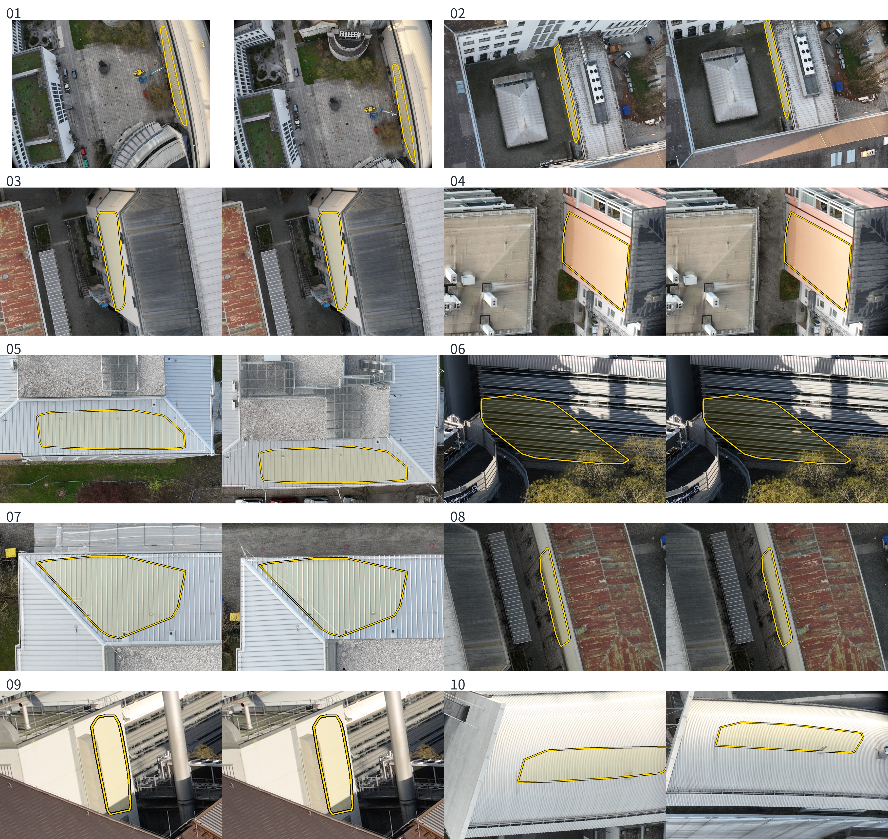

# 설명 자료용 실사 그림 — 보고 v1

- 작업: `PHD-SLIDE-PHOTO-v1` / 발주문 v5 / 갱신: 2026-10-27T01:52:37.165754+09:00
- `scientific_verdict: null` · 학습 없음 · CPU만 사용
- 설정 잠금: `e9f9ed5016b12ee504f85194ddde268de8b8d856eaee11d2ab9b3363d12b3f61`
- 기준 커밋: `016fc77ee0ddbcd58ddc5b37b05a40f90eaf8609`

## 1. 범위와 기존 자료

일 0은 WIDEN0-v2 공개 개발용 NPZ에서 좌표·법선·패치 면적·건물 ID 등 허용된 입력 기하 키만 읽었다. 기존 판정, 칸, 오차 값과 학습 결과는 읽지 않았다. 원본 입력 타일, 학습 영상과 기하 일관성 검사 후 깊이로 다시 계산했다. `holdout/` 경로는 열지 않았다.
새 수치는 **[이 발주에서 냄]**으로 표시한다. 드론 LiDAR는 기존 정합 좌표의 평가 참조다. MVS와의 일치가 독립적인 실제 표면 검증을 뜻하지 않으며, 재질의 원인 효과도 확정하지 않는다. 사진 재질 답은 외관 판단이다.

기존 그림은 다음 위치에서 확인했다. 이전 판은 설명 글자와 여러 도표를 포함하고 이번 슬라이드 배치·글자 크기·색에 맞지 않아 입력과 스크립트 일부를 재사용했다.
- `docs/experiments/phd/main_regionfig_v1/figures/영역예시_보정.png`: 두 단면, 최종 숫자 JSON, 원본 및 표시 사진 재사용.
- `docs/experiments/phd/main_photofig_v1/figures/photo_fig1_glass.png`: B173 유리 채광창 비교 위치 확인용. 일 0의 자리를 이 그림으로 고정하지 않았다.
- `docs/experiments/phd/main_photofig_v1/figures/photo_fig3_r1.png`: 고정 R1 벽면 19 위치와 영상 이름 재사용.
- `PHD-MAIN-STAGE1-v1/stage1/B0_b10/prop_LoD2_s0/model/dump/iteration_30000/`: 기존 RGB·깊이 렌더 재사용.
- 발주문의 `docs/figures/영역예시_보정.png`는 현재 없으며 위 승격된 경로를 사용했다.

## 2. 일 0 — 전역 입력 검색

상태: **PASS**. 24개 입력 타일의 개발용 기하를 검색했다. 기존 전역 칸은 사용하지 않았다.

|원래 면적 순위|건물|면|재질 답|넓이 m²|MVS−참조 절댓값 중앙값 cm|검사 통과 %|사전 정보−참조 중앙값 cm|색 흩어짐|
|---:|---|---|---|---:|---:|---:|---:|---:|
|1|DEBY_LOD2_4906968|벽|금속|186.88|34.34|86.19|-11.64|0.12557|
|5|DEBY_LOD2_4959461|지붕|금속|47.74|59.69|93.50|-1.39|0.04852|
|6|DEBY_LOD2_4906968|벽|금속|44.38|34.56|71.51|-10.92|0.15518|
|7|DEBY_LOD2_4959461|지붕|금속|42.95|37.17|68.46|-1.65|0.10650|
|10|DEBY_LOD2_4906968|지붕|금속|35.85|46.90|48.43|1.10|0.10316|

유리·금속으로 판독된 적격 후보는 5개다. 다섯보다 적으면 나머지를 임의로 채우지 않는다. 원래 면적 상위 열 후보와 재질 답도 JSON에 모두 보존했다.

선택: `candidate_0001` / `DEBY_LOD2_4906968` / 금속.
B173 기존 유리 채광창이 재질 확인 후 상위 다섯 안에 포함: **False**. 모든 후보의 패치 ID·영상·자른 상자는 JSON에 있다.



입력 선택 정의: 사전 정보 우선순위는 ALS, ALS 지원이 없는 위치에서만 LoD2. 허용 오차는 광역 동결값 ALS 12.66 cm, LoD2 20 cm. 지붕은 100점/m², 벽은 30점/m² 이상. 앞쪽 카메라에서 보이는 실제 GT 점을 깊이 화소에 대응시켜 법선 방향 잔차의 절댓값 중앙값을 계산했다. 두 개 이상 시점의 검사 통과가 필요하다. 연결은 같은 건물·면·유형과 15° 법선 조건, 거리 0.36 m 이내다.
색 흩어짐은 RGB [0,1]에서 시점별 색과 중앙색 사이 유클리드 거리의 중앙값이다. 영상에서 보이는 실제 GT 대표점에 대해 계산한다. 참조 층이 여러 개라 대응이 모호한 패치는 제외했다. 24개 공개 입력 타일 전체의 점으로 만든 z-buffer를 사용했으며 이웃 화소로 채우지 않았다. 공개 개발용 LoD2 입력 면이 같은 광선에 0.5m 이상 앞서 있으면 가림으로 제외하는 보수적 검사도 적용했다. 최종 계산은 `mvs_v4`이며 가림 전 후보와 재질 판독은 무효 기록으로 분리했다.
선택은 금속 외관과 깊이 불일치가 함께 관측된 사례다. 반사가 불일치의 원인이라는 독립 검증은 아니다. 사진에서 금속으로 읽히는 면이라도 MVS 점이 같은 실제 표면의 복원인지 완전히 보장하지는 않는다.

## 3. 그림별 산출물과 값

|그림|파일|현재 상태|
|---|---|---|
|다 · 실제 변화|[figS_c_change.png](figures/figS_c_change.png)|PASS_AFTER_ONE_REVISION|
|다 · 표현 오차|[figS_c_repr.png](figures/figS_c_repr.png)|PASS|
|다 · 영상이 틀림|[figS_c_specular.png](figures/figS_c_specular.png)|PASS_AFTER_ONE_REVISION|
|가|[figS_a_image_limits.png](figures/figS_a_image_limits.png)|PASS|
|라|[figS_d_gs_real.png](figures/figS_d_gs_real.png)|PASS|
|마 · 보존|[figS_e_aim_keep.png](figures/figS_e_aim_keep.png)|REVISION_REVIEW_PENDING|
|마 · 보정|[figS_e_aim_correct.png](figures/figS_e_aim_correct.png)|PASS_LOCATION|
|마 · 다듬기|[figS_e_aim_refine.png](figures/figS_e_aim_refine.png)|PASS_LOCATION|
|마 · 상속|[figS_e_aim_inherit.png](figures/figS_e_aim_inherit.png)|REVISION_REVIEW_PENDING|
|나|[figS_b_correction_sections.png](figures/figS_b_correction_sections.png)|PARTIAL_AFTER_ONE_REVISION|

B173 보정 참조값은 최종 REGIONFIG JSON의 **+455.634 cm**, MVS **+0.800 cm**이다. 옛 설정의 +484.1 cm 예상값은 쓰지 않았다. R1은 LoD2 **−101.607 cm**, MVS **−1.9 cm**의 방향을 확인한다.
B0 표현 오차는 발주문의 양의 방향 조건을 만족하는 면이 없어 허용된 반대 부호 규칙을 적용했다. 면 7의 945개 입력 패치에서 LoD2−참조 중앙값 **−14.610 cm**, |MVS−참조| 중앙값 **2.111 cm**다. τ는 **19.75 cm**이며 20 cm에 맞추지 않았다.
그림 라는 원본 화면 점유 조건을 충족하는 시점이 없어, 사용자가 승인한 동일 부분 자르기를 적용했다. 자른 사진과 렌더·깊이의 픽셀 범위를 같게 유지한다. 중간 학습 장면은 넣지 않았다.

## 4. 맥락 없는 독립 확인 답 전문

### figS_a_image_limits

```json
{
  "status": "PASS",
  "question": "이 그림이 보여 주는 것을 한 문장으로",
  "round1": {
    "agent": "blind_a",
    "answer": "이 그림은 무늬 없는 지붕에서는 깊이가 누락되고, 그늘진 벽에서는 누락과 오류가 함께 나타나며, 금속 표면에서는 깊이가 있어도 틀릴 수 있음을 보여 준다.",
    "assessment": "세 사례의 결측과 오류 구분이 읽힘. 첫 지붕은 20화소로 표본이 작음."
  },
  "scientific_verdict": null
}
```

### figS_b_correction_sections

```json
{
  "status": "PARTIAL_AFTER_ONE_REVISION",
  "question": "이 그림이 보여 주는 것을 한 문장으로",
  "round1": {
    "agent": "blind_b",
    "answer": "두 건물의 실제 사진과 높이 단면을 통해 입력 형상, 다섯 방법의 복원 결과, 그리고 τ 범위 안에 든 비율을 비교한 그림이다.",
    "assessment": "Recognizes comparison but not intended prior-preservation versus correction direction."
  },
  "revision": "Add colour legend, keep common axes enclosing all input and GT heights without extending to remote result outliers, use exact original 0.25m GT heights in input panel, keep all unfiltered mesh segments in JSON and count segments outside the displayed axes.",
  "scientific_verdict": null,
  "round2": {
    "agent": "blind_b_second",
    "answer": "이 그림은 두 건물의 지붕 단면에서 사전 정보와 MVS를 활용한 여러 복원 방법을 참값과 비교하며, 본 방법의 참값 허용오차 τ 이내 비율이 각각 85%와 100%임을 보여 줍니다.",
    "assessment": "방법 비교와 수치는 읽히지만 요청한 두 지붕 모두의 사전 정보 잔류는 읽히지 않음. B173 실제 단면은 그 주장을 지원하지 않으므로 PARTIAL."
  }
}
```

### figS_c_change

```json
{
  "status": "PASS_AFTER_ONE_REVISION",
  "question": "이 그림이 보여 주는 것을 한 문장으로",
  "round1": {
    "agent": "blind_c_change",
    "answer": "2022년 항공 LiDAR와 2024년 드론 LiDAR의 건물 점군을 비교하며, 2024년 자료에서 지붕과 벽면 구조가 더 촘촘하게 드러납니다.",
    "assessment": "Expected changed roof; reader focused on sampling density."
  },
  "revision": "Same site and values; shared roof-height crop, input-based camera selection within the crop, labels old and lower roof.",
  "round2": {
    "agent": "blind_c_change_second",
    "answer": "2022년 항공 LiDAR의 옛 지붕과 2024년 드론 LiDAR의 낮아진 지붕을 비교해 시간에 따른 지붕 높이 변화를 보여 준다.",
    "assessment": "Matches intended temporal roof change."
  },
  "scientific_verdict": null
}
```

### figS_c_repr

```json
{
  "status": "PASS",
  "question": "이 그림이 보여 주는 것을 한 문장으로",
  "round1": {
    "agent": "blind_c_repr",
    "answer": "이 그림은 지붕 단면에서 MVS가 참값을 가깝게 따라가는 반면 LoD2는 더 낮게 나타나며, 그 차이가 14.6 cm로 표시된 모습을 보여 준다.",
    "assessment": "Matches geometric representation gap and direction; causal simplification remains an interpretation."
  },
  "scientific_verdict": null
}
```

### figS_c_specular

```json
{
  "status": "PASS_AFTER_ONE_REVISION",
  "question": "이 그림이 보여 주는 것을 한 문장으로",
  "round1": {
    "agent": "blind_c_specular",
    "answer": "노란색으로 표시한 금속 지붕에서 사전 정보의 점들은 참값에 비교적 가깝게 분포하고, MVS 점들은 그 주변으로 더 넓게 흩어져 있다.",
    "assessment": "자료 사이 관계는 읽히나, 입력 기하의 벽을 지붕으로 읽음. 짧은 재질·면 이름과 점/화살표 가독성만 수정."
  },
  "scientific_verdict": null,
  "revision": "금속 벽이라는 짧은 면 이름, MVS 점의 색·크기, 화살표 끝 크기만 수정. 같은 자리·시점·수치 유지.",
  "round2": {
    "agent": "blind_c_specular_second",
    "answer": "금속 벽에서 참값과 사전 정보는 비슷한 형태로 분포하지만 MVS 점들은 주변으로 넓게 흩어져 있으며, 오른쪽에는 34 cm의 간격이 표시되어 있습니다.",
    "assessment": "금속 벽과 자료 사이의 차이가 읽힘. 반사 원인 및 동일 표면 대응의 독립 검증은 아님."
  }
}
```

### figS_d_gs_real

```json
{
  "status": "PASS",
  "question": "이 그림이 보여 주는 것을 한 문장으로",
  "round1": {
    "agent": "blind_d",
    "answer": "가우시안 집합에서 생성한 렌더링 영상과 깊이를 같은 시점의 실제 영상, MVS 깊이, 사전 정보 깊이와 비교하는 과정을 보여 준다.",
    "assessment": "Matches intended Gaussian representation and three comparison targets."
  },
  "scientific_verdict": null
}
```

### figS_e_aim_correct

```json
{
  "status": "PASS_LOCATION",
  "question": "이 그림이 보여 주는 것을 한 문장으로",
  "round1": {
    "agent": "blind_e_correct",
    "answer": "항공사진에서 식생 지붕과 반복된 곡면 지붕 구조물을 포함하는 옥상의 일부 영역을 노란색 다각형으로 표시한 그림입니다.",
    "assessment": "글자 없는 자리 사진 조건에서 보정 패치의 위치가 읽힘. 변화 방향 자체는 다의 비교 그림과 슬라이드 설명이 필요함."
  },
  "scientific_verdict": null
}
```

### figS_e_aim_inherit

```json
{
  "status": "REVISION_REVIEW_PENDING",
  "question": "이 그림이 보여 주는 것을 한 문장으로",
  "round1": {
    "agent": "blind_e_inherit",
    "answer": "도로와 인접 건물 사이의 길쭉한 녹화 옥상에 채광창이 줄지어 있으며, 옥상 왼쪽 가장자리가 노란 선으로 표시된 수직 항공사진이다.",
    "assessment": "표시 위치는 읽히나 보이지 않는 벽의 가림 관계는 읽히지 않음. 같은 사진을 회전하고 전체 벽 윗변을 담도록 범위만 수정."
  },
  "scientific_verdict": null
}
```

### figS_e_aim_keep

```json
{
  "status": "REVISION_REVIEW_PENDING",
  "question": "이 그림이 보여 주는 것을 한 문장으로",
  "round1": {
    "agent": "blind_e_keep",
    "answer": "건물 외벽을 따라 길게 뻗은 좁은 지붕 면이 항공사진 위에서 노란 윤곽선으로 강조되어 있다.",
    "assessment": "선택 위치는 읽히나 벽을 좁은 지붕으로 읽음. 같은 영상에서 표시 범위 주위의 벽 문맥을 더 보이는 배치만 수정."
  },
  "scientific_verdict": null
}
```

### figS_e_aim_refine

```json
{
  "status": "PASS_LOCATION",
  "question": "이 그림이 보여 주는 것을 한 문장으로",
  "round1": {
    "agent": "blind_e_refine",
    "answer": "건물 사진에서 경사진 기와지붕의 일부 영역을 노란색 테두리와 반투명 색으로 강조한 그림입니다.",
    "assessment": "글자 없는 자리 사진 조건에서 선택 지붕면이 읽힘. 다듬기의 효과 자체는 결과 없는 사진만으로 판단하지 않음."
  },
  "scientific_verdict": null
}
```

### task0_material_review

```json
{
  "agent": "material_review_final",
  "context": "Ten paired native photographs only; no task or numeric context",
  "question": "노란 테두리 안 면의 재질이 무엇으로 보이나: 유리, 금속, 그 밖, 모름",
  "answers": [
    {
      "rank": 1,
      "material": "metal",
      "answer": "금속. 촘촘한 평행 리브와 밝은 반사가 보여 금속 판재처럼 보입니다."
    },
    {
      "rank": 2,
      "material": "unknown",
      "answer": "모름. 매끈한 불투명 면과 일부 이음선은 보이지만 재질을 구별할 표면 질감은 불분명합니다."
    },
    {
      "rank": 3,
      "material": "unknown",
      "answer": "모름. 밝고 평평한 단색 면으로 보여 도장 금속인지 미장면인지 구별하기 어렵습니다."
    },
    {
      "rank": 4,
      "material": "unknown",
      "answer": "모름. 주황빛의 매끈한 면이 보이지만 재질을 특정할 질감이나 이음 구조가 뚜렷하지 않습니다."
    },
    {
      "rank": 5,
      "material": "metal",
      "answer": "금속. 일정한 간격으로 길게 돌출된 이음부가 반복되어 금속 지붕 판재처럼 보입니다."
    },
    {
      "rank": 6,
      "material": "metal",
      "answer": "금속. 빛을 받는 얇은 가로 날개와 그 사이의 어두운 틈이 반복되어 금속 루버처럼 보입니다."
    },
    {
      "rank": 7,
      "material": "metal",
      "answer": "금속. 평평한 판 사이에 일정한 간격의 돌출 이음부가 있어 금속 판재처럼 보입니다."
    },
    {
      "rank": 8,
      "material": "unknown",
      "answer": "모름. 좁고 밝은 면에 얼룩은 보이지만 재질을 식별할 세부 질감이 부족합니다."
    },
    {
      "rank": 9,
      "material": "unknown",
      "answer": "모름. 밝은 불투명 면에 희미한 이음선은 보이지만 금속과 다른 외장재를 구별하기 어렵습니다."
    },
    {
      "rank": 10,
      "material": "metal",
      "answer": "금속. 촘촘한 골과 능선이 반복되고 밝게 반사되어 골이 있는 금속 판재처럼 보입니다."
    }
  ],
  "scientific_verdict": null
}
```

## 5. 변경·예외·검증

자세한 실패 및 수정 기록은 [issues.md](issues.md)에 있다. 가시성 구현 결함과 보충 기록 03~05, 그때까지 본 자료를 모두 기록했다. 앞의 재질 답으로 최종 자리를 고르지 않고, 전수 재계산 후 새로운 맥락 없는 판독자의 답을 사용했다.
원래 `regionfig_v1/common.py`의 COLMAP 파서·원본 카메라 투영, `photofig_v1/pf_geo.py`의 TSDF 단면 도구를 재사용했다. 이번 스크립트는 저장된 원본에 덮어쓰지 않으며 읽기 전용 마운트에서 실행한다. 가시성 C++ 최적화는 동일 화소 점유 및 1e-9 m 미만 수치 오차 조건을 통과했다.
각 PNG는 요청한 픽셀 크기로 저장한다. 최종 전달 검증 JSON에 실제 크기·최소 글자 규격·PNG 해시를 남긴다. ZIP CRC와 구성 파일 해시 검사는 외부 `package_<단계>.json`에 남긴다. 독립 점검은 그림만 보고 답하도록 요청한다. PASS 표시는 해당 기술 검사에만 해당하며 과학적 판정이 아니다.
입력 파일 SHA-256과 Python·수치/그림 라이브러리 버전은 [input_lineage.json](input_lineage.json), 큰 가림 오류의 회귀 검사는 [global_visibility_regression.json](qa/global_visibility_regression.json)에 있다. 원본 사진은 각 그림 JSON의 ZIP 멤버 해시로 식별한다.

## 6. 전달과 시간

현재 단계: `d`. 외부 전달 폴더: `/media/innopam/InnoPAM-8TB/hwiyoung/code/JointBuildGS-artifacts/phase-payloads/phd/slide_photo_v1/PHD-SLIDE-PHOTO-v1`.
시작 설정 저장: 2026-10-27T00:14:00.216081+09:00. 현재 보고 저장: 2026-10-27T01:52:37.185471+09:00. 각 실행 시간과 종료 기록은 외부 payload의 `logs/`에 있다.
최종본 이름: `PHD-SLIDE-PHOTO-v1_handover.zip`. 각 단계별 `_part_<단계>.zip`에는 그 시점까지의 그림, JSON, 보고서, 설정, 스크립트가 들어 있다.
